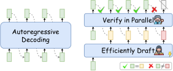
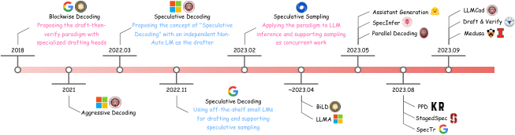
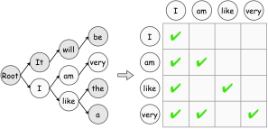
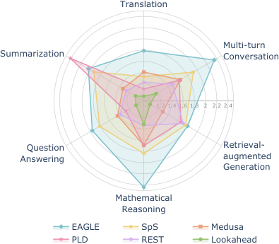
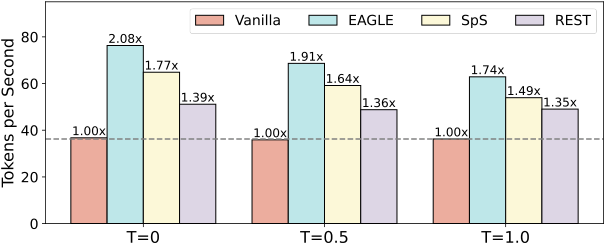
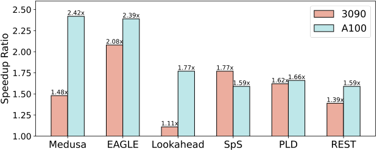
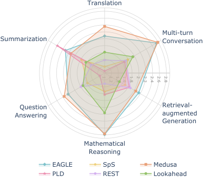
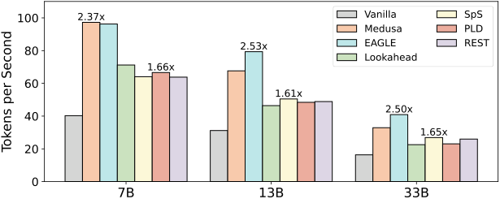
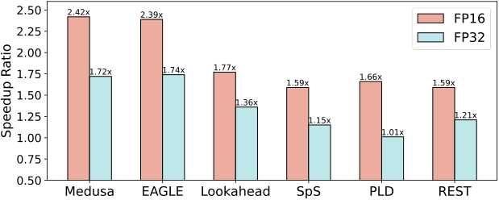

# Speculative Decoding：一次验证多个 Token

大语言模型逐 Token 生成的方式，让响应延迟随输出长度和模型规模不断增加，也抬高了实时对话与 Agent 应用的部署成本。Speculative Decoding（推测解码）瞄准的正是这个瓶颈：先用低成本方式草拟多个未来 Token，再让目标大模型一次性并行验收。它不是牺牲质量换速度，而是通过验证与纠正机制保持目标模型的输出标准。论文在统一环境中测得，EAGLE 在 RTX 3090、Vicuna-7B、FP16、贪心解码下平均提速 **2.08×**，数学推理子任务达到 **2.44×**；换到 A100 后，Medusa 的平均提速达到 **2.42×**。

## 为什么逐 Token 生成会浪费 GPU？

自回归解码（Autoregressive Decoding）像“写一个字、检查一次、再写下一个字”。给定已经生成的序列 $x_1,\dots,x_t$，目标模型 $\mathcal{M}_q$ 每次只预测下一个 Token：

$$
x_{t+1}\sim q_{t+1}=\mathcal{M}_q(x\mid x_{<t+1})
$$

关键问题不只是串行，而是**显存带宽瓶颈**。每一步通常都要把大量模型参数从高带宽显存（HBM）搬到 GPU 片上缓存，计算单元却没有被充分利用。生成序列越长、模型越大，重复搬运参数的次数就越多。

Speculative Decoding 借鉴了计算机体系结构中的“推测执行”：先猜后续结果，再统一核对。它依赖两个观察：

- 很多容易预测的 Token，不需要完整大模型反复计算，小模型或轻量模块也能给出可靠草稿。
- 大模型并行验证一批 Token 时，可以复用一次参数读取，把闲置算力转化为有效吞吐。

> 图解：左侧的自回归解码按顺序逐个生成 Token；右侧先由高效起草器产生一串候选 Token，再由目标 LLM 并行验证。绿色勾表示草稿被接受，红色叉标出首个分歧位置，其后的草稿会被丢弃或纠正，因此加速不等于放松目标模型的输出约束。

这个思路把研究问题拆成了三块：草稿怎样生成得又快又准、验证怎样兼顾质量与接受率、不同方法怎样公平比较。下面先回看技术演进，再进入正式定义。

## 从 Blockwise 到 EAGLE：范式如何形成？

“先起草、后验证”并非一开始就拥有成熟的形态，而是沿着三条线逐步完善。

- **2018 年，Blockwise Decoding**：在 Transformer Decoder 上增加前馈神经网络（FFN）预测头，一次草拟多个 Token，再由原始模型并行验证，确立了 Draft-then-Verify 范式。
- **2022 年，SpecDec**：使用独立训练的 Non-Autoregressive Transformer 起草，并放宽过于严格的验证条件，在质量相当时报告约 **5×** 加速。
- **2022—2023 年，Speculative Sampling**：Leviathan 等人和 Chen 等人分别把该范式扩展到采样解码，并从理论上保证输出分布不变。直接采用同系列现成小模型，也降低了落地门槛。
- **2023 年之后，方法快速分化**：SpecInfer 引入 Token Tree，Medusa 使用多个轻量预测头，Lookahead 利用 n-gram，EAGLE 则结合目标模型特征进行自回归起草。

> 图解：时间轴从 2018 年的 Blockwise Decoding 延伸到 2023 年的 LLMCad、Draft & Verify 与 Medusa。2022 年后，独立起草器、现成小模型、无损采样、并行解码和检索式草稿等路线集中出现，Speculative Decoding 也由单一技巧发展为通用推理范式。

历史演进说明，真正可复用的不是某一个起草器，而是“低成本猜测 + 大模型验收”的框架。接下来把这个框架写成可复现的算法。

## 核心机制：先起草，再并行验收

### 一轮推测解码做什么？

设目标模型为 $\mathcal{M}_q$，起草模型为 $\mathcal{M}_p$，每轮起草长度为 $K$。起草器根据当前上下文产生 $K$ 个条件分布，并采样候选 Token：

$$
p_1,\dots,p_K=\mathrm{Draft}(x_{\leq t},\mathcal{M}_p),\qquad \widetilde{x}_i\sim p_i,\quad i=1,\dots,K
$$

随后，目标模型在一次并行前向计算中得到 $K+1$ 个位置的分布：

$$
q_i=\mathcal{M}_q(x\mid x_{\leq t},\widetilde{x}_{<i}),\qquad i=1,\dots,K+1
$$

完整流程可以压缩为五步：

1. 起草器生成 $K$ 个候选 Token 及其分布 $p_i$。
2. 目标模型并行计算各候选位置的 $q_i$。
3. 按顺序验证候选，连续接受满足条件的 Token。
4. 在首个失败位置 $c$ 用 $\mathrm{Correct}(p_c,q_c)$ 纠正，并丢弃之后的草稿。
5. 若 $K$ 个候选全部通过，再从 $q_{K+1}$ 多生成一个 Token；随后进入下一轮，直到 `[EOS]` 或最大长度。

这里最重要的工程指标是**每轮平均接受的 Token 数**。草稿质量、验证标准、起草器与目标模型的一致性都会影响它；但最终速度还取决于起草延迟。草稿猜得再准，如果起草本身太贵，整体仍可能变慢。

笔者认为，这个框架的聪明之处在于把“生成质量”和“生成并行度”解耦：小模型只负责提供可能性，大模型仍掌握最终决定权。

### 一张分类地图看懂研究分支

论文将现有工作归入 Drafting、Verification 和 Alignment 三条主线，前两条直接决定每轮成本与收益，第三条提升前两者之间的配合。

| 主线 | 子类 | 代表方法 |
|---|---|---|
| Independent Drafting | 微调起草器 | SpecDec、BiLD、SpecInfer、Online Speculative、DistillSpec |
| Independent Drafting | 免调优起草器 | Speculative Decoding、StagedSpec、SpS、SpecTr、REST、CS. Drafting、MCSD |
| Self-Drafting | FFN Heads | Blockwise、Medusa、EAGLE |
| Self-Drafting | Early Exiting / Layer Skipping | PPD、Self-Speculative、SPEED |
| Self-Drafting | Mask-Predict | Parallel Decoding、Lookahead Decoding、PaSS |
| Verification | Greedy Decoding，无损或近似 | Blockwise、SpecDec、Parallel Decoding、PPD、BiLD 等 |
| Verification | Speculative Sampling，无损或近似 | Speculative Decoding、SpS、DistillSpec、Online Speculative、CS. Drafting 等 |
| Verification | Token Tree Verification | SpecInfer、StagedSpec、SpecTr、REST、Medusa、EAGLE |

有了整体地图，下一步先考察草稿从哪里来，因为这通常是额外延迟的主要来源。

## Drafting：怎样猜得又快又准？

起草策略可以按“是否借助独立模型”分为两大类，也可以按计算方式分为并行起草与自回归起草。前者决定系统复杂度，后者决定候选序列的生成方式。

| 起草方式 | 条件分布计算 | 典型起草器 |
|---|---|---|
| Parallel Drafting | $p_1,\dots,p_K=\mathcal{M}_p(x\mid x_{\leq t})$ | FFN Heads、Non-Autoregressive LM、Mask-Predict |
| Autoregressive Drafting | $p_i=\mathcal{M}_p(x\mid x_{\leq t},\widetilde{x}_{<i}),\ i=1,\dots,K$ | Small LMs、Early Exiting、Layer Skipping |

并行起草延迟低，但较远位置缺乏前面候选的真实上下文；自回归起草能利用已生成的草稿，通常更稳定，却要付出多步计算。这个权衡贯穿后面的所有方法。

### Independent Drafting：外挂一个更便宜的模型

SpecDec 从头训练专门的 Non-Autoregressive Transformer，用深浅结合的 Encoder-Decoder 同时生成多个候选。它能针对任务优化草稿质量，但需要额外训练预算。

更省事的做法是直接使用同系列小模型，例如用 T5-small 给 T5-XXL 起草。相同系列的模型往往共享 Tokenizer、预训练语料和训练流程，天然更容易对齐，而且不必修改目标模型结构。

这条路线还衍生出几种变体：

- **SpecInfer**：使用多个 boost-tuned 小模型产生多样草稿，再聚合成候选树。
- **DistillSpec / Online Speculative**：通过离线或在线知识蒸馏，提高小模型与目标模型的一致性。
- **CS. Drafting**：采用级联语言模型，在不同成本与能力之间分层起草。
- **REST**：不额外运行小模型，而是根据上下文从文本语料中检索草稿。

独立模型的短板也很现实：找不到合适的小模型时，需要额外训练；部署两个模型还会增加显存、调度和分布式通信复杂度。

### Self-Drafting：让目标模型自己提供草稿

Self-Drafting 复用目标模型的结构或中间结果，避免维护完整的外部起草器，主要有四种做法。

- **增加轻量 FFN Heads**：Blockwise 和 Medusa 在 Decoder 顶部增加预测头，一次预测多个未来位置；EAGLE 则采用自回归预测头，并复用 LLM 的 KV Cache 与特征来降低起草成本。
- **提前退出或跳层**：PPD 在当前步骤提前退出部分计算并启动后续起草；Self-Speculative 自适应跳过若干中间层，用“浅版目标模型”生成草稿。
- **Mask-Predict**：Parallel Decoding 在输入尾部追加多个 `[PAD]` Token 进行并行预测，但这偏离自回归预训练方式，草稿质量有限。
- **改进并行候选**：Lookahead 把低质量并行输出重组为多个 n-gram；PaSS 引入可学习的 `[LA]` Token，并在小数据集上微调其嵌入。

相比并行预测头，EAGLE 的自回归起草能利用前一个草稿位置的信息，因此候选更稳定。论文也将这一点视为它在统一评测中表现突出的原因之一。

草稿已经生成，接下来的问题是：目标模型该按什么标准接受它？这个标准直接决定加速是否无损。

## Verification：怎样验收而不改变输出？

验证器逐位置比较草稿分布 $p_i$ 与目标分布 $q_i$。首个未通过的位置称为**分歧点（bifurcation）**，此前候选可以保留，该位置需要纠正，其后候选全部舍弃。

| 验证策略 | 接受条件 $\mathrm{Verify}(\widetilde{x}_i,p_i,q_i)$ | 分歧点纠正 $\mathrm{Correct}(p_c,q_c)$ | 代表工作 |
|---|---|---|---|
| Greedy Decoding | $\widetilde{x}_i=\arg\max q_i$ | $x_{t+c}\leftarrow\arg\max q_c$ | Blockwise Decoding、SpecDec |
| Speculative Sampling | $r<\min(1,q_i(\widetilde{x}_i)/p_i(\widetilde{x}_i)),\ r\sim U[0,1]$ | $x_{t+c}\sim\operatorname{norm}(\max(0,q_c-p_c))$ | Speculative Decoding、SpS |

### Greedy Decoding：只接受目标模型的第一名

贪心验证要求候选恰好等于目标模型的 Top-1：

$$
\widetilde{x}_i=\arg\max q_i
$$

若不匹配，就直接把分歧点替换为 $\arg\max q_c$。这种规则简单，并保证与目标模型贪心解码结果一致，但也会拒绝许多“不同却合理”的候选。

近似验证尝试用轻微的质量或一致性让步换取更高接受率。例如 SpecDec 只要求候选落入目标模型的 Top-k，BiLD 则等连续不匹配次数超过阈值才回滚。它们可能更快，但不再属于严格无损验证。

### Speculative Sampling：保持整个输出分布不变

采样场景不能只比较 Top-1，而要比较候选在两个分布下的概率。对均匀随机数 $r\sim U[0,1]$，接受规则为：

$$
r<\min\left(1,\frac{q_i(\widetilde{x}_i)}{p_i(\widetilde{x}_i)}\right)
$$

直觉上，如果目标模型比起草模型更看好这个 Token，即 $q_i\geq p_i$，就必然接受；否则按概率拒绝。拒绝后，从修正分布中重采样：

$$
x_{t+c}\sim\operatorname{norm}(\max(0,q_c-p_c))
$$

Leviathan 等人和 Chen 等人证明，这套接受—纠正过程能保持与目标模型相同的输出分布。引入 $l\in[0,1]$ 等宽松参数虽然能提高接受率，却会放弃严格的分布一致性。

### Token Tree Verification：一次验证多条候选路径

单链草稿一旦在前部出错，后面的候选全部浪费。Token Tree Verification 像把多条“备选路线”合并成一棵共享路口的树：多个序列共享前缀，再用 Tree Attention Mask 保证每个节点只关注自己所在路径的祖先。

> 图解：左侧把 `It will be`、`It will very`、`I am very`、`I like the`、`I like a` 等候选按公共前缀合并为 Token Tree；右侧矩阵的行、列对应 Token，绿色勾表示允许关注的关系。以 `I—am—very` 路径为例，Attention Mask 阻止它关注另一条分支的 `like`，从而让整棵树在一次并行验证中仍保持各条路径的因果关系。

SpecInfer 可从多个小模型收集候选，Medusa 可组合各预测头的 Top-k 结果，REST 和 EAGLE 也能使用类似结构。树验证提高了候选覆盖率，但树越大，验证计算和注意力管理成本也越高。

除了验证规则，起草器和目标模型“像不像”同样重要。接下来就看知识蒸馏如何提高这种一致性。

## Alignment：让小模型更像目标模型

行为对齐的目标不是让小模型全面复制大模型能力，而是让它在目标模型关心的位置上更容易猜中。论文总结了三类知识蒸馏（Knowledge Distillation，KD）策略。

- **Seq-KD（序列级知识蒸馏）**：用目标模型生成的句子训练起草器。Blockwise 采用这一方法；SpecInfer 的 Col-BT 则对多个小模型分别微调，再聚合输出。
- **分布级 KD**：Seq-KD 只学习最终文本，没有利用目标模型的完整概率分布，在采样场景下可能对齐不足。DistillSpec 系统比较了不同 KD 目标，为下游任务选择更合适的对齐方式。
- **Online-KD**：Online Speculative 在推理过程中利用真实查询动态更新起草器，使对齐跟随输入分布变化，而不是停留在固定训练集上。

对齐的价值在于，它可以提高接受率，却不必像扩大起草器那样同步增加每轮延迟。不过，分歧点之后的草稿注定被丢弃，因此未来训练目标或许应更重视草稿前部位置，而不是平均优化所有位置。

下面这张总表把起草、对齐和验证能力放在一起。注意，“报告提速”来自各方法原论文，模型、硬件与任务并不统一，**不能直接据此横向排名**。

| 类别 | 方法 | 起草方式 | 对齐 | 免调优 | Greedy | Sampling | Token Tree | 代表目标 LLM | 原论文报告提速 |
|---|---|---|---|:---:|:---:|:---:|:---:|---|---:|
| Independent-D | SpecDec | Non-Auto LM | Seq-KD | 否 | 是 | 否 | 否 | Transformer-base (65M) | 3.9×～5.1× |
| Independent-D | SpS | Small LM | — | 是 | 是 | 是 | 否 | Chinchilla (70B) | 1.9×～2.5× |
| Independent-D | SpecInfer | Boost-tuned LMs | Col-BT | 否 | 是 | 是 | 是 | LLaMA (30B–65B) | 2.0×～2.4× |
| Independent-D | DistillSpec | Small LM | KD | 否 | 是 | 是 | 否 | T5-XL (3B) | — |
| Independent-D | Online Speculative | Small LM | Online-KD | 否 | 是 | 是 | 否 | Vicuna (7B) | — |
| Independent-D | CS. Drafting | Cascaded LMs | — | 是 | 是 | 是 | 否 | FLAN-T5-xxl (11B) | — |
| Independent-D | REST | Context Retrieval | — | 是 | 是 | 是 | 是 | Vicuna (7B–13B) | 1.6×～1.8× |
| Self-D | Blockwise Decoding | FFN Heads | Seq-KD | 否 | 是 | 否 | 否 | Transformer-big (213M) | 1.7×～3.0× |
| Self-D | Medusa | FFN Heads | Seq-KD | 否 | 是 | 是 | 是 | Vicuna (7B–13B) | 2.2×～2.3× |
| Self-D | PPD | Early Exiting | — | 否 | 是 | 否 | 否 | Vicuna (13B) | 1.1×～1.5× |
| Self-D | Self-Speculative | Layer Skipping | — | 是 | 是 | 是 | 否 | LLaMA-2 (13B–70B) | 1.4×～1.7× |
| Self-D | Parallel Decoding | Mask-Predict | — | 是 | 是 | 否 | 否 | MBart50 (610M) | 1.0×～1.1× |
| Self-D | Lookahead Decoding | Mask-Predict + N-grams | — | 是 | 是 | 否 | 否 | LLaMA-2 (7B–70B) | 1.5×～2.3× |
| Self-D | EAGLE | Autoregression Head | KD | 否 | 是 | 是 | 是 | Vicuna (7B–33B) | 2.9×～3.1× |

方法分类回答了“有哪些选择”，却没有回答“在我的设备上到底谁更快”。这正是 Spec-Bench 要解决的问题。

## Spec-Bench：把六种方法放到同一考场

不同论文使用不同数据集、GPU、精度和解码参数，报告的倍率无法直接比较。Spec-Bench 用六个子任务覆盖开放式生成、输入引导生成与推理任务，每项随机抽取 80 个测试样本，共 480 个。

| 子任务 | 数据集 | 样本数 |
|---|---|---:|
| 多轮对话 | MT-bench | 80 |
| 检索增强生成（RAG） | Natural Questions | 80 |
| 摘要 | CNN/Daily Mail | 80 |
| 翻译 | WMT14 DE-EN | 80 |
| 问答 | Natural Questions | 80 |
| 数学推理 | GSM8K | 80 |
| **合计** | — | **480** |

其中，RAG 输入由问题与 DPR 检索的 Top-5 文档拼接而成；摘要和 RAG 都具有明显的输入—输出重叠，适合检验检索式草稿的优势。

### 实验设置与参评方法

主实验使用 Vicuna-7B-v1.3、FP16、Batch Size 1，在单张 RTX 3090 24GB 上运行，环境为 PyTorch 2.0.1、CUDA 11.8 和 12 核 CPU。每个结果报告 3 次运行的均值与波动。附录实验改用单张 A100 80GB、64 核 CPU 和 CUDA 11.4。

六种开源方法各有代表性：SpS 使用 Vicuna-68M 起草器；Medusa 和 EAGLE 添加轻量预测头；Lookahead 生成 n-gram 候选；PLD 从输入中选择文本片段，是 LLMA 的代码实现；REST 从外部语料检索草稿。Lookahead 和 PLD 使用默认参数。

> 图解：六个轴分别表示翻译、多轮对话、RAG、数学推理、问答和摘要，径向刻度为相对自回归解码的加速比，越向外越快。实验条件为 Vicuna-7B、FP16、Batch Size 1、$T=0$。EAGLE 的轮廓整体最外，PLD 则只在摘要轴上特别突出，直观展示了通用起草器与输入检索式草稿的适用场景差异。

### 主结果：EAGLE 更均衡，PLD 更依赖输入重叠

下表完整列出 RTX 3090 主实验结果。六列任务数值和 Avg. 均为加速比，`tokens/s` 为每秒生成 Token 数，数值后为 3 次运行的波动范围。

| 温度 | 方法 | 多轮对话 | 翻译 | 摘要 | 问答 | 数学推理 | RAG | tokens/s | Avg. |
|---|---|---:|---:|---:|---:|---:|---:|---:|---:|
| $T=0$ | Autoregressive | 1.00±0.00× | 1.00±0.00× | 1.00±0.00× | 1.00±0.00× | 1.00±0.00× | 1.00±0.00× | 36.74±0.31 | 1.00× |
| $T=0$ | Lookahead | 1.15±0.01× | 0.98±0.02× | 1.07±0.02× | 1.06±0.02× | 1.32±0.02× | 1.03±0.02× | 40.64±0.26 | 1.11× |
| $T=0$ | REST | 1.49±0.02× | 1.23±0.04× | 1.26±0.03× | 1.39±0.04× | 1.34±0.03× | 1.71±0.05× | 51.12±0.78 | 1.39× |
| $T=0$ | PLD | 1.63±0.02× | 1.11±0.02× | **2.41±0.04×** | 1.27±0.03× | 1.70±0.03× | 1.66±0.04× | 59.42±0.55 | 1.62× |
| $T=0$ | SpS | 1.92±0.04× | 1.33±0.02× | 1.93±0.01× | 1.81±0.04× | 1.84±0.00× | 1.76±0.01× | 64.85±0.70 | 1.77× |
| $T=0$ | Medusa | 1.65±0.03× | 1.41±0.02× | 1.33±0.01× | 1.44±0.03× | 1.69±0.01× | 1.29±0.02× | 54.30±0.34 | 1.48× |
| $T=0$ | EAGLE | **2.35±0.03×** | **1.79±0.03×** | 2.04±0.02× | **1.96±0.03×** | **2.44±0.02×** | **1.80±0.03×** | **76.30±0.36** | **2.08×** |
| $T=1$ | Autoregressive | 1.00±0.00× | 1.00±0.00× | 1.00±0.00× | 1.00±0.00× | 1.00±0.00× | 1.00±0.00× | 36.24±0.43 | 1.00× |
| $T=1$ | REST | 1.43±0.01× | 1.19±0.02× | 1.24±0.00× | 1.36±0.02× | 1.34±0.02× | 1.61±0.02× | 49.04±0.30 | 1.35× |
| $T=1$ | SpS | 1.55±0.01× | 1.20±0.01× | 1.57±0.01× | 1.54±0.03× | 1.56±0.03× | 1.52±0.02× | 53.94±0.43 | 1.49× |
| $T=1$ | EAGLE | **1.79±0.02×** | **1.61±0.03×** | **1.74±0.03×** | **1.66±0.04×** | **1.95±0.06×** | **1.63±0.03×** | **62.88±0.54** | **1.74×** |

可以看到三个细节：

- EAGLE 在 $T=0$ 时平均达到 2.08×，在数学推理上达到 2.44×；论文将其优势归因于 KV Cache 复用和更稳定的自回归起草。
- PLD 在摘要上达到 2.41×，但问答只有 1.27×、翻译只有 1.11×；输入与输出重叠越多，从提示中查找草稿越有利。
- Lookahead 在翻译上为 0.98×，说明推测机制并非必然加速，起草和验证开销也可能超过收益。多数方法在翻译上表现相对较弱，作者推测与预训练语料中的多语言数据不足有关。

### 温度升高，为什么加速普遍下降？

> 图解：横轴为温度 $T=0$、$T=0.5$、$T=1.0$，纵轴为每秒生成 Token 数，柱顶标注相对 Vanilla 自回归解码的加速比。EAGLE 从 2.08× 降至 1.74×，SpS 从 1.77× 降至 1.49×，REST 从 1.39× 降至 1.35×；尽管高温下收益收窄，EAGLE 仍保持三者中的最高吞吐。

论文援引既有研究，将高温下加速下降归因于 Speculative Sampling 验证准则计算复杂度的增加。因此，报告“最高提速”时必须同时注明温度，不能把贪心解码结果直接当作采样场景收益。

统一基准揭示了任务和温度的影响，但还有一个容易忽略的问题：同一方法换一块 GPU、换模型规模或换精度，排名与倍率也可能变化。

## A100 补充实验：硬件、规模与精度都会改写收益

### 更强的 GPU，为什么往往更适合推测解码？

> 图解：横轴为六种方法，纵轴为 Spec-Bench 平均加速比，橙色与蓝色分别对应 RTX 3090 和 A100，其余条件保持为 Vicuna-7B、FP16、$T=0$。Medusa 从 1.48× 提升到 2.42×，Lookahead 从 1.11× 提升到 1.77×；SpS 则从 1.77× 降到 1.59×，说明硬件红利并非对所有方法一致。

高性能 GPU 拥有更多可用计算资源，并行验证更容易利用原本闲置的算力，因此 Medusa 和 Lookahead 获益明显。但 SpS 的反例提醒我们，外部小模型的串行起草成本、调度方式与硬件特性也会共同决定最终速度。

> 图解：与 RTX 3090 雷达图相同，六个轴为六类任务，径向数值为加速比；此图使用 A100、Vicuna-7B、FP16 和 $T=0$。Medusa 与 EAGLE 的平均加速分别约为 2.42× 和 2.39×，两者在多轮对话、数学推理上都接近 2.8×，但 PLD 仍在摘要任务上以 2.59× 领先。

### 模型变大，EAGLE 的收益更稳定

下表为 A100、FP16、$T=0$、Batch Size 1 下的完整结果，所有任务列与 Avg. 均为相对同规模自回归解码的加速比。

| 模型 | 方法 | 多轮对话 | 翻译 | 摘要 | 问答 | 数学推理 | RAG | tokens/s | Avg. |
|---|---|---:|---:|---:|---:|---:|---:|---:|---:|
| Vicuna-7B | Autoregressive | 1.00±0.00× | 1.00±0.00× | 1.00±0.00× | 1.00±0.00× | 1.00±0.00× | 1.00±0.00× | 40.24±0.30 | 1.00× |
| Vicuna-7B | Lookahead | 1.95±0.01× | 1.61±0.05× | 1.63±0.02× | 1.73±0.04× | 2.16±0.04× | 1.50±0.00× | 71.20±1.30 | 1.77× |
| Vicuna-7B | REST | 1.72±0.06× | 1.38±0.05× | 1.46±0.04× | 1.80±0.04× | 1.31±0.03× | 1.87±0.06× | 63.81±1.00 | 1.59× |
| Vicuna-7B | PLD | 1.67±0.03× | 1.06±0.03× | **2.59±0.06×** | 1.16±0.03× | 1.63±0.03× | 1.83±0.02× | 66.61±1.15 | 1.66× |
| Vicuna-7B | SpS | 1.78±0.03× | 1.19±0.02× | 1.78±0.03× | 1.58±0.03× | 1.54±0.02× | 1.69±0.02× | 64.07±0.41 | 1.59× |
| Vicuna-7B | Medusa | **2.79±0.07×** | **2.36±0.07×** | 2.14±0.04× | **2.36±0.08×** | 2.77±0.08× | 2.05±0.01× | **97.27±2.04** | **2.42×** |
| Vicuna-7B | EAGLE | 2.75±0.05× | 2.08±0.05× | 2.32±0.05× | 2.23±0.03× | **2.79±0.04×** | **2.15±0.01×** | 96.23±1.15 | 2.39× |
| Vicuna-13B | Autoregressive | 1.00±0.00× | 1.00±0.00× | 1.00±0.00× | 1.00±0.00× | 1.00±0.00× | 1.00±0.00× | 31.38±0.22 | 1.00× |
| Vicuna-13B | Lookahead | 1.57±0.01× | 1.34±0.01× | 1.39±0.00× | 1.40±0.01× | 1.82±0.02× | 1.32±0.01× | 46.42±0.12 | 1.48× |
| Vicuna-13B | REST | 1.68±0.01× | 1.31±0.05× | 1.51±0.01× | 1.67±0.02× | 1.29±0.00× | 1.96±0.01× | 48.89±0.26 | 1.56× |
| Vicuna-13B | PLD | 1.53±0.02× | 1.08±0.01× | 2.25±0.00× | 1.09±0.02× | 1.65±0.03× | 1.72±0.00× | 48.42±0.17 | 1.54× |
| Vicuna-13B | SpS | 1.73±0.02× | 1.25±0.02× | 1.76±0.00× | 1.53±0.01× | 1.68±0.00× | 1.73±0.00× | 50.48±0.28 | 1.61× |
| Vicuna-13B | Medusa | 2.39±0.02× | 2.12±0.02× | 1.92±0.00× | 2.07±0.02× | 2.49±0.02× | 1.88±0.00× | 67.64±0.07 | 2.16× |
| Vicuna-13B | EAGLE | **2.88±0.05×** | **2.24±0.04×** | **2.52±0.03×** | **2.24±0.04×** | **2.90±0.03×** | **2.34±0.01×** | **79.35±1.18** | **2.53×** |
| Vicuna-33B | Autoregressive | 1.00±0.00× | 1.00±0.00× | 1.00±0.00× | 1.00±0.00× | 1.00±0.00× | 1.00±0.00× | 16.34±0.01 | 1.00× |
| Vicuna-33B | Lookahead | 1.46±0.00× | 1.21±0.00× | 1.32±0.00× | 1.29±0.00× | 1.71±0.00× | 1.28±0.00× | 22.58±0.08 | 1.38× |
| Vicuna-33B | REST | 1.71±0.01× | 1.39±0.00× | 1.57±0.00× | 1.69±0.01× | 1.34±0.01× | 1.89±0.00× | 25.98±0.07 | 1.59× |
| Vicuna-33B | PLD | 1.45±0.00× | 1.06±0.00× | 1.98±0.00× | 1.07±0.00× | 1.54±0.00× | 1.43±0.00× | 23.07±0.01 | 1.41× |
| Vicuna-33B | SpS | 1.79±0.00× | 1.31±0.00× | 1.80±0.00× | 1.57±0.00× | 1.73±0.00× | 1.69±0.00× | 26.89±0.03 | 1.65× |
| Vicuna-33B | Medusa | 2.22±0.00× | 1.95±0.00× | 1.85±0.00× | 1.87±0.01× | 2.32±0.01× | 1.84±0.00× | 32.92±0.06 | 2.01× |
| Vicuna-33B | EAGLE | **2.81±0.00×** | **2.14±0.00×** | **2.53±0.00×** | **2.19±0.00×** | **3.01±0.00×** | **2.31±0.00×** | **40.91±0.03** | **2.50×** |

> 图解：横轴为 Vicuna 7B、13B、33B，纵轴为 A100 上的每秒 Token 数，柱顶标出部分方法的平均加速比。图中 EAGLE 在 7B、13B、33B 上分别标注为 2.37×、2.53×、2.50×，其中 7B 的明细表数值为 2.39×；Medusa 则从 2.42× 降至 2.16×、2.01×。因此，7B 上 Medusa 略优，并不意味着更大模型上仍保持领先。

### FP32 下，为什么提速普遍缩水？

> 图解：横轴为六种方法，纵轴为 A100 上的平均加速比，橙色为 FP16，蓝色为 FP32。Medusa 从 2.42× 降至 1.72×，EAGLE 从 2.39× 降至 1.74×，Lookahead 从 1.77× 降至 1.36×，SpS 从 1.59× 降至 1.15×，PLD 从 1.66× 降至 1.01×，REST 从 1.59× 降至 1.21×。

论文特别提醒，FP16 中浮点误差会在长序列上累积，因此推测解码与自回归解码的实际输出未必始终一致；在其实验设定下，FP32 才能保证两者输出完全相同。作者建议未来同时报告 FP16 和 FP32 的加速结果，避免只展示更有利的精度条件。

到这里，实验结论已经很清楚：推测解码没有脱离任务与系统的“固定倍率”。不过在某些特殊应用中，它还能把检索、缓存和模型加载也纳入推测过程。

## 应用扩展：不只加速文本逐字生成

### 输入与输出高度相似的任务

语法纠错、RAG、缓存辅助生成和多轮对话中，输出经常复用输入片段。此时无需专门训练小模型，直接从用户输入或检索上下文选取草稿即可。

- **SAD**：把含语法错误的输入句子作为草稿，让模型并行验证整句，在语法纠错上报告 **9×～12×** 加速。
- **LLMA**：从参考文本中选取片段作为草稿，在 RAG、缓存辅助生成和多轮对话等场景报告 **2×～3×** 加速。

这与 Spec-Bench 中 PLD 在摘要上的突出表现相互印证：当答案大量复用已有文本时，检索比重新预测更便宜。

### 检索增强与端侧推理

推测思想也可以加速模型之外的瓶颈。

- **RaLMSpec**：迭代式检索增强语言模型频繁访问大型知识库，检索本身成为延迟来源。它用本地缓存进行“推测检索”，在保持输出相同的前提下获得约 **2×** 加速。
- **LLMCad**：端侧设备内存有限，反复加载和释放大模型权重代价很高。它让可常驻内存的小模型负责起草，只调用目标 LLM 并行验证，相对既有推理引擎报告 **9.3×** 加速。

这些结果来自各自论文的任务与系统环境，不能与 Spec-Bench 的统一评测数字直接混排；它们展示的是推测范式可迁移到检索和权重调度，而非同一种模型加速能力。

## 还有哪些难题没有解决？

### 草稿准确率与起草成本如何平衡？

扩大起草器通常能提高准确率，却会增加延迟，甚至抵消整体收益。行为对齐提供了一条不显著增加推理成本的路径，草稿质量和推测长度 $K$ 也需要联合优化。尤其值得探索的是位置加权：既然分歧点后的候选都会被丢弃，就不应把过多训练与计算预算浪费在草稿尾部。

### Batch Inference 中如何保持加速？

论文实验只覆盖 Batch Size 1，这是其明确局限。批量服务中有两个难点：

1. 不同样本的接受率不同，每轮前进长度不一致，整个 Batch 可能被最慢样本拖住。
2. 推测验证引入的额外计算会随 Batch 增大，采样场景尤其明显。

EAGLE 和 SpS 虽有部分批量实现，但如何与 Continuous Batching 配合、在不同 Batch Size 下维持收益，仍需要系统实验。

### 能否与其他高效技术组合？

Speculative Decoding 是一种解码范式，而不是完整的推理系统。它已经开始与 Contrastive Decoding 结合，在加速之外改善生成质量；未来还可与 vLLM、Non-Autoregressive Generation、Flash-Attention 和 Continuous Batching 联合优化。

同样的思路也有望扩展到图像合成、文本转语音和视频生成，但不同模态的候选表示、验证标准与误差纠正都需要重新设计。论文尚未展开这些组合方案，也未覆盖批量评测，因此它们更适合作为后续方向，而不是现有结论。

## 总结：加速来自“便宜地猜，严格地验”

- Speculative Decoding 用低成本起草与目标模型并行验证，缓解自回归解码的显存带宽和串行瓶颈。
- 实际速度由草稿接受率与起草延迟共同决定，Independent Drafting、Self-Drafting 和 Token Tree 各有适用边界。
- Greedy Verification 可保持贪心输出一致，Speculative Sampling 可保持目标输出分布；近似准则则用一致性换取更高接受率。
- Spec-Bench 的统一测试显示，EAGLE 在 RTX 3090 上平均提速 2.08×，Medusa 在 A100、Vicuna-7B 上平均提速 2.42×，但任务、温度、硬件、模型规模和精度都会改变收益。
- 输入复用、检索缓存和端侧权重调度进一步说明，“先推测、再验证”不仅能加速 Token 生成，也能优化更广泛的推理流程。

未来真正值得关注的，不只是单样本最高倍率，而是推测解码与批量调度、显存管理及其他系统优化结合后，能否在真实服务负载下稳定降低端到端延迟。

> 本文参考自 [Unlocking Efficiency in Large Language Model Inference: A Comprehensive Survey of Speculative Decoding](https://arxiv.org/abs/2401.07851)