# iWAM：视频单次前传隐式想象，延迟约为IDM的1/6

机器人世界动作模型（World-Action Model，WAM）能借助视频生成来预测动作，但逐帧生成高分辨率未来视频，推理成本很难满足实时控制。iWAM 的核心思路是：训练一个双向 Flow Map，把多步未来生成的计算摊销进模型参数，动作策略只读取一次视频模型前向传播的中间特征，不再显式解码未来。在未见过的 DROID 仿真环境中，iWAM 成功率达到 **93.3%**，接近显式生成未来的 IDM 的 **96.7%**；在真实机器人上，iWAM（MIP）达到 **85.0%**，高于 IDM 的 **80.0%**。在统一采用两步动作去噪的计时协议下，iWAM（MIP）的延迟约为 IDM 的 **1/6**，而只看当前观测的 FastWAM 在仿真和真实任务上的平均成功率分别只有 **9.2%** 和 **13.3%**。

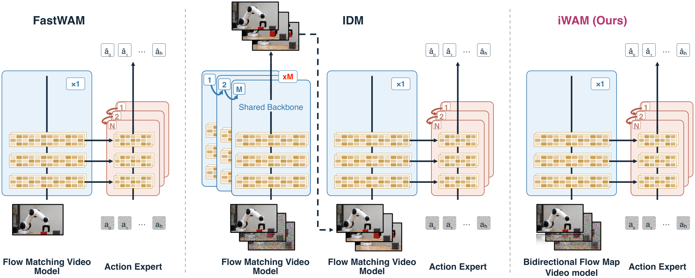

> 图解：推理时，模型先从 Flow 的先验分布采样一个噪声端点，再执行一次 noise-to-clean 前向传播。动作专家直接读取这次计算的中间激活来预测动作，不需要把对应的未来视频真正生成出来。

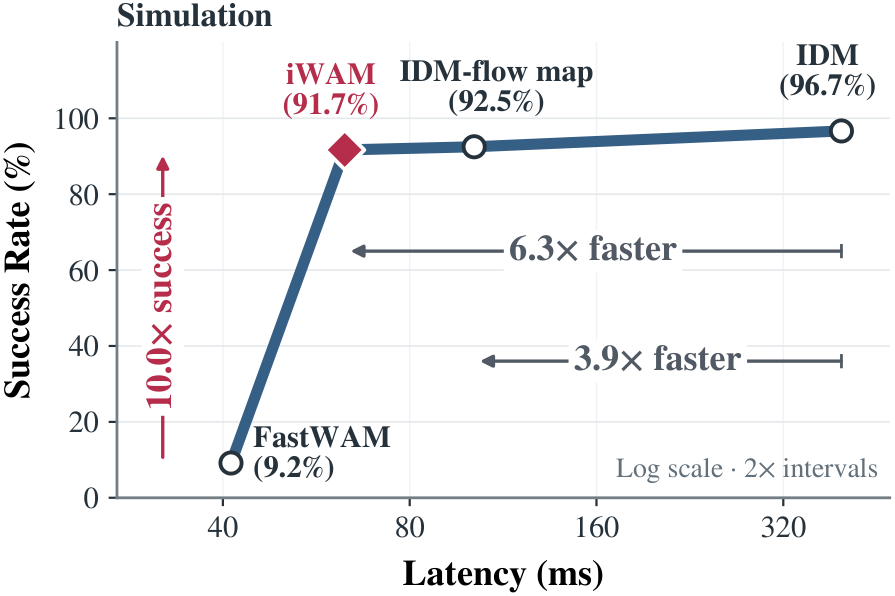

> 图解：图中将 DROID 仿真成功率与推理延迟放在一起比较。iWAM 在成功率上接近 IDM，同时显著减少视频模型的调用开销；FastWAM 虽然更快，但成功率明显落后。这里的延迟比较采用统一的两步动作去噪预算，成功率则来自各方法自己的正式评估配置。

## 为什么“看过未来”有帮助，却又如此昂贵

视频生成模型从海量视频中学会了物体、空间关系和物理动态，这些先验恰好是机器人示范数据所稀缺的。WAM 将视频模型微调到机器人数据上，让“预测场景如何变化”服务于“决定下一步怎么动”。

现有方法大致位于两个极端：

| 方法 | 动作策略读取的信息 | 推理时是否生成未来 | DROID 中视频骨干调用次数 |
|---|---|---:|---:|
| IDM | 未来观测对应的视频特征 | 是，8 步生成未来后再提取特征 | 9 |
| FastWAM | 仅由当前观测和指令计算的特征 | 否 | 1 |
| IDM-flow map | 一步生成的近似未来及其特征 | 是 | 2 |
| iWAM | 从噪声端点指向未来的中间激活 | 否 | 1 |

IDM 即逆动力学模型（Inverse Dynamics Model）：先生成未来，再根据当前状态与未来状态推断动作。它的优势是未来条件非常明确，代价是必须完成迭代视频生成。

FastWAM 则完全不为未来条件付出额外推理计算。训练时视频模型仍学习预测未来，但动作策略只接收当前观测产生的激活。这在分布内基准上很有效，却也留下一个关键问题：**便宜的动作特征，是否丢掉了泛化所需要的未来信息？**

### 用统一符号看清两种条件化方式

令当前观测为 $o_0$，语言指令为 $\ell$，条件上下文为 $c=(o_0,\ell)$。视频模型表示未来观测 $o_{1:N}$ 的条件分布，动作策略记为 $\pi$，视频模型的中间层特征记为 $h_{\theta_v}$。

IDM 的动作预测为：

$$
a_{1:N} \sim \pi\left(\cdot \mid h_{\theta_v}(c,\tilde{o}_{1:N})\right)
$$

训练时 $\tilde{o}_{1:N}=o_{1:N}$，即真实示范未来；推理时 $\tilde{o}_{1:N}=\hat{o}_{1:N}$，即模型迭代生成的未来。

FastWAM 则写成：

$$
a_{1:N} \sim \pi\left(\cdot \mid h_{\theta_v}(c)\right)
$$

两者的差别不在动作网络大小，而在 $h_{\theta_v}$ 的输入：**一个指向具体未来，另一个没有指定任何未来。**

## 实验先回答：去掉未来条件，泛化真的会下降吗

作者使用相同的 Wan2.2-5B 视频骨干和约 1B 参数动作专家，对比 FastWAM 与 IDM。评估分为两组：DROID 用来测试多样、真实且完全未见的操作环境；LIBERO-PRO 用来施加受控扰动，包括物体属性、初始位置、指令措辞和任务意图变化。

### DROID：差距不是小幅波动，而是任务能否完成

| 方法 | 仿真：Cube→Bowl | 仿真：Can→Mug | 仿真：Banana→Bin | 仿真平均 | 真实：Blocks→Bowl | 真实：Pen 转移 | 真实：Fold Towel | 真实平均 |
|---|---:|---:|---:|---:|---:|---:|---:|---:|
| FastWAM | 0.0 | 0.0 | 27.5 | 9.2 | 0.0 | 30.0 | 10.0 | 13.3 |
| IDM | 97.5 | 92.5 | 100.0 | 96.7 | 85.0 | 85.0 | 70.0 | 80.0 |

表中数值均为成功率（%），每项任务测试 20 次；仿真结果对 16 步和 24 步重规划时距取平均。Blocks→Bowl 只有把三个方块全部放入碗中才算成功。

FastWAM 在真实方块任务中有 80% 的尝试至少放入一个方块，却从未完成全部三个。这说明它并非完全不会操作，而是难以稳定执行完整意图。它还可能操作无关物体，或在一次抓取失败后放弃目标，而不是重试。

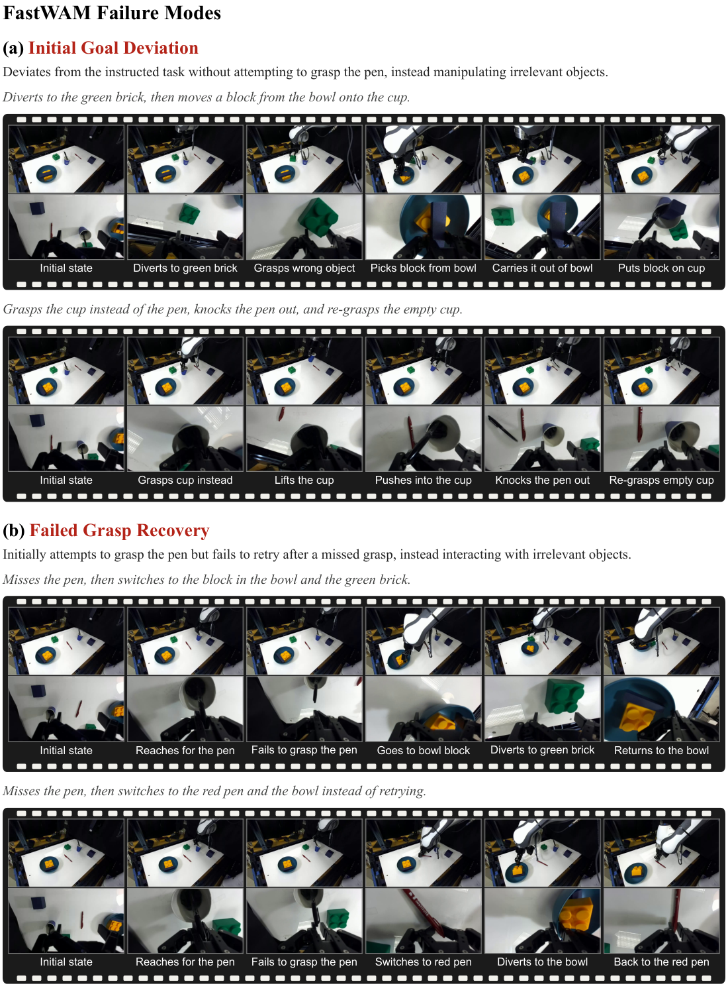

> 图解：在“从杯中取笔并放到桌上”任务中，FastWAM 展示了两类失败：一类从一开始就操作无关物体；另一类原本朝目标行动，但抓取失败后转去操作其他物体。问题因此不只是控制精度，也包含对未来任务进程的表示不足。

### LIBERO-PRO：分布内接近，扰动后差距扩大

下表中，joint 表示视频模型与动作策略联合训练，disj 表示先训练视频模型、再冻结它训练动作策略。None 是无扰动，Obj.、Pos.、Sem.、Task 分别对应物体、位置、语义和任务扰动。

| 方法 | None | Obj. | Pos. | Sem. | Task |
|---|---:|---:|---:|---:|---:|
| IDM（joint） | 97.9 | 83.7 | 2.7 | 96.3 | 23.7 |
| FastWAM（joint） | 96.9 | 78.0 | 0.9 | 83.7 | 15.3 |
| IDM（disj） | 98.5 | 84.9 | 10.9 | 98.0 | 23.6 |
| FastWAM（disj） | 97.6 | 79.5 | 10.5 | 94.7 | 20.4 |

对四类扰动取平均，联合训练时 IDM 为 51.6%、FastWAM 为 44.5%；两阶段训练时则分别为 54.4% 和 51.3%。无扰动时两者几乎相同，说明标准基准的高分可能掩盖泛化差异。

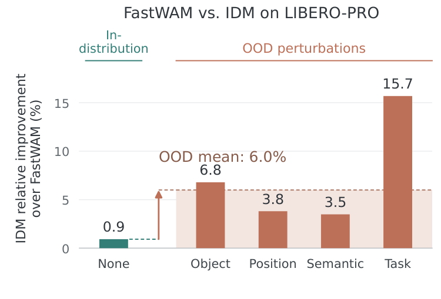

> 图解：图中比较两阶段训练下 FastWAM 与 IDM 的相对差距。分布内差距只有 0.9%，在未见场景和任务上的平均分布外差距扩大到 6.0%；联合训练时，这两个数字分别为 1.0% 和 16.0%。

这组结果支持一个重要判断：预训练视频模型本身能够泛化，但只读取当前观测特征，并不能充分把这份能力传给动作策略。下一步不是简单恢复昂贵的视频生成，而是找出未来条件真正需要提供什么。

## 单步未来条件的两个门槛：具体且对齐

最自然的折中方案是 **1-Step from Prior**：训练时随机采样噪声 $z_1$，只评估一次视频模型，再把中间特征交给动作专家。它比 FastWAM 多了一次从噪声出发的计算，却仍然不需要生成视频。

但它在 DROID 上拟合得很差。

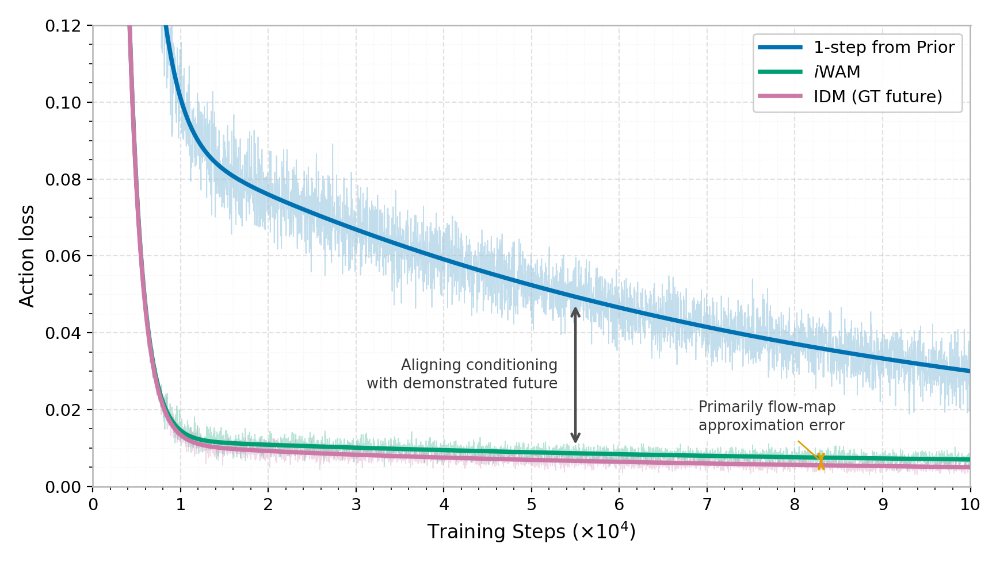

> 图解：图中比较动作训练损失。1-Step from Prior 的损失显著高于直接以真实未来为条件的 IDM；iWAM 使用与示范未来对应的噪声端点后，大幅缩小了差距。剩余小差距可能来自双向 Flow Map 的近似误差。

作者由此拆出了两个不同问题。

### 门槛一：普通 Flow 的一次评估并不能确定具体未来

Flow Matching 学习一个随时间变化的速度场，把高斯噪声运输到数据分布。设 $z_0$ 是干净未来，$z_1$ 是独立采样的噪声，线性插值为：

$$
z_\tau=(1-\tau)o_{1:N}+\tau\epsilon
$$

其中 $\epsilon\sim p_{\mathrm{prior}}$。条件速度是 $u_\tau=\epsilon-o_{1:N}$，模型学习边缘速度：

$$
v^\tau(z_\tau\mid c)=\mathbb{E}\left[\epsilon-o_{1:N}\mid z_\tau,c\right]
$$

在噪声端点 $\tau=1$，有 $z_1=\epsilon$，所以：

$$
v^1(z_1\mid c)=z_1-\mathbb{E}\left[o_{1:N}\mid c\right]
$$

若直接用这一速度做一步去噪，估计结果是：

$$
z_1-v^1(z_1\mid c)=\mathbb{E}\left[o_{1:N}\mid c\right]
$$

它与采样的 $z_1$ 无关，退化为给定当前观测和指令时的 **条件平均未来**。直观地说，完整 Flow 像沿地图逐段走到目的地；只查询一次局部方向，并不能知道整条路线最终通向哪里。

这就是“未来特异性”问题：一次前向传播虽然消耗了计算，却未必解析出某个具体未来。

### 门槛二：即便生成完整未来，也可能与动作监督错位

作者又测试了一个更强的变体：随机采样噪声，完整生成未来，再用这个未来训练动作策略。它的训练损失仍接近 1-Step from Prior，而不是 IDM。

原因是训练数据给出的是同一个示范中的未来 $o_{1:N}$ 和动作 $a_{1:N}$。独立采样的噪声可能对应另一个合理未来，而那个未来需要另一套动作。动作网络看到的是未来 A，却被要求输出实现未来 B 的动作，监督自然相互冲突。

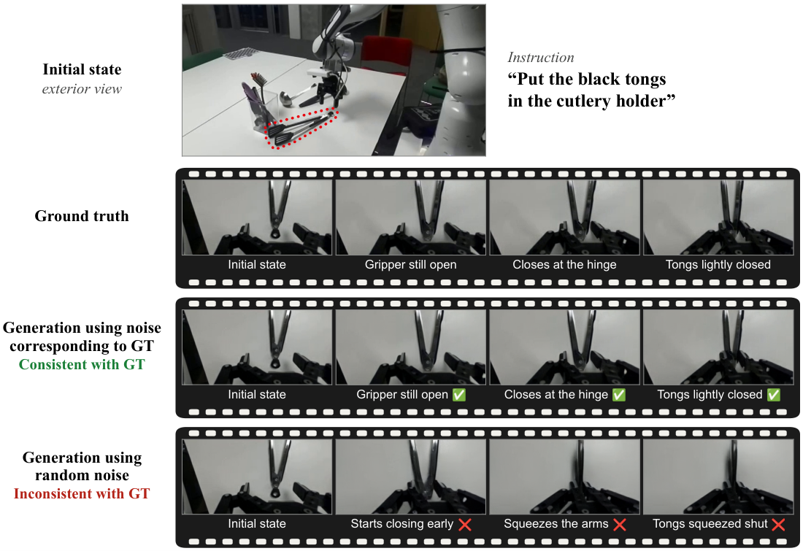

> 图解：三行依次是真实示范、从示范对应噪声端点生成的未来、从随机噪声生成的未来。随机未来中，夹爪提前闭合在夹子两臂处并将其夹紧；真实示范则在铰链处闭合，夹子仅轻微收拢。对应噪声端点能够保留示范中的抓取时机和夹爪形态，说明“合理未来”不等于“与本次动作监督一致的未来”。

因此，有效方法必须同时满足：

- **未来特异性**：一次模型评估要包含某个具体未来的信息，而不是平均化的局部速度。
- **未来—动作对齐**：训练时，这个未来必须与示范动作所实现的未来相同。

## iWAM：用双向 Flow Map 摊销生成与反演

iWAM（implicit world-action model，隐式世界动作模型）的关键不是再训练一个更快的视频解码器，而是学习一张可以跨时间段直接运输状态的地图。

### Flow Map：从“瞬时速度”变成“整段平均速度”

普通 Flow 需要多次积分；Flow Map 直接预测从时间 $t$ 到 $s$ 的平均速度：

$$
z_s=z_t+(s-t)v_{\theta_v}^{t\rightarrow s}(z_t\mid c)
$$

这里的平均速度概括了整个区间的位移，因此一次评估就能跨过很远的 Flow 时间。iWAM 进一步允许任意 $t,s$ 顺序：$s<t$ 是 noise-to-clean，$s>t$ 是 clean-to-noise，所以称为 **双向 Flow Map**。

对示范未来 $z_0=o_{1:N}$，clean-to-noise 方向直接恢复其专属噪声端点：

$$
z_1^{o_{1:N}}=o_{1:N}+v_{\theta_v}^{0\rightarrow1}\left(o_{1:N}\mid c\right)
$$

反方向则从这个端点返回同一个未来：

$$
o_{1:N}=z_1^{o_{1:N}}-v_{\theta_v}^{1\rightarrow0}\left(z_1^{o_{1:N}}\mid c\right)
$$

前一个方向解决训练对齐，后一个方向把多步生成所需的信息压缩进单次前向传播。**这个设计的聪明之处在于：高分辨率重建不再是动作预测的中间交付物，网络只需让中间激活保留足以区分未来的信息。**

### 训练：先反演示范，再读取指向示范的特征

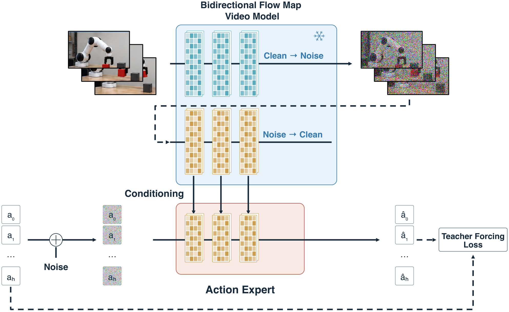

> 图解：训练时，冻结的 Flow Map 视频模型先把示范未来映射到对应噪声端点，再从该端点执行 noise-to-clean 评估。动作专家读取第二次评估的中间激活，学习预测同一个示范中的动作块。视频模型不参与动作 Loss 的梯度更新。

完整流程可以概括为：

1. 从数据集采样 $(c,o_{1:N},a_{1:N})$。
2. 通过 clean-to-noise Flow Map 得到 $z_1^{o_{1:N}}$。
3. 计算 $h_{\theta_v}^{1\rightarrow0}(c,z_1^{o_{1:N}})$。
4. 用这组特征作为条件，以 $a_{1:N}$ 为监督训练动作专家。

动作策略统一写成：

$$
a_{1:N}\sim\pi\left(\cdot\mid h_{\theta_v}^{1\rightarrow0}(c,\tilde z_1)\right)
$$

训练时 $\tilde z_1=z_1^{o_{1:N}}$；推理时 $\tilde z_1=z_1\sim p_{\mathrm{prior}}$。部署只需采样噪声、执行一次视频骨干前向传播，再让动作专家输出动作块，全程不显式生成未来。

### 视频模型怎么训练：三项 Loss 各管一件事

iWAM 采用 Shortcut 风格的自蒸馏：一个大时间步的运输，应当等于两个连续小时间步的组合。与需要网络导数的 MeanFlow、TVM 等目标相比，这种方法只用前向评估，联合预测多帧视频时更稳定。

为了让中间特征遵循语言指令，作者没有使用标准 Classifier-Free Guidance（CFG）。CFG 的引导速度为：

$$
v^\tau(z_\tau\mid y,w)=w v^\tau(z_\tau\mid y)-(w-1)v^\tau(z_\tau\mid\varnothing)
$$

它需要分别计算有条件和无条件分支，单次前向传播中没有直接对应“引导后速度”的激活。Guidance-Free Training（GFT）则把引导强度 $w$ 作为网络输入，让一个网络直接学习引导后的速度：

$$
\mathcal{L}_{\mathrm{GFT}}=\mathbb{E}\left[\left\|\frac{1}{w}v^\tau_{\theta_v}(z_\tau\mid y,w)+\left(1-\frac{1}{w}\right)\operatorname{sg}\left[v^\tau_{\theta_v}(z_\tau\mid\varnothing)\right]-u_\tau\right\|_2^2\right]
$$

其中 $\operatorname{sg}$ 表示停止梯度。训练时采样 $w=1/\beta$，$\beta\sim\mathcal{U}(0,1)$，并对 10% 样本丢弃语言指令、保留当前观测。

Shortcut 的目标由参数为 $\bar\theta_v$ 的指数滑动平均（EMA）网络产生。令区间中点 $m=(t+s)/2$：

$$
\tilde x_m=x_t+(m-t)v_{\bar\theta_v}^{t\rightarrow m}(x_t\mid c,w)
$$

$$
\bar v^{t\rightarrow s}=\frac{1}{2}\left[v_{\bar\theta_v}^{t\rightarrow m}(x_t\mid c,w)+v_{\bar\theta_v}^{m\rightarrow s}(\tilde x_m\mid c,w)\right]
$$

$$
\tilde x_s=x_t+(s-t)\operatorname{sg}\left[\bar v^{t\rightarrow s}\right]
$$

Self-Consistency Loss 让大步骤预测匹配这两个半步骤的组合：

$$
\mathcal{L}_{\mathrm{SC}}=\mathbb{E}\left[\left\|v_{\theta_v}^{t\rightarrow s}(x_t\mid c,w)-\operatorname{sg}\left[\bar v^{t\rightarrow s}\right]\right\|_2^2\right]
$$

仅有这一项并没有显式约束双向一致性，因此作者加入 Round-Trip Loss：

$$
\mathcal{L}_{\mathrm{RT}}=\mathbb{E}\left[\left\|v_{\theta_v}^{s\rightarrow t}(\tilde x_s\mid c,w)-\operatorname{sg}\left[\bar v^{t\rightarrow s}\right]\right\|_2^2\right]
$$

最终视频目标为三项加权和：

$$
\mathcal{L}_{\mathrm{video}}=\lambda_{\mathrm{FM}}\mathcal{L}_{\mathrm{GFT}}+\lambda_{\mathrm{SC}}\mathcal{L}_{\mathrm{SC}}+\lambda_{\mathrm{RT}}\mathcal{L}_{\mathrm{RT}}
$$

GFT 负责语言引导，Shortcut 负责把多步运输摊销成大步，Round-Trip 负责约束正反方向。三者共同让一次 noise-to-clean 前向传播产生可用于动作预测的未来特异特征。

## 实验验证：成功率接近 IDM，视频计算只需一次

### 数据集与实现细节

DROID 原始数据包含约 95K 条轨迹、564 个场景。本文使用 DreamZero 的过滤版本，去除空闲帧以及无标注或失败片段，得到 **57,774 个 episode、14.7M 帧**，控制频率为 15 Hz。

每个训练样本包含当前观测、32 步动作块和对应未来视频。未来在时间上二倍降采样为 16 帧，加当前帧共 17 帧；腕部相机和第一路外部相机都缩放到 $160\times320$，横向拼接后经 Wan2.2 VAE 压缩为 5 个 latent 帧。动作包括 7 个相对关节位置目标和 1 个绝对夹爪命令；本体状态只提供给动作专家，不输入视频模型。

DROID 训练分两阶段：

- **Stage 1**：从 Wan2.2-TI2V-5B 初始化，冻结 VAE 和文本编码器，完整微调视频 DiT 100K 步，全局 batch size 为 256。每个 batch 的 3/4 用于 Flow Matching，1/4 用于 Shortcut；两个运输方向等概率采样，Round-Trip Loss 应用于 1/8 的 batch，权重逐步升至 0.2。
- **Stage 2**：使用 Stage 1 的 EMA 权重并冻结视频模型，从头训练约 1B 参数动作专家 100K 步。动作专家有 30 层 Transformer，隐藏维度 1024，FFN 维度 4096。实际 DROID 实现使用两次 clean-to-noise Flow Map 步骤恢复示范噪声端点，再以一次 noise-to-clean 评估提供动作条件；训练和推理的引导强度均为 $w=7$。

所有基于 Flow 的动作策略使用 8 步动作去噪。另一个版本 iWAM（MIP）采用 Minimal Iterative Policy，只做“初始回归＋一次细化”共两步动作去噪。

### DROID 仿真：iWAM 接近显式未来条件

| 方法 | Cube→Bowl，16 | Cube→Bowl，24 | Can→Mug，16 | Can→Mug，24 | Banana→Bin，16 | Banana→Bin，24 | 平均 |
|---|---:|---:|---:|---:|---:|---:|---:|
| FastWAM | 0 | 0 | 0 | 0 | 20 | 35 | 9.2 |
| IDM | 95 | 100 | 95 | 90 | 100 | 100 | 96.7 |
| $\pi_{0.5}$ | 95 | — | 55 | — | 45 | — | 65.0 |
| IDM-flow map | 90 | 80 | 95 | 95 | 100 | 95 | 92.5 |
| iWAM | 80 | 85 | 100 | 95 | 100 | 100 | 93.3 |
| iWAM（MIP） | 90 | 95 | 85 | 85 | 100 | 95 | 91.7 |

数值为成功率（%），每个任务与时距组合评估 20 次。$\pi_{0.5}$ 使用官方 DROID 微调检查点和原生 15 步动作块，因此结果列在 16 步栏。

iWAM 的 93.3% 与 IDM 的 96.7% 相差 3.4 个百分点，却远高于 FastWAM 和 $\pi_{0.5}$。它也接近 IDM-flow map 的 92.5%；后者先用一次 Flow Map 生成近似未来、再读取未来特征，而 iWAM 省掉了这次额外调用。

### 真实机器人：两步动作去噪版本达到 85.0%

| 方法 | Blocks：至少1块 | Blocks：至少2块 | Blocks：全部3块 | Pen 转移成功 | Fold Towel 成功 | 三项任务平均 |
|---|---:|---:|---:|---:|---:|---:|
| FastWAM | 80 | 15 | 0 | 30 | 10 | 13.3 |
| IDM | 100 | 90 | 85 | 85 | 70 | 80.0 |
| iWAM（MIP） | 100 | 90 | 75 | 95 | 85 | 85.0 |

每项真实任务测试 20 次。iWAM（MIP）在方块全部入碗上比 IDM 低 10 个百分点，但在取笔和折毛巾上分别高 10 和 15 个百分点，最终平均成功率为 85.0%。

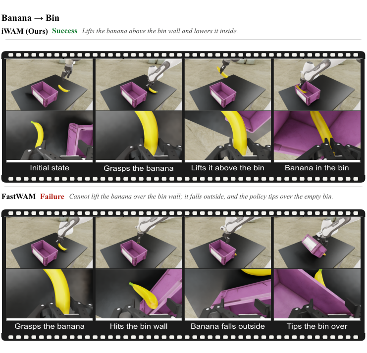

> 图解：iWAM 会把香蕉抬到足够高，越过收纳箱边缘后再放入；FastWAM 只取得部分进展，未能完成同样的放置过程。

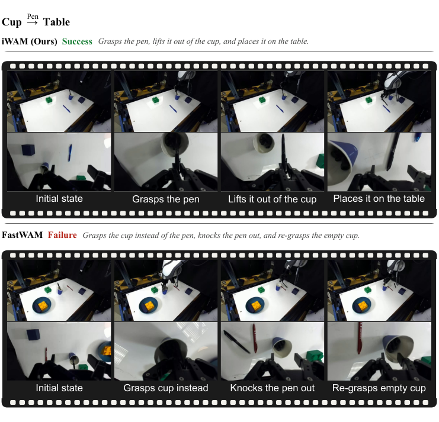

> 图解：iWAM 按指令从杯中取笔并转移到桌面；FastWAM 出现指令跟随问题，操作过程偏离目标。两组画面与数值结果共同说明，差距来自完整任务行为，而非单一动作瞬间。

### 延迟：约 6 倍优势来自少做 8 次视频骨干前向传播

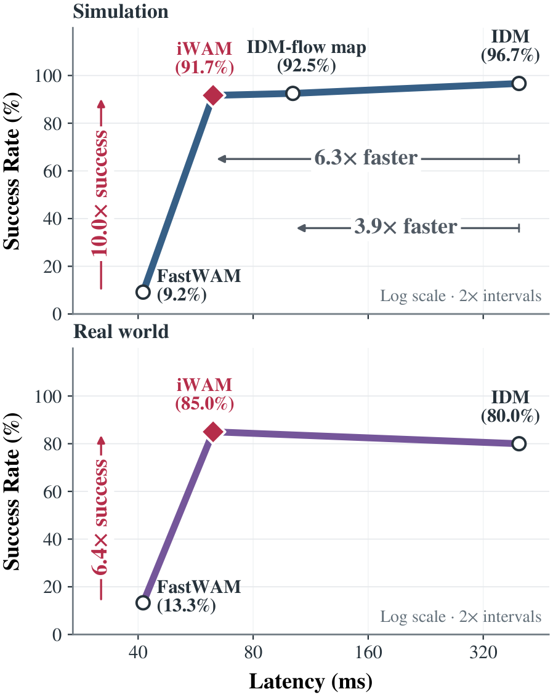

> 图解：上下两个子图分别汇总 DROID 仿真与真实机器人结果。iWAM（MIP）只需一次视频骨干评估，延迟约为 IDM 的 1/6；IDM-flow map 需要两次视频骨干评估，因此虽然成功率接近，仍比 iWAM 慢。FastWAM 延迟更低，但成功率大幅下滑。

计时使用单张 NVIDIA A100 80GB PCIe、batch size 1，所有方法统一采用两步动作去噪，以隔离视频条件的成本。IDM 的 8 步未来生成加一次特征读取共需 9 次视频骨干前向传播，iWAM 只需 1 次。

这个比较需要准确解读：FastWAM 和 IDM 的成功率仍来自正式的 8 步动作去噪评估，但延迟只按 2 步计时；iWAM（MIP）的成功率和延迟则都来自 2 步配置。因此，基线的成功率—延迟点是偏乐观的估计，约 6 倍的延迟优势还是相对保守的结果，而不是一张严格意义上所有点都在同一动作预算下测得的 Pareto 前沿。

### 为什么 LIBERO 上随机噪声也行，DROID 上却不行

LIBERO-PRO 主结果如下：

| 方法 | None | Obj. | Pos. | Sem. | Task |
|---|---:|---:|---:|---:|---:|
| IDM（joint） | 97.9 | 83.7 | 2.7 | 96.3 | 23.7 |
| FastWAM（joint） | 96.9 | 78.0 | 0.9 | 83.7 | 15.3 |
| IDM（disj） | 98.5 | 84.9 | 10.9 | 98.0 | 23.6 |
| FastWAM（disj） | 97.6 | 79.5 | 10.5 | 94.7 | 20.4 |
| 1-Step from Prior | 98.8 | 85.2 | 12.3 | 98.5 | 23.5 |
| iWAM | 99.0 | 84.4 | 9.7 | 97.8 | 24.1 |

1-Step from Prior 在 LIBERO-PRO 上已能接近 IDM，说明单次噪声条件计算本身可以带来有用信息。但它在 DROID 仿真中的平均成功率不足 3%，证明**只有特异性还不够，数据多样时必须解决对齐。**

作者用随机噪声生成未来与示范未来之间的像素 MSE 做了辅助测量，数值单位为 $10^{-3}$：

| 数据集 | 1-step | 2-step | 4-step |
|---|---:|---:|---:|
| LIBERO | 2.225 | 2.213 | 2.111 |
| DROID | 27.710 | 30.801 | 32.898 |

DROID 的 MSE 在所有去噪步数下都比 LIBERO 高出一个数量级以上。像素 MSE 只是粗糙代理，也受画面内容差异影响，但结果与这一解释一致：LIBERO 的任务和示范更受约束，随机未来碰巧更接近示范；DROID 中合理未来更多样，独立噪声更容易选到与动作监督不一致的未来。

## 附录中的关键分析：训练方式也会改变泛化

### 联合训练不一定优于两阶段训练

在 LIBERO 上，动作 Loss 反传进视频模型会让预训练表示适应较窄的动作数据，损害原有泛化。先独立微调视频模型、再冻结训练动作专家后，IDM 在初始位置扰动上的成功率从 2.7% 提升到 10.9%，FastWAM 从 0.9% 提升到 10.5%。

作者还发现，联合 IDM 原本会以 0.5 的概率给动作专家输入加噪未来。去掉这项增强、始终提供干净未来后，即 IDM（$p=0$），四类扰动的平均表现恢复到接近两阶段训练：

| 方法 | None | Obj. | Pos. | Sem. | Task |
|---|---:|---:|---:|---:|---:|
| IDM（joint） | 97.9 | 83.7 | 2.7 | 96.3 | 23.7 |
| IDM（$p=0$） | 98.3 | 84.5 | 9.7 | 97.2 | 24.1 |
| IDM（disj） | 98.5 | 84.9 | 10.9 | 98.0 | 23.6 |

这说明干净未来降低了动作目标对共享视频表示的改造压力。FastWAM 没有未来条件，动作专家更依赖当前观测表示，因此冻结视频骨干在 LIBERO 上尤其有帮助。

但 DROID 呈现相反趋势：

| 方法 | Cube→Bowl，16/24 | Can→Mug，16/24 | Banana→Bin，16/24 | 平均 |
|---|---:|---:|---:|---:|
| FastWAM | 0 / 0 | 0 / 0 | 20 / 35 | 9.2 |
| FastWAM（disj） | 0 / 0 | 0 / 0 | 0 / 10 | 1.7 |
| iWAM | 80 / 85 | 100 / 95 | 100 / 100 | 93.3 |

作者推测，DROID 的示范更加多样，没有具体未来条件的 FastWAM 更需要让视频表示适应动作目标；此时冻结骨干反而限制了学习。这不是“联合或两阶段谁绝对更好”，而是取决于动作专家能拿到多少未来信息。

### 几何变化比外观变化更能暴露未来条件的价值

LIBERO-Goal 的物体扰动进一步区分了纯颜色/外观变化与碗放大 $1.5\times$ 的几何变化：

| 扰动 | FastWAM-joint | IDM-joint | FastWAM-disj | IDM-disj |
|---|---:|---:|---:|---:|
| 仅颜色/外观 | 98.0 | 97.2 | 93.2 | 94.4 |
| 碗放大 $1.5\times$＋外观变化 | 44.4 | 60.8 | 53.6 | 65.2 |
| 平均 | 71.2 | 79.0 | 73.4 | 79.8 |

当物体变大，IDM 生成的未来能更明确地表现夹爪与大物体的交互，FastWAM 的动作块则更难相应调整。这支持未来特征不仅提供任务语义，也提供对分布外泛化有用的几何线索。

### 真实任务如何初始化与判定成功

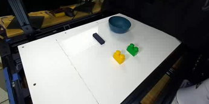

> 图解：桌面上放置三个方块和一个碗，指令是把所有方块放进碗里。只有三个方块全部入碗才计为完整成功，论文同时报告至少一个、至少两个和全部三个的部分完成率。

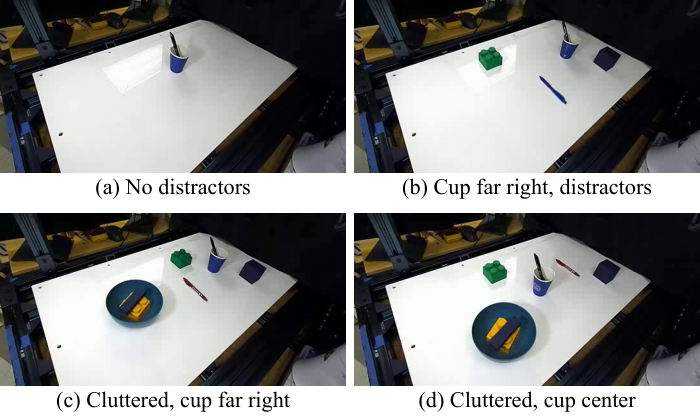

> 图解：笔最初放在杯中，四种配置改变杯子的位置和周围干扰物，每种执行 5 次。策略必须把笔从杯中取出并放到桌面，抓取杯子或把笔碰倒都不算成功。

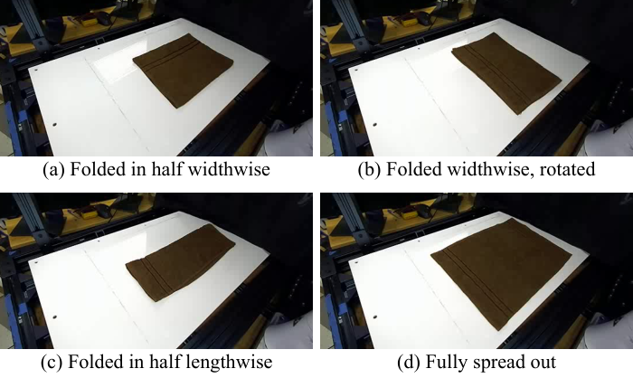

> 图解：毛巾按横向对折、旋转、纵向对折和完全展开等方式初始化。机器人需要抬起并翻折毛巾，使累计约 40% 以上的初始暴露面积被翻到另一侧。

真实评估统一使用 16 步重规划时距，每条轨迹最多执行 750 个控制步，即 15 Hz 下 50 秒；等待模型推理的时间不计入这段执行预算。

### 六项任务的完整行为对比

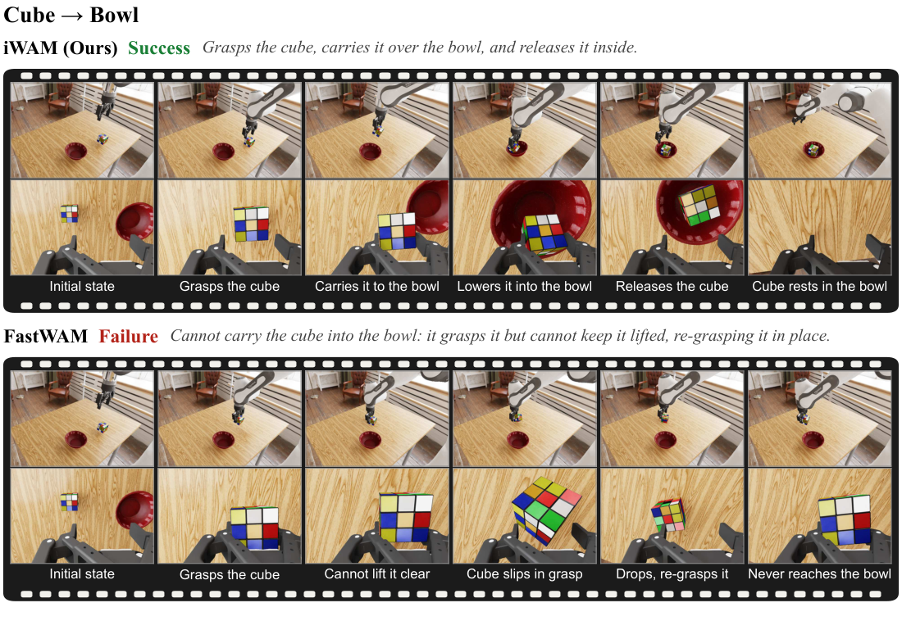

> 图解：iWAM 在搬运方块时持续保持抓取，并把方块送入碗中；FastWAM 多次丢失抓取，后续动作难以完成放置。

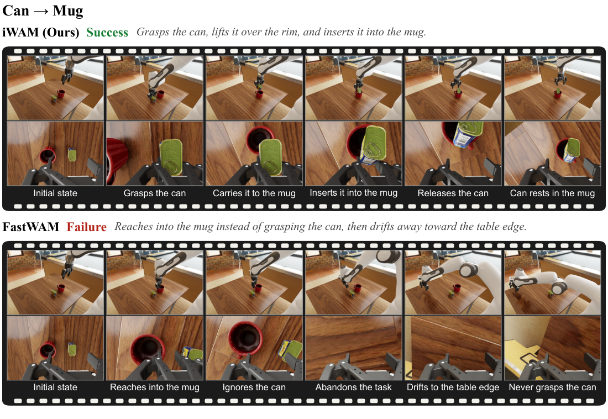

> 图解：iWAM 把罐子抬起并放入杯中；FastWAM 虽伸向杯子，却没有正确抓取罐子，说明接近目标位置并不等于完成操作。

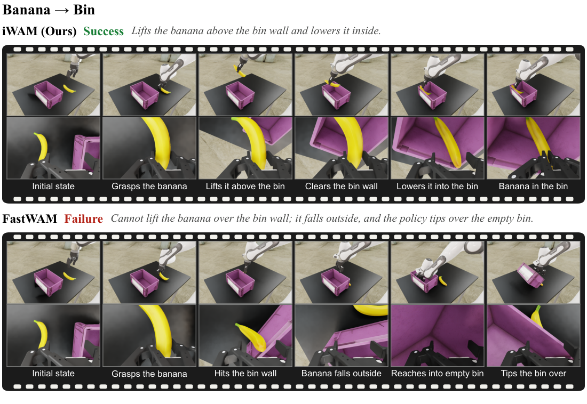

> 图解：iWAM 将香蕉抬过箱壁后放下；FastWAM 没有越过箱壁，把香蕉落在外面，随后还碰倒了空箱。

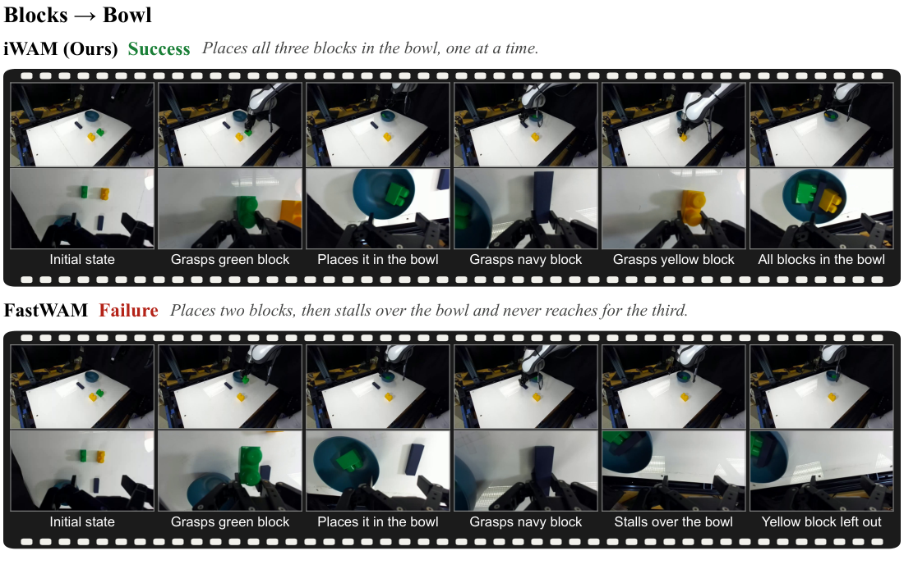

> 图解：iWAM 连续完成三个方块的放置；FastWAM 放入两个后停止，没有完成完整指令。

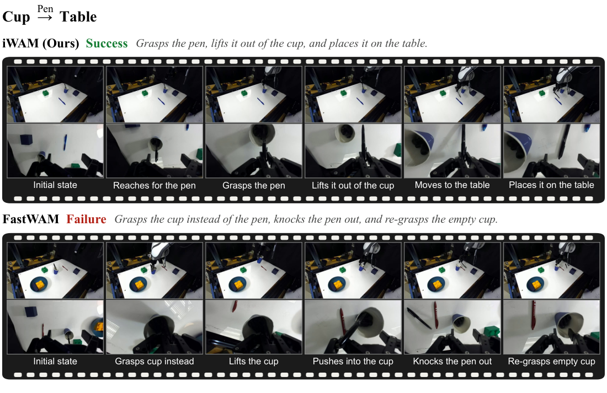

> 图解：iWAM 抓笔、提出杯子并放到桌上；FastWAM 转而抓取杯子并把笔碰出，未满足规定的成功条件。

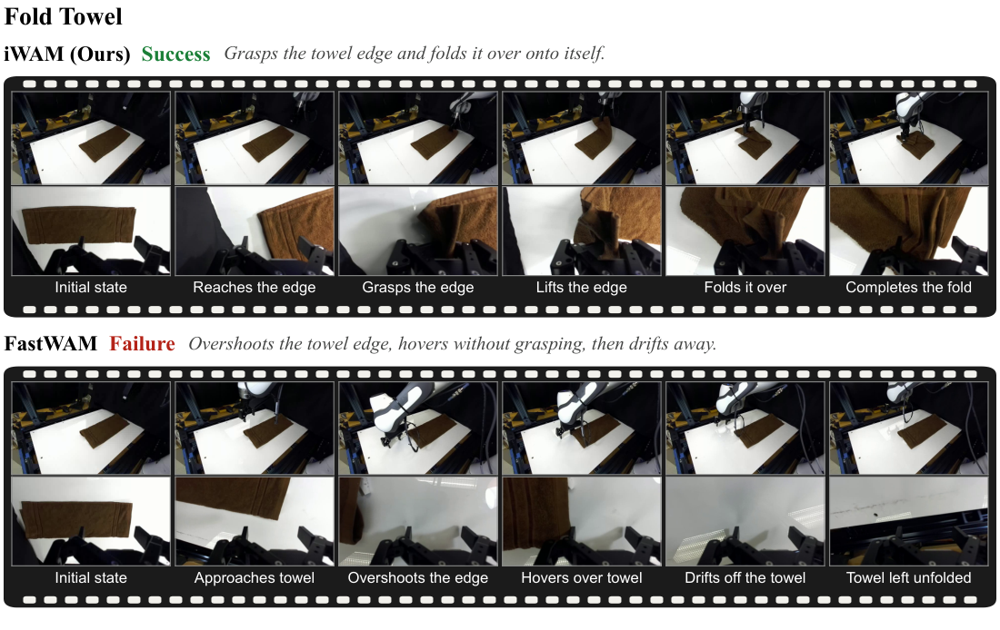

> 图解：iWAM 抓住毛巾边缘并抬起翻折；FastWAM 越过边缘后离开，没有形成有效抓取。

## 与相关方法相比，iWAM 真正新增了什么

VPP、VidMan 等方法也会读取视频扩散模型的中间特征，FastWAM、UVA 则避免在测试时生成未来。iWAM 的区别不在于“同样用了中间层”，而在于训练时这些激活被明确约束为对应 **同一个示范未来**：clean-to-noise 找回示范专属端点，noise-to-clean 再产生与该未来对齐的特征。

Consistency Model、Shortcut、MeanFlow、TVM 和双向一致性模型原本主要服务于更快的样本生成或编辑。iWAM 借用了这类大步运输与反演能力，却把目标换成了控制：从不解码未来，只把未来特异信息交给动作策略。这也解释了为什么它可以容忍一定的视频近似误差——动作选择不需要每一个像素都准确。

## 总结：动作策略需要的是未来信息，不是未来视频

- 只看当前观测的 FastWAM 在分布内可以接近 IDM，但在 DROID 未见环境中，仿真与真实平均成功率分别只有 9.2% 和 13.3%，未来条件对泛化确实重要。
- 普通 Flow 的单次噪声端点评估会退化为条件平均未来；随机生成完整未来又可能与动作监督错位，因此有效近似必须同时满足未来特异性与未来—动作对齐。
- iWAM 用双向 Flow Map 同时摊销正反向运输：训练时反演示范未来以对齐动作，推理时只读取一次 noise-to-clean 中间激活，不显式生成视频。
- iWAM 在 DROID 仿真达到 93.3%，真实机器人上的 MIP 版本达到 85.0%；统一两步动作去噪计时下，其延迟约为 IDM 的 1/6，同时避免了 FastWAM 的大幅性能损失。

未来可以把同样的隐式未来条件用于 Best-of-$N$ 规划，并行评估多个噪声端点的价值而不生成候选视频；也可用 rCM、因果 rCM 或辅助对抗目标进一步缩小双向 Flow Map 的近似误差，但这些目标都需要同时覆盖 clean-to-noise 与 noise-to-clean 两个方向。

> 本文参考自 [iWAM: Efficient Action Prediction from World Models without Explicit Future Prediction](http://arxiv.org/abs/2611.33141v1)