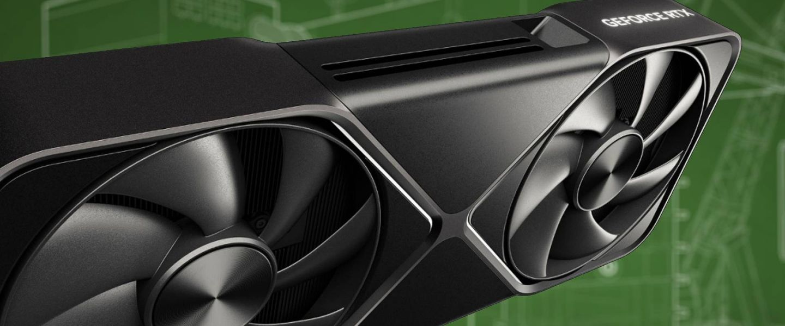
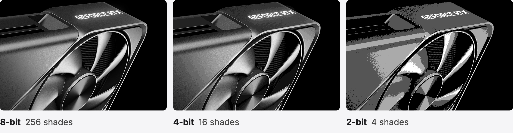
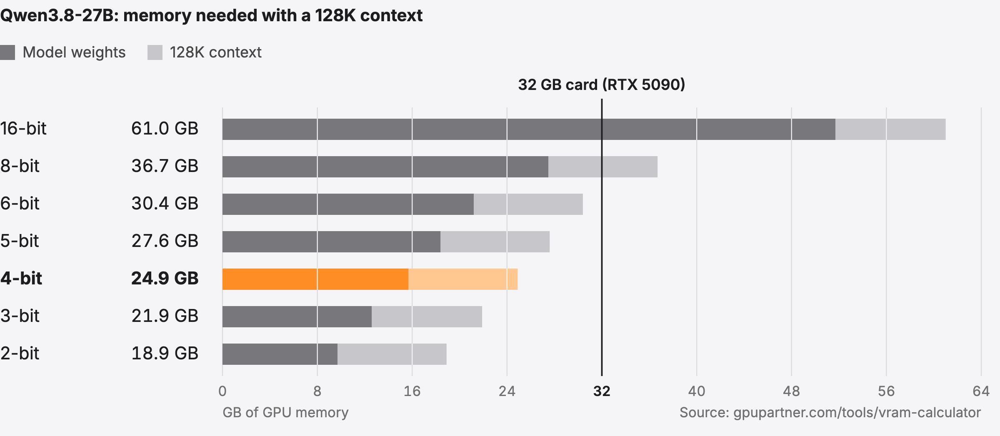
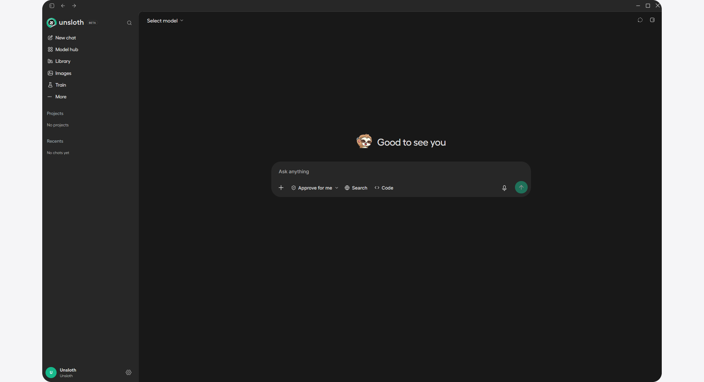
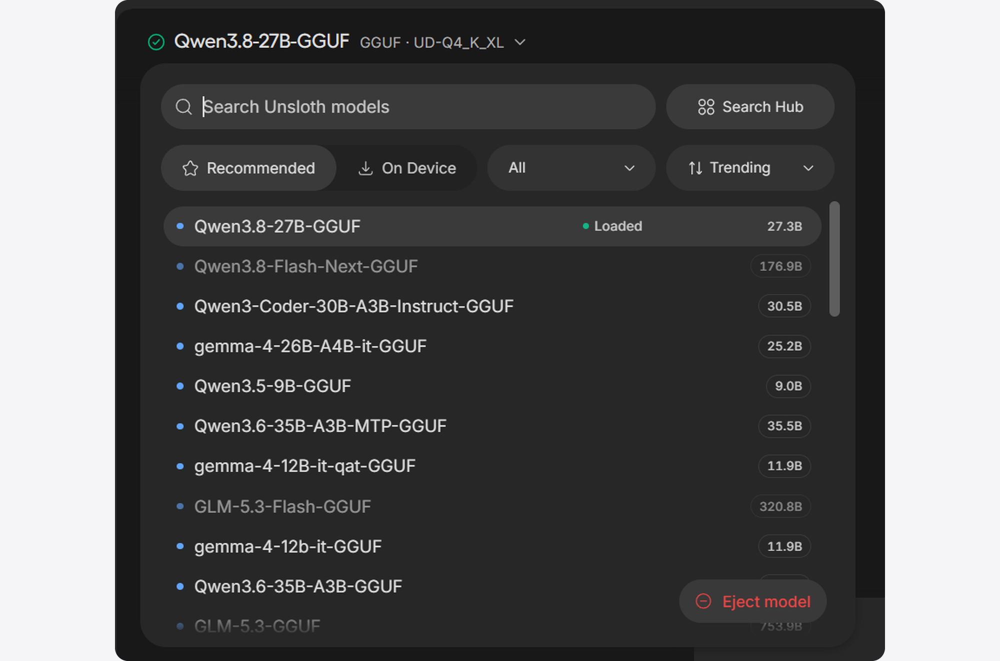
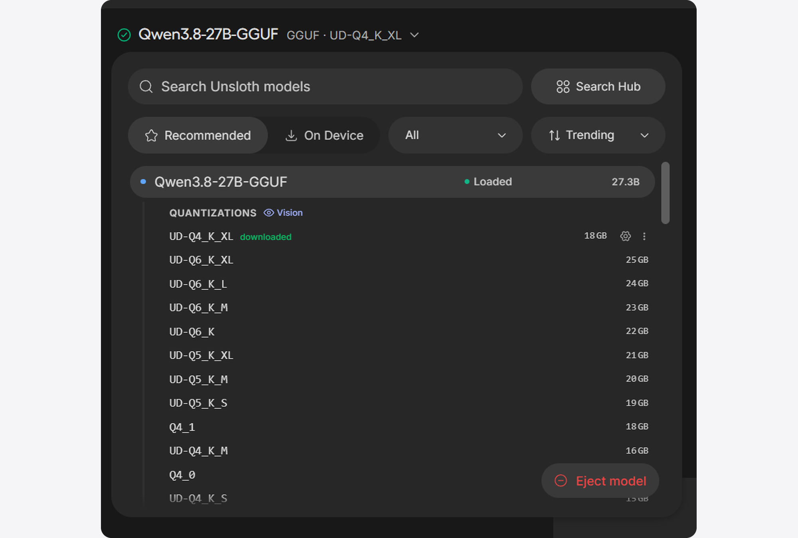
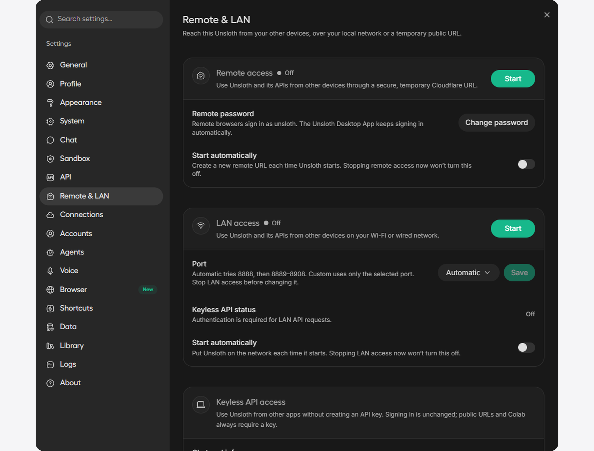

# Local AI：27B模型量化装入显卡，全家局域网共享

一块 32GB 显存的 RTX 5090，能否让 27B 参数的开放权重模型成为全家共用的私人聊天助手？作者 Jerry James 给出的方案是：用 Unsloth Desktop 运行 4-bit 量化的 Qwen3.8-27B，把上下文设为 128K，再开启局域网访问。模型文件约 18GB，模型与 128K 上下文合计约 24.9GB，不必把显存塞满。硬件准备好后，配置本身约需 10–15 分钟，下载时间另计。

这套做法的意义不只是把 ChatGPT 式界面搬到自己的电脑上。作者希望把研究、资料收集和编程中消耗大量 token 的任务交给本地模型，减少用量限制、订阅成本和隐私顾虑；家人则能通过浏览器使用同一台电脑上的模型。整个入门过程不需要终端命令、Python 环境或 AI 订阅，代价主要体现在硬件、量化带来的质量取舍，以及主机必须持续开机。

> 图解：作者使用 32GB 显存的 RTX 5090 搭建这套本地 AI。显卡只是起点，真正决定体验的是模型大小、量化精度与上下文长度如何共同占用显存。

## 先把模型和上下文一起装进显存

本地运行的最低配置并不复杂：一台带 GPU 的 Windows PC、免费的 Unsloth Desktop，以及一个能放进显存的模型。显存（VRAM）越大，通常越能容纳更大的模型和更长的对话；Unsloth Desktop 则负责加载模型、提供聊天界面，并把环境配置藏在图形界面之后。

原文给出的粗略起点是：8–12GB 显存适合较小的 9B–12B 模型，32GB 则能较从容地运行 27B–35B 模型，并为长对话留下空间。不过，模型标称的参数规模并不等于最终占用。以 Qwen3.8-27B 为例，官方 16-bit 权重约 56GB，普通消费级显卡难以完整容纳；苹果统一内存设备是原文提到的例外。

上下文窗口也不能漏算。它决定模型一次能保留多少对话及相关内容，窗口越长，额外占用的内存通常越多。作者没有在 32GB 显卡上硬塞更高精度的模型，而是采用 Qwen3.8-27B 的 4-bit 版本，把剩余空间留给 128K 上下文。这是一种明确的取舍：优先长任务容量，而不是单纯追求最高权重精度。

## 量化省显存，但不同任务的损失不一样

量化通过降低权重精度来压缩模型，让它能够装入较小的显存，并通常运行得更快。换成显存预算的语言，就是用一部分准确性换取可运行性；Q8、Q4、Q2 等名称对应不同的量化档位。

> 图解：同一张照片在每像素 8-bit 时有 256 级灰度，4-bit 剩 16 级并出现轻微色带，2-bit 只剩 4 级、画面明显成块。模型权重从 Q8 降到 Q4、Q2 时也会丢失细节，但图片只用于帮助理解，不能直接代表模型质量下降的幅度。

这种交换是否划算，要看任务。作者指出，有些工作负载在量化后仍能给出相近输出，另一些任务却可能变得几乎不可用。因此，不能仅凭“4-bit 能运行”就推断它在编程、研究或数据处理上都有相同质量；更稳妥的做法是下载几个候选版本，在自己的日常任务上比较。

> 图解：原文的显存计算器显示，在 128K 上下文条件下，Qwen3.8-27B 从 16-bit 到 2-bit 的总内存需求依次为 61.0、36.7、30.4、27.6、24.9、21.9 和 18.9GB，对应精度依次为 16、8、6、5、4、3、2-bit。以 32GB 显卡为界，6-bit 及以下可以放下；作者选择的 4-bit 方案占用 24.9GB，还留有余量。

## 按显存选模型，不必从同一个答案出发

如果显卡小于 32GB，也不必直接放弃。原文按显存、量化版本和上下文长度给出了以下起步组合。这些是配置建议，不是所有模型在同一任务上的质量排名。

| 规模 | 显存 | 可尝试的模型 | 量化版本 | 上下文大小 | 对应显卡示例 |
| --- | --- | --- | --- | --- | --- |
| Small | 8–12GB | Qwen3.5-9B、Gemma 4 12B | UD-Q4_K_S 或 Q4_K_M | 8K–16K | RTX 5060 8GB、RTX 3060 12GB、RTX 5070 12GB |
| Medium | 16GB | Qwen3-14B、gpt-oss-20b（MoE）、Gemma 4 26B（MoE）、Qwen3-Coder-30B（MoE）、Qwen3.6-35B（MoE）、Inkling 2 Mini（MoE） | Q4_K_M 或 Q5_K_M | 16K–32K | RTX 5060 Ti 16GB、RTX 5070 Ti、RTX 5080、RTX PRO 2000 |
| Large | 24GB | Gemma 4 31B、Qwen3.8-27B、Inkling 2 Mini | UD-Q4_K_M 或 Q4_K_S | 16K–32K | RTX 3090、RTX 4090、RX 7900 XTX、RTX PRO 4000 |
| Extra Large | 32GB+ | Qwen3.8-27B、Inkling 2 Mini | UD-Q4_K_XL 或 Q6_K | 64K–128K+ | RTX 5090 32GB、RTX PRO 4500 32GB、RTX PRO 5000 48GB、RTX PRO 6000 96GB |

表中的 MoE 是“混合专家模型”。它并不要求每生成一个 token 都启用全部参数，因此一部分模型状态可以放在系统内存中，以速度为代价换取较小的显卡需求。这解释了为什么 35B 模型会出现在 16GB 一栏：原文计算器估计，Qwen3.6-35B 在 RTX 5060 Ti 16GB 上以这种方式运行时约为每秒 47 个 token；这个数字只适用于该配置与估算条件。

硬件预算同样是选择的一部分。作者虽然批评 RTX 5090 价格过高，但认为在消费级设备上运行这一档模型时，它仍是可考虑的方案；另一端则是更昂贵的企业级 GPU。对入门者而言，先用上表找到显存允许的模型，再结合任务测试量化版本，比只追求最大参数更实际。

## Inkling 2 Mini 能替代进这套配置，Small 不行

RTX 5090 还可以运行 Inkling 2 Mini，但不能运行 Inkling 2 Small。两者名称相近，硬件要求却完全不在一个量级。

Thinking Machines Lab 于 2026 年 11 月 17 日发布了 Inkling 2 Mini。按原文列出的模型卡信息，它有 26.4B 参数，采用 Apache 2.0 许可证，支持视觉输入和 100 万 token 上下文。Unsloth 推荐的 UD-Q4_K_XL 文件为 17.6GB，与文中 Qwen3.8-27B 文件只差约 0.1GB，因此同样适合 32GB 显卡，并可留下约 14GB 给上下文。

配置流程也不需要重做：先更新 Unsloth Desktop，因为 Inkling 2 需要较新的版本，再在模型下拉菜单中搜索 Inkling 2 Mini。只看模型本身，各量化档位的内存需求如下。

| Inkling 2 Mini 精度 | 所需内存 | 可完整容纳的显卡 |
| --- | --- | --- |
| 2-bit | 10–11GB | 12GB 显卡 |
| 3-bit | 13–15GB | 16GB 显卡 |
| 4-bit（推荐） | 17–18GB | 24GB 显卡 |
| 8-bit（无损） | 24GB | 32GB 显卡 |

这些数字来自 Unsloth，统计的是 RAM 与 VRAM 的合计，而且只覆盖模型本身，长上下文还需要额外空间。Inkling 2 Mini 也是 MoE 模型，每个 token 激活 5.4B 参数，所以 4-bit 文件也能借助系统内存运行在 16GB 显卡上，只是速度会慢一些。

Inkling 2 Small 则只是名字里有“Small”：它有 594B 参数，Unsloth 发布的最小文件也达到 171.7GB。原文把它归到 256GB Mac Studio 或 DGX Station 这类统一内存设备的范围，而不是普通单张显卡。

Mac 确实适合运行一些更大的本地模型，因为 CPU 与 GPU 可共享统一内存，但性能未必最佳。苹果芯片应选择专门构建的 MLX 版本；MSI PRO MAX EDGE AI+ 11M 和 NVIDIA DGX Spark 等统一内存 PC，也适用类似思路。

## 三步启动：安装、下载、设置上下文

作者在 LM Studio 与 Unsloth Desktop 之间选择了后者。两者都能把终端命令、Python 环境和依赖管理收进图形界面，适合第一次搭建；Unsloth Desktop 还是免费、开源应用，支持 macOS、Windows 和 Linux，可运行 GGUF 与 MLX 模型。作者选择它的主观原因很直接：喜欢这个名字，而且打开网站时没有迎面看到自己正想摆脱的订阅推销。

安装并首次启动后，主界面包含新聊天、模型中心、模型库和模型选择框。此时还没有加载模型。

> 图解：首次启动的 Unsloth Desktop。左侧是 New chat、Model hub 和 Library，顶部模型下拉框用于选择要下载和运行的模型。

接着在左上角打开模型选择器，找到 Qwen3.8-27B。原文所用的文件是 Qwen3.8-27B-GGUF，位于推荐列表顶部。

> 图解：模型选择器的 Recommended 页面。选择模型后，还需要继续选择具体的量化文件，而不是只确定参数规模。

作者下载的是 Unsloth 的 UD-Q4_K_XL。M 和 S 版本更小，XL 在作者看来更接近完整模型的表现，同时不会占满 32GB 显存；这个判断属于作者的配置选择，并非适用于所有任务的统一结论。

> 图解：界面会列出各量化版本及下载大小，UD-Q4_K_XL 约为 18GB。已下载版本旁的齿轮图标用于设置上下文。

下载完成后，点击模型右侧的齿轮即可手动设置上下文；不确定需求时也可以保留 Auto。作者选择了未量化的 128K 上下文，并计划在日常任务中使用数周后再评估。至此，模型已经能在 Unsloth 的聊天窗口里直接使用。具体速度和效果仍会随显卡、模型、量化版本与上下文配置而变化，原文没有在这篇入门教程中给出完整性能测试。

## 开启局域网，让家人用浏览器访问

模型在本机运行后，还需要打开 Unsloth Desktop 内置的 LAN 分享功能，才能让家里其他设备使用。入口在左下角齿轮设置中的“Remote & LAN”页面。

> 图解：Remote access 与 LAN access 是两项不同功能。这里使用第二张卡片中的 LAN access；上方的 Remote access 留待后续内容。

多数选项在设置 Remote password 之前会呈灰色。设定密码后，点击 LAN access 的 Start，界面就会给出一个局域网地址。家人或朋友可在同一家庭网络的浏览器中打开它，以用户名 `unsloth` 和刚设置的 Remote password 登录，再使用主机上的模型。

这个共享方式有两个边界。主机必须保持开机且 Unsloth 持续运行，其他设备才能连接；这套设置本身也只覆盖家庭局域网，并不会自动把模型开放到互联网。原文把性能测试、隧道访问，以及仅使用获允许网络工具的本地智能体留到后续部分，因此当前教程并不包含公网访问或自动化编程的完整部署方法。

回到最初的问题，本地 AI 最容易被低估的不是安装，而是显存分配：模型精度、文件大小和上下文必须一起计算。已有 8–32GB 显卡、希望减少云端用量限制并重视本地隐私的读者，可以从表中较低成本的配置起步，再用自己的任务检验量化损失；若目标是让全家马上使用，则还需确认主机能长期开机。作者已经证明这套配置在操作上足够简单，但它的长期速度、质量和智能体能力仍待后续测试，不能由安装成功直接推出。

> 本文参考自 [A beginner's guide to Local AI with Inkling, Qwen, and Unsloth](https://www.gpupartner.com/blog/beginners-guide-local-ai-inkling-qwen-unsloth)