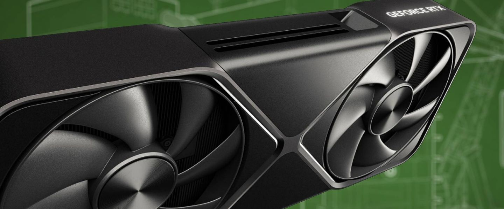

# Local AI：27B模型量化装入显卡，全家局域网共享

一块 32GB 显存的 RTX 5090，能否让 27B 开放权重模型成为全家共用的私人助手？作者 Jerry James 的方案是：用 Unsloth Desktop 运行 4-bit 量化的 Qwen3.8-27B，设置 128K 上下文并开启局域网访问。模型文件约 18GB，与上下文合计约 24.9GB；硬件就绪后，配置约需 10–15 分钟，下载时间另计。

作者希望把研究、资料收集和编程中的高 token 消耗任务转到本地，减少用量限制、订阅成本与隐私顾虑。入门不需要终端、Python 环境或 AI 订阅，代价则是硬件投入、量化损失，以及主机必须持续开机。

## 模型精度和上下文要一起算

Qwen3.8-27B 的 16-bit 权重约 56GB，普通消费级显卡难以容纳。原文计算器显示，在 128K 上下文下，总内存需求从 16-bit 的 61.0GB、8-bit 的 36.7GB，降至 6-bit 的 30.4GB、4-bit 的 24.9GB。作者选择 4-bit，是在权重精度与长任务容量之间取舍，而非单纯追求最大模型。

量化以部分准确性换取可运行性，通常也能提速，但损失因任务而异：有些输出接近原模型，有些工作负载可能几乎不可用。因此，“4-bit 能运行”不等于编程、研究等任务质量不变，应下载候选版本，用自己的日常任务比较。

显存较小的设备也有起点：8–12GB 可尝试 9B–12B 模型与 8K–16K 上下文，16GB 可考虑 14B–35B 的量化模型。后者包含 MoE（混合专家）模型，可将部分状态放入系统内存，以速度换取较低显存需求；原文估算 Qwen3.6-35B 在 RTX 5060 Ti 16GB 上约为每秒 47 个 token，仅限该配置与估算条件。

RTX 5090 还可运行 Inkling 2 Mini：其 4-bit 推荐文件为 17.6GB，并有 26.4B 参数、视觉输入和 100 万 token 上下文。名字相近的 Inkling 2 Small 却有 594B 参数，最小文件也达 171.7GB，并非普通单卡方案。

## 图形界面安装，再开放局域网

作者选择免费、开源的 Unsloth Desktop，在模型选择器中找到 Qwen3.8-27B-GGUF，下载 UD-Q4_K_XL，再通过模型旁的齿轮设置 128K 上下文；不确定时也可保留 Auto。他认为 XL 比 M、S 版本更接近完整模型表现，但这只是个人配置判断，原文尚未给出完整性能测试。

随后进入设置的“Remote & LAN”页面，先设置 Remote password，再启动 LAN access。家人可在同一网络中用浏览器打开所得地址，以用户名 `unsloth` 和该密码登录。主机必须开机并持续运行 Unsloth；此功能只覆盖家庭局域网，不会自动开放到互联网。

回到最初的问题，关键并非安装，而是把模型精度、文件大小和上下文一起纳入显存预算。作者证明了这套配置操作足够简单，但长期速度、质量及智能体能力仍待测试，不能由安装成功直接推出。

> 本文参考自 [A beginner's guide to Local AI with Inkling, Qwen, and Unsloth](https://www.gpupartner.com/blog/beginners-guide-local-ai-inkling-qwen-unsloth)