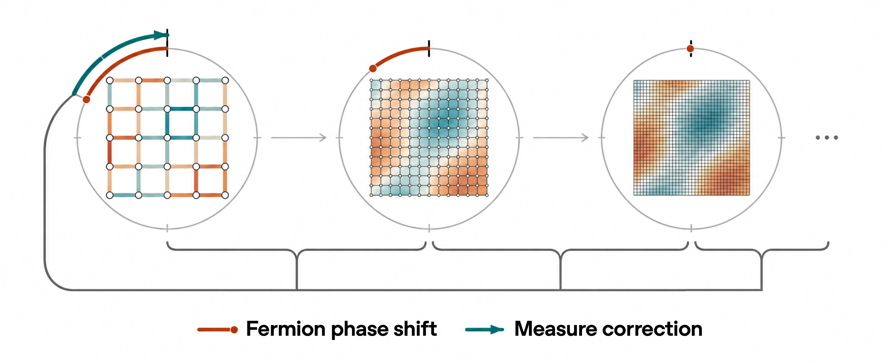

# Standard Model：逐层细格补齐手性费米子相位

粒子物理标准模型能在十八个数量级的能量范围内与实验精确吻合，却至今缺少一个完整的非微扰定义。换句话说，这套理论极其善于计算，但人们甚至还没有完全弄清：不把所有相互作用拆成小修正时，它在数学上是否仍然定义良好。

加州大学圣巴巴拉分校物理学家 Nathaniel Craig 在十月发布的预印本中提出了一种候选方案：把时空离散成格点，通过逐层细化网格，补齐左手费米子在不同规范场构型下所需的相位修正，从而构造有限格距下的标准模型费米子测度。GPT‑6 Astra 帮助他把这一策略变成具体构造，并主导了详细证明。不过，Craig 强调，这仍是一项有待专家检验的“原则性答案”，距离可用于真实格点模拟还有很长的路。

## 精确计算为何还不等于完整定义

标准模型描述已知基本粒子，以及四种基本力中的三种：强力、弱力和电磁力。从氢原子21厘米射电辐射的低能过程，到大型强子对撞机的高能碰撞，它的理论计算与实验结果在十八个数量级内高度一致。这样成功的理论，为什么还会“缺少定义”？

问题出在通常的计算起点。量子力学和狭义相对论告诉我们粒子与力如何相互作用，但面对完整的相互作用理论，物理学家往往先想象把相互作用关闭。例如，关闭电磁作用后，电子不再相互排斥，这个简化问题可以精确求解；随后再把相互作用作为一系列小修正逐项加回。这就是微扰理论。当后续修正越来越小时，只算前几项也能得到惊人精度，电子磁性强度的预测就可以达到万亿分之几以内。

但并非所有问题都能这样处理。质子由三个夸克组成，其质量却主要来自夸克、传递强力的胶子在内部的运动与相互作用。如果关闭强力，质子根本不会存在，自然也无法从“无相互作用质子”出发，用小修正解释它的质量。要处理这类现象，必须让相互作用从一开始就完整存在，而不是把它们视为微小扰动，这就是非微扰方法要解决的问题。

格点场论提供了一条路径：用离散点阵代替连续时空，格距限定理论能分辨的最短距离；在有限网格上，可以在给定格距下严谨地定义理论，并把它交给计算机直接计算。过去几十年，这种方法已经让物理学家能够从第一性原理定量理解质子质量。那么，既然强力能被放上格点，为什么整个标准模型不能照搬？

## 弱相互作用带来的“左右手”难题

障碍来自标准模型的手性。手性理论在空间反射下看起来不同，就像左手手套在镜子里会变成右手手套。如果左右手套成对存在，镜中的集合与原集合相同；但如果只有左手手套，镜里出现的便是另一种东西。

夸克、电子等费米子都有这种左右手之分。强力和电磁力对左手、右手费米子一视同仁，因此较容易放到格点上；弱力却区别看待它们，不具备交换左右手的镜面对称性。正是这种差异，使标准模型成为手性理论。

最自然的格点规则会产生一个多余结果：放进一个左手费米子，格点还会附赠一个并不需要的右手伙伴，即“加倍子”。这样一来，理论包含的粒子内容就不再符合弱相互作用的要求。这个看似技术性的障碍，是标准模型成形五十多年后仍缺少完整非微扰定义的重要原因。

Craig 用光与镜面解释了加倍现象，也借此说明已有方案缺了哪一块。光有两种偏振，描述传播时电场的取向。这里不使用偏振太阳镜所区分的水平、垂直偏振，而把光分成左旋圆偏振和右旋圆偏振，即电场绕传播方向顺时针或逆时针旋转。对光而言，“左右”指光子的螺旋度，也就是自旋沿传播方向还是反向；它与费米子的手性并不相同，只是在这个类比中扮演相似角色。

假设要研究一个只有左旋光的世界，可以把发出左旋光的激光器放进两端装有镜子的盒子，让光来回反射并逐渐增强。普通镜子却会改变结果：左旋光反射后变成右旋光，盒内很快同时出现两种偏振。原因是光的传播方向反转了，而电场旋转方式没有相应翻转。这就像向格点只提供左手费米子，最后却得到了另一只手性的伙伴。

一种特殊薄膜可以充当“手性镜子”。膜内分子分层排列，取向逐层略微转动，整体形成螺旋。当光的波长和手性与螺旋匹配时，各层的小反射相互增强，并翻转反射光电场的旋转。结果是，左旋光反射后仍是左旋光，右旋光则穿过薄膜。这种镜子已存在十多年，一些金龟子带有螺旋结构的光泽外壳也会出现类似现象。

格点理论中有一条相对应的技术路线。Paul Ginsparg 与 Ken Wilson 在1982年给出了类似“反射时翻转电场旋转”的格点规则；Rajamani Narayanan 和 Herbert Neuberger 后来找到了所需的格点费米子定义，即重叠费米子，相当于造出了手性镜子。Martin Lüscher 进一步展示如何在格点上区分左右手重叠费米子，Yoshio Kikukawa 及合作者则探索了如何用这些结果描述标准模型中的弱相互作用。至此，去掉加倍子已有办法，但整个构造仍缺少一个关键部分。

## 真正棘手的是相位

手性镜子解决了偏振问题，却没有自动保证光能在盒内有效增强。光除了偏振，还有相位：在固定位置观察，电场会像水面随波起伏一样周期性变化。两列波同相到达时，波峰相遇、彼此增强；一列波的波峰遇到另一列的波谷，则会相互抵消。

盒内的左旋光绕行一圈后，会与激光器新发出的同向光相遇。若两者电场同步，光就不断增强；若相差半个周期，返回的光反而会抵消一部分新光。解决办法是相对另一面镜子旋转其中一面手性镜子。想象镜面边缘十二点钟位置有个标记，将标记转到三点钟，相当于让每层薄膜都转过四分之一圈，反射光的相位会移动半个周期。调到合适角度，就能补偿光在其余传播过程中积累的相位。

重叠费米子能在格点上保留需要的左手费米子、排除加倍子，却不直接告诉研究者怎样设置相应相位。这里的相位与手性镜子思想实验中的光学相位并不相同，但补偿思想相通。格点上的困难在于，相位取决于标准模型各种力场在每个格点上的状态。Lüscher 已为较简单的一类理论给出相位规则，例如手性版电磁理论；完整标准模型所需的对应规则却悬而未决超过25年。

一种直观做法是，从格点上的某个力场构型出发，以小步改变力场，并持续跟踪允许的左手费米子状态。如果沿一系列小步走回起点，允许的状态虽然与最初相同，携带它们绕行的过程却可能留下不同相位。正如盒中需要补偿光绕一圈积累的相位，格点理论也必须知道怎样补偿沿每一条允许闭合路径积累的相位。

> 图解：让力场沿闭合路径变化并回到起点，橙色弧线表示左手费米子在原始格点及逐层细化格点上积累的相位。相邻两层格点的弧线差异组成一组修正，累加后恢复原始格点的相移；青色箭头再抵消这段相移，使费米子测度回到初始相位。图片来源：Nathaniel Craig/GPT‑6 Astra。

## Astra 如何把细化策略变成构造

Craig 的策略是，先把目标格点上的同一组力场表示到一系列更细的网格上，再比较相邻两层格点所允许的费米子状态。每次比较给出力场发生小变化时的一部分相位修正，把这些部分逐层累加，就得到原始格点上的相位规则。

这套构造的证明表明，沿每一条允许的闭合路径，它都能给出正确修正。单个位置的变化所需的修正主要取决于附近的场；如果用不同数学方式描述同一组力场，结果也保持一致。由此，方案在有限格距下给出了标准模型所需的测度，但有一个明确条件：格点尺度上的场强必须受到限制。

从想法到证明并非一次生成。Craig 与 Astra 进行了多轮工作，并与外部专家讨论。据他介绍，Astra 提出了把给定力场延续到更细网格的正确方法，证明细格上的比较会收敛到确定答案，并主导了详细证明的展开。人类专家则承担了关键的审查与追问：格点场论研究者 Maarten Golterman、Andreas Kronfeld 和 Yigal Shamir 检查 Astra 的证明，提出的问题帮助 Craig 判断构造是否可靠。这里更准确的分工不是“模型独立解决了全部问题”，而是人类提出策略，模型推进构造和证明，再由领域专家帮助检验。

## 候选定义之后，还有两道门槛

这项结果之所以重要，是因为它针对标准模型完整非微扰格点定义中拖延数十年的相位问题，给出了一套明确规则。但 Craig 把当前结果称为候选定义：它是否具备物理学家希望的全部性质，仍需科学共同体进一步讨论。标题中的“迈向一步”，比“已经完成标准模型定义”更符合证据所处的阶段。

第一道门槛是从数学构造走向实际计算。作者明确表示，这套方法目前更多是原则上的答案，而非实用方案，要用于真实格点模拟仍有许多工作。他还在考察构造是否满足有限格距下的反射正性；这一条件有助于把格点模型中的计算连接到概率守恒的量子理论。若这一点不能确认，候选规则与完整量子理论之间就仍缺关键环节。

第二道门槛是连续时空。当前构造在有限格距下成立，并没有直接定义连续时空中的相互作用理论。Craig 同时提到，OpenAI 最近关于杨—米尔斯理论存在性的证明提供了相关拼图：强力与弱力都属于这类理论。借助该结果，研究者能够从格点上的重叠费米子出发并取连续极限，证明包含标准模型规范场和费米子的最简统一杨—米尔斯理论存在。不过，这一进展不应被直接等同于已经完成现实标准模型的连续极限。

因此，这项工作最直接的价值，是把“怎样在格点上为完整手性标准模型安排正确相位”从长期缺口推进为一个可供检验的具体候选构造。关注格点场论、手性规范理论和数学物理定义的读者，接下来值得追踪的是专家复核、反射正性的判断，以及构造能否转化为可执行的模拟方法；它在物理上的最终地位，仍取决于这些后续证据。

> 本文参考自 [A step toward defining the Standard Model on a lattice](https://openai.com/index/step-toward-defining-the-standard-model)