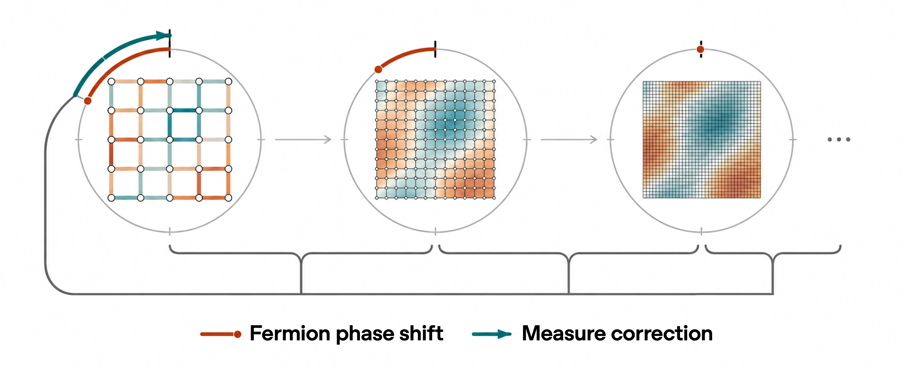

# Standard Model：逐层细格补齐手性费米子相位

标准模型在十八个数量级的能量范围内与实验精确吻合，却仍缺少完整的非微扰定义：它极其善于计算，但人们尚未完全弄清，不把相互作用拆成小修正时，这套理论在数学上是否依然定义良好。加州大学圣巴巴拉分校的 Nathaniel Craig 在十月发布的预印本中提出候选方案：逐层细化格点，补齐左手费米子在不同规范场构型下所需的相位修正。GPT‑6 Astra 参与具体构造并主导详细证明，但 Craig 强调，这仍是有待专家检验的“原则性答案”。

## 格点上的“左右手”障碍

通常的微扰计算先关闭相互作用，再把它们作为小修正逐项加回。但并非所有问题都适用：若关闭强力，质子根本不会存在，也就无法从“无相互作用质子”出发解释其质量。格点场论用离散点阵代替连续时空，可在有限格距下严谨定义并直接计算理论，已帮助研究者从第一性原理定量理解质子质量。

整个标准模型却更难照搬。弱力区别对待左手与右手费米子，而最自然的格点规则会在放入一个左手费米子时附赠多余的右手“加倍子”。重叠费米子等既有成果提供了排除加倍子的办法，却没有自动解决相位问题：相位取决于各种力场在每个格点上的状态。Lüscher 已为手性版电磁理论等较简单情形给出规则，完整标准模型所需的对应规则则悬而未决超过25年。

## Astra 如何补齐相位

Craig 把目标格点上的同一组力场表示到一系列更细的网格上，再比较相邻两层允许的费米子状态。每次比较给出力场小变化所需的一部分相位修正，逐层累加后便得到原始格点的相位规则。

证明显示，沿每一条允许的闭合路径，该构造都能给出正确修正；局部变化主要取决于附近的场，用不同数学方式描述同一组力场也得到一致结果。不过，它有一个明确条件：格点尺度上的场强必须受到限制。

据 Craig 介绍，这并非一次生成。Astra 提出了把给定力场延续到细格的正确方法，证明逐层比较会收敛，并主导详细证明；Maarten Golterman、Andreas Kronfeld 和 Yigal Shamir 则审查证明、提出追问。更准确的分工是人类提出策略，模型推进构造和证明，再由领域专家帮助检验。

## 候选定义之后

这项工作把长期缺失的相位规则推进为可检验的具体构造，但尚不能等同于完成标准模型定义。它目前并非实用的模拟方案，Craig 仍在考察有限格距下的反射正性，以确认计算能否连接到概率守恒的量子理论。此外，构造只在有限格距下成立，并未直接定义连续时空中的相互作用理论。OpenAI 最近关于杨—米尔斯理论存在性的证明提供了相关拼图，但也不能据此宣称现实标准模型的连续极限已经完成。

因此，接下来真正决定其物理地位的，是专家复核、反射正性的判断，以及这套规则能否转化为可执行的模拟方法。

> 本文参考自 [A step toward defining the Standard Model on a lattice](https://openai.com/index/step-toward-defining-the-standard-model)