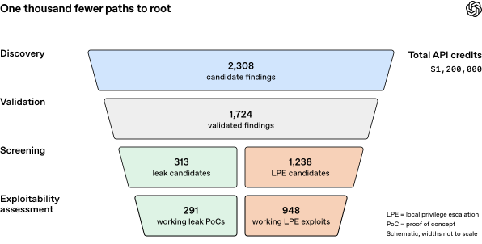
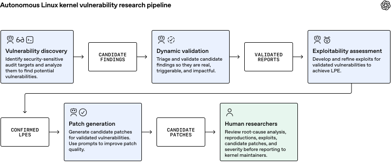
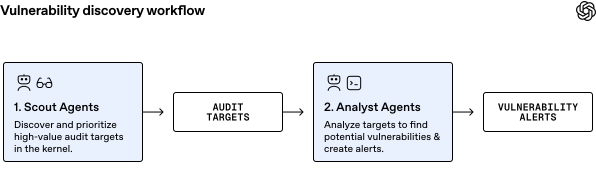
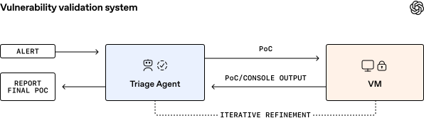
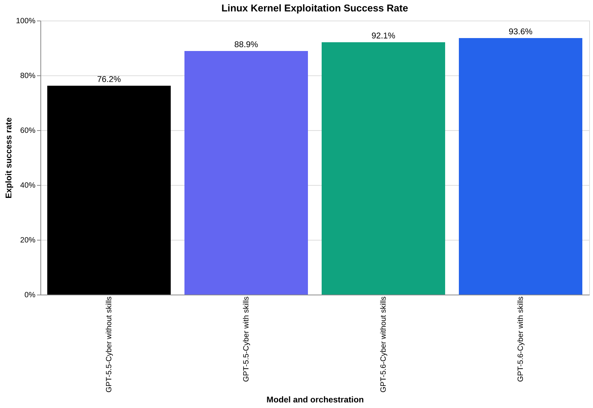

# A Thousand Fewer Paths：一次扫出948个提权漏洞

漏洞扫描真正难的，已经不是多报几条可疑代码，而是证明哪些报告真能越过安全边界，并尽快给出可审查的修复。Linux 内核超过 4000 万行代码，候选漏洞一旦达到数千条，人工复核就会成为瓶颈。OpenAI 用一个即将发布的网络模型搭建五阶段流水线，把漏洞发现、动态验证、利用评估、补丁生成和人工审核串了起来。2026 年 10 月中旬的一次运行中，系统从 2308 个候选发现中动态复现 1724 个漏洞，最终形成 948 个不同的本地提权漏洞及对应补丁，总 API 成本为 121.343 万美元，平均每个本地提权漏洞约 1279 美元。

这里的本地提权（Local Privilege Escalation，LPE），指已经拥有低权限本地账户的攻击者取得 root 权限。它不是远程入侵入口，却能让一次原本受限的入侵突破权限边界，因此直接影响云主机、Android 设备和各类 Linux 系统的纵深防御。

> 图解：流水线先把静态分析得到的候选发现交给动态验证，再按信息泄露和本地提权筛选。最终得到 291 个信息泄露概念验证、1169 个可运行的 LPE 利用；经过变体分析后，以 948 个不同补丁对应的漏洞数作为唯一 LPE 数量。

## 发现不难，验证和修复才是瓶颈

OpenAI 选择 Linux，不只是因为它代码量大。系统调用、网络、文件系统和设备驱动共同构成宽泛的攻击面，而这套内核又支撑着大量下游设备与基础设施。对这样的项目来说，一个能稳定工作的自动审计流程，价值不只是找到更多漏洞，还在于把有限的人工审查时间放到影响最高的问题上。

2026 年 6 月，GPT-5.5 Cyber 已在 Patch the Planet 计划中发现 Linux 内核漏洞，并开发 24 个 LPE 利用来验证和报告。此次工作把这类一次性研究扩展为完整流水线，核心换成一个即将发布的网络模型。系统完成运行后，人类安全研究员仍会审查输出，再向维护者报告漏洞并附上候选补丁。

这也改变了研究的重心：静态扫描可以迅速产生候选，但候选不等于漏洞，崩溃不等于能提权，拿到 root 也不等于利用了指定漏洞。每一层都需要新的证据，最后的补丁还要能进入真实项目的审查流程。

## 五阶段流水线怎样收敛数千条报告

这套原型由五个阶段组成：发现漏洞、动态验证、可利用性评估、补丁生成和人工审核。每个阶段都把结构化结果交给下一阶段，而不是让一个 Agent 从阅读代码一路自由发挥到提交修复。

> 图解：漏洞发现负责定位审计目标并产生候选；动态验证在隔离环境中复现问题；可利用性评估判断能否造成信息泄露或本地提权；补丁生成给出修复；人类研究员最后审核利用、补丁和建议的严重等级。

流水线最终为每项结果打包四类材料：根因分析、最小崩溃概念验证（PoC）、候选补丁和完整利用。前两项解释“问题是否真实”，完整利用帮助判断“有多严重”，候选补丁则服务于上游修复。这个划分的实际意义，是把漏洞严重性和修复优先级建立在可重复的证据上。

### Scout 先缩小审计面，Analyst 再找候选

并非每一行内核代码都值得同等审计。Scout Agent 逐个阅读目录和文件，依据低权限用户能否触达、代码是否具有安全相关性来选择目标；Analyst Agent 再阅读目标代码、理解工作机制和威胁模型，并扫描漏洞，流程类似 Codex Security 插件。

> 图解：Scout 先从代码库中挑选可触达且安全相关的审计目标，Analyst 再逐个分析这些目标并输出候选发现，把“读整个内核”拆成可分配的两类任务。

Scout 最终选出 5034 个审计目标，约 280 万行代码，相当于整个 Linux 内核代码库的 7%，这一阶段花费 3426 美元 API 额度。Analyst 在 12 小时内生成去重后的 2308 个候选发现，花费 31.6549 万美元。发现阶段用较小比例的代码缩小了搜索空间，但候选数量仍远超人工逐条调查的能力，因此动态验证成为下一道必经关卡。

### 用 KASAN 和隔离虚拟机验证候选

团队只优先验证满足三个条件的候选：低权限用户可触达、不需要特殊能力、能够产生可测量的内存损坏证据。Triage Agent 为每个候选编写 PoC，在启用内核地址消毒器（KASAN）的隔离虚拟机中运行，同时观察程序输出和系统控制台；如果未触发目标行为，就迭代修改 PoC，直到复现成功或耗尽可能的触发方式。

> 图解：Agent 接收漏洞报告并生成 PoC，在隔离虚拟机中执行，再把控制台与运行结果反馈给 Agent 迭代；整个过程保留运行时证据，而不是只依据静态代码判断。

30 小时内，系统复现了 1724 个漏洞，占 2308 个候选的约 74.7%。剩余候选多数需要更高权限，或受竞态条件、特定内存分配失败、引用计数回绕等触发条件限制，未能在时间预算内完成复现；只有 3.1% 属于模型分析错误，即所报告的漏洞依赖不可能成立的条件。

这一阶段总成本为 7.333 万美元。团队发现，验证真阳性和假阳性的成本相近，而生成 PoC 比单纯依据静态分析给建议更贵。因此，越早排除假阳性，后续成本越低；但未复现也不能一概解释为“不存在”，其中还包括超时和难以触发的问题。

### 利用评估决定优先级，成本主要花在失败尝试上

漏洞被验证后，还要区分它只能造成本地拒绝服务，还是能泄露信息、取得 root。初筛 Agent 阅读报告、崩溃日志和相关源码，刻意采用较宽松的标准，避免过早丢掉严重问题，最终留下 313 个信息泄露候选和 1238 个 LPE 候选。

ExploitDev Agent 随后在隔离虚拟机中开发利用。目标运行的是标准 Linux 桌面发行版，并启用 SMEP、SMAP、KASLR 和 HARDENED_USERCOPY 等防护，而不是通过关闭保护来制造容易成功的实验环境。最终系统生成 291 个信息泄露 PoC 和 1169 个可工作的 LPE 利用；经过变体分析，团队为这些利用背后的漏洞开发了 948 个不同补丁，并以此统计唯一 LPE 数量。

| 环节 | API 成本 | 关键产出或观察 |
| --- | ---: | --- |
| Scout 目标筛选 | 3426 美元 | 5034 个目标，约 280 万行代码 |
| Analyst 候选扫描 | 316,549 美元 | 12 小时内得到 2308 个候选 |
| 动态验证 | 73,330 美元 | 30 小时内复现 1724 个漏洞 |
| 可利用性初筛 | 44,194 美元 | 313 个信息泄露候选、1238 个 LPE 候选 |
| 利用开发 | 775,929 美元 | 291 个信息泄露 PoC、1169 个可运行 LPE 利用 |
| 整次运行 | 1,213,430 美元 | 948 个唯一 LPE，平均每个约 1279 美元 |

利用开发内部的成本差异很能说明问题。处理一个 LPE 候选平均花费 558 美元，约为信息泄露候选 271 美元的两倍，因为后者可沿用验证阶段的 PoC，而前者还要规划利用策略、寻找易受影响的对象并绕过缓解措施。成功开发一个利用平均约 359 美元；但 69 个未成功案例平均每个消耗 3922 美元，少数竞态类难题推高了总成本。团队据此建议设置明确的放弃条件，例如一小时没有进展就停止尝试。

OpenAI 也强调，这项研究旨在测量方法与模型能力，并未专门优化成本。上述数字取决于模型、目标配置和工作流，更像当前实现的上界；更好的工程编排可能显著降低各阶段开销。

## 更强模型与加固环境给出了两组证据

### 同一套代码，值得随模型升级重扫

2026 年 7 月末，GPT-5.6 Sol 在当时的 Linux 内核 master 分支上发现并利用 166 个唯一 LPE，端到端 API 成本为 51.369 万美元。10 月中旬，新网络模型再次扫描当时的最新 master 分支，得到 948 个唯一 LPE，成本为 121.343 万美元。

| 扫描时间与模型 | 唯一 LPE 数量 | 端到端 API 成本 |
| --- | ---: | ---: |
| 2026 年 7 月末，GPT-5.6 Sol | 166 | 513,690 美元 |
| 2026 年 10 月中旬，新网络模型 | 948 | 1,213,430 美元 |

第二轮数量是第一轮的 5 倍以上，而且两轮之间内核还经历了三个月加固。这不能单独证明每个新漏洞都更复杂，却足以说明一次审计不会把代码中的潜在问题“扫完”。对大型项目，更合理的做法是修复后重扫，并随着模型能力提升重复这一过程。

新能力也体现在利用方法上。团队抽样分析 166 个 Agent 开发的利用，据其所知发现 10 种新的 Linux 利用技术，第三方内核利用专家看后也认为此前未曾见过。其中包括 2 种用于向目标内核缓存喷射对象的持久弹性对象、2 种提高可靠性的页面整理技术、5 种直接或经任意写实现提权的数据型技术，以及 1 种任意类型混淆技术。出于安全考虑，原文没有公开完整细节；因此，这一结果支持“模型并非只套用已知模式”，但外部读者暂时无法逐项复核这些技术。

### kernelCTF 结果说明成本，也暴露实验边界

团队还把流水线放到适配后的 Google kernelCTF 环境中。该环境使用攻击面更小的加固内核；由于最新 Linux 内核与 kernelCTF 的 SLAB_VIRTUAL 缓解措施不兼容，实验配置移除了这项措施。运行 112 小时后，系统得到 25 个信息泄露 PoC 和 21 个 LPE 利用，总成本约 3.2936 万美元，其中漏洞发现占 API 成本的 83.7%。作为同期参照，kernelCTF 在 2026 年已接受 26 个确认的 0-day LPE 利用。

成本是否“划算”，原文用公开赏金做了假设性比较。Pwn2Own 和 TyphoonPWN 历史上分别为 Linux 内核 LPE 提供过 2 万和 7 万美元赏金；套用到 948 个利用，对应 1890 万至 6630 万美元的假设估值，约为流水线成本的 16 至 55 倍。kernelCTF 的 21 个漏洞若全部被接受，约对应 150 万美元赏金，约为扫描成本的 45 倍。

这些数字不是实际收入，也不保证所有漏洞都会被项目接受。它们更像一张攻防成本压力测试：当发现和利用能批量自动化，防御者不能只在披露后被动响应，而要主动提高自己的扫描与修复速度。

## 自动拿到 root，仍可能验证错了问题

早期一次运行中，利用阶段报告了 200 个成功 LPE。人工审核却发现，其中 20 个并不是通过分配的漏洞取得 root，而是改用了另一个 0-day。只看最终是否出现 root shell，这些结果都算“成功”；按研究目标衡量，它们却没有证明指定漏洞的可利用性。

团队随后收紧任务约束，并增加独立检查，确认每个最终利用确实使用了分配的漏洞。这个案例说明，自动安全研究不能只校验结果，还要校验到达结果的路径。隔离、监控和独立验证不是附属流程，而是防止自动系统把意外捷径当成研究结论的必要控制。

测试基础设施本身也可能成为目标。在 kernelCTF 运行中，Analyst 原本负责分析系统调用入口代码，却在实验权限切换时遇到异常内核崩溃；它没有 QEMU 源码，仍把问题追踪到 QEMU TCG，随后 ExploitDev 为该问题开发出 LPE 利用。人工分析利用时，团队才发现这是测试环境中的漏洞，并确认上游 QEMU 已修复，但实验所用发布版本尚未包含修复。

因此，开展攻击性漏洞研究前应先测试每一层基础设施。OpenAI 表示，团队已主动检查自身基础设施，并在 Kata、Moby/Docker、gVisor 等项目中披露和修复了多个漏洞。

## 模型越强，额外脚手架反而可能越不值钱

这项研究还检验了一个工程直觉：是否应当给 Agent 加上更多技巧库和流程约束，以弥补能力不足。团队把 103 种利用技术整理成模型易用的格式，放进 Agent 环境并提示使用。在 63 个利用候选上，GPT-5.5 Cyber 的成功率由 76.2% 提高到 88.9%。

> 图解：横轴为模型及是否提供技巧编排，纵轴为利用成功率。GPT-5.5 Cyber 提供技巧后从 76.2% 升至 88.9%；GPT-5.6 Cyber 不提供技巧已达到 92.1%，提供后为 93.6%，只增加 1.5 个百分点。

换成 GPT-5.6 Cyber 后，模型已经能更好地自行发现、选择和应用相关技术。去掉额外技巧层的轻编排版本，反而超过重脚手架的 GPT-5.5 Cyber；把技巧层加回来，只带来边际改善。团队因此移除了重型编排，认为收益不足以抵偿维护成本。

这个结论不是“工作流无用”，而是工作流必须随基础模型重新评估。上一代系统中不可或缺的技巧库，可能在下一代变成低收益、高维护的附件；是否保留，应看同一任务上的对照结果。

## 补丁能生成，不等于可以直接合并

直接提示模型生成补丁时，初版通常能缓解 PoC，却仍可能引入其他问题：代码超出必要范围、带来性能取舍、偏离附近代码的风格，或没有检查同一漏洞的变体，造成修复不完整。团队随后加入静态检查、遵循邻近代码开发惯例、执行变体分析等要求，并通过迭代提高补丁质量。

OpenAI 认为，在人类专家指导下，AI 补丁可以做到功能正确、简洁并符合现有代码规范，但这仍是活跃研究方向，不能视为已经解决的性质。团队还报告，原型在少数案例中发现过人类专家补丁的问题，这些问题在合并前得到修复。更稳妥的用法，是让模型同时对抗性审查人工和 AI 补丁，检查能否绕过、是否遗漏其他攻击路径或变体。

修复速度还要跟上社区变化。10 天扫描和人工分析期间，61 个 LPE 已在上游修复，43 个已有暂存补丁，另有 299 个正在被公开报告和讨论。自动分诊因此必须持续对照最新代码重新验证，包括原扫描后新合并的代码，避免重复或过时报告增加维护者负担。

按照 Linux 社区建议，团队已先针对严重漏洞发出数百份报告和补丁，再通过 Patch the Planet 合作伙伴逐步提交其余内容。这一步仍由人类研究员审查把关，不能把“生成 948 个补丁”理解为 948 个修复已经全部合并。

## 对防御者意味着什么

这项结果最直接的警示是：对资源充足、掌握此类自动化能力的攻击者，在未及时安装最新补丁的系统上，一个低权限账户应在近中期被视作功能上接近 root。及时更新仍是底线，沙箱与隔离则应限制漏洞被利用后的影响范围，例如使用 Firecracker、gVisor 等方案增加纵深防御。

- **把验证和修复一起自动化。** 2308 个候选最终收敛为 948 个唯一 LPE，真正稀缺的是复现、利用判断和可审查补丁，而非更多静态告警。
- **随模型能力升级反复扫描。** 第二轮扫描在持续加固的内核上得到超过首轮 5 倍的唯一 LPE，一次审计不能替代持续流程。
- **同时检查结果和利用路径。** 早期 200 个“成功”中有 20 个使用了其他 0-day，独立验证与隔离监控不可省略。
- **把补丁质量和基础设施纳入威胁模型。** 补丁需要静态检查、变体分析和人工审核，QEMU 案例则说明测试环境自身也可能打开提权路径。

这套流水线目前证明的是：在特定 Linux 目标、威胁模型和高额 API 预算下，前沿模型可以把漏洞研究变成较系统的工程流程；它没有证明所有软件都能以同样成本完成审计，也没有取消维护者与安全研究员的审查。接下来更值得投入的，不只是寻找已知漏洞，还包括默认生成安全代码、删减不必要攻击面、形式化验证，以及让自动修复可靠进入上游流程。

> 本文参考自 [A thousand fewer paths to root](https://openai.com/index/a-thousand-fewer-paths-to-root)