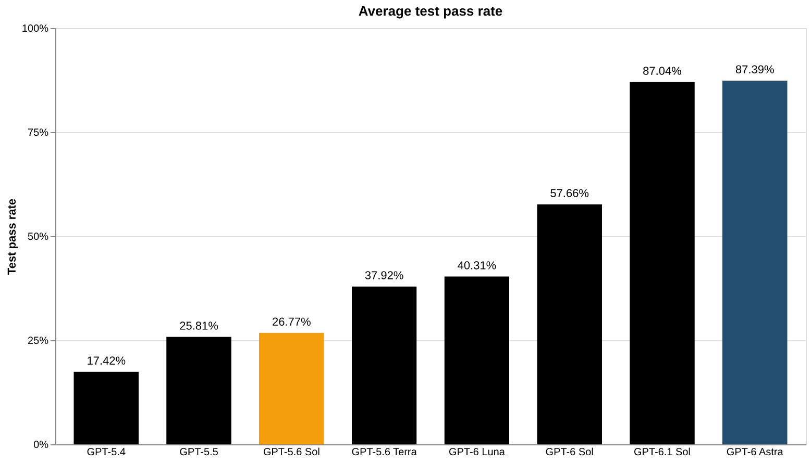

# GPT-6 系列：让大模型学会写 COBOL 和 Fortran

COBOL 诞生于 1959 年，至今支撑着全球超过 40% 的网上银行系统、80% 的线下信用卡交易和 95% 的 ATM 交易；Fortran 则仍在天气预报和核反应堆安全分析中服役。这些“低资源语言”的共同问题是：网上的代码和文档远比 Python、JavaScript 少，大模型训练时见得少，用起来自然力不从心。

2026 年 10 月 19 日，OpenAI 发布的研究进展给出了一个新答案：为这类语言专门构建两个评测——MultiLangBench（从零构建软件）和 COBOL 迁移评测（迁移存量软件），并用它们验证新模型的能力提升。结果相当醒目：在 MultiLangBench 上，GPT-6 Astra 的平均测试通过率从 GPT-5.6 Sol 的 26.8% 提升到 87.4%；在 COBOL 迁移评测上，GPT-6.1 Sol 的准确率从 5.4% 跃升至最高 97.9%，同时成本还在下降。

## 为什么偏偏是这些“老语言”难住大模型

这项工作的动机直接来自开发者和企业客户的反馈：编码模型在 COBOL、Fortran、Visual Basic 这类语言上经常翻车。困难不只是“训练语料少”这么简单。维护这些老系统时，文档往往残缺不全，当年的开发者可能已经离职，关键的业务规则只存在于代码本身。无论是修 bug 还是把系统迁移到现代语言，团队都必须精确保留系统原有的行为——改错一个舍入规则，财务报表就会对不上。

OpenAI 把这个问题拆成两种互补的能力分别测量：一是**构建新软件**的能力，二是**保留存量软件行为**的能力。对应的两个评测就是 MultiLangBench 和 COBOL 迁移评测。

## MultiLangBench：用 20 种语言从零写一个 SQLite

MultiLangBench 的任务设定很硬核：让模型在指定的编程语言里，从零构建一个兼容 SQLite 的数据库引擎。这要求模型组织代码库、管理状态、处理错误，并在添加新功能的同时不破坏已有功能——基本上是一次完整的长周期编码会话。

这个评测的巧妙之处在于跨语言比较的方式。不同语言写出的数据库引擎没法直接对比代码，但数据库文件本身可以成为统一接口：候选程序接收一个初始数据库和一条 SQL 查询，输出一个修改后的数据库；再用 SQLite 官方实现检查结果是否符合预期。这样一来，无论引擎是用 COBOL 还是 Rust 写的，都可以套用同一套测试。测试用例改编自 SQLite 现有的测试套件，评测同时报告测试通过率和 API 成本。

### 结果：20 种语言全面提升，COBOL 仍是最难的

在最高推理档位下，GPT-6 Astra 在 20 种语言上的平均测试通过率达到 87.4%，而 GPT-5.6 Sol 只有 26.8%，且每种语言都有提升。几个低资源语言的对比尤其明显：

| 语言 | GPT-5.6 Sol | GPT-6 Astra |
| --- | --- | --- |
| COBOL | 10.9% | 72.1% |
| OCaml | 25.6% | 85.8% |
| Fortran | 21.4% | 83.5% |
| Visual Basic | 27.5% | 89.4% |

Astra 在 20 种语言中的 19 种上得分超过 83%，唯一的例外是 COBOL（72.1%）——它依然是最难啃的骨头。这个细节比平均分更有信息量：低资源语言的提升是真实的，但天花板仍然存在，COBOL 的特立独行（冗长的语法、固定点算术、老式工程习惯）不是靠通用能力就能完全抹平的。

定位更低的 GPT-6 Luna 也在所有语言上超过了 GPT-5.6 Sol，平均通过率 40.3%（COBOL 10.9%→17.1%，OCaml 25.6%→34.1%，Fortran 21.4%→31.4%，Visual Basic 27.5%→41.6%）。更值得注意的是成本：Luna 的单样本估算 API 成本约 $0.77，而 GPT-5.6 Sol 是 $3.48，便宜了约 78%。

> 图解：MultiLangBench 上各模型在 20 种语言上的平均测试通过率。横轴按模型代际排列，纵轴为通过率（0–100%）。从 GPT-5.4 的 17.4% 一路上升到 GPT-6 Astra 的 87.4% 和 GPT-6.1 Sol 的 87.0%；GPT-6 Luna（40.3%）作为低成本选项仍略高于 GPT-5.6 Terra（37.9%）。

OpenAI 已在 GitHub 上开源了 MultiLangBench 的评测框架和测试套件，并公布了各语言的详细结果。想知道自己常用的语言处于什么水平的开发者，可以直接去查。

## COBOL 迁移评测：行为一致比跑起来难得多

第二个评测面向更实际的企业场景：把 COBOL 程序迁移到 C++、Java、Kotlin、Python 或 Rust，同时严格保持原有行为。

为什么这很难？因为 COBOL 程序处理的往往是金融交易和业务记录，舍入规则、缺失记录的处理方式这类细节直接对应业务要求。原文举了一个很好的例子：COBOL 的固定点算术默认丢弃多余的小数位，除非显式要求舍入。如果迁移后的代码改用了常规的四舍五入，程序照样能跑、不报错，但算出来的金额就不一样了。这类“安静地出错”恰恰是迁移项目最害怕的。

因此评测的判定标准极为严格：隐藏测试要求可观测输出逐字节一致，所有测试全部通过才算迁移成功。这意味着模型不仅要懂目标语言，还得真正理解 COBOL 特有的语言行为背后的业务逻辑。

### 结果：从 5.4% 到接近饱和

在这个评测上，GPT-6.1 Sol 在低推理档位下达到 86.6% 的准确率，而 GPT-5.6 Sol 在相同设置下只有 5.4%——前者还便宜了 39%（成本仅为后者的 61%）。调高推理档位后，准确率达到 97.9%，几乎把这个评测做满了。从 5.4% 到 86.6%，这个跨度说明此前的模型在这项任务上基本不可用，而现在已经进入可以考虑实际应用的范围。

## 值得关注的边界

OpenAI 自己也保留了必要的谨慎：这类行为保持能力对维护和现代化老系统有用，但用到生产软件上仍然需要专家审查，并针对系统的业务规则和依赖做测试。97.9% 是评测集上的数字，不是任何真实核心银行系统的免检通行证。另外，MultiLangBench 测的是“从零构建”，与真实遗留系统中“读懂几十万行祖传代码再动刀”的场景还有距离——开源评测套件的价值之一，就是让社区能验证这些数字在自己关心的语言上是否成立。

## 结语

- COBOL、Fortran 等低资源语言支撑着金融、气象、核安全等关键基础设施，但大模型在这些语言上的能力长期落后；
- OpenAI 用两个互补评测来度量进展：MultiLangBench 测从零构建软件，COBOL 迁移评测测行为保持式迁移；
- GPT-6 Astra 在 MultiLangBench 上达到 87.4% 平均通过率（GPT-5.6 Sol 为 26.8%），COBOL 仍是 20 种语言中最难的（72.1%）；
- GPT-6.1 Sol 在 COBOL 迁移评测上从 5.4% 提升到 86.6%（高推理档 97.9%），且成本更低；
- 两个评测都指向同一个结论：模型正在把通用软件工程能力——理解陌生代码库、规划变更、使用构建工具、跑测试、调 bug——扩展到更多语言上。

如果你的团队正在维护老系统，现在值得用团队实际使用的语言在 API 上跑一两个真实任务试试水温——但别把评测分数当成生产环境的交付承诺。

> 本文参考自 [Advancing coding in low‑resource programming languages](https://openai.com/index/low-resource-programming-languages)