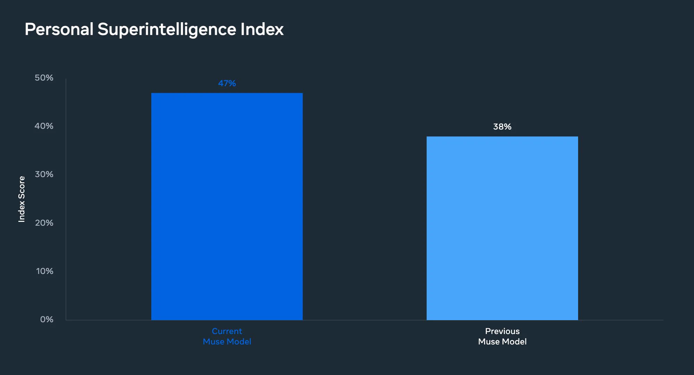
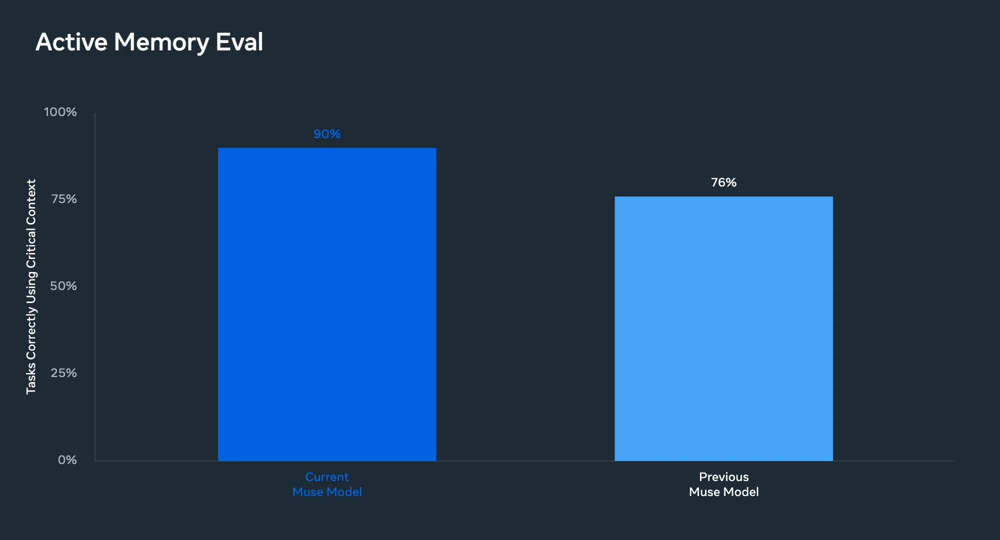

# Muse Wonder：让AI持续推进目标

2026年11月6日，Alexandr Wang 宣布，Muse 和 Meta AI 从当天起开始运行由 Muse Wonder 训练的新专用模型。公告没有给出模型参数、基准成绩或成本数据，明确点名的变化是两项能力：**Active Memory** 让模型能够跨时间推理，并更好地记住重要信息；**Active Focus** 则让 Muse 在遇到阻碍后仍能继续朝目标工作。

两项能力指向同一个具体问题：AI 不只处理当前一句话，还要在延续的任务中保留关键信息，并且不因中途受阻而偏离目标。这对多轮交互和长任务尤其重要，因为早期目标、约束与决定一旦在后续步骤中丢失，单次回答再流畅也未必能完成整项任务。

> 图解：Alexandr Wang 原帖发布的第一张公告配图。

## Active Memory：记住对后续有用的信息

按照公告表述，Active Memory 包含两层意思：一是“跨时间推理”，即较早获得的信息仍能参与后续判断；二是“记住重要内容”，重点不仅是保留信息，还包括选择保留哪些信息。如果只是保留内容却不分轻重，也不必然有助于完成当前目标，因此公告把“记住什么”与“如何用于推理”放在一起强调。

不过，原帖没有说明这种记忆能维持多久、如何筛选和更新，也没有交代它与传统上下文窗口或外部存储的关系。目前没有公开数字可以判断记忆容量或准确率提升了多少。

## Active Focus：遇到阻碍后继续推进

Active Focus 处理的是另一类中断：任务尚未完成，执行过程却遇到了阻碍。公告将其描述为让 Muse“即使在遇到障碍时，也能继续朝着目标努力”，关注的是目标能否在后续步骤中保持，而不只是一次回答是否流畅。

这并不等同于承诺模型能够解决所有问题。原帖没有列出阻碍类型、具体处理流程或任务成功率，因此无法确认模型会采用重试、调整计划还是其他方式，也不能把这项能力扩大解释为任意长任务都能可靠完成。

> 图解：Alexandr Wang 原帖发布的第二张公告配图。

## 目前能确认的是方向，而不是提升幅度

这次公告可以确认的事实是：Muse 与 Meta AI 已开始使用由 Muse Wonder 训练的新专用模型，Active Memory 和 Active Focus 是其中被明确点名的能力。至于它们相对旧模型改善多少、适用于哪些任务，原帖没有提供对照测试或适用范围。

回到持续任务这个具体问题，现有信息说明了模型训练与产品能力的方向，却还不足以评估实际效果。后续真正值得关注的是记忆保留机制、受阻后的实际案例和可复现测试，它们才能帮助判断模型是否确实更能记住关键信息并推进目标。

> 本文参考自 [Alexandr Wang (@alexandr_wang) on X](https://x.com/alexandr_wang/status/2118776727912755478)