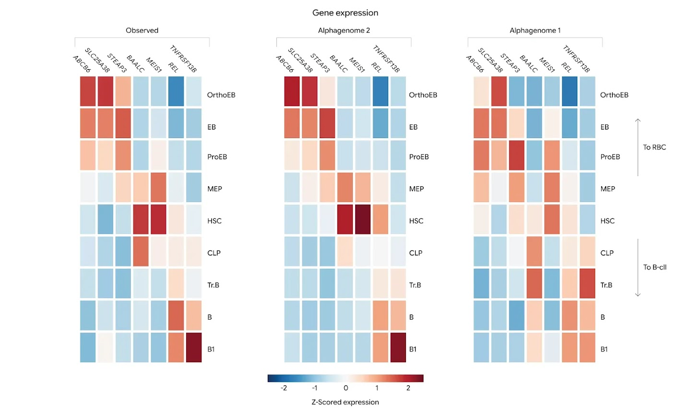
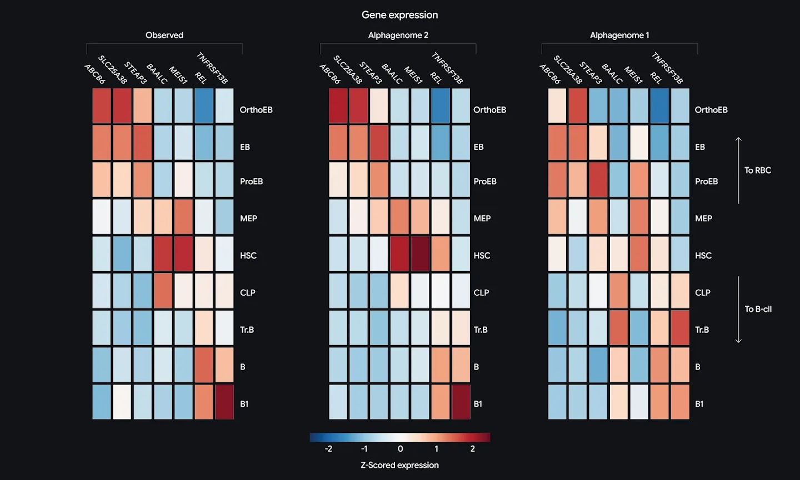

# AlphaGenome 2：按细胞状态预测DNA变异效应

在包含28种原代免疫细胞的TenK10K数据集上，DeepMind报告，AlphaGenome 2可靠识别因果变异的比例达到30%，上一代模型为16%；判断基因效应方向的比例则从23%提高到43%。这组结果的意义不只是“预测更准”，还在于模型开始回答一个更具体的问题：某个DNA变异究竟在哪一种细胞、哪一种状态下发挥作用。

人体细胞大体共享同一套DNA，但心肌细胞、免疫细胞会通过开关不同基因执行不同功能。只看组织层面的平均信号，容易抹平少数特化细胞中的变化。AlphaGenome 2因此把预测粒度推进到细胞类型和细胞状态，并采用新的条件化架构，让同一段DNA在不同生物条件下产生不同预测。

## 从并行预测组织，转为逐条件理解细胞

第一代AlphaGenome接收一段100万个字母的DNA序列，一次性并行预测许多组织和细胞系中的数千项实验结果。这种方式效率很高，但模型容量被分摊到大量输出上，也难以捕捉近缘细胞类型之间的细微差别。

AlphaGenome 2改用了条件模型：每次针对一个生物条件进行预测，这个条件可以是组织、细胞类型或细胞状态。除了百万字母DNA序列，目标条件还会作为输入进入模型架构的每个阶段，使模型学习同一段DNA在不同细胞中如何被读取。

> 图解：第一代模型从一段百万字母DNA序列并行输出固定的组织和细胞系预测；AlphaGenome 2则同时接收DNA与指定生物条件。条件可以来自参考细胞类型目录，也可以由研究人员自己的单细胞实验通过细胞编码器现场生成。

这套设计还带来跨模态补全能力。模型将细胞的生物状态与实验输出分开表示，因此研究人员只提供一种测量结果，例如单细胞基因活性，模型就能预测尚未测量的属性，例如染色质可及性。它不能替代实验，但可以帮助判断下一步更值得做哪些实验。

训练数据也同时覆盖人类和小鼠的组织样本与单细胞样本，包含超过1.07亿份单细胞档案，涉及68种组织。AlphaGenome 2保留了基因表达、组蛋白修饰、染色质可及性等核心读出，并新增DNA甲基化预测。相比上一代主要观察组织平均值，新模型试图分辨特定心肌细胞、血液免疫细胞等更细的内部活动。

## 提升体现在哪些预测上

在训练数据之外的基因组区域，DeepMind测试了模型解释同一组织内不同细胞类型表达差异的能力。团队报告称，AlphaGenome 2能解释更多细胞类型间的差异，并跟踪连续的表达变化，例如人造血干细胞逐步成熟为红细胞和免疫细胞谱系的过程。

> 图解：热图展示红细胞成熟过程中的基因表达，横向为不同基因，纵向为连续的造血分化阶段。每行经过Z分数标准化，用于观察同一基因在各阶段的相对变化；左侧是实测值，中间是AlphaGenome 2预测，右侧是经过单细胞数据微调的第一代模型预测。按原文对比，AlphaGenome 2的预测更接近实测结果。

变异效应测试给出了更明确的数字。在TenK10K单细胞图谱中，AlphaGenome 2面对28种原代免疫细胞，可靠识别因果变异的比例为30%，对照为16%；识别方向性基因效应的比例为43%，对照为23%。这里的对照包括经过单细胞数据微调的第一代AlphaGenome及其他专用工具，结论适用于这一测试设置，而不是所有细胞与所有疾病。

一个炎症性肠病（IBD）案例展示了细胞特异性为何重要。此前一项研究发现，某变异位于远离ETS2基因的调控开关中，会通过过度激活肠道免疫细胞——巨噬细胞中的ETS2，推动IBD发生。AlphaGenome 2在多种肠道免疫细胞中进行计算预测，复现了这一结果：它锁定了该因果变异，并预测其选择性地提高肠道巨噬细胞中的ETS2活性，对其他细胞类型和基因则大体没有影响。

这类结果说明，模型不只是判断“变异是否有影响”，还可以把影响定位到具体基因和细胞环境。对于只在少数疾病相关细胞中起作用的变异，这比组织平均预测更有用。

## 没见过的细胞状态，无需重训也能分析

条件化架构还用于处理训练时未见过的单细胞实验。研究人员可以上传仅几十个细胞的单细胞RNA测序快照，模型把其中的基因活性压缩为细胞状态表示，再用这个表示设定预测条件，不需要针对新数据重新训练。

DeepMind称，在这些新实验中，AlphaGenome 2可以达到或超过直接在这些数据集上训练或微调的模型。原文没有列出这一对比的全部数值，因此更确定的意义在于工作流程：面对新的疾病或免疫状态，研究人员可以先提供少量单细胞测量，再预测基因调控和变异效应。

一项COVID-19 mRNA疫苗研究的数据提供了例子。模型区分了被疫苗激活的免疫T细胞与静息T细胞，并预测一个与重症COVID-19相关的变异，在激活状态下会更强烈地扰乱基因活性。若只分析未激活细胞，这一效应就会被错过。这里的“细胞状态”因此不是附加标签，而可能直接决定变异预测的结果。

## 把GWAS变异接到具体细胞和基因上

全基因组关联研究（GWAS）能找到与性状或疾病相关的DNA区域，但往往难以继续确定精确的因果变异、目标基因和发生作用的细胞类型。AlphaGenome 2试图把这些人遗传统计线索与不断扩展的单细胞图谱连接起来。

DeepMind已经预先计算了数百种人类细胞和组织条件下、性状相关变异的预测分数，让研究人员不必自行运行大规模计算。这些结果主要服务于两类问题。

一类是连接增强子与基因。许多疾病相关变异位于远离目标基因的增强子中，作用路径难以追踪；而CRISPR实验筛选通常使用稳定的实验室细胞系，未必能代表人体中的真实细胞。AlphaGenome 2把增强子—基因关系预测扩展到原代人类细胞，例如支持和保护神经元的脑星形胶质细胞，帮助研究人员在疾病实际发生的细胞环境中寻找调控关系。

另一类是缩小GWAS候选范围。对于身高、2型糖尿病等复杂性状，预计算的变异分数可用于指出更可能涉及的变异和细胞类型。在预测置信度较高时，模型还能判断变异会提高还是降低基因活性，为理解该基因如何影响疾病提供方向性线索。不过，这些输出仍是用于确定优先级的计算预测，并不等同于实验确认的因果链条。

## 研究价值与使用边界

AlphaGenome 2目前已经通过AlphaGenome API开放给非商业研究，表达条件化的交互式Colab教程也已提供；商业研究则处于非公开预览阶段。DeepMind还计划把AlphaGenome 2 Skills加入其智能体开发平台Google Antigravity，与Gemini 4等工具结合，但这些后续能力尚属于计划中的发布。

对研究单细胞调控、罕见病变异或复杂性状的人来说，这次升级最值得关注的是条件化建模：它既提高了特定测试中的变异识别能力，也让未见过的细胞状态成为可直接输入的条件。与此同时，模型只供研究使用，尚未经过临床或诊断用途的验证和批准；计算预测适合帮助筛选候选变异和设计后续实验，不能直接作为诊断依据。

> 本文参考自 [AlphaGenome 2: Deciphering how cells read DNA to better understand disease](https://deepmind.google/blog/alphagenome-2-deciphering-how-cells-read-dna-to-better-understand-disease/)