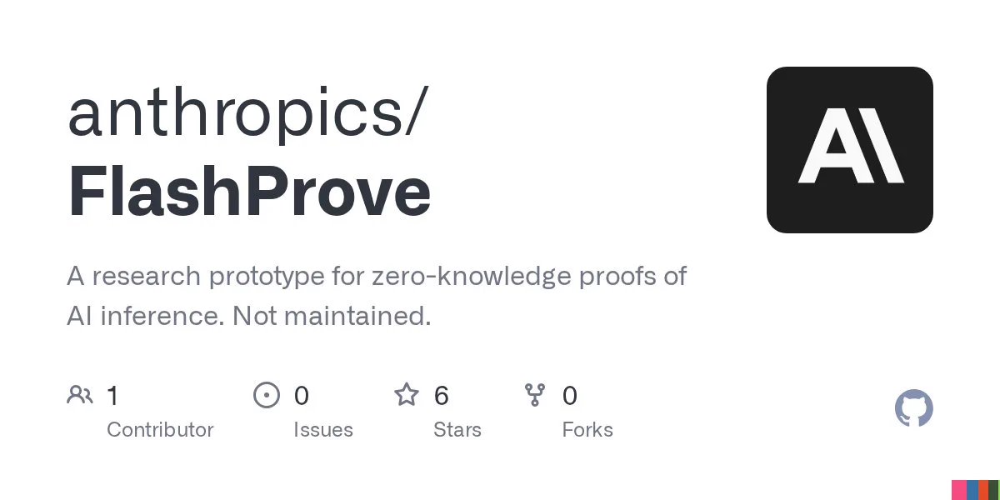

# FlashProve：验证回答来自哪个模型

一个 AI 回答摆在面前，如何确认它确实由指定模型生成？当模型由第三方托管或通过服务接口提供时，外部参与者往往只能接受服务方对模型来源的声明。Anthropic 发布的研究原型 FlashProve 尝试用密码学证明补上这一缺口：开发者可以检验某个回答是否来自某个模型。Anthropic 称，它的效率显著高于此前的开源方法，但这则帖文没有给出具体测试数据。

## 可证明推理，证明的是来源

FlashProve 属于“可证明推理”（provable inference）研究，建立在已有的密码学技术之上。它要为模型推理增加一份可检验的证明，让验证者不必只接受服务方对模型来源的声明。

这里需要划清边界：证明“回答由哪个模型生成”，不等于证明“回答内容正确”，也不等于证明模型本身安全。FlashProve 针对的是推理来源的可验证性，而不是内容真实性或回答质量。

从仓库描述看，这项原型还涉及 AI 推理的零知识证明。不过，帖文没有展开证明如何生成、验证者需要执行哪些步骤，也没有说明具体适用于哪些模型，因此现阶段不能进一步推断其技术实现和部署门槛。

## 从聊天防劫持到安全评估

明确了证明对象之后，下一个问题是它能用在哪里。Anthropic 给出了两类应用：在聊天场景中，这类证明可以提高攻击者劫持对话的难度；在安全评估中，评估者可以确认自己测试的模型，与服务商实际提供给客户的模型是否一致。

这两个场景指向同一个缺口：当模型由第三方托管或通过服务接口提供时，外部参与者如何核实模型身份。可证明推理把“服务方说是同一个模型”转变为可以执行验证的声明，为部署信任增加一层技术依据。

不过，帖文只说明了应用可能性，没有展示真实攻击测试或安全评估案例。它能在多大程度上提高聊天劫持的成本、能覆盖哪些模型替换方式，仍需更多证据回答。

## 效率优势尚未量化

效率是 FlashProve 的核心卖点。Anthropic 明确表示，它比此前用于同类验证的开源方法“显著更高效”，但没有公布基线名称、测试条件、证明生成耗时或验证成本。因此，这一表述目前只能作为方向性结论，不能换算成具体提速倍数，也不能直接推导出生产环境的成本降幅。

Anthropic 已公开 [FlashProve 代码](https://github.com/anthropics/FlashProve)，方便外界检查和使用。仓库将其定位为“AI 推理零知识证明的研究原型”，并标注“不维护”。这意味着它更适合作为可证明推理的研究起点，而不能仅凭开源发布就被视为已经具备生产级保障。

> 图解：GitHub 仓库卡片给出了 FlashProve 的定位——面向 AI 推理零知识证明的研究原型，并明确标注“不维护”。

对于关注模型托管、第三方服务审计和安全评估的人，FlashProve 值得跟踪：它处理的是模型来源难以独立核实的问题，并给出了开源实现。现有材料已经说明其目标和潜在用途，但实际性能、集成成本与安全保障边界，仍需结合完整技术说明和进一步测试来验证。

> 本文参考自 [Anthropic (@AnthropicAI) on X](https://x.com/AnthropicAI/status/2117707052948898271)