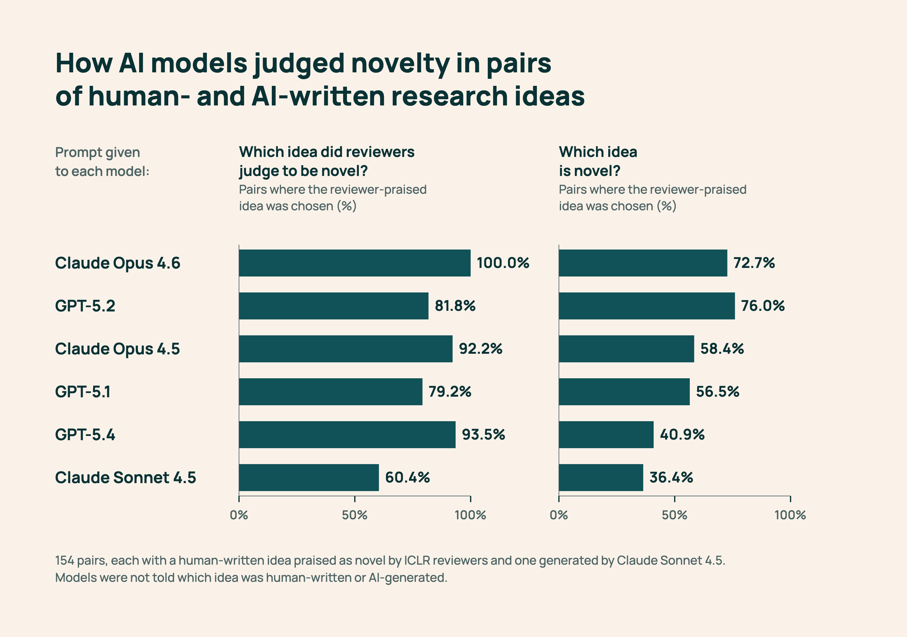

# Novelty Bench：提示词让准确率腰斩

同一批 154 对人类与 AI 研究想法，GPT-5.4 判断哪个更新颖的准确率，仅因提示词不再透露“评审认为其中一个想法新颖”，就从 93.5% 跌至 40.9%。如果科研机构用 LLM 生成想法，再交给另一个 LLM 筛选，这种波动会直接改变研究方向和生成系统排名。Ai2 因此发布《Old Ideas, Novel Problems》，并开放 Novelty Bench 的数据、代码与构建流程。

## 新颖性不能由论文录用代替

团队挖掘 ICLR 2026 评审中明确讨论原创性的文字，构建两组数据。Human-Only 包含 154 个高新颖性想法，来自评分前 10% 且评审一致肯定新颖性的录用论文；另有 145 个低新颖性想法，来自评分后 10% 且评审一致质疑原创性的拒稿。Human+Generated 则将 154 个人类想法分别与 AI 想法配对。生成器只获得研究领域和“提出一个新颖想法”的指令，没有检索、工具或反馈，因此这些配对只是弱标签。

一位专家复核了 30 对较多取自最强模型错误案例的样本，全部偏好人类想法；但样本偏向困难案例，不能用来估计整体生成质量。更重要的是，即使标签不完美，同一对想法在合理设置下得到相反答案，也足以证明评审不稳定。

## 换一种问法，结论就会翻转

实验覆盖 GPT-5.1、GPT-5.2、GPT-5.4、Claude Sonnet 4.5、Claude Opus 4.5 和 Claude Opus 4.6。影响最大的因素是提示词：GPT-5.4 在去掉评审先验后，准确率下降 52.6 个百分点，低于随机猜测，并在超过一半的相同样本上改变结论。

> 图解：154 对样本中的 AI 想法均由 Claude Sonnet 4.5 生成，受测模型不知道哪边来自人类。提供评审先验时，GPT-5.4、Claude Sonnet 4.5、Claude Opus 4.6 的准确率分别为 93.5%、60.4%、100.0%；直接询问哪个更新颖后，分别降至 40.9%、36.4%、72.7%。

同样变化在 Human-Only 上整体只造成约 7 个百分点的波动，说明在人类论文上稳定，不代表能稳定评价 AI 想法；不过 Claude Opus 4.6 仍移动了 21 个百分点。比较不同生成器时，6 个评审模型平均约四分之一到三分之一的判断会随提示词翻转，排名可能部分来自问法而非想法本身。

## 更多检索和推理未必更准

GPT-5.6 Sol 即使用上超高推理预算和 arXiv 迭代搜索，macro-F1 也只有 0.78，低于 Claude Opus 4.6 的 0.89，单次判断成本却约为后者 10 倍。另一组实验中，低推理预算、3 次投票的 Claude Opus 4.6 简单基线以 0.854 macro-F1、2.59 美元总成本，胜过 Idea Novelty Checker 的 0.642、30.66 美元和 AI Scientist 的 0.772、82.05 美元。两组配置不同，不能拼成统一排行榜，但都不支持“流程越复杂越可靠”。

这项研究并未证明 LLM 不能评价新颖性，弱标签、简单生成器和有偏专家样本也限制了外推，40.9% 更不是跨领域通用准确率。实际使用时，应以真实 AI 想法测试，更换提示词与评审模型并报告翻转，同时比较检索、推理和投票的增益与成本，保留简单基线。回到 93.5% 到 40.9% 的落差：更值得信任的不是一次“新颖”标签，而是能暴露分歧、检验敏感性并核算成本的评估过程。

> 本文参考自 [Can we trust LLMs to judge whether a research idea is novel?](https://huggingface.co/blog/allenai/novelty-bench)