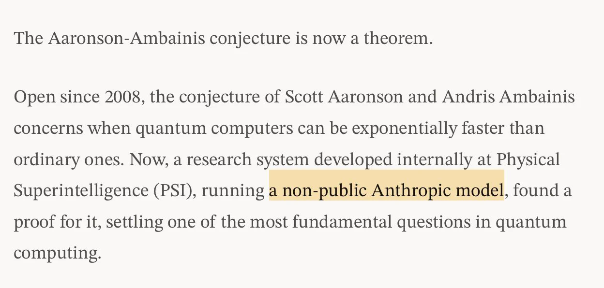

# PSI：AI 证明量子开放猜想

一个自 2008 年以来未解决的量子计算问题，如今出现了由 AI 研究系统完成的证明。Physical Superintelligence（PSI）宣布证明 Aaronson–Ambainis 猜想；Chubby 的转述补充称，这套系统使用了 Anthropic 的非公开模型，在第三天找到完整证明，最终版本还经过了 Lean 检查。

这项结果的重要性不只在于“AI 解出了一道题”。按照 PSI 的说法，该猜想是量子复杂性研究的核心开放问题之一，其证明有助于解释量子计算机何时能够相对经典计算机获得指数级优势。

## 公告给出了哪些信息

PSI 将这项工作直接与量子计算加速的条件联系起来，但现有帖子没有展开证明过程，也没有给出定理形式或推导细节。因此，目前能确认的是团队对证明及其意义的表述，而不是从原帖中独立核验这项数学结论。

Chubby 的描述则给出了研究流程中的两个时间节点：系统在第三天找到完整证明，随后形成经过 Lean 检查的最终版本。Lean 是用于形式化证明检查的工具，这意味着最终证明至少被纳入了机器可检查的流程；不过，帖子并未说明检查覆盖的具体命题、依赖和证明文件。

## 为什么仍需区分宣布与复现

“第三天完成证明”是一个很具体的结果，但原帖没有交代计时起点、系统配置、人工参与程度或此前尝试，因此不能据此推导出其他数学问题的求解速度。使用非公开 Anthropic 模型也意味着，外部读者暂时无法仅凭这些信息复现同一研究过程。

同样，Lean 检查增强了最终证明的可核查性，却不等于自动说明 AI 的搜索过程、问题建模和中间判断都可独立复现。证明如何被发现，与发现后的证明如何被检查，是两个需要分别评估的环节。

## 现在值得关注什么

对量子复杂性研究者来说，重点是证明本身能否澄清量子计算获得指数级优势的适用条件；对自动定理证明和 AI 研究系统的关注者来说，更关键的是完整证明、Lean 检查材料以及研究过程能否公开检验。

当前公告足以让这项工作受到关注，但还不足以评价方法的通用性，也不能把单次证明扩大成 AI 已能普遍独立完成数学研究的结论。接下来真正需要检验的，仍是这项证明及其研究过程能否经受公开核查。

> 本文参考自 [Chubby♨️ (@kimmonismus) on X](https://x.com/kimmonismus/status/2118735527025250755)