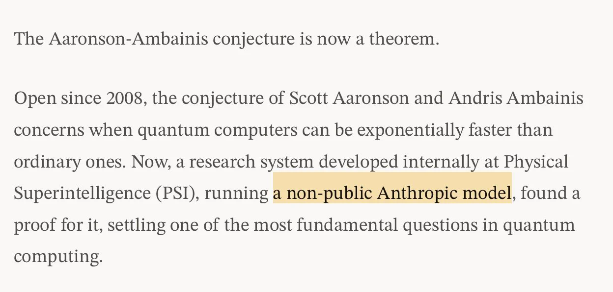

# PSI：AI 证明量子开放猜想

一个自 2008 年以来未解决的量子计算问题，如今出现了由 AI 研究系统完成的证明。Physical Superintelligence（PSI）宣布证明 Aaronson–Ambainis 猜想；Chubby 的转述补充称，系统使用了 Anthropic 的非公开模型，在第三天找到完整证明，最终版本还经过 Lean 检查。

按照 PSI 的说法，该猜想是量子复杂性研究的核心开放问题之一，其证明有助于解释量子计算机何时能相对经典计算机获得指数级优势。因此，这项结果值得关注的不仅是“AI 解出了一道题”，还包括它可能为量子计算加速的适用条件提供答案。

## 公告与转述说明了什么

现有帖子没有展开证明过程，也未给出定理形式或推导细节。目前能确认的是 PSI 对证明及其意义的表述，而不是仅凭原帖独立核验这项数学结论。

Chubby 的描述提供了两个研究流程节点：第三天找到完整证明，随后形成经过 Lean 检查的最终版本。Lean 是形式化证明检查工具，这意味着最终证明至少进入了机器可检查的流程；但帖子没有说明检查覆盖的具体命题、依赖和证明文件。

## 宣布之后，还需公开核查什么

“第三天完成证明”虽然具体，原帖却没有交代计时起点、系统配置、人工参与程度或此前尝试，不能据此推导其他数学问题的求解速度。非公开 Anthropic 模型也意味着，外部读者暂时无法仅凭这些信息复现同一研究过程。

Lean 检查增强了最终证明的可核查性，但不等于 AI 的搜索过程、问题建模和中间判断都能独立复现。证明如何被发现，与发现后的证明如何被检查，是两个需要分别评估的环节。

对量子复杂性研究者，重点是证明能否澄清量子计算获得指数级优势的适用条件；对自动定理证明和 AI 研究系统的关注者，则更需检验完整证明、Lean 材料及研究过程能否公开。当前公告足以引起关注，却不足以评价方法的通用性，更不能把单次证明扩大为 AI 已能普遍独立完成数学研究。回到这项开放猜想本身，接下来真正需要核查的仍是证明及其研究过程。

> 本文参考自 [Chubby♨️ (@kimmonismus) on X](https://x.com/kimmonismus/status/2118735527025250755)