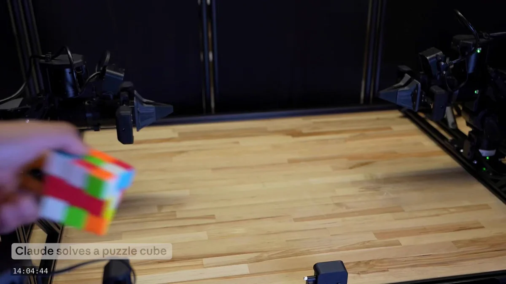

# Fable 5.2：机器人控制迁移到未训练任务

Anthropic 对 Fable 5.2 的最新介绍把重点放在了机器人控制上。团队称，模型控制物理机器人的能力有明显提升，即使面对从未明确训练过的任务，也能展现出相应技能。

这条信息的核心不是某个固定动作完成得更好，而是控制能力能否迁移到新任务。不过，原帖只给出了定性结论，没有披露提升幅度、任务清单或成功率。

## “未训练任务”考验的是迁移能力

机器人通常需要针对具体任务学习感知、规划和动作控制。若一个模型能把已有能力用于未专门训练的任务，就有机会减少逐任务训练的工作量，并适应更多变化。

但“从未明确训练过”并不等于模型从未接触机器人数据，也不意味着它能完成任意新任务。原帖没有说明训练数据、训练任务与测试任务如何划分，因此目前只能确认团队所报告的跨任务表现，不能进一步推断其泛化边界。

## RoboDojo 上的双机械臂测试结果

Fable 5.2 还在 RoboDojo 上接受了测试。这个基准使用模拟的双机械臂机器人。Anthropic 称，Fable 5.2 的表现超过了其他模型，也超过了大多数专为机器人控制构建的 AI 系统。

> 图解：原帖随文提供的机器人控制演示。公开文字没有说明画面中的具体任务、运行条件或定量结果，不能仅凭演示判断性能提升幅度。

这个对比值得注意，因为基线不只包括其他通用模型，还包括专门的机器人控制系统。但“超过大多数”不等于超过所有系统；原帖也未列出参与比较的模型、评分指标和具体得分，所以无法还原各系统之间的差距。

## 模拟基准优势还不等于真实硬件优势

原帖同时提到物理机器人控制能力提升和模拟双机械臂基准成绩，两者相关，却不是同一项证据。RoboDojo 的结果可以支持模型在该模拟环境中具有竞争力，不能单独证明它在真实机器人上也有同等幅度的优势。

要判断这项能力的实际价值，还需要看到真实硬件测试、任务成功率、对比基线及运行条件。对于关注通用模型如何进入机器人控制的读者，Fable 5.2 值得继续跟踪；现阶段最可靠的结论是，团队报告了跨任务控制改善和 RoboDojo 上的领先表现，而提升幅度与真实环境适用范围仍待更多数据验证。

> 本文参考自 [Claude (@claudeai) on X](https://x.com/claudeai/status/2119867132452221045)