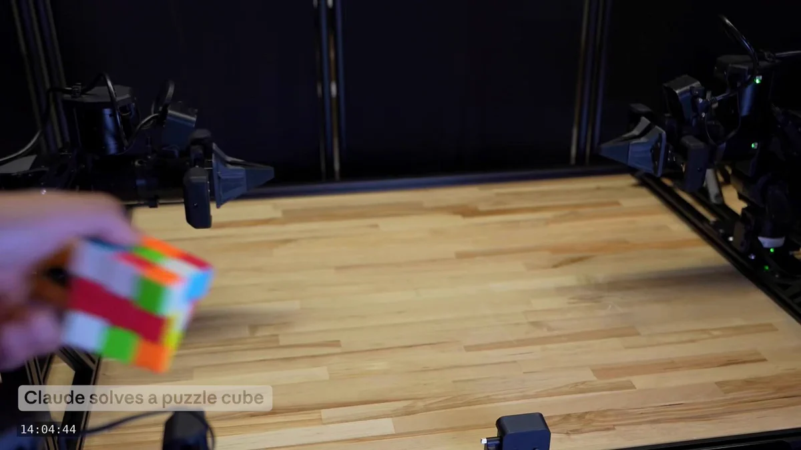

# Fable 5.2：机器人控制迁移到未训练任务

Anthropic 对 Fable 5.2 的最新介绍，把机器人控制作为重点：团队称，模型控制物理机器人的能力有明显提升，即使面对从未明确训练过的任务，也能展现相应技能。值得关注的是，变化不只是某个固定动作做得更好，而是已有控制能力能否迁移到新任务，从而减少逐任务训练，并适应更多环境变化。

## “未训练任务”不等于任意新任务

机器人通常需要围绕具体任务学习感知、规划和动作控制，因此跨任务表现是检验迁移能力的重要线索。但“从未明确训练过”不意味着模型从未接触机器人数据，也不代表它能完成任意新任务。

原帖没有披露训练数据、训练任务与测试任务的划分，也没有给出提升幅度、任务清单或成功率。目前只能确认 Anthropic 报告的跨任务控制改善，无法据此判断其泛化边界。

## RoboDojo 双机械臂基准表现

Fable 5.2 还在 RoboDojo 上接受了测试。该基准使用模拟的双机械臂机器人。Anthropic 称，Fable 5.2 的表现超过其他模型，也超过大多数专为机器人控制构建的 AI 系统。

> 图解：原帖随文提供的机器人控制演示。公开文字没有说明画面中的具体任务、运行条件或定量结果，不能仅凭演示判断性能提升幅度。

这项对比的意义在于，基线不仅包括其他通用模型，还包括专门的机器人控制系统。不过，“超过大多数”并不等于超过所有系统。由于原帖未列出参与比较的模型、评分指标和具体得分，外界仍无法还原各系统之间的实际差距。

## 模拟领先仍待真实硬件验证

物理机器人控制能力提升与模拟双机械臂基准成绩，是两项相关但不同的证据。RoboDojo 的结果可以支持 Fable 5.2 在该模拟环境中具有竞争力，却不能单独证明它在真实机器人上拥有同等优势。

回到跨任务控制这一核心问题，判断其实际价值还需要真实硬件测试、任务成功率、对比基线及运行条件等数据。现阶段较可靠的结论是：Anthropic 报告了 Fable 5.2 的跨任务控制改善和 RoboDojo 领先表现，但提升幅度与真实环境适用范围仍待验证。

> 本文参考自 [Claude (@claudeai) on X](https://x.com/claudeai/status/2119867132452221045)