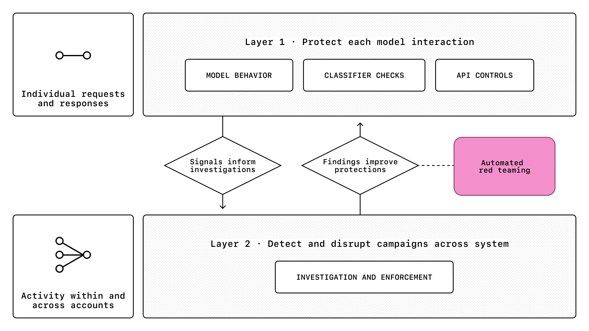

# Adversarial distillation：守住推理链，限制危险能力迁移

一个模型拒绝协助网络攻击，并不意味着它的能力不会被用来训练另一个更愿意配合的模型。攻击者可以未经授权收集前沿模型的输出，用这些数据训练能力相近的“学生模型”，再把后者部署到没有同等保护措施的环境中。OpenAI 将这种行为称为对抗性蒸馏，并在 2026 年 11 月 20 日发布的文章中介绍了相应的检测、阻断和调查方法。

这次防护的重点不是最终答案，而是模型作答时内部生成的中间推理步骤，也就是通常所说的思维链。它们可能包含最终回答没有展示的信息，因此是更有价值的训练材料。OpenAI 报告称，在针对“恢复此前请求所生成受保护推理”的内部自适应黑盒测试中，GPT‑6.2 Astra 更新防护后的平均攻击成功率为 0.2%，而采用原始防护的 GPT‑6 Astra 为 54.0%。这些结果来自 OpenAI 自己的评估，反映的是特定模型、攻击方式和测试设置，不能直接等同于对所有蒸馏攻击的防御效果。

## 为什么普通输出也可能带来安全风险

蒸馏本身是常见的机器学习技术：一个模型学习另一个模型生成的数据，包括答案、推理过程，或者对答案优劣及其原因的判断。问题在于，能力可以随数据迁移，原模型的安全约束却不会自动复制过去。

这种风险在网络安全和生物学等双重用途领域尤其明显。帮助防守者寻找软件漏洞的能力，也可能帮助攻击者利用漏洞；辅助生物研究的能力，也可能被用于开发有害病原体。如果学生模型继承了能力却没有同等防护，它就可能提供教师模型原本会拒绝、或其安全系统原本会拦截的帮助。

因此，OpenAI 的防护目标不只是阻止某一次敏感回答，而是限制攻击者持续获得可迁移的能力。其整体方案结合了对模型行为的对抗性训练、输入与输出分类器、API 控制，以及对跨账号协同提取活动的调查，防护思路与其在生物和网络安全领域采用的措施更接近。

## 精确推理轨迹比摘要传递了更多能力

为了研究推理数据究竟多重要，OpenAI 做了一项内部网络能力迁移实验。产生训练数据的模型称为教师，学习这些数据的模型称为学生。基线蒸馏只使用通常对用户可见的内容：最终回答、推理摘要和工具交互；另一组学生还能接触教师的精确推理轨迹，由此可以比较额外暴露原始思维链带来的影响。

各次训练都从同一个预训练学生模型开始。监督微调数据主要由 Astra 级别教师模型处理编程和防御性网络安全任务时产生的轨迹组成，每条轨迹包含完成任务的全步骤、工具交互和最终回答。完成微调后，学生还要接受一轮轻量级强化学习，并分别在网络安全和编程环境中评估。

监督微调之后，使用精确推理轨迹训练的学生通常优于使用推理摘要训练的学生。强化学习之后，结果出现了值得保留的条件：在文中所示两项基准的最大推理预算下，精确轨迹学生的得分仍然更高；但在较低预算下，摘要训练的学生反而得分更高。原文没有给出这组实验的具体分数，因此只能确认这种相对趋势，不能进一步推算能力差距。

这个结果支持一个更谨慎的判断：即使教师执行的是使用政策允许的防御性任务，大量精确推理轨迹仍可能把学生教会一些能泛化到其他任务的技能。保护推理轨迹因而可能限制网络能力迁移，但 OpenAI 也表示，不同学生模型和蒸馏训练方案究竟会额外迁移多少能力，仍需继续研究。Anthropic 的相关工作曾在软件工程基准 SWE-bench Verified 上报告完整推理记录相对摘要的类似优势；OpenAI 认为自己的结果说明，这种优势也延伸到了前沿网络安全领域。

## 单层拦截不够，请求防护与活动调查要形成闭环

OpenAI 将防护分成两个相互补充的层级。请求层面通过模型行为、分类器和 API 控制减少单次交互中的推理泄露；活动层面则结合请求与账号信号，识别有组织的提取行为。调查发现的攻击又会成为训练和测试防护的新样本，自动化红队发现的问题也会进入这个循环。

> 图解：左侧的请求级防护负责限制单次推理提取，右侧的活动级检测与处置负责发现跨请求、跨账号的协同行为；调查和自动化红队把新攻击反馈到两侧，形成持续更新的防御闭环。

### 在单次请求中封住多个泄露出口

模型本身需要学会拒绝提取受保护推理的请求。OpenAI 使用对抗性训练让模型识别这类尝试，同时尽量保留对正常解释和求助请求的回应。训练样本来自内部自动化红队成功实施的攻击、实际调查，以及外部研究者或行业合作伙伴负责任披露的安全弱点。

模型拒绝说出口还不够，系统还要检查输入和输出。输入分类器负责发现提取受保护推理的企图；输出分类器检查助手消息和工具调用参数中是否出现泄露，并可在可疑内容到达调用方之前将其阻断。这些检查同时覆盖流式和非流式响应。

工具调用参数被单独列出，是因为推理内容可能不进入最终答案，却被塞进某个工具的参数。只检查用户最终看到的文本，会漏掉这条出口。

API 则负责限制推理跨交互、跨模型复用。OpenAI 在 9 月披露过一类攻击：攻击者把加密推理从一个对话转移到另一个对话，再要求模型将其转换成用户可读的形式。此后，OpenAI 加强了用户、工作区、组织和模型系列之间的边界，包括关闭一条可能暴露其他用户加密推理的路径。

在 GPT‑6.2 Astra 和 GPT‑6.2 Sol 中，受保护推理会绑定到产生它的对话历史。新增消息时，模型可以继续利用先前推理；如果较早的消息被改写，API 会丢弃跟随该消息产生的推理。安全防护较弱的旧模型系列也不能读取这两个新模型的受保护推理。

### 从账号网络入手，处置协同提取活动

单次请求看似独立，也可能属于同一场规模化蒸馏活动。OpenAI 检测到未经授权的对抗性蒸馏活动后，会调查相关账号；确认违规时，再依据政策和服务条款对整个账号网络采取处置。每次调查得到的信息还会用于改进对类似活动的检测。

处置并不限于 OpenAI 自己的平台。公司会把入侵指标分享给其他模型提供商，便于对方检查各自服务上的相关滥用；其“一致标准”政策则要求部署其模型的合作方遵守共同的防护与协同处置标准。OpenAI 还表示，会在适当情况下与行业及政府分享相关发现。

## 攻击成功率怎么测，结果支持到哪里

请求级防护的评估分为静态和自适应两种。静态评估重放一组过去成功过的攻击，检查它们如今是否仍能暴露推理；自适应评估让自动化 AI 红队根据系统响应调整策略，以发现固定样本遗漏的弱点。黑盒测试只给攻击者外部用户能看到的信息，白盒测试则提供额外系统信息，以帮助构造更强的攻击。

下表来自自适应黑盒评估，测试攻击者能否恢复模型在较早请求或当前请求中生成的受保护推理。结果汇总了六个攻击者模型，ASR 即攻击成功率，数值越低越好。

| 攻击类型 | GPT‑6 Astra 原始防护：自适应提取 ASR（%） | GPT‑6.2 Astra 更新防护：自适应提取 ASR（%） |
| --- | ---: | ---: |
| 提取较早请求中的受保护推理 | 54.0 | 0.2 |
| 提取当前请求中的受保护推理 | 22.9 | 0.9 |

两种攻击在更新防护后的平均成功率都低于 1%，也明显低于 GPT‑6 Astra 的原始防护。OpenAI 表示，正在把部分防护改进应用到 GPT‑6 Astra。

活动层面的指标则不能只用一次攻击是否成功来衡量。OpenAI 还会跟踪蒸馏滥用的普遍程度，以及从发现到处置所需的时间，目标是减少蒸馏者能获得的数据量和价值、提高活动成本，并缩短对新攻击的响应时间。公司称，今年已在平台上发现多场未经授权的对抗性蒸馏活动，每周处置规模从数千到数万个账号不等，入夏以来处置频率显著上升。这些数字描述的是处置账号规模，并不能单独证明蒸馏行为已经减少。

## 蒸馏防护也被纳入国家安全政策讨论

OpenAI 将对抗性蒸馏视为国家安全风险：外国行为者如果复制美国模型的先进能力，就可能在没有原开发者保护措施的情况下部署这些能力。公司称，2 月曾向美国国会通报 DeepSeek 试图蒸馏美国前沿模型的活动；9 月又报告挫败了一场提取其模型受保护推理的活动，并将其中核心部分归因于与 Kimi 开发商 Moonshot AI 有关联的个人。这些均为 OpenAI 在文中的表述和归因，公司计划进一步披露近期处置的活动。

在政策层面，OpenAI 支持赋予美国政府更多工具，以识别和制裁非法提取美国 AI 模型能力的外国行为者，并表示支持《Chip Security Act》《AI OVERWATCH Act》和《MATCH Act》。在其论述中，出口管制限制对手获得训练前沿模型所需硬件，蒸馏防护则提高从已训练模型中获取部分能力的难度，两者相互补充。

## 其他模型平台可以直接借鉴的四项措施

OpenAI 根据自身经验给出了几组可执行建议：

- **覆盖完整交互过程。** 检查助手消息和工具调用参数中的推理泄露，并限制加密推理跨对话、跨模型复用。
- **把成功攻击变成回归测试。** 保存红队、生产监控或负责任披露发现的成功提取记录；在符合隐私政策的前提下，用这些样本改进模型训练和分类器。更新防护后既重放原始攻击，也测试自适应红队能否找到新路径。
- **同时建设请求级缓解与活动级调查处置。** 前者减少单次泄露，后者识别规模化、协同化的提取。
- **与部署伙伴统一防护和处置要求。** 在适当范围内与其他模型开发者共享专业知识，提高整个行业的最低防护水平。

OpenAI 此前也通过 Frontier Model Forum 和适当的政府信息共享渠道披露发现，同时保留可能被攻击者利用的细节。这套方法的核心并不是宣称某一种分类器或训练手段已经解决蒸馏，而是让单次请求防护、持续攻击测试和跨账号调查彼此补强。

回到最初的问题：只保护最终答案，确实不足以阻止危险能力随训练数据迁移；OpenAI 的内部实验为“精确推理轨迹值得单独保护”提供了依据，自适应红队结果也显示新防护能显著降低特定推理提取攻击的成功率。但能力迁移幅度仍受学生模型、训练方案和推理预算影响，活动处置数字也无法替代对滥用规模的持续测量。对提供前沿模型的团队来说，当前最值得优先检查的是工具参数、跨对话推理复用和协同账号行为这三个容易超出单条内容审核范围的环节。

> 本文参考自 [Combatting adversarial distillation](https://openai.com/index/combatting-adversarial-distillation)