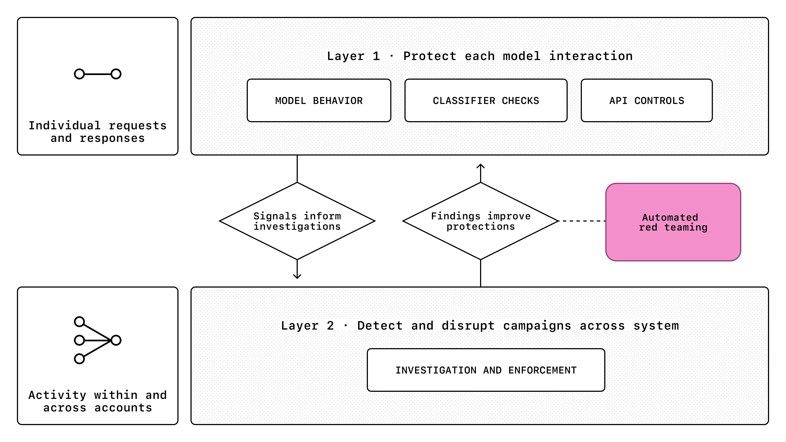

# Adversarial distillation：守住推理链，限制危险能力迁移

一个模型拒绝协助网络攻击，并不意味着它的能力不会被用于训练另一个更愿意配合的模型。攻击者可以收集前沿模型输出，训练能力相近的“学生模型”，再将其部署到缺乏同等保护措施的环境中。OpenAI 将这种未经授权的行为称为对抗性蒸馏，并于 2026 年 11 月 20 日介绍了检测、阻断和调查方法。

## 为什么推理轨迹值得单独保护

蒸馏本是常见的机器学习技术，风险在于能力会随答案、推理过程等数据迁移，安全约束却不会自动复制。在网络安全和生物学等双重用途领域，学生模型可能因此提供教师模型原本会拒绝的帮助。

OpenAI 的内部网络能力迁移实验比较了两类训练数据：基线学生只接触最终回答、推理摘要和工具交互，另一组还能接触教师的精确推理轨迹。各组从同一个预训练学生模型开始，使用 Astra 级别教师处理编程和防御性网络安全任务产生的轨迹进行监督微调，再接受轻量级强化学习。

微调后，精确轨迹训练的学生通常表现更好。强化学习后，在文中所示两项基准的最大推理预算下，这一优势仍然存在；但在较低预算下，摘要训练的学生反而得分更高。原文未给出具体分数，因此只能确认这一相对趋势。结果支持保护精确推理轨迹，但额外迁移多少能力仍取决于学生模型和训练方案，尚需继续研究。

## 单次拦截与跨账号调查形成闭环

请求级防护结合模型对抗性训练、输入与输出分类器及 API 控制。输出检查不仅覆盖助手消息，也覆盖工具调用参数，因为推理可能被藏进参数而非最终答案；流式和非流式响应都在检查范围内。GPT‑6.2 Astra 和 GPT‑6.2 Sol 还将受保护推理绑定到产生它的对话历史，限制其跨对话、跨模型复用，旧模型系列也不能读取这些推理。

单次请求看似独立，也可能属于规模化提取活动。活动级防护因此结合请求与账号信号，调查并处置整个违规账号网络；调查、自动化红队和负责任披露发现的新攻击，又会用于改进训练和分类器。

在汇总六个攻击者模型的自适应黑盒评估中，提取较早请求受保护推理的平均攻击成功率，从 GPT‑6 Astra 原始防护的 54.0% 降至 GPT‑6.2 Astra 更新防护的 0.2%；提取当前请求推理则从 22.9% 降至 0.9%。这些内部结果只反映特定模型、攻击方式和测试设置，不能代表对所有蒸馏攻击的防御效果。

OpenAI 还称，今年每周处置规模从数千到数万个账号不等，入夏以来频率显著上升；但账号处置量不能单独证明蒸馏行为已经减少。回到最初的问题，只保护最终答案确实不够，当前尤其需要检查工具参数、跨对话推理复用和协同账号行为这三个容易超出单条内容审核范围的环节。

> 本文参考自 [Combatting adversarial distillation](https://openai.com/index/combatting-adversarial-distillation)