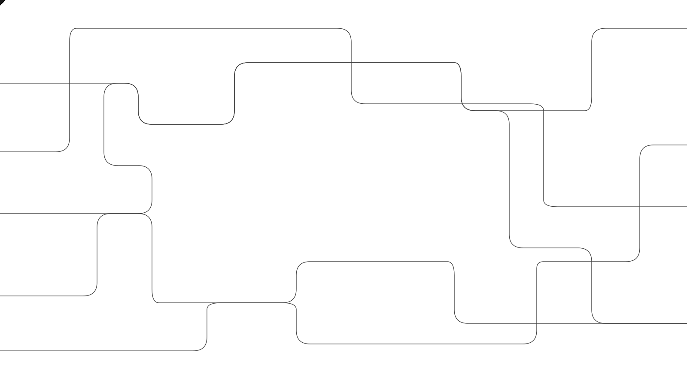

# Control Room：统一管控研究推理，35秒内停止模型输出

OpenAI 给研究基础设施加了一套集中“刹车”：当模型任务引发安全或网络安全顾虑时，Control Room 可以跨研究负载停止后续模型输出。按 OpenAI 的描述，从 Control Room 收到停止指令，到任务无法继续推进，最长间隔为 **35 秒**；如果 Control Room 自身发生故障，推理请求也会被拒绝，而不是绕过管控继续执行。

这套系统已经部署在 OpenAI 的研究基础设施中，覆盖模型训练与评测中的智能体式采样、数据处理等研究推理负载。它要解决的并不只是“如何关掉一个进程”，而是如何在模型、引擎和研究任务彼此交叉使用的环境里，可靠地切断一个任务的全部后续推理。

> 图解：Control Room 将研究负载的集中追踪、停止控制与监控系统连接起来，目标是在出现安全或网络安全问题时迅速停止模型输出。

## 为什么终止机制要放在推理层

研究负载通常由研究人员或团队自行拥有和运行，可能是强化学习实验、评测、高吞吐量采样或数据处理任务。这类代码变化频繁、形式各异，而且高度分散，并不适合承载必须始终可靠的安全机制。

OpenAI 因此把终止机制放进了推理层。与种类繁多、持续变化的工作负载代码相比，整个研究体系实际使用的推理代码路径很少，部署也更集中、统一。推理层由此成为一个瓶颈：所有研究推理都必须在这里接受 Control Room 的授权检查，关键保护不必依赖每份实验代码都正确实现。

这套设计还考虑了绕过管控的可能。OpenAI 会持续运行智能体式和程序化扫描，检查用户是否意外或恶意启动了未接入 Control Room、或禁用了该集成的推理引擎实现。也就是说，集中鉴权之外还需要持续核查，确保实际运行的引擎没有脱离这套控制面。

研究基础设施之外的模型服务则有所不同。OpenAI 表示，其外部模型服务架构本身更加集中，已经具备快速下线模型部署的运营能力，因此 Control Room 优先覆盖风险需求更突出的研究环境。

## 一个任务如何被追踪和停止

Control Room 把一次推理过程拆成三个相互协作的部分：

- **工作负载（workload）**：正在运行的任务，例如强化学习实验、评测或数据处理。每个进行智能体式推理的研究工作负载，都必须关联一个经批准的 safety case（安全案例）。
- **推理引擎（inference engine）**：直接运行在 GPU 上、负责执行模型的部分。一个工作负载可以使用一个或多个模型，这些模型可能运行在多个引擎上；同一个引擎也可能服务多个工作负载。
- **Control Room 服务**：集中记录任务，并决定它是否仍可继续生成模型输出。引擎在满足请求前先检查授权，已停止任务的请求会被拒绝。

具体流程围绕一个 `job_id` 展开。新任务启动时，工作负载代码先向 Control Room 申请新的 `job_id`；此后每次需要从模型采样 token，工作负载都会把请求和该标识一起发给推理引擎。引擎再携带 `job_id` 向 Control Room 请求授权。

如果该任务已被终止，Control Room 会拒绝推理请求，引擎随后向工作负载返回拒绝结果，阻止它继续产生模型输出。由于任务与模型、引擎之间并非固定的一对一关系，统一的 `job_id` 很关键：停止状态跟随任务，而不是只关闭某一台服务器或某一个模型实例。

> 图解：工作负载先取得 `job_id`，推理引擎再依据该标识检查授权；任务被终止后，后续推理请求会被拒绝，从而停止新的模型输出。

## 监控告警如何变成实际停止动作

Control Room 负责执行停止，但异常识别需要与监控系统配合。OpenAI 表示，其所有前沿强化学习任务都配有监控器：由另一个模型检查被训练模型的全部行为，并在发现问题时发出告警。OpenAI 近期披露的一起 DNS 相关事件，就是由监控器发现的。

监控与停止之间的链路同样使用 `job_id`。监控系统发现潜在问题后，会依据具体情况和严重程度决定是否停止任务；若决定停止，它便把带有 `job_id` 的消息发给 Control Room。Control Room 将该任务记录为已终止，下一次这个任务通过任何引擎、向任何模型请求采样更多 token 时，请求都会被拒绝。

因此，监控系统和 Control Room 承担的是不同职责：前者发现异常并作出停止决定，后者把决定落实为跨推理路径的输出阻断。仅有告警而没有执行层，任务仍可能继续运行；仅有停止系统，也不等于自动获得了识别所有异常行为的能力。

> 图解：监控系统依据告警情况和严重程度决定是否停止任务，Control Room 记录终止状态，再由推理层拒绝该任务的后续请求。

## 35 秒延迟与“故障时关闭”的取舍

OpenAI 给出的停止时间上界是 35 秒，起点是 Control Room 收到停止指令，终点是任务无法再继续推进。这并不意味着系统每次都在收到指令后立即切断输出；延迟来自推理授权所用的缓存层，而缓存是为了支撑所需的请求流量。

这也暴露了当前设计的明确边界：集中控制已经建立，但还不是即时停止。OpenAI 表示，团队正在努力把这一数值降至零，让任务能够立即结束。在那之前，35 秒仍是评估这套机制时必须保留的条件，不能把“可停止”简化成“零延迟停止”。

可靠性设计还有另一面：如果 Control Room 因系统错误而宕机，或因其他原因被禁用，包括遭到恶意行为者篡改，引擎中的集成会拒绝所有推理请求，直到服务恢复正常。这就是“故障时关闭”（fail-closed）——控制服务不可用时，默认选择停止，而非放行。

这种策略用可用性换取更保守的安全结果：集中服务故障可能让正常研究也无法继续推理，但能避免系统在最需要管控时失效。文章发布时，故障时关闭已覆盖所有前沿模型研究工作负载，OpenAI 计划在随后几天内完成其余研究负载的部署。

## 它提供了什么，又没有回答什么

Control Room 最值得关注的工程选择，是把终止能力从频繁变化的实验代码中抽离，放进少数集中、统一的推理路径，并用任务级标识贯通监控、授权和拒绝输出。对于建设模型训练或评测基础设施的团队，这一思路比单纯增加一个“停止按钮”更有参考价值：真正需要保证的是每条推理路径都受控，以及控制系统自身故障时不会静默放行。

不过，这些能力和 35 秒时间上界均来自 OpenAI 对自身系统的工程披露，原文没有提供独立测试结果。它也不能替代异常检测、安全案例或其他安全措施；当前仍存在缓存带来的停止延迟，部署范围与研究之外的服务架构也有所区别。OpenAI 表示，未来数月还会继续扩展 Control Room，并同时投入失调行为与网络安全事件的监控。

> 本文参考自 [Control Room: A central system to track and stop model workloads across our research infrastructure](https://openai.com/index/control-room)