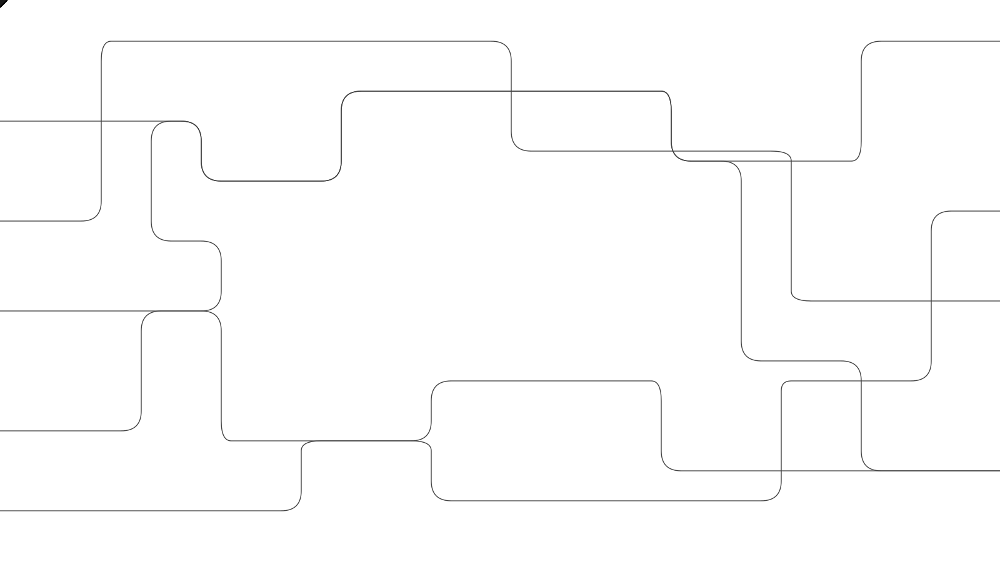

# Control Room：统一管控研究推理，35秒内停止模型输出

OpenAI 为研究基础设施增加了一套集中“刹车”：当模型任务引发安全或网络安全顾虑时，Control Room 能跨研究负载阻止后续模型输出。按 OpenAI 披露，从收到停止指令到任务无法继续推进，最长为 **35 秒**；若控制服务故障或被禁用，推理请求也会被拒绝，而非绕过管控。

系统已部署于 OpenAI 的研究基础设施，覆盖训练与评测中的智能体式采样、数据处理等负载。它解决的不是“关掉一个进程”，而是在模型、引擎和任务交叉使用时，可靠切断一个任务的全部后续推理。

## 把刹车装进推理层

强化学习实验、评测、高吞吐量采样等研究代码变化快、形式分散，不适合承载必须始终可靠的安全机制。相比之下，研究体系实际使用的推理代码路径更少、部署更集中。OpenAI 因此要求所有研究推理在这里接受 Control Room 授权，避免安全依赖每份实验代码都正确实现。

集中鉴权之外，OpenAI 还会持续进行智能体式和程序化扫描，查找未接入或禁用该集成的推理引擎。外部模型服务架构更集中，已有快速下线部署的运营能力，因此这套系统优先覆盖研究环境。

## 用 job_id 跨引擎停止任务

每个进行智能体式推理的研究工作负载，都必须关联经批准的 safety case（安全案例）。任务启动时，工作负载先向 Control Room 申请 `job_id`；之后每次请求模型采样 token，都携带该标识，由运行在 GPU 上的推理引擎向 Control Room 检查授权。

一个任务可跨多个模型和引擎，一个引擎也可服务多个任务，因此停止状态必须跟随 `job_id`，而非某台服务器。任务被终止后，后续请求会被拒绝，工作负载无法继续产生模型输出。

> 图解：工作负载取得 `job_id`，推理引擎据此检查授权；任务终止后，所有后续推理请求均被拒绝。

## 告警、延迟与故障取舍

异常识别由监控系统配合完成。OpenAI 表示，所有前沿强化学习任务都配有监控器，由另一个模型检查被训练模型的全部行为；近期披露的一起 DNS 相关事件即由监控器发现。监控系统按情况和严重程度决定是否停止，再将含 `job_id` 的消息发给 Control Room，由后者落实跨推理路径的阻断。

35 秒上界来自支撑请求流量的授权缓存，并不意味着即时停止；OpenAI 正尝试将其降至零。另一方面，系统采用“故障时关闭”：控制服务不可用时拒绝全部推理，以正常研究可能中断的可用性代价，避免管控失效时静默放行。文章发布时，该机制已覆盖所有前沿模型研究工作负载，其余负载计划在随后几天完成部署。

Control Room 的参考价值，在于把终止能力抽离实验代码，并用任务级标识贯通监控、授权和拒绝输出。但这些能力及 35 秒上界均来自 OpenAI 自身披露，尚无独立测试结果；它也不能替代异常检测、安全案例等其他措施。回到开头的问题，这套系统提供的是可靠、集中的停止路径，而不是零延迟或自动识别所有异常的保证。

> 本文参考自 [Control Room: A central system to track and stop model workloads across our research infrastructure](https://openai.com/index/control-room)