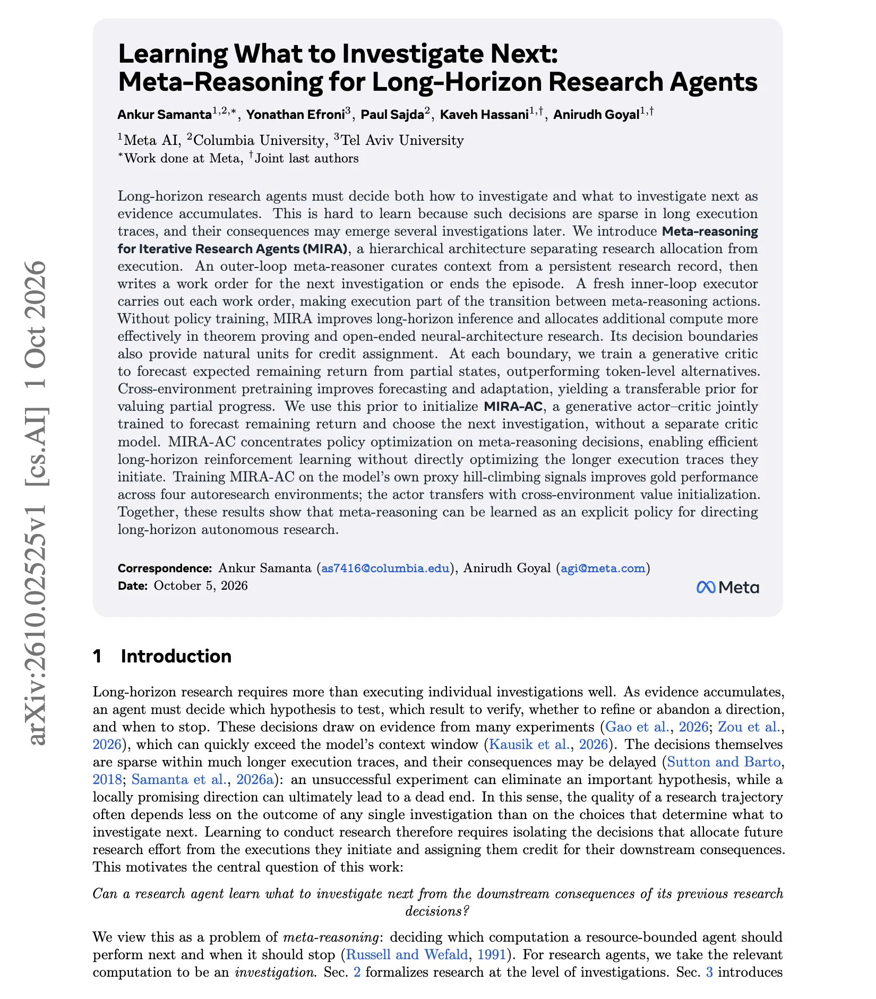

# Meta AI 新作 MIRA：让研究型 Agent 学会“下一步该查什么”

长周期（Long-horizon）研究型 Agent 面临一个核心难题：随着证据不断累积，它不仅要决定“怎么查”，更要决定“接下来查什么”。这类决策在长长的执行轨迹中非常稀疏，后果又往往要好几步之后才显现，因此极难通过强化学习学到。Meta AI 联合哥伦比亚大学、特拉维夫大学提出的 **MIRA**（Meta-reasoning for Iterative Research Agents）用一个巧妙的二分结构解决这个问题：把“研究资源分配”和“具体执行”拆成内外两层。最硬的结果是： **不做任何策略训练**，仅靠这种架构拆分就能提升定理证明和开放式神经网络架构研究的表现；而在用模型自身的 proxy 信号训练出 MIRA-AC 之后， **四个自动研究（autoresearch）环境的 gold score 全部提升**。

## 问题：为什么“决定下一步查什么”这么难学？

一个自主做研究的 Agent，本质上面临两类决策：

- **执行层**：某个具体调查怎么做——跑哪个实验、证哪条引理、试哪种架构。
- **分配层**：下一步该调查什么——验证哪个假设、细化还是放弃某个方向、何时收手。

第二类决策才是研究轨迹质量的关键。一次失败的实验可能淘汰掉一个重要假设，一个局部看似有前景的方向最终可能走进死胡同。但这类决策有两个对强化学习极不友好的特性：

1. **稀疏**：在上万 token 的执行轨迹里，“决定下一步做什么”的时刻寥寥无几，训练信号极度稀薄。
2. **延迟**：一个分配决策的后果，可能要等好几个调查周期之后才会显现，credit assignment（功劳/责任分配）非常困难。

博主点评：这其实是所有长周期 Agent 的通病——奖励稀疏加延迟反馈。MIRA 的思路不是硬刚这个难题，而是通过架构设计把问题“变形”，我们接着看。

## 核心思路：把研究 Agent 一分为二

MIRA 的全称是 **Meta-reasoning for Iterative Research Agents**，它是一个层级化架构，核心是把研究分配与执行彻底分离：

- **外层 Meta-reasoner（元推理器）**：读取一份持久化的“研究记录”（research record），从中整理上下文，然后为下一次调查写下一份 **work order（工单）** ——或者直接结束整个 episode。
- **内层 Executor（执行器）**：每个工单由一个 **全新的** executor 来完成，执行完毕后，结果回流到研究记录中，成为 meta-reasoner 下一次决策的依据。

这个设计的聪明之处在于：executor 每次都是“新鲜”的，执行过程被整体视作 meta-reasoning 动作之间的 **状态转移**。换句话说，从外层视角看，整个研究过程被压缩成一串稀疏但清晰的决策点—— **决策只发生在工单边界上**。

这样一来，原本混在长轨迹里难以学习的分配决策，就被隔离成了天然的、可对齐的训练单元，credit assignment 有了明确的落点。这就像把一本流水账改写成一份“决策日志 + 附件”：日志里只有关键决策，细节都归档在附件里。

## 从架构到训练：Critic 先行，再升级为 Actor-Critic

架构拆分只是第一步。解决了“决策在哪里发生”之后，下一个问题是：如何在这些决策点上训练出判断力？

### 第一步：在工单边界上训练生成式 Critic

作者在每个工单边界处训练一个 **生成式 critic**，让它从“部分完成的研究状态”出发，预测 **剩余回报**（expected remaining return）。这相当于让模型学会给“半成品的研究进度”打分：照目前这个局面走下去，最终能拿到多少收益？

实验显示，这种在决策边界上做预测的方式 **优于 token 级别的替代方案**。更有意思的是 **跨环境预训练**：在多个研究环境上预训练 critic，能提升预测精度和适应能力，得到一个可迁移的“评估部分进展”的先验（prior）。

### 第二步：MIRA-AC——一个模型身兼演员与评委

有了 critic 先验之后，作者用它初始化 **MIRA-AC**：一个 **生成式 actor-critic** 模型，同时进行两项训练——预测剩余回报（critic 职责）和选择下一个调查方向（actor 职责），而且 **不需要单独的 critic 模型**。

MIRA-AC 把策略优化集中在 meta-reasoning 决策上，从而实现了高效的长周期强化学习： **不需要直接去优化那些动辄上万 token 的执行轨迹**，只需在稀疏但关键的决策点上学。这就像教练只在每次换战术的瞬间给反馈，而不是对球员每一秒跑位都打分。

### 训练信号：模型自己的 proxy 爬山信号

一个务实的设计是：MIRA-AC 直接利用 **模型自身的 proxy hill-climbing 信号** 进行训练（即模型自己评估进展好坏的代理指标），结果却提升了四个自动研究环境上的 **gold 性能**（真实目标指标）。这说明 meta-reasoning 确实可以被当作一个显式策略来学习，而不只是手工设计的流程。

## 实验结果：架构免费提分，训练再加码

总结一下论文报告的关键结果：

- **无训练即提升**：不做任何策略训练，仅 MIRA 的架构拆分就能改善长周期推理，并在 **定理证明** 和 **开放式神经网络架构研究** 两类任务上更有效地分配额外算力。
- **Critic 预测更准**：在工单边界上预测剩余回报，优于 token 级预测方案；跨环境预训练带来可迁移的评估先验。
- **MIRA-AC 全面提分**：在四个 autoresearch 环境上，基于 proxy 信号训练的 MIRA-AC 提升了全部 gold score；actor 还能借助跨环境的 value 初始化实现迁移。

> 图解：论文《Learning What to Investigate Next: Meta-Reasoning for Long-Horizon Research Agents》首页截图。作者为 Ankur Samanta、Yonathan Efroni、Paul Sajda、Kaveh Hassani、Anirudh Goyal，来自 Meta AI、哥伦比亚大学和特拉维夫大学。摘要部分概述了 MIRA 的层级架构：外层 meta-reasoner 基于持久化研究记录撰写工单，内层 executor 执行工单；并说明了在工单边界训练 critic 预测剩余回报、进而初始化 MIRA-AC 的技术路线。

## 总结与展望

- **问题**：长周期研究 Agent 的“下一步查什么”决策稀疏且后果延迟，难以直接学习。
- **架构方案**：MIRA 把 Agent 拆成外层 meta-reasoner（写工单）+ 内层 executor（执行工单），决策被隔离到工单边界，credit assignment 有了天然单元。
- **训练方案**：先在决策边界训练生成式 critic 预测剩余回报，跨环境预训练得到可迁移先验，再升级为单一模型的 actor-critic（MIRA-AC）。
- **效率优势**：策略优化只聚焦 meta-reasoning 决策，无需直接优化冗长的执行轨迹。
- **结果**：零训练即有收益；训练后四个 autoresearch 环境 gold score 全部提升。

展望：MIRA 证明了“meta-reasoning 可以作为显式策略被学习”，但它的训练仍依赖 proxy 信号与 gold 目标之间的对齐质量——当代理指标与真实研究价值出现偏差时，这种自我评估驱动的训练是否会累积偏差，是值得继续观察的方向。

## 原文图表补充

> 图解：原始推文作者 DAIR.AI（@dair_ai）在 X 平台上的头像。

> 本文参考自 [Learning What to Investigate Next: Meta-Reasoning for Long-Horizon Research Agents](https://arxiv.org/abs/2610.02525)，原始推文见 [DAIR.AI (@dair_ai) on X](https://x.com/dair_ai/status/2107482016342233309)