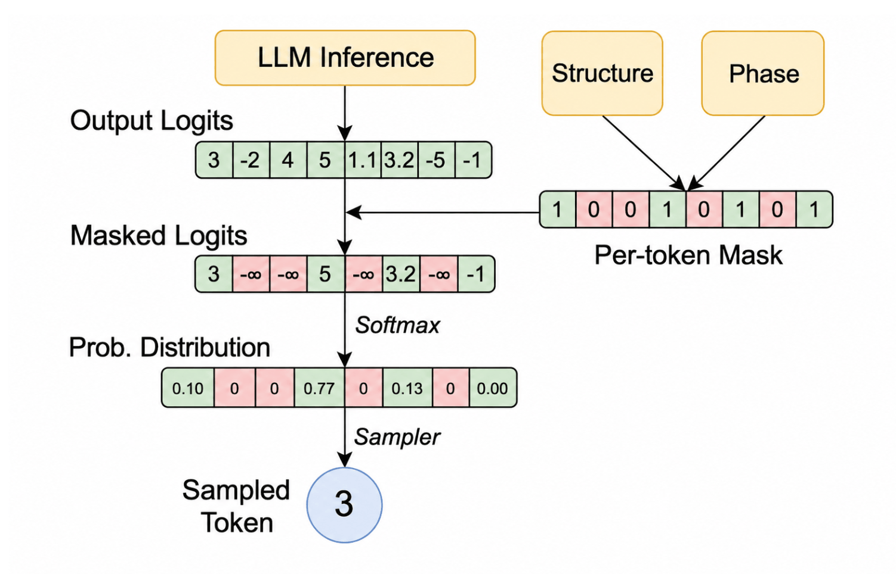

# vLLM：工具调用 Schema 准确率升至 100%

Ubicloud 团队用 vLLM 0.28 部署 Kimi K2.6 时，只有 92% 的工具调用符合预期 schema，相当于每 25 次调用约有 2 次失败。对需要连续调用工具、反复读取上下文的 Agent 来说，这不只是偶发的格式瑕疵：错误信息会进入后续上下文，重试还会增加成本，并拖低后续回答质量。

团队最终采用的不是更复杂的提示词，而是**约束解码（constrained decoding）**：在生成过程中屏蔽不符合工具语法和参数 schema 的 Token，而不是等模型输出完整 JSON 后再检查。启用该功能后，他们在 K2VV ToolCall 基准上把 schema 准确率从 92% 提升到 100%。不过，这个数字只代表结构合法，并不意味着模型一定选对了工具或填对了参数值。

## 一次工具调用，要跨过几道格式关卡

让模型使用外部工具，首先要告诉它有哪些工具可用，以及每个工具接受什么参数。例如，OpenCode 连接 Kimi 时，会发送一个 JSON 数组描述工具。其中，`webfetch` 用于抓取网页，要求必须提供字符串类型的 `url`，还可以选择 `text`、`markdown` 或 `html` 作为返回格式。

```json
[{
  "type": "function",
  "function": {
    "name": "webfetch",
    "parameters": {
      "type": "object",
      "properties": {
        "url": { "type": "string" },
        "format": {
          "type": "string",
          "enum": ["text", "markdown", "html"],
          "default": "markdown"
        },
        "timeout": { "type": "number" }
      },
      "required": ["url"]
    }
  }
}]
```

推理引擎不会把这段 JSON 原样交给模型，而是按模型训练时使用的格式，在外层加上专用 Token。Kimi 的工具声明大致会被包装为：

```text
<|im_system|>tool_declare<|im_middle|>[{"type":"function","function":{...}, ...]<|im_end|>
```

这些参数名称、类型、必填项和枚举值共同构成工具的 **schema**。当用户要求抓取网页时，模型可能生成一段自然语言说明，再接上工具名、调用索引和 JSON 参数。推理服务器的解析器负责剥离 Kimi 专用标记，把它们转换成 Agent 框架能够执行的标准工具调用对象。OpenCode 执行 `webfetch` 后，再把结果送回模型，进入下一轮对话。

因此，一次调用至少涉及两层转换：先按模型约定生成专用 Token，再由解析器转成框架所需的 JSON。任何一层不符合约定，工具都可能无法执行。

## 92% 为什么仍然不够

最简单的工具调用方式，是让模型自由生成，再相信训练已经教会它遵守格式。现代模型大多数时候确实能做到，但“大多数时候”与 Agent 所需的稳定性并不等价。多轮任务会不断累积工具结果；一次畸形调用带来的报错和重试，不只是损失一次请求，还会成为后续模型继续阅读的上下文。

为了检验服务质量，Moonshot AI 发布了 **K2VV ToolCall** 基准。它包含 2000 个请求，分别考察两个容易混淆的指标：

- **触发相似度（trigger similarity）**：服务决定何时调用工具，这些决策与 Moonshot AI 自家服务有多接近。
- **Schema 准确率（schema accuracy）**：已经生成的工具调用中，有多少符合给定 schema，因而能够被成功调用。

Ubicloud 报告的 92% 和 100% 指的是后者。即使 schema 准确率达到 100%，也仍需单独判断模型是否在该调用工具时触发、是否选择了合适的工具，以及参数内容是否符合用户意图。

自由生成之所以会产生非法结构，根源在于语言模型按概率选择下一个 Token，本身并不运行编译器或类型检查器。训练数据里还存在大量工具集合、schema 和命名惯例；当这些经验与当前部署环境不完全一致时，模型可能生成训练时见过、当前却并不存在的名称。例如，可用工具叫 `web_search`，它却输出 `search_web`；当前 schema 要求 `location`，它却填写 `city_name`。

## 约束解码：把事后检查改成生成时拦截

普通解码会为每个候选 Token 计算概率，再按概率采样。约束解码增加了一层实时筛选：推理引擎根据工具语法和参数 schema，计算当前位置允许出现哪些 Token，把其余候选屏蔽掉，然后才让模型从合法集合中选择。

这有点像在自动填空时实时限制可选答案，而不是填完整张表后再退回去修改。模型仍决定生成什么，但选择范围始终限定在当前语法能够接受的路径上。

vLLM 使用 XGrammar 库的结构化标签实现这一机制。针对 Kimi K2.6，规则描述了工具调用从哪里开始、名称和索引出现在哪里、参数从哪里开始，以及参数必须遵守哪份 JSON Schema。简化后的定义如下：

```python
TagFormat(
    begin=f"{TOOL_CALL_BEGIN_PREFIX}{name}{TOOL_CALL_SUFFIX}",
    content=SequenceFormat(
        elements=[
            RegexFormat(pattern=r"\d+"),
            ConstStringFormat(value=TOOL_CALL_ARGUMENT_BEGIN),
            JSONSchemaFormat(
                json_schema=parameters,
                any_order=any_order,
                max_whitespace_cnt=max_whitespace_cnt,
            ),
        ]
    ),
    end=TOOL_CALL_END,
)
```

在这套规则下，生成必须沿固定路径前进：

**开始工具调用 → 工具名 → 调用索引 → 开始参数 → 符合 schema 的 JSON → 结束工具调用。**

如果当前位置要求整数索引，引擎就只保留整数相关 Token，其他候选会被掩码排除。进入参数阶段后，限制则来自具体工具的 JSON Schema，因此必填字段、字段类型和枚举值不再只靠模型自觉遵守。



> 图解：XGrammar 根据当前结构化生成的位置计算合法 Token 集合，并通过掩码排除非法候选。模型仍从剩余候选中采样，但无法沿会导致格式错误的路径继续生成。该图源自 Dong、Yixin 等人的论文《XGrammar: Flexible and efficient structured generation engine for large language models》（MLSys 2025）。

关键在于，这把 schema 合规从“尽力而为”变成了**运行时保证**。原文称其实际性能开销可以忽略：XGrammar 会预先计算各阶段的 Token 掩码，并在生成时高效地应用到 GPU 上。不过，文章没有给出具体延迟或吞吐测试数字，因此更稳妥的理解是，团队没有观察到值得权衡的显著开销，而不是所有部署都完全没有性能成本。

## 功能正确，不代表应该默认开启

约束解码看似只有收益，Ubicloud 的实际经历却说明了部署中的另一层问题。Moonshot AI 建议开启约束解码，其自家 API 也采用了这一行为。Ubicloud 最初在自己的 vLLM 分支中加入该功能；vLLM 从 v0.25 开始支持后，他们切换到上游实现，用于 Kimi 和 DeepSeek。不久之后，工具调用准确率却回落到 91%。

排查结果显示，vLLM 的约束解码实现本身仍然正确，变化在于：**未显式开启该功能的请求，默认行为被调整了。**这与 vLLM 面向多种模型的定位有关。结构化约束需要适配每个模型的工具格式，而默认强制开启暴露过三类问题：

- **通用模型适配问题**：有些模型自由生成时的输出与目标 schema 或工具格式差异很大。强行限制可能迫使模型选择原本不会选择的 Token，使生成偏离正常路径。gpt-oss-20b、Qwen 3.6 和 GLM 5.1 的用户都报告过默认开启后的问题。
- **语法转换缺陷**：把工具 schema 或模型工具格式翻译成专用语法时，可能产生非法调用、请求失败、约束被静默跳过，或调用准确率下降。
- **功能交互缺陷**：约束解码与其他推理功能组合时也可能出错。例如，它与投机解码交互的一个问题，会让语法错误地拒绝投机 Token，最终导致请求失败。

因此，对一个模型无关的通用推理引擎来说，默认关闭是更保守的选择。vLLM 随后提供 `--tool-strict-level` 参数，让部署者按需开启工具调用严格模式；该能力以服务端开关的形式在 vLLM 0.31 中发布。

Ubicloud 的目标则更集中：让 Kimi 和 DeepSeek 的服务质量接近用户对第一方服务的预期。团队启用约束解码后重新运行 K2VV ToolCall，确认所有已服务模型版本的 schema 准确率均达到 100%，才把改动部署到生产环境。这里真正值得借鉴的不是“所有模型都应强制开启”，而是**先针对目标模型验证，再改变默认值**。

## 模型质量也取决于推理配置

这次排查把问题定位到了模型权重之外：推理引擎、工具格式适配和默认参数，都会改变用户实际看到的结果。对正在部署 Kimi K2.6、DeepSeek V4 Flash 或类似 Agent 工作负载的团队，可以从三件事入手：

- 把触发决策与 schema 合规分开测试，避免用一个“工具调用准确率”掩盖不同故障。
- 检查所用 vLLM 版本及 `--tool-strict-level` 配置，不能假设上游支持约束解码就等于请求已经启用。
- 在目标模型上验证后再开启，并覆盖语法转换、投机解码等实际使用的功能组合。

K2VV ToolCall 上从 92% 到 100% 的结果，证明约束解码能解决这类部署中的**结构合法性**问题；它不证明工具选择、参数语义或最终任务成功率同样达到 100%。对多轮 Agent 而言，这个边界很重要，而消除本可避免的格式错误，正是让后续质量评估更可靠的一步。

> 本文参考自 [Fixing Tool-Call Accuracy in vLLM](https://www.ubicloud.com/blog/fixing-tool-call-accuracy-in-vllm)