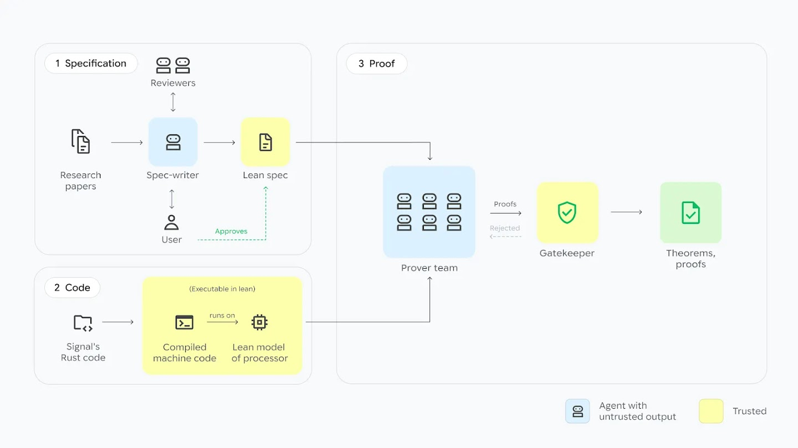
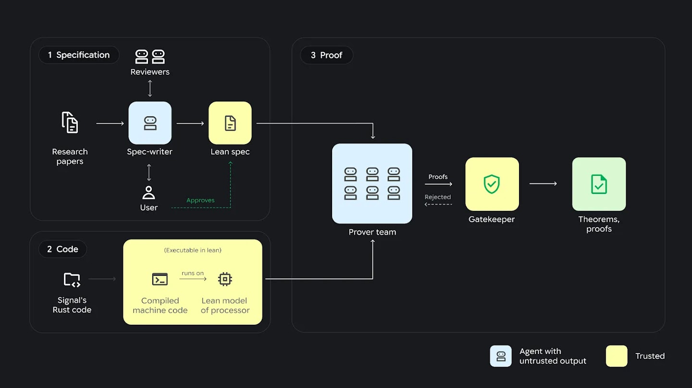

# AlphaProof Code：超600万行Lean证明验证Signal实现

> 图解：题图用多层透明材质象征软件验证的不同层次；本文关注的关键变化，是从协议设计进一步深入实际代码。

Google DeepMind团队报告，他们用四周时间验证了Signal核心密码学代码的关键安全性质。过程中，AI智能体生成了超过600万行Lean证明，Lean负责自动检查证明；智能体审计后，只将代码库的1%标记为需要人类再次查看。

这项工作针对的不是一份理想化的协议设计，而是最终在设备上运行的编译后代码。团队称，这是AI首次以这样的深度参与广泛部署的密码协议形式化验证，也是此类广泛部署协议的实现首次通过任何方法获得形式化验证。

## 为什么验证协议设计还不够

Signal协议支撑着Signal、Google Messages等应用中数十亿次私密对话的保护。类似的密码协议也广泛存在于网上银行、网页浏览等数字通信中，一个缺陷可能同时影响大量用户，因此学界和工程界已经对其进行了数十年的形式化分析。

但许多验证止步于设计层：数学模型可以证明协议设计满足某些安全目标，却不能自动证明程序员写出的实现与模型完全一致。现实中的漏洞往往藏在这段差距里，例如设计正确而具体代码没有忠实实现设计。越过这一层直接验证实现，证明的复杂度也会随之大幅增加。

AlphaProof Code要解决的正是这个问题。它验证的性质包括：即使设备曾暂时遭到攻破，设备被攻破前后的消息仍受到保护。最终结论落在设备实际运行的代码上，而非仅落在抽象设计上。

## 人类确定目标，智能体完成证明

AlphaProof Code是一个由多种大语言模型共同组成的智能体框架，分工方式接近研究团队：人类专家与AI共同决定“要证明什么”，一组AI智能体再负责“如何证明”。

研究人员先与多种模型协作，把Signal的安全目标翻译成正式的数学规范，每一条规范都由人类专家审核。这一步决定了证明最终表达的安全含义，因此没有完全交给模型。

随后，由Gemini Carbon驱动的智能体开展证明工作，生成超过600万行Lean代码。Lean是一种用于表达并检查数学证明的计算机语言；在这里，它不是多运行几组测试，而是检查证明链条是否成立。

> 图解：AI智能体先协助用户编写规范，再自主证明实现满足规范；每份证明都交由Lean检查，而不是直接接受模型给出的结论。

证明完成后，智能体还会审计证明并标出值得人类重新审视的部分。需要二次查看的代码只占1%，其余部分由Lean自动检查。人工审核并没有消失，而是集中在规范确认和少数更需要判断力的区域。

> 图解：这一流程把规范编写、实现证明和机器检查连接起来；人类专家负责审核安全规范，并复查智能体标出的重点部分。

## 四周完成验证，还用旧缺陷做了反向检查

团队报告，整个验证过程耗时四周，而同类任务过去通常需要专家团队投入数年。这个时间对比来自项目团队的报告，但它显示了智能体分工和机器检查可能带来的工程收益：人不必平均审查每一行，而可以把精力投向规范与关键疑点。

团队还测试了系统能否区分正确代码和含缺陷代码。他们把两个真实存在、此前已经修复的缺陷重新引入一个隔离的Signal代码版本。在两个案例中，系统都生成了经机器检查的证明，证明含缺陷版本并不安全。

这项测试很重要，因为对一个验证系统而言，只对正确实现给出“通过”并不够。重新引入已知缺陷后仍能证明其不满足安全要求，为证明过程没有空洞地放行代码提供了额外证据。

Signal首席技术官Ehren Kret认为，过去受大量人工工作限制，生产代码与密码设计的严格匹配往往只能在较小范围内验证；将实际代码自动转换为有效Lean定理，为扩大验证范围提供了新的路径。他表示，核心Signal协议经过自动定理证明的严格验证后，团队对代码兑现隐私承诺有了更强信心。

## 证明的边界与下一步

这次结论有明确边界：它覆盖Signal的核心密码学实现，以及人类专家所指定的关键安全性质，并不等于证明整个Signal应用或所有可能的安全问题都不存在。数学规范仍需要人类审核，1%的代码也仍需要进一步查看；AI改变的是证明与审查的分配方式，而不是取消人的责任。

团队认为，这次工作为医疗设备固件、电网软件等其他关键系统奠定了基础，但这些应用仍是后续方向，不是本次已经完成的结果。要扩大这类技术的适用范围，还需要继续研究。DeepMind也提出，可将形式化验证与CodeMender等自动化防御智能体结合，以应对AI驱动的网络威胁在速度和规模上的挑战。

项目团队正在开源本次形式化验证产物，供社区使用。对于关注高保障软件、密码协议实现或AI辅助证明的人，最值得进一步查看的不只是“600万行”这个规模数字，而是开源产物中的安全规范、实现与定理之间的对应关系，以及Lean实际检查的证明范围。

> 本文参考自 [Introducing AlphaProof Code: a breakthrough in verifying complex software at depth](https://deepmind.google/blog/introducing-alphaproof-code/)