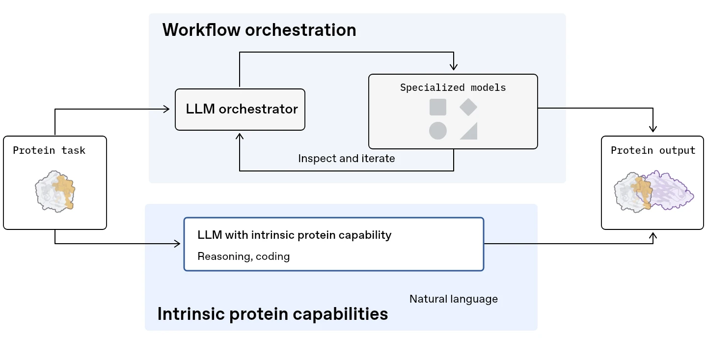
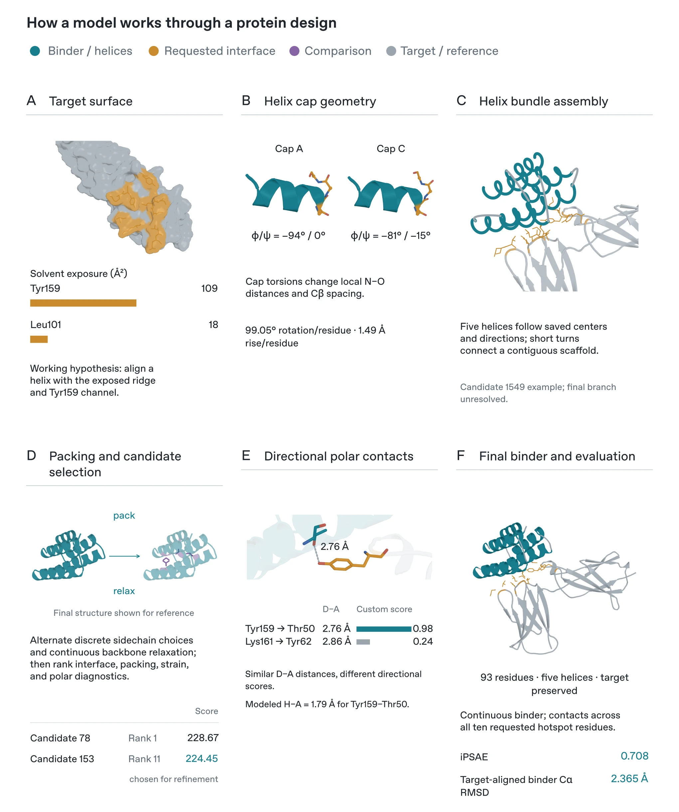
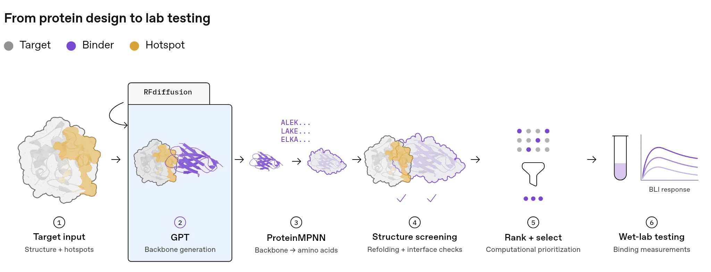
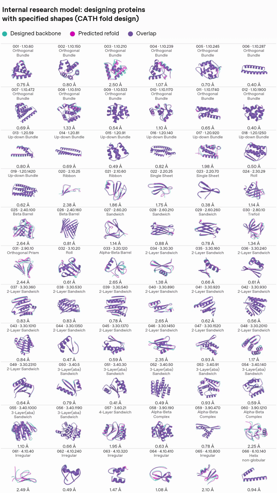
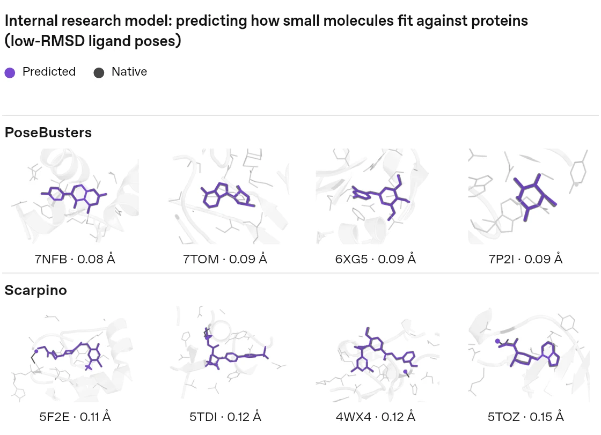
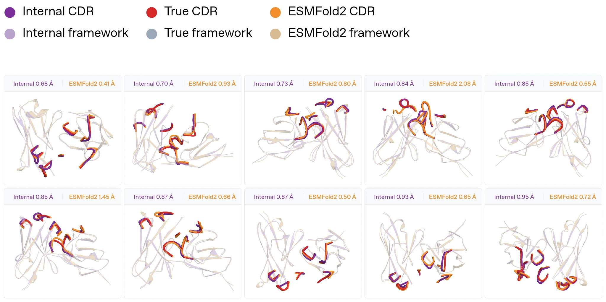

# GPT-6：靠推理和代码设计蛋白，实验验证结合

一个通用大模型能否不只讨论蛋白质，而是真正提出可供实验室检验的设计？OpenAI 与研究机构 Onava 给出了一组早期答案：在针对 5 个靶标的实验中，团队测试了 322 个基于 GPT-6.2 结构设计的小型结合蛋白，其中 35 个表现出与预期靶标结合的迹象，占比为 10.9%。模型还重新设计了小型结合蛋白和抗体的氨基酸序列，多批候选在实验中保留了结合能力。

这并不等于 GPT-6 已经能独立替代整条蛋白质设计流程。实验仍借助专用模型生成部分序列、预测结构并筛选候选，完整蛋白质结构预测也仍是明显短板。这项研究真正展示的变化是：通用模型可以依靠推理和通用编程工具，承担骨架生成、序列重设计、分子对接等过去由不同专用模型分别处理的任务，并通过自然语言接受更细致的设计约束。

## 通用模型切入的是哪一段蛋白质设计流程

蛋白质由氨基酸连接而成，氨基酸的排列顺序称为序列。序列会影响链如何折叠成三维结构，结构又进一步决定蛋白质能完成什么功能。设计蛋白质因此包含两个紧密相连的问题：什么形状可能实现目标功能，以及什么序列能够折叠成这个形状。

例如，研究者可能希望设计一种蛋白，阻断癌细胞用来逃避免疫系统的信号。过去，这类工作通常需要组合多种专用生物模型：有的生成三维骨架，有的为骨架设计序列，还有的预测结构或评估结合可能性。它们各有输入格式和约束，若要加入一种新的条件，往往需要修改软件或重新训练。

GPT-6 的尝试是把其中若干环节交给同一个通用模型。模型用自然语言接收任务，写出并运行代码来探索结构和序列，而不是调用专用生物模型直接生成这些设计。研究团队在 14 项蛋白质任务上测试了不同代际模型，并报告最新模型在多数任务上与专用模型相当或更好，但完整结构预测除外。

> 图解：这项研究关注的不是单个预测工具，而是通用模型能否借助推理和代码参与蛋白质设计流程，并在不同任务之间切换。

这种统一接口带来的直接好处是约束可以写进提示词。研究者可指定小型结合蛋白应接触靶标的哪个位置，也可要求它采用全螺旋、全折叠或混合结构，甚至规定螺旋和折叠的数量。团队称，一个内部模型在三维设计中几乎完全遵循了这些数量要求。分子对接任务也类似：如果已经知道小分子与蛋白质之间由哪两个原子成键，就可以把这条信息直接交给模型，再让它推断分子的其余部分如何放置，无须为此重新训练。

## 从文字推理到可制造的蛋白质

计算测试显示，GPT-6 系列可以参与小型结合蛋白设计、围绕指定结构特征搭建蛋白、预测分子相互作用，以及评估序列变化对稳定性和结合的影响。团队还保留了模型的文字推理和代码，用来观察它如何拆解问题。

在一个针对 IL-7Rα 的设计例子中，模型先分析靶标表面以及两种蛋白可能的相互作用，再安排五段螺旋形成整体形状，随后编写和运行代码，探索能够支持这种结合的结构与氨基酸选择。这里体现的是数学、物理、化学、编程与蛋白质知识的组合，而不是一次直接输出答案。

> 图解：模型检查靶标表面，将五段螺旋组织成候选蛋白形状，并计算它与靶标能否配合。文字推理与代码共同构成了设计过程。

不过，纸面上的三维形状还不能直接送进实验室。第一道湿实验因此采用了一条明确分工的流程：向预发布版 GPT-6.2 提供 5 个靶蛋白的三维结构，并标出希望小型结合蛋白附着的位置；GPT-6.2 用代码生成候选骨架；专用模型 SolubleMPNN 为这些骨架提出氨基酸序列；其他专用模型再预测候选能否按设计折叠、能否在指定位置结合，帮助筛选待测试对象。

> 图解：GPT-6.2 负责提出小型蛋白的三维形状，专用模型补充序列并参与筛选，Onava 随后制造和测试这些蛋白。该流程不是完全脱离专用模型的端到端设计。

在计算质量评估中，GPT-6.2 的三维设计得分略低于专用设计模型 RFdiffusion，而团队最新的内部模型得分更高。真正进入实验室的是基于 GPT-6.2 设计制造的候选：322 个候选中有 35 个检出预期结合，具体为 PD-L1 5 个、IL-7Rα 3 个、TrkA 1 个、VEGF-A 8 个、IL-17A 18 个。五个靶标都至少获得了一个有结合迹象的候选。

> 图解：灰色为目标蛋白，彩色部分比较设计与计算预测的折叠和结合位置。它们展示了候选形状，不代表结合后的全部生物学效果。

原始 RFdiffusion 研究报告过更高的命中率，但 OpenAI 提醒，这类比例高度依赖实验前的筛选严格程度以及“结合”的判定定义，不能只按百分比判断两种方法的优劣。这组实验能够支持的结论更谨慎：GPT-6.2 提出的三维设计经过专用模型补充序列和筛选后，确实能转化成在实验室中显示目标结合的蛋白质。

## 不只看懂结构，还能给出不同的序列

第二道实验把更难的一步交给 GPT-6.2：给出已有小型结合蛋白与靶标配合的三维模型，隐去原始氨基酸序列，让模型重新提出序列，专用模型仍参与候选筛选。

其中三组起始结构来自经计算预测、且已确认能结合的蛋白。初次实验筛查中，MDM2 的 88 个设计有 75 个显示结合，占 85%；VEGF-A 的 42 个中有 26 个，占 62%；PD-1 的 59 个中有 8 个，占 14%。新序列与原序列的差异也不小：每个靶标组内，序列差异比例的中位数分别为 MDM2 43%、VEGF-A 50%、PD-1 15%。

团队还使用了三个此前未公开、由 GPT-6.2 生成的小型结合蛋白结构，其中两个针对 PD-L1，一个针对 IL-7Rα。每个结构原本都有一条由 ProteinMPNN 提供、并已显示结合的序列。GPT-6.2 针对这些结构另外提出序列后，107 个受测蛋白中有 14 个显示结合，占 13.1%。

同一个 PD-L1 小型结合蛋白结构提供了更具体的对照。GPT-6.2 给出的两条序列各长 90 个氨基酸，与原始序列分别有 52 个和 58 个位置不同，两条新序列彼此之间也有 44 个位置不同。由于起始结构未公开，而且同一结构能得到差异显著且均有结合迹象的序列，团队认为这为“能力不只是记住训练数据”提供了较强证据，也说明模型有潜力同时参与结构和序列设计。

## 抗体改造先验证“改后仍能结合”

抗体设计常涉及亲和力成熟，也就是改造与靶标接触的环区，让抗体结合得更紧；另一项目标是提高选择性，减少与相似蛋白的非预期结合。OpenAI 此次测试的是更基础的一步：换掉关键环区的序列后，能否保留对原靶标的结合。

第一轮使用 6 个都识别 IL-4Rα 的小型抗体 VHH。研究者提供预测三维结构和大部分序列，隐去三个参与结合的环区，让 GPT-6.2 重新设计。182 个受测设计中，128 个显示与 IL-4Rα 结合的迹象，占 70%。

第二轮面向 5 个已有治疗性抗体。模型获得完整原始序列，并被要求对三个结合环各改造约一半氨基酸，其余序列保持不变。团队把改造部分作为抗体片段进行实验，在 272 个片段中，179 个仍显示对原靶标 PD-1 或 PD-L1 的结合，占 66%。这些结果证明了保留结合的改造空间，但尚未证明亲和力、选择性或治疗效果得到提升。

## 自然语言约束能细化到什么程度

除了结合实验，团队还用多项计算基准检查模型能否接受更具体的结构要求。可编程结构设计的一个长期目标，是让研究者像描述图像一样描述蛋白：不仅要“能结合”，还要说明在哪里结合、采用什么整体形状，以及结合界面应出现哪些相互作用。

在小型结合蛋白任务中，模型持续生成了接触指定靶标位置的设计。更细的条件还包括结合后哪些靶标氨基酸应被包埋，以及结合双方是否通过“β 折叠—β 折叠”等特定方式相互作用。这里的证据来自计算评估，不能等同于这些界面要求都已在实验室实现。

### 固定关键局部，再补全整个蛋白

酶能够加快化学反应。设计新酶时，研究者可能知道反应中心附近几个关键氨基酸必须怎样排列，但这些氨基酸在线性序列上可能相距很远。所谓“motif scaffolding”，就是固定这组局部三维关系，再设计其余蛋白，使链条折叠后能把它们带到正确位置并稳定住。

团队从 MotifBench 选取 30 个挑战，覆盖酶和蛋白结合位点。模型得到称为 motif 的固定氨基酸空间排布后，用编程工具设计其余结构。每个设计再由 ProteinMPNN 给出 8 条候选序列，并用 ESMFold 预测折叠。只要至少一条预测结构既保留 motif，又与模型设计的整体结构接近，就记为成功。

初步分析中，最新内部模型有 43.7% 的受评设计同时满足两项标准，RFdiffusion 为 27.8%。这支持模型具备围绕局部约束补全结构的计算能力，但还没有验证这些蛋白能否真正催化目标反应或完成其他预期功能。

> 图解：金色为必须保持固定形状的局部区域，彩色结构用于比较模型设计与计算预测。只有金色的面板表示没有设计通过计算检查。

### 指定整体折叠，难在链条走对路径

另一项任务不再只固定局部，而是指定整个蛋白的折叠类型。研究者给出链长和 CATH 结构分类代码，模型需要确定每个氨基酸在三维空间中的位置。

不少设计抓住了要求的大致布局，真正困难的是链条连接各部分的顺序。两个蛋白可能都把若干螺旋堆成相似束状结构，但链条穿过这些螺旋的先后路径不同，最终仍不是同一种折叠。成功标准要求至少一条序列被预测为具有指定折叠，并且与模型的三维设计接近。在 200 个挑战中，最新内部模型有 18.9% 的受评设计通过，专用模型 Proteina 为 17.1%。

> 图解：任务包括生成螺旋束或折叠层等指定形状。彩色部分展示入选设计与计算预测较接近的例子，而非全部 200 个挑战。

## 对接与突变排序表现较强，但证据边界不同

小分子对接要预测药物一类的小分子在蛋白上的结合位置和朝向。研究者从实验解析的复合物结构出发，在计算机中移除小分子，只向模型提供蛋白结构和描述原子连接关系的 SMILES 字符串，再要求它还原结合方式。

在未提供结合位点的 PoseBusters 测试中，GPT-6.2 有 93% 的已评分预测与实验观察到的位置和朝向接近，最新内部模型为 96%，专用模型 DiffDock-L 为 50%。Scarpino 数据集则包含 179 个蛋白与小分子形成化学键的结构。团队明确告诉模型哪两个原子成键后，GPT-6.2、最新内部模型和 DiffDock 的接近实验结构比例分别为 92%、97% 和 60%。后一组结果说明提示词能注入已知约束，但也意味着测试条件比完全未知结合方式时更具体。

> 图解：灰色为蛋白，紫色是模型预测的小分子位置，青色是既有实验确定的位置。图示例子中两者接近，对应位置和朝向均较准确的预测。

抗体—蛋白对接采用另一项指标。研究者分别提供数百对抗体和靶蛋白，并隐藏表面的全部侧链原子细节，让模型预测结合位置与朝向。在各模型最高的受评估计算量设置下，平均 DockQ 分数从 GPT-5.6 的约 0.05，提升到 GPT-6 的 0.28、GPT-6.2 的 0.57，再到最新内部模型的 0.81；DockQ 越高，表示越接近实验观察到的排列。

> 图解：每行比较四个模型，彩色为预测，深灰色为实验观察位置。不同代际模型的预测逐步接近实验结构。

但这些结构来自公开数据，模型训练时可能见过相同或相似的抗体—靶标组合，因此成绩不能直接外推到陌生靶标。团队把逐代提升视为对更困难对接问题的乐观信号，而不是已经解决泛化的证明。

突变排序测试则更接近实验前的候选取舍。团队使用四个公开实验数据集，每次提供原始蛋白序列和 50 个突变版本，说明实验测量的是稳定性、活性或结合能力，但不提供结果，也不允许模型使用代码，只让它通过推理排序。

在室温下预测蛋白是否折叠的稳定性研究中，排序与实验顺序的一致程度用秩相关表示：1 为完全一致，0 表示没有一致关系，−1 为完全相反。在 265 组测试中，平均分从 GPT-5.6 的 0.41 上升到 GPT-6 的 0.52、GPT-6.2 的 0.57 和最新内部模型的 0.66。在四个数据集上，GPT-6.2 与最新内部模型的平均排序也都比专用蛋白模型 ESM2-650M 更准确。若这一能力在更多陌生蛋白上成立，它可能帮助研究者优先制造更有希望的版本，减少每轮实验的候选数量。

## 完整结构预测仍是清楚的能力缺口

前面的流程多次使用专用模型判断一条序列能否折叠成设计结构。为了检查通用模型能否自己完成这一步，研究者提供已知三维结构的蛋白序列，只让模型使用基础编程工具预测折叠，并用 TM-score 评价。1 表示完全匹配，高于 0.5 通常意味着抓住了整体折叠。

最新内部模型在个别样例上能重现早期模型漏掉的折叠，但整体平均成绩仍低：GPT-5.6 为 0.16，GPT-6.2 为 0.26，最新内部模型为 0.38，而 ESMFold2 达到 0.93。这解释了为什么当前设计流程还不能直接撤掉专用结构预测模型。

> 图解：每个模型都收到相同序列，彩色为预测，深灰为实验结构。个别改进没有消除平均 TM-score 与 ESMFold2 的明显差距。

补全局部结构相对容易一些。团队对 100 个抗体片段提供序列和周围三维结构，隐藏用于识别靶标的六个环区。最新内部模型经常能较准确地预测这些环的形状与位置，但 ESMFold2 即使只依据完整序列，整体准确性仍然更高。

> 图解：模型拿到不完整的抗体结构，预测缺失的 CDR 区域。彩色区域比较内部模型、ESMFold2 与实验结构，局部补全表现不代表完整结构预测问题已经解决。

## 这项研究目前能说明什么

OpenAI 对限制的说明与实验结果同样重要。整个蛋白设计活动使用了 Boltz-2、OpenDDE、ESMFold2 等专用结构预测模型筛选候选，因此结果只支持 GPT 模型在骨架生成和序列重设计两个阶段展现出可与专用模型相比的内在能力，尚不能证明它能在零样本、无专用模型帮助的条件下，端到端生成全新小型结合蛋白。

不同任务之间的表现也不均衡。分子对接、结构约束设计和突变排序的强结果，与完整结构预测的明显落后同时存在。某些“从结构反推序列”的基准若出现异常高准确率，还可能受到记忆或数据生成过程遗留模式的影响，不能单独证明对陌生蛋白可靠。

实验室中的“结合”也只是候选筛选的一步。要成为研究工具或药物，还需验证选择性、稳定性、生物活性，以及治疗用途所需的安全性和有效性。OpenAI 下一步计划挑战更难的靶标，设计结合后能产生特定生物效应且便于制造的分子，并把对象扩展到多靶标分子、RNA、小分子和可促使细胞降解特定蛋白的 PROTACs。团队也表示将依据 Preparedness Framework 评估生物安全风险，因为同样的设计能力可能被滥用。

所以，这项研究最值得关注的不是“通用模型已经取代蛋白质专用模型”，而是自然语言、推理与代码开始把多个设计环节连接到同一接口上，并已有一批候选通过初步结合实验。对从事蛋白设计的研究者而言，它可能减少在不同工具间转换约束的成本；但要判断它能否缩短完整研发周期，还需要陌生靶标、功能验证和更少专用模型参与的后续实验。

> 本文参考自 [GPT-6 models demonstrate intrinsic protein-design capabilities](https://openai.com/index/gpt-6-models-demonstrate-intrinsic-protein-design-capabilities)