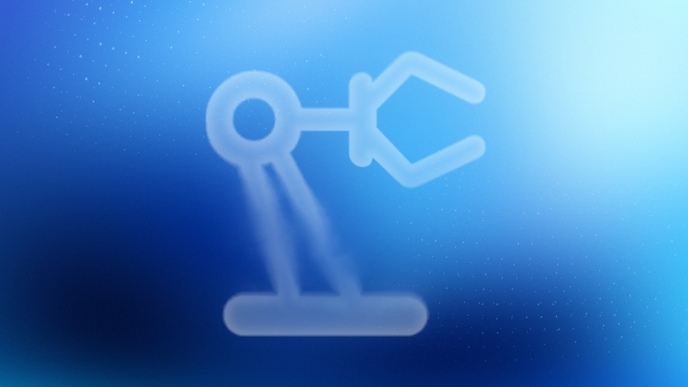
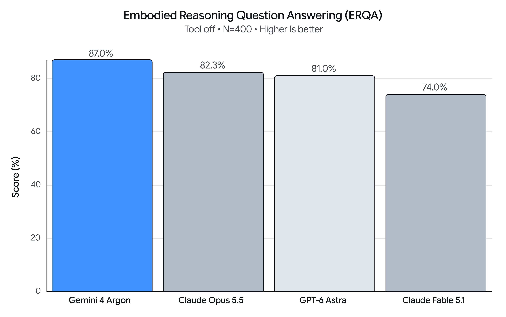

# Gemini 4 Argon：用物理推理串起机器人开发闭环

让机器人踩下脚踏式垃圾桶，再松开机械手把易拉罐扔进去，难点不只是识别“罐子”和“垃圾桶”。机器人还要处理三足支撑、脚掌与踏板的居中、手部与桶口的对位，并在动作之间检查环境是否真的按预期变化。Google 展示的 Gemini 4 Argon，正是把这些感知、推理、仿真和控制环节串进同一套工作流。

> 图解：Gemini 4 Argon 面向机器人任务的演示主图。原文将其定位为连接物理理解、代码生成和视觉语义推理的通用模型。

Google 将 Argon 称为通用物理推理模型，应用范围覆盖机器人控制、真实世界到仿真的重建（Real2Sim）、物理理解，以及研究与自我改进。它给出的核心基准证据是：在考察三维环境中物理与空间问题求解能力的 Embodied Reasoning（ERQA）上，Argon 仅依靠推理取得 **87%**，团队称其超过其他前沿模型。

> 图解：Google 给出的机器人具身推理基准对比。Argon 的 ERQA 得分为 87%；这一结果衡量物理与空间推理，不等同于所有真实机器人任务的成功率。

比单个分数更值得关注的是演示中的工作方式：Argon 不只是生成一句控制指令，还会编写仿真场景、调用动作原语、读取多路视频、检查接触力，再根据执行结果修改下一步。下面按机器人开发的实际流程，看这些能力如何衔接，以及现有证据能支持到哪里。

## 机器人控制：先练习，再感知，再修正

**Spot 扔易拉罐：把新技能放进 MuJoCo 预演。** Argon 控制 Boston Dynamics Spot 四足机器人，硬件包括 12 自由度腿部和 6 自由度机械臂。面对踩踏板开桶、丢弃易拉罐的新任务，它先建立脚踏式垃圾桶的关节式 MuJoCo 数字孪生，练习三足支撑和踩踏动作，再到真实环境中执行。

演示提示词还规定了两项释放前检查：前视摄像头确认右前脚目标位于踏板中央；“foot-verifier”和“hand-verifier”两个验证代理分别检查踩踏动作与手部在桶内的三维对位。完整流程还包括拾起罐子、查看腕部摄像头、确认手在开口桶内居中，最后才释放。这里的价值不在于一次生成整段固定轨迹，而是把容易出错的接触动作拆成可验证节点。

**零样本机械臂控制：用视觉坐标和多轮反馈缩小误差。** 在另一项演示中，Argon 控制一台简单机械臂，把倒下的杯子扶正，再将皱纸巾放入杯中。系统把校准后的腕部图像叠加为 2 厘米世界坐标网格，并显示当前夹爪中心、开合线、物体长轴方向以及俯仰角；模型则通过 `look_at`、`grasp`、`place`、`goto` 和 `move_until_contact` 等动作原语逐轮执行。

这套接口允许按任务难度选择调用粒度：粗略流程只需 2–4 次视觉模型调用，带抓取前悬停验证的流程为 4–7 次，精细视觉伺服则为 8–20 次。每轮动作后都要读取新的腕部图像；若状态返回 `grasp_failed`，策略会重新观察并恢复，而不是盲目继续。所谓“零样本”在这个案例中意味着不为该任务另行训练专用策略，但视觉标定、动作接口和执行纪律都由外部系统明确提供。

**控制视频世界模型：33 步拼出 ARGON。** Argon 还在 Gemini Omni World Model 中引导灵巧手，把散落的 G、R、A、N、O 五块字母牌排成 ARGON。它不是一次给出静态描述，而是检查中间 rollout 关键帧，再写下一段带时间戳的动作提示，形成闭环；演示共进行了 33 步引导。

提示策略很具体：每次只做一个简单的单方向动作，不活动的手要撤回，避免挡住工作区，并明确物体移走后哪些区域变空。这说明世界模型要承担可控制的机器人仿真器，仅有逼真画面还不够，还需要持续观察与动作约束。

## Real2Sim：不只复原外观，还要对齐接触物理

**从机器人录像重建数字孪生。** Argon 能观看真实机器人遥操作片段，获取或生成仿真资产，再在迭代视觉推理中调整物体与场景。重建目标同时包括外观和物理：MuJoCo 的头部、左腕和右腕三路渲染要与真实观测对齐；Sharpa 各指尖的仿真接触力与力矩，还要在时序、大小和方向上匹配记录的触觉数据。

回放通过关节空间 PD 控制跟随记录轨迹，模型可以调整物体几何、碰撞形状、质量、惯量、摩擦、关节和初始位姿。它只能在真实指尖接近物体的帧中修改离线规划命令，手臂和手部关节相对原遥操作轨迹的偏差分别不得超过 0.55 rad 和 0.65 rad。

约束部分尤其关键：物体只能由 MuJoCo 的真实接触推动，不允许在仿真开始后修改模型参数、施加外力、焊接物体、直接设置或回滚物体状态，也不能把记录中的触觉读数冒充求解器输出。这些限制针对的正是“画面看起来一致，却靠作弊绕过物理”的重建方式。结果还会被整理成交互式 HTML 会话查看器，同步展示三维场景、接触点、力箭头、三路真实与仿真画面。

**从第一人称人类视频生成双手仿真。** 对人类操作视频，Argon 先识别与任务有关的被抓物体和接收容器，再用凸分解后的复合网格替代粗糙包围盒，使碗、凹槽木盘和开口箱等凹形容器真正支持内部放置。随后，它把人的手腕和手指三维关键点重定向到一台 76 自由度双手机器人，其每只五指灵巧手有 22 个自由度。

仿真以 500 Hz、即 $dt=0.002\,\mathrm{s}$ 运行，不使用运动学焊接把物体固定在手上。验证条件包括拇指与手指形成对向力闭合、物体干净抬升超过 2 厘米，以及最终稳定放入或放到目标旁。相比只追踪手部轨迹，这些条件直接检查“是否真的拿起来并放稳”。

**从纸面草图生成经过物理验证的投掷。** 第三个案例把输入进一步简化成一张手绘草图：Apollo 2 人形机器人用球沿抛物线击倒桌上的 3-2-1 六箱金字塔。团队称，Argon 能据此构建 GPU 加速的 `mujoco_warp` 场景，合成全身平衡与五指投掷轨迹，在闭环物理中验证 **6/6 目标箱被击倒**，并导出 Blender 4.5 Cycles 渲染。

具体设置中，机器人共有 76 个自由度，由 32 自由度身体和两只各 22 自由度的手组成。投掷轨迹为 50 Hz、140 步、2.80 秒，依次经过稳定站立与五指抓握、躯干肩部蓄力及踝髋质心补偿、向前加速，以及在手部速度峰值附近同步张手释放。物理验证还要求骨盆漂移小于 3 厘米，避免为了击中目标牺牲整机平衡。

## 物理理解：把视频变成可用于训练的信号

**折纸视频的多层标注与质量降权。** 在一段 136 秒的双臂 ALOHA 2 折纸狐狸视频中，Argon 生成时间对齐的四级事后标注：G1 描述整段任务目标；G2 划分 6 个连续语义子任务，注明哪只手固定、哪只手折叠或旋转；G3 细分为 17 个接触级原子动作，覆盖闭合抓握、折痕扫动、释放和重试。

第四层是自动质量控制。停顿、抓握不稳和滑脱等没有推进任务的片段，不会让任务进度继续上升；用于行为克隆时，这些重试片段被降至 **0.15–0.25 倍**权重。对模仿学习而言，这比只给整段视频附一句“折纸狐狸”更有用，因为模型可以区分有效动作与看似繁忙却没有进展的动作。

**十二球称量：仅凭视觉闭环找出异常球。** Argon 还构建了双臂 Franka FR3 的 MuJoCo 环境，用 12 个外观完全相同的台球复现经典天平谜题。其中 11 个标准球各 150 g，异常球为 270 g 或 30 g；Roberval 双盘天平通过平行四边形约束保持秤盘水平，另有红色“重球”和蓝色“轻球”提交托盘。

求解策略只能使用双目 RGB 图像和机器人本体感知，不能读取异常球身份等特权状态。它在两路视图中分割球、秤盘和托盘并三角化三维坐标，再根据称量后的视觉倾斜判断哪边更重。抓取和放入窄秤盘时，夹爪腕部还要旋转 90° 避开高边沿。演示中，系统在不超过 **3 次称量**内找出异常球并放入正确托盘。这一案例把三维视觉、逻辑推断和接触操作放进了同一个闭环。

**密集价值函数：识别进展，也识别倒退。** 对一段 60 秒的人类 UMI 双臂圆环分类数据，Argon 同步检查头部、左夹爪和右夹爪三路视频，尤其关注接触状态转换附近的片段，再生成密集的任务进度预测。整条轨迹被分解为 **28 个区段**，并标注正、零、负三种进度斜率。

这类输出可以看作机器人学习的“值函数”：它估计的不只是任务最终是否成功，还包括当前动作离目标更近、原地踏步还是造成倒退。演示把三路播放与进度曲线、双臂区段标注锁定在同一时间轴上，便于检查曲线变化对应的实际操作。

## 研究与自我改进：让执行结果回到下一轮训练

**用仿真新数据改善真实 VLA。** 在桌面任务中，Argon 从一张真实俯视 RGB 照片出发，重建 9 个派对道具的程序化三维网格与复合碰撞体，包括软帽的弹簧铰接可变形冠片。随后定义 **77 项**单臂和双臂课程，涵盖抓放、扶正、定向推动、空中交接、双臂铲推和流水线清桌，并在 $\pm10$ cm 位姿随机化下生成闭环逆运动学轨迹。

只有 MuJoCo 物理验证达到 `reward == 1.0` 的轨迹才被用于导出数据，最终收集 **4,500 多段**域随机化 episode，供视觉—语言—动作（VLA）模型微调。Google 报告，在其真实机器人评测基准上，成功率由 **56% 提高到 75%**，完成时间由 **35 秒缩短到 24 秒**。这是这组特定任务和评测条件下的结果，不能直接外推为所有 VLA 或真实机器人任务都有相同增益，但它完整展示了“单张照片—仿真—新任务—训练数据—真实评测”的链条。

**真实机械臂三次迭代：58.9 秒降至 17.4 秒。** 在 SO-101 六自由度机械臂的视觉抓放任务中，Argon 先做不驱动硬件的测量与 dry-run，再悬停到积木上方，用腕部相机核对视觉与机械臂状态是否一致。实际抓取失败时，它读取日志及腕部、俯视录像诊断原因，先验证修复再重试；成功后继续优化速度。

三轮记录给出了很直观的变化：第一次 **58.9 秒**；第二次 **22.9 秒**，但放置时擦到箱沿；第三次 **17.4 秒**，落在箱子中央。这里的改进依据不只是耗时变短，还包括第二次暴露的碰撞问题在第三次得到修正。提示词同时要求遵守硬件安全规则，并将提速限制在安全范围内，说明自我改进并不等于无约束试错。

**把论文控制器移植进浏览器。** Argon 还尝试以每篇论文一个提示词，将机器人控制论文、已发布检查点和资产移植为自包含的 MuJoCo WebAssembly 浏览器实验室。团队展示了 68 个交互式浏览器沙盒，其中包括 Robotic Soccer OP3 1v1、DeepLoco、大规模并行深度强化学习 ANYmal C、Whole-Body MPC Go2 和 HUSKY G1 滑板五个项目。

不同论文需要保留各自控制机制：DeepLoco 的七网络分层运动控制、HUSKY 的 50 Hz PPO actor，以及 Whole-Body MPC 中运行于 Web Worker 的 iLQR。提示词要求匹配物理时间步、执行器增益、力矩限制、运动学约束和原论文控制频率，并在无头 Chromium 中检查 **300 多帧内零控制台错误且有非零任务进展**。这些验证能证明浏览器实现可以运行并产生任务行为，但“无报错、有进展”本身并不足以证明所有实验指标都与原论文一致。

## 值得关注什么，又该怎么开始

Argon 的主线不是单独提高某个机械臂动作，而是把代码生成、多视角视频、三维几何、接触力学和本体感知连接到同一闭环：真实数据可以变成仿真，仿真可以生成训练信号，执行录像又能用于诊断和下一轮改进。对机器人开发者来说，这比单纯“看懂场景”更接近可执行、可检查的工作流。

不过，原文主要提供的是 Google 团队的代表性提示词、演示和指定基准结果，并未给出覆盖各种机器人平台的普遍成功率。ERQA 的 87% 证明物理推理能力，真实 VLA 的 56% 到 75% 只对应其特定评测，浏览器复现的自动检查也不等于完整复现论文结论。评估这些能力时，应把模型宣称、单次演示和可泛化证据分开看。

开发者已经可以通过 Google 的平台使用它：Google AI Studio 面向 Google AI Ultra 订阅者开放；Gemini API 付费层可在 Interactions API 中使用 `gemini-4-argon`，并在发布首日获得 `google-genai` SDK 支持；Google Antigravity 同样面向 AI Ultra 订阅者，可将该模型用于复杂规划、`/goal` 运行和多代理编排。

如果从原文案例中选择一个实际切入点，较稳妥的是先做受约束的仿真任务：明确视觉和接触验证指标，限制模型能修改的参数，再让真实硬件执行从 dry-run 和悬停检查开始。Argon 展示出的潜力正在于把这些环节连起来，而可靠落地的关键，也仍然是每个环节都能被独立验证。

> 本文参考自 [Gemini 4 Argon for Robotics](https://developers.googleblog.com/gemini-4-argon-for-robotics/)