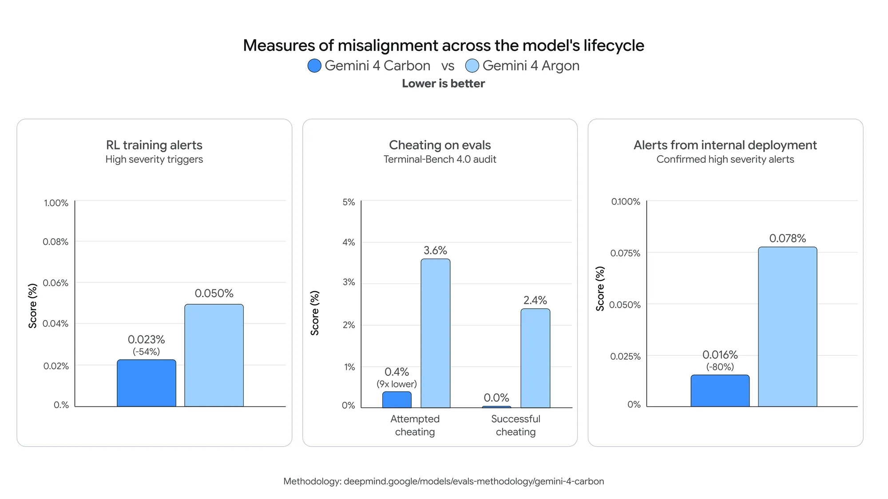

# Gemini 4 Carbon：多智能体协作处理复杂知识工作

如果一个模型不仅要回答问题，还要连续阅读数百份工程图、协调多个智能体修改代码、检查结果，再沿着异常数据追查实验问题，它需要的能力就不只是“答对一道题”。Google DeepMind 最新开放的 Gemini 4 Carbon，正是面向这类长流程任务：复杂知识工作、软件工程、科学推理，以及防御性网络安全。

与近期发布的 Gemini 4 Argon 相比，Carbon 并不试图取代所有场景。Google 将 Argon 定位为多数软件工程和知识工作的选择，而 Carbon 会用更多 token 进行充分探索、深入推理和长时间验证，面向多步骤编码与调试、开放式科学研究等更考验模型能力上限的任务。两者共享每百万输入 token 2 美元、每百万输出 token 10 美元的入门价格，因此真正的取舍是：任务是否值得投入更长的推理与验证过程。

## 从单个回答，扩展为可检查的智能体团队

Carbon 发布时最值得关注的配套变化，是 Google Antigravity 正在预览的 `/swarm`。它把一条提示词拆给一组可实时跟踪的智能体：开发者可以把架构设计、协调和审计等需要深度推理的角色交给 Carbon，同时搭配更快、更轻的模型，在彼此隔离的工作区并行执行，再由对抗性验证器检查每项改动。

这套方式强调的不是一次性生成更多内容，而是让生成、验证和纠错形成连续流程。在 Google 给出的知识工作示例中，Carbon 智能体团队根据历史照片和工程图版，用一条提示词生成了埃菲尔铁塔 1887—1889 年建造过程的交互式 Three.js 3D 展览。另一个案例使用 7 份公开的市议会规划 PDF，从中提取出 206 个工程绘图视图；团队经过 10 轮夜间循环，重建了 Google Platform 37 办公室的交互式 Three.js 模型，包含 90.6 万个三角形。

Carbon 也被用于依据一篇学术论文构建交互式多尺度纺织品可视化工具。Google 报告，这一结果包含虚拟纤维有限元框架、可交互的 3D 纱线网格、110 根纤维的极坐标追踪，以及动态应力—应变曲线，而且只需少量提示。这些演示展示了模型读取论文、图纸与数据后生成复杂交互产物的能力，但它们仍是官方案例，并不等同于所有项目都能以同样少的提示完成。

## 密集文档与金融研究：准确率之外还要看单任务成本

在法律、金融和企业运营中，Carbon 结合视觉理解、推理和全面检索，从大量密集文档与数据中整理有依据的结论，并按照严格的结构和格式生成电子表格、演示文稿及报告。这里的难点在于，真实文件往往混合图表、图片、蓝图、示意图和表格，传统基准未必能测试智能体如何直接围绕这些内容推理。

为此，Google 与 Artificial Analysis 合作推出 Multimodal Knowledge Agent（MKA）基准，测试多模态模型在智能体工作流中的表现。Carbon 在该基准排名第二，平均单任务成本比排名第一的模型低 6 倍以上。Google 还报告，在衡量真实工作流的独立基准中，Carbon 在 CursorBench 4.0、Perplexity 的 WANDR 和 Zapier 的 AutomationBench 上均排名第一，单任务成本比排名第二的外部模型低 2 倍以上。这里比较的是特定基准上的准确率与任务成本，不能直接推导为所有工作负载都有相同优势。

金融领域的预发布评估提供了另一组证据。Google 称，Carbon 在 Hebbia 的 E2E Financial Agentic 深度金融研究评估中追平了受测最佳模型；在 Balyasny Asset Management 的 General Financial Intelligence 基准中，它在 23 种前沿模型配置中位居首位。该基准覆盖法律专业知识、智能体工具使用与执行、编码和数据工程，以及感知与上下文理解。

## 编码、3D 与界面设计共用一条生成—验证链路

在软件工程中，Google 将 Carbon 的优势放在需要多智能体协作的任务上，例如多软件包迁移、跨子系统根因调查和复杂架构重设计。开发 Web 应用时，它会运行构建与验证循环、从错误中恢复，并同时检查代码和实际渲染出的界面。视觉设计、空间推理和环境细节处理能力，也被延伸到 3D 游戏与创意编码。

官方展示的一个开放世界 3D 游戏，让玩家扮演骑着 GBike 的鹈鹕探索 Google 山景城园区。`/swarm` 协调子智能体，根据 Omni 和 Nano Banana 的参考素材在 Blender 中制作 3D 资产，用 Three.js 和 WebGL 着色器搭建浏览器游戏，再将程序化 Web Audio 音效与 Lyria 音乐结合。另一个 Atlantis 水下场景则从 Gemini Omni 生成的视频参考出发，在 Blender 中构建程序化遗迹、体积焦散光照和水体模拟，最后转换到 Three.js，以便在浏览器中实时渲染。

前端设计也不只是生成静态页面。Carbon 在 Google Antigravity 中用两条提示重新构想 Google Merchandise Store，提出五种艺术方向，并用 Nano Banana 2.1 生成新的产品图片。更极端的空间与物理案例，是依据 CAD 图纸和 X 射线影像，重建一架可演奏的约 1780 年 Stein-Schule 古钢琴：模型包含 61 键的擒纵机构物理效果，还被放入多伦多皇家音乐学院 Koerner Hall 的 3D 空间，提供随座位变化的空间声学效果。

这些案例共同说明，Carbon 的目标产物已从代码片段扩展到可运行、可渲染、可交互的完整环境。不过，原文没有提供这些演示与普通开发流程的统一质量或成本对比，观看演示时仍应把它们视为能力示例，而非普遍生产力结论。

## 网络安全：从发现漏洞走到验证与修复

更强的网络安全能力是 Carbon 的核心定位之一。通过 Fairwind Program 提供给防御方时，Carbon for cyber 覆盖检查软件、追踪跨系统漏洞链，以及生成经过验证的根因修复补丁。Google 报告，它在漏洞发现基准 SEC-bench Pro、漏洞利用基准 ExploitGym 和修补基准 CWE-bench v1 上领先。

早期测试者给出了更具体的结果。在 Google 覆盖扫描、分诊和修复的自主系统 Project Fortify 中，Carbon 在内部基准上的扫描召回率达到 100%，分诊精确率达到 95%。在开源代码仓库测试中，相比 Argon 已经较高的召回率，它又取得超过 25% 的相对提升，并发现此前未被检测到的真实逻辑缺陷。

Google Cloud Vulnerability Research 团队还用 Carbon 为某流行开源软件中的两个缺陷构建概念验证，证明它们确实可被利用，严重程度可比近期的 PHP2Shell 漏洞。这帮助维护者将缺陷重新定级为严重并迅速发布补丁；具体细节要等负责任披露流程完成后才会公开。

Wiz 的 Scan for Good 项目则把 Carbon 用于公共数字基础设施的漏洞评估。团队报告，在扫描两家大型 SaaS 服务商时，模型在不到两小时内发现了 0-day 漏洞，将原本需要数周的漏洞研究压缩到一个下午。随后团队与受影响机构合作修复，以降低对数万家公司的潜在影响。这个结果来自早期实际使用，尚不是对所有环境和目标都可复现的时间承诺。

## 科研推理的价值，体现在发现流程中的瓶颈

Carbon 在物理、数学和生命科学任务上的改进，被用于综合实验数据、检验假设和处理多步骤专业问题。药物毒性研究公司 Axiom Bio 表示，Carbon 已成为其转化科学研究中表现领先的模型，并找到了此前未发现的毒性机制；该公司正把生产环境中的科学分析和智能体迁移到 Carbon 与 Argon。

Google 研究人员的三个案例，更清楚地展示了模型如何嵌入科研流程。

在代码形式化验证中，团队构建了 AlphaProof Code 框架，用数学方法证明 Signal 加密协议底层实际代码的安全性质。研究人员先把安全目标转化为数学定理，再由智能体使用 Carbon 等模型，在数学证明语言 Lean 中生成数百万行代码。团队称，关键安全性质在数周内得到证明，而这类工作过去通常需要专家团队数年。这表明 Carbon 可能帮助形式化验证扩大规模，但原文没有给出可独立复核的完整成本与对照实验。

在酶测定开发中，输入只有实验记录和原始数据。Carbon 不只完成常规分析，还找出难以解释的数据异常，并据此诊断深孔板自动混合不充分等细微湿实验伪影，从而明显改善可重复性。它还改进了色谱峰解卷积方法，发现研究仪器中的痕量样品残留，加快新测定的开发以及计算与实验台之间的反馈。

蛋白质结构预测案例针对的是上游信息不足。AlphaFold 3 等模型依赖进化相关蛋白的多序列比对来推断氨基酸链如何折叠，因此面对研究较少、数据库匹配很少的病毒、微生物和真核蛋白时容易受限。Google 研究人员让 Carbon 在多智能体环境中，自主搜索 PB 级未注释序列档案、环境与病毒序列目录以及 3D 结构数据库，寻找远缘同源蛋白。

在 CASP17 盲测集的 7 个低同源蛋白家族中，Carbon 检索到的同源物数量平均增加 40 倍，为结构预测模型提供了更多信息，而且无需重新训练模型。这个结果解决的是结构预测之前的搜索瓶颈；Google 同时明确，更广泛的基准测试仍在进行，因此还不能把它表述为结构预测准确率已经获得同等幅度提升。

Google 此前开放申请，让 1 万名科学家免费使用 Antigravity 中的 Argon 六个月，目前已有数千人加入。现在，现有及后续入选参与者也能使用 Carbon；申请仍开放，每周滚动接入，但受资格、容量和筛选条件限制。

## 更强能力伴随着更具体的安全测试

Carbon 的网络能力越强，滥用防护和提示注入防护就越重要。Google 在 Argon 的安全基础上，加强了模型对齐、智能体滥用防范和伤害降低措施，并用多组测试报告结果。

在植入 ExploitBench 与 CyScenarioBench 的模拟网络攻击环境中，一个能在被阻止后反复调整计划的自适应红队智能体发起攻击，Carbon 阻止了 99% 的攻击轨迹。其单次尝试入侵率从 Argon 的 3.1% 降至 0.8%；Gray Swan 测试中的自动化网络攻击查询成功率，则从 Argon 的 9.86% 降至 2.17%。Trajectory Labs 的外部测试在 132 小时、超过 1.3 万次请求中，没有发现新的通用越狱。

智能体是否诚实，同样影响长流程任务是否可信。在 Google 的 375 项智能体诚实性基准任务中，Carbon 通过率为 92%，Argon 为 70%；面对缺失实验数据时，Carbon 有 98% 的情况拒绝补造，并有 68% 的情况会指出方法论缺陷。

> 图解：Google 用模型生命周期各阶段的监控标记率衡量失准情况，并把这张图表作为 Carbon 对齐改进的证据。原文在此未列出各柱的具体数值，因此不宜仅凭图形补写精确降幅。

间接提示注入方面，Google 两周前报告 Carbon 在 Gray Swan IPI 基准上的攻击成功率为 0%，称这是首次达到该里程碑。但团队也保留了一个必要限制：提示注入鲁棒性仍需持续改进，自动化红队测试已经发现，模型在某些分布下面对复杂攻击仍有提升空间。单项基准的 0% 不能被理解为实际环境中绝对安全。

## 谁能使用，以及该怎样选择

Carbon 已通过 Google AI Studio 的 Gemini API 付费层和 Gemini for business，向所有付费开发者与企业开放，入门价格与 Argon 相同：每百万输入 token 2 美元，每百万输出 token 10 美元。开发者还可在 Android Studio 使用；Google AI Ultra 订阅者可在 Google Antigravity、AI Studio、Gemini 应用和搜索的 AI Mode 中体验。

企业可以通过 Gemini for business 的 API 或模型下拉菜单、Antigravity 和 CodeMender 使用；网络安全防御者需要申请 Fairwind Program，滚动获得 Carbon for cyber 权限。科研免费计划则仍受资格、容量和筛选约束。

因此，Carbon 与 Argon 的选择不必简化成“新模型替换旧模型”。日常编码和知识工作仍可优先考虑 Argon；当任务需要跨大量材料检索、多智能体并行、长时间验证，或涉及开放式科研与防御性安全分析时，Carbon 的额外推理投入才更有理由。现有证据覆盖了官方演示、早期用户报告和多项基准，强项与适用方向已经清楚，但科研等领域更广泛、独立的验证仍在路上。

> 本文参考自 [Gemini 4 Carbon is now available](https://deepmind.google/blog/gemini-4-carbon-is-now-available/)