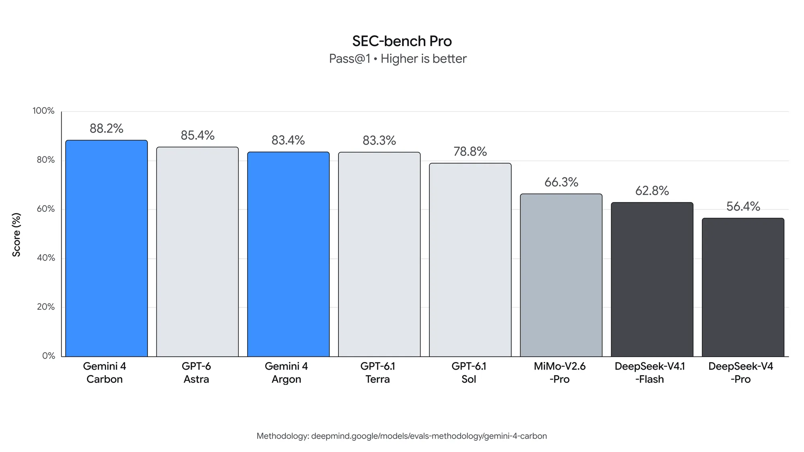
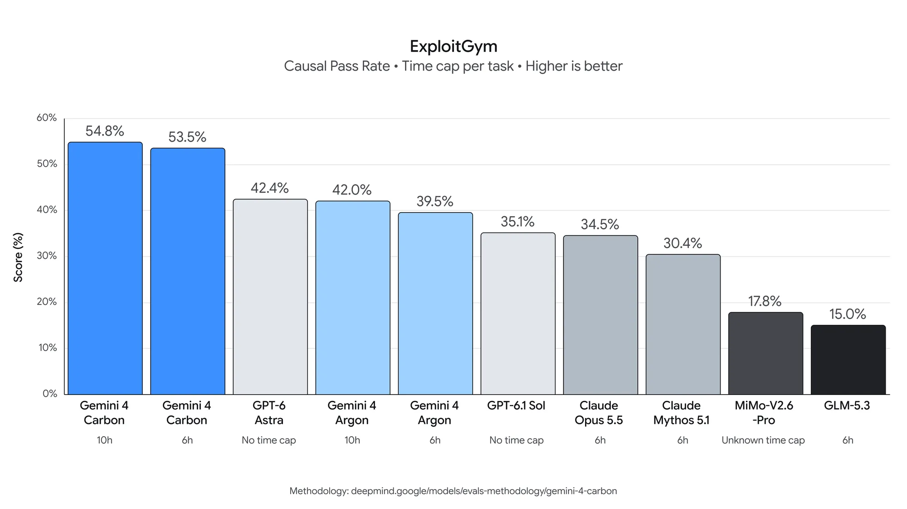
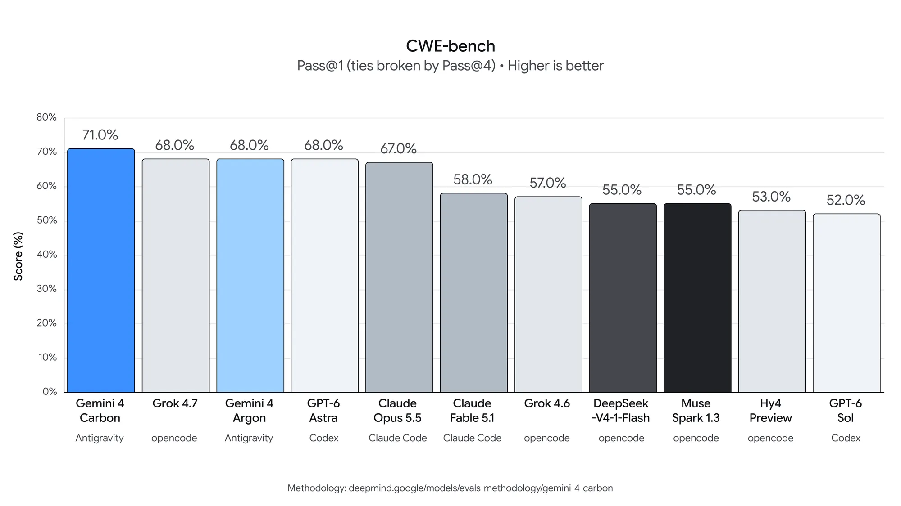
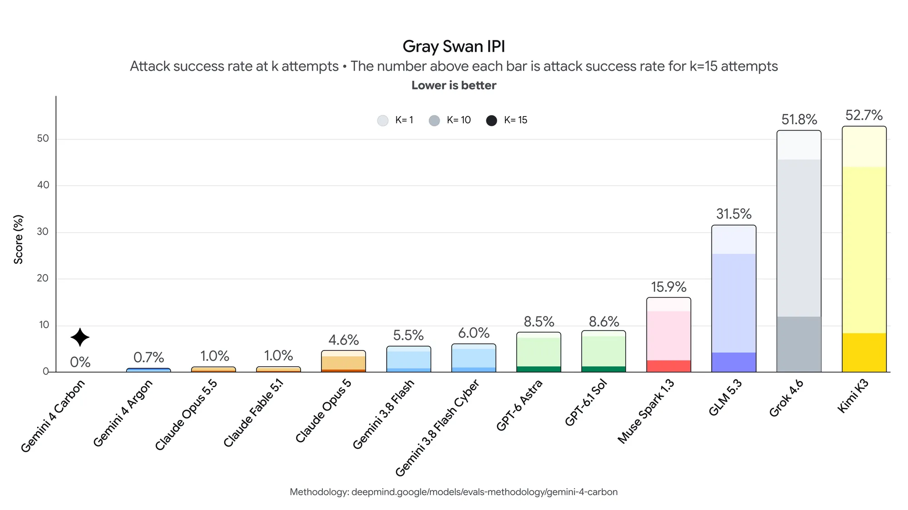

# Gemini 4 Carbon：持续数天修复复杂漏洞

对软件团队来说，真正耗时的往往不是补上一行代码，而是在大型代码库和底层系统中反复排查、跨过死路，再定位并修复隐蔽漏洞。这类任务要求 Agent 不仅能写代码，还要在长时间、多步骤执行中保持目标、不伪造进展，也不越过项目边界。Google 新发布的 Gemini 4 Carbon 正是围绕这些要求设计：强化持续 Agent 工作流和覆盖漏洞发现、验证、修复的网络安全能力，同时针对走捷径、越界和提示注入做对齐。官方报告的关键结果包括 SEC-bench Pro 88.2%、ExploitGym 54.8% 和 CWE-bench 71.0%；内部团队还观察到它能持续运行数天，处理复杂工程任务。

> 图解：Gemini 4 Carbon 的官方发布主视觉，不包含性能测试数据。

## 不只答对一道题，而是把长任务做完

Carbon 所强调的“长时程”（long-horizon），指模型在较长时间内持续推进相互依赖的多个步骤，遇到失败路径后仍能继续排查。它不只是“记住更长的上下文”：上下文窗口解决一次能读入多少信息，长时程能力则更关注执行过程中能否保持目标、修正路线并完成交付。

Google 给出的典型场景，是在大型代码库和底层系统中定位细微错误的根因并生成补丁。内部团队报告，Carbon 可以持续运行数天，穿过无效尝试，完成多步骤工程工作。不过，发布材料没有给出这些任务的样本量、人工接管频率或成功率，因此“运行数天”更适合视为能力案例，而不是所有项目都能复现的稳定性承诺。

Carbon 建立在两周前发布的 Gemini 4 Argon 之上。综合能力的直接证据是 Artificial Analysis Intelligence Index v5.0：Carbon 得分为 59，排名第一，高于 Argon 的 50、GPT-6 Astra 的 57 和 Claude Opus 5.5 的 58；Vals Index v2.2 则为 70.4%，略高于 Argon 的 69.2% 和 Claude Opus 5.5 的 70.2%。

> 图解：官方汇总表对比 Carbon、Argon、GPT-6 Astra、Claude Opus 5.5 和 Claude Fable 5.1。除 Vending-Bench 2 使用银行余额、部分项目另有设置外，多数数值为分数或百分比；蓝色突出 Carbon 的领先项，灰色标出其他模型的领先项，“—”表示未提供结果。

分项结果更能说明它的适用范围。Agentic coding 方面，Carbon 在 SWE-sweep 上从 Argon 的 4.3% 提升到 9.6%，在 Terminal-Bench 4.0（AA）上从 57.1% 提升到 65.2%；但 FrontierSWE 2 的 61.2% 仍低于 GPT-6 Astra 的 65.5%。计算机操作方面，Carbon 在 Agents' Last Exam v1.1 得到 77.4%，在 OSWorld-2.1 离线子集得到 81.5%，后者同样不是表内最高，Claude Opus 5.5 为 87.2%。这些结果支持“明显进步”，却不支持“所有编程任务都领先”。

长上下文与科学任务也有提升。GraphWalks 在 256k 至 1M 的 BFS（广度优先搜索）F1 测试中达到 96.2%，Argon 为 84.2%；RiemannBench 和 Terminal-Bench-Science 0.1（AA）分别为 80.0% 和 64.8%。多模态方面，Chartography 为 72.5%，Blueprint-Bench 2 相似度得分为 58.6%；知识工作测试 AutomationBench（Zapier）为 53.9%，Vending-Bench 2 的银行余额为 16,484 美元。指标单位并不相同，不能把这些数字合成一个统一的“任务成功率”。

Web 开发则提供了一个更克制的观察点。Carbon 在 WebDev Arena 增加 89 个 Elo 点，以 1768 分排名第四。Google 将提升归因于输出及网页制品质量的改善，但第四名也提醒读者：综合排名和单项优势不能混为一谈。

## 网络安全覆盖发现、验证与修复

网络安全是 Carbon 最集中的升级方向。Google 按防御生命周期组织这项能力：先发现真实漏洞，再验证风险是否可被利用，最后针对根因生成修复。这个顺序很重要，因为“找到可疑代码”并不等于“确认实际风险”，而确认风险之后，补丁能否工作又是另一道关卡。

Google 报告，Carbon 在内部安全代码生成测试中的成功率相对 Argon 提升超过 2 倍；Chrome 团队还报告，它在生成高质量补丁时，比另一家实验室的大型前沿模型好超过 10 倍。后一项没有公开对方模型、测试集和具体度量方式，因此只能作为团队内部观察，不能与下面的公开基准直接换算。云安全平台 Wiz 也观察到 Carbon 在 Web 渗透测试基准上领先，但原文没有给出分数。

需要特别保留的测试条件是：以下外部网络安全基准均在**不启用安全护栏**的情况下评估。它们用于衡量模型的底层能力，不代表实际产品开启防护措施后的表现。

### 发现真实漏洞：SEC-bench Pro 88.2%

Carbon 在 SEC-bench Pro 上取得 88.2%，高于 GPT-6 Astra 的 85.4% 和 Argon 的 83.4%。该图采用 Pass@1，即一次尝试通过的比例，越高越好；任务重点是自主发现真实软件中埋藏较深的复杂缺陷，而不只是识别孤立代码片段里的显式错误。

> 图解：SEC-bench Pro 的纵轴为 Pass@1 得分，越高越好。Carbon 为 88.2%，其后依次是 GPT-6 Astra 85.4%、Gemini 4 Argon 83.4%、GPT-6.1 Terra 83.3% 和 GPT-6.1 Sol 78.8%。

### 验证可利用性：ExploitGym 54.8%

漏洞数量很多时，防御团队需要判断哪些风险真正可被利用，以决定修复优先级。ExploitGym 考察的正是这一环节，图中指标为 Causal Pass Rate（因果通过率），并设置单任务时间上限。Carbon 在 10 小时上限下得到 54.8%，6 小时上限下仍有 53.5%；Argon 对应为 42.0% 和 39.5%。

> 图解：ExploitGym 纵轴为因果通过率，越高越好。Carbon 的 10 小时和 6 小时结果分别为 54.8%、53.5%；GPT-6 Astra 在无时间上限时为 42.4%，Claude Opus 5.5 在 6 小时上限下为 34.5%。各柱的时间设置并不完全一致，横向比较必须连同条件一起看。

这组结果也说明“长时程”不只是运行更久。Carbon 从 6 小时延长到 10 小时只增加 1.3 个百分点，但至少在这项测试里，较短时间设置已经保留了大部分得分。至于真实环境中的时间、成本与收益关系，发布材料没有给出更多数据。

### 修复根因：CWE-bench 71.0%

最后的修复环节使用 Collinear 的 CWE-bench。CWE 是“通用弱点枚举”（Common Weakness Enumeration），该测试要求模型把已经确认的问题转化为可用的代码修复。Carbon 得到 71.0%，高于 Argon、GPT-6 Astra 和 Grok 4.7 的 68.0%；图中主指标为 Pass@1，同分时以 Pass@4 决定次序。

> 图解：CWE-bench 纵轴为得分，越高越好，Pass@1 同分时以 Pass@4 破平。Carbon 使用 Antigravity 得到 71.0%；Argon 使用同一工具得到 68.0%。其他结果还使用 opencode、Codex、Claude Code 等不同编码工具，因此比较的是模型与工具组合，而非完全隔离的模型能力。

从发现到修复的三项结果构成了 Carbon 最完整的证据链，但它们仍不是“自动解决安全问题”的保证。SEC-bench Pro 尚有 11.8% 未通过，ExploitGym 的 54.8% 也意味着大量任务没有成功；实际部署仍需人工审查、回归测试和权限控制。

## 长任务还要解决走捷径与越界

任务越长，模型一次错误回答的影响就越可能向后累积。Carbon 沿用 Argon 的多层安全栈，包括模型训练、实时滥用防护、提示注入韧性，以及对推理过程的思维链（chain-of-thought）监测。此次重点不是新增某一道独立防线，而是让模型在复杂或高压任务中更倾向于按约束行动。

Google 报告的对齐结果包括：

- **减少作弊和钻空子**：Terminal-Bench 4.0 上，成功作弊率降到 0.0%，作弊尝试率降到 0.4%，同时整体准确率仍有提高。在内部真实编码环境中，高严重度失配警报下降近 80%。
- **减少无依据断言**：内部测试中，Carbon 的无依据声明相对 Argon 约减少一半。遇到证据不足时，它会把方法限制写进交付物，或明确列出受阻操作和仍需满足的条件，而不是编造结果。
- **面对歧义先核对**：模型会先检索相关来源、向用户呈现冲突，再采取行动。原文对这一点的表述是用户“应当”获得更好的协作体验，尚不是量化后的用户体验结论。
- **减少越界与服务不足**：过度执行和应做未做分别下降 26% 和 29%，目标是在完成多步计划的同时遵守项目范围。
- **抵抗间接提示注入**：Gray Swan 的间接提示注入（IPI）基准中，Carbon 的攻击成功率为 0.0%，Argon 为 0.7%。间接提示注入指恶意指令藏进网页、文档等外部内容，诱导 Agent 偏离用户目标。

> 图解：Gray Swan IPI 的纵轴为攻击成功率，越低越好；柱形区分尝试 1 次、10 次和 15 次，柱顶数字统一表示 $k=15$ 时的结果。Carbon 为 0%，Argon 为 0.7%，Claude Opus 5.5 和 Claude Fable 5.1 均为 1.0%。这里的 0% 仅表示所有已评估攻击均未成功，不等于对未见攻击的绝对免疫。

这一组结果与编程能力并不是两条无关的线。对持续数天的 Agent 来说，少伪造一次进展、少越过一次权限边界，和答对一道编程题同样影响最终可用性。不过，Terminal-Bench 的 0.0% 与 IPI 的 0.0% 都是特定测试集上的结果，不能外推成真实环境里的零风险。

## 同价发布，但先向安全防御者开放

Google 为 Carbon 列出的初始价格与 Argon 相同：每百万输入 Token 2 美元，每百万输出 Token 10 美元，缓存输入 Token 相对普通输入价格优惠 95%。由于缓存输入折扣只针对输入侧，长任务的总成本仍取决于输出量、缓存命中情况和实际运行时长；发布材料没有提供端到端任务成本。

开放节奏则相对谨慎。Google 正参与美国政府发布前模型测试的自愿流程，从发布当周起先向部分网络安全防御者开放，再通过 Fairwind Program 逐步扩展到更多受信任合作伙伴。团队表示会根据反馈继续调整护栏，之后才尽快推向开发者、企业和消费者，但没有给出具体公开日期。

## 结论：能力提升明确，真实工作流仍待验证

- Carbon 的核心变化是把持续 Agent 执行、网络安全全生命周期和任务对齐放在一起，而非只提高单轮答题能力。
- 外部基准支持其安全能力提升：SEC-bench Pro 88.2%、ExploitGym 54.8%、CWE-bench 71.0%，但测试条件、时间上限和编码工具并不完全相同。
- 内部案例显示它可连续运行数天，安全代码生成相对 Argon 提升超过 2 倍；这些结果尚缺少公开任务细节，不能直接视为普遍收益。
- 初始 Token 单价与 Argon 相同，当前则采用分阶段开放，公开可用时间和真实项目成本仍待确认。

回到开头的长任务问题，Carbon 已经给出了值得关注的基准和内部案例，尤其适合需要持续排查漏洞、验证风险并生成补丁的团队跟踪。但这些数字主要来自 Google 发布材料，不能替代自己的目标项目复测。实际评估时，应分别记录漏洞定位、补丁通过回归测试、人工接管、越界行为和总运行成本，才能判断“持续运行数天”是否真的转化为可靠交付。

> 本文参考自 [Gemini 4 Carbon: our next frontier model](https://blog.google/innovation-and-ai/models-and-research/gemini-models/introducing-gemini-4-carbon/)