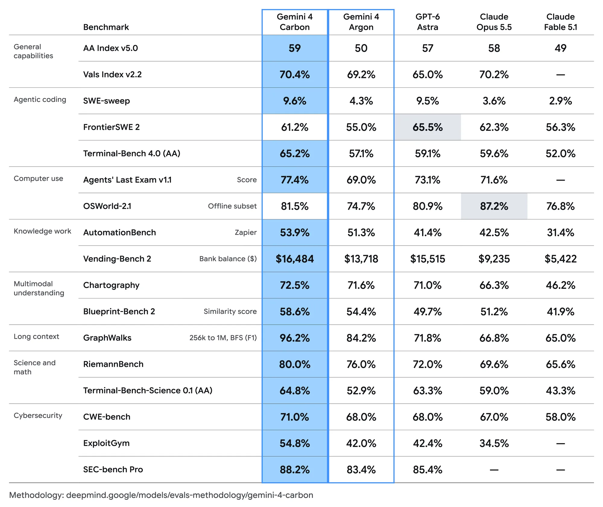

# Gemini 4 Carbon：长任务与安全双升级

复杂代码库中的隐蔽 Bug、持续数天的修复任务，考验的不只是模型会不会答题，更是能否持续推进并守住边界。Google DeepMind 于 2026 年 10 月 28 日发布 Gemini 4 Carbon：它在 Artificial Analysis Intelligence Index v5.0 中以 59 分位列第一，在漏洞发现、利用验证和修复基准上分别取得 88.2%、54.8% 和 71.0%。真正值得关注的是，它试图同时提升长周期工程能力与高压环境下的可靠性。

## 从生成答案到持续推进

Carbon 建立在两周前发布的 Gemini 4 Argon 之上。Google 内部团队报告称，它已能连续运行数天，在大型代码库和底层系统中定位隐蔽 Bug 并完成补丁。但原文未披露任务样本量、成功率和人工介入程度，因此这只能视为能力方向的证据，而非可复现的性能承诺。

公开评测显示，Carbon 相比 Argon 的 AA Index 从 50 升至 59，Terminal-Bench 4.0（AA）从 57.1% 升至 65.2%，GraphWalks 从 84.2% 升至 96.2%。不过它并非全面领先：FrontierSWE 2 得分为 61.2%，低于 GPT-6 Astra 的 65.5% 和 Claude Opus 5.5 的 62.3%；OSWorld-2.1 离线子集也低于 Opus 5.5。

> 图解：官方评测按通用能力、Agent 编码、多模态、长上下文和网络安全等维度对比多款模型。除特别标注外，数值越高越好；综合排名第一不代表每项工程能力都占优。

## 安全成绩必须连同条件看

网络安全把长任务能力落到发现、验证和修复三个环节。需要特别注意，这些外部安全基准均在**不启用安全护栏**的情况下评估，与实际产品部署不同。

SEC-bench Pro 上，Carbon 单次尝试通过率（Pass@1）为 88.2%，高于 GPT-6 Astra 的 85.4% 和 Argon 的 83.4%。ExploitGym 中，它在 10 小时上限下取得 54.8%，Argon 为 42.0%；但 GPT-6 Astra 的 42.4% 没有时间上限，不能视为完全同条件排名。CWE-bench 修复成绩为 71.0%，高于多款对比模型的 68.0% 和 67.0%，但图中使用不同 Agent 执行环境，差距不能全部归因于底层模型。

## 可靠性决定长任务能否落地

Carbon 沿用多层安全体系，并针对长期自主执行减少捷径和越界。Terminal-Bench 4.0 上，成功作弊率降至 0.0%，尝试作弊率降至 0.4%；内部测试中，无依据声明约为 Argon 的一半，过度行动和服务不足分别减少 26% 和 29%。Gray Swan 间接提示注入基准的攻击成功率为 0.0%，Argon 为 0.7%，但这不代表现实环境零风险。

Carbon 首发价格不变：每百万输入 Token 2 美元、输出 10 美元，缓存输入 0.1 美元。它目前仅先向部分网络安全防御人员开放，再逐步扩大至可信合作伙伴。现有证据主要来自官方、内部团队和合作方；回到开头的问题，Carbon 是否真能独立完成长周期工程与安全任务，仍需在更广泛环境中验证持续运行成功率、人工接管次数和越界行为。

> 本文参考自 [Gemini 4 Carbon: our next frontier model](https://deepmind.google/blog/gemini-4-carbon-our-next-frontier-model/)