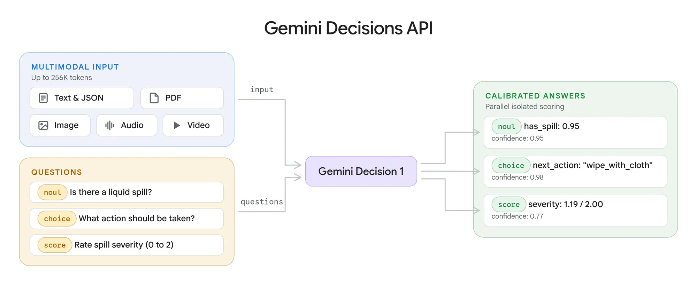
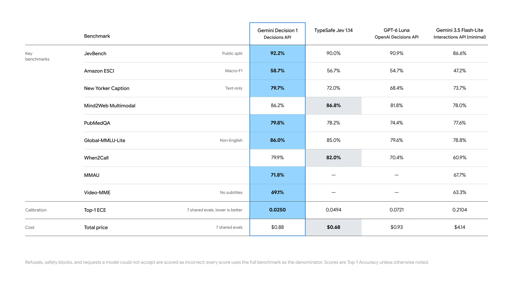
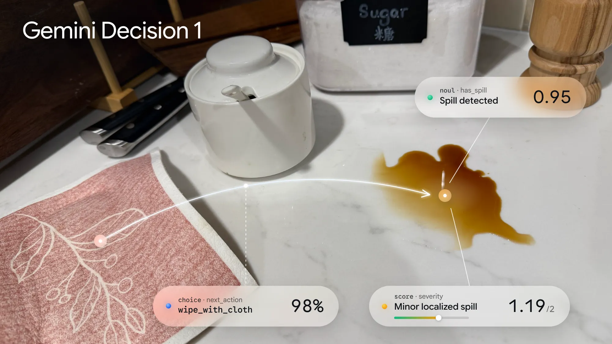

# Gemini Decisions API：一次前向计算评估千项多模态问题

一张茶水柜台面的照片，加上一句“上午 9 点客户会议前检查”的文字说明，系统需要同时回答三个问题：台面上是否有未清理的液体、接下来该用什么方式处理、污渍严重程度如何。这类任务不需要模型写一篇分析，而需要它尽快给出明确选项和置信度，让程序决定下一步动作。

Google 新发布的 Gemini Decisions API 正是为这类封闭集合判断设计的。它由 Gemini Decision 1 模型驱动，可在文本、图片、音频、视频和 PDF 上评估是非、多选和评分问题：一次请求最多接收 256K token 的共享输入，并提出 1,000 个相互独立的问题。它不逐 token 生成答案，而是在一次前向计算中给候选项打分，返回概率与置信度。

## 不生成回答文本，直接计算选项概率

Decisions API 面向的是边界明确的决策：该调用哪个工具、内容是否违反规则、请求应路由到哪个模型、上下文属于哪个等级。这些任务通常已有固定选项，真正需要的是“每个选项有多可能”，而不是一段开放式生成文本。

因此，Gemini Decision 1 跳过了逐 token 解码。共享输入只处理一次，多个问题围绕同一份材料进行评估，答案则带上 0 到 1 的置信度。程序可以据此设置阈值，把模糊案例交给备用模型或人工审核，而不必让所有请求都走同一条高成本路径。

Google 将这项能力定位为低延迟控制平面：开发者通过定义选项来搭建功能，不必为每个判断任务训练专用分类器，也不必等待完整的生成式回答。它更像通用模型提供的决策组件，而不是开放式聊天接口的替代品。

## 官方基准强调校准，延迟数字有明确条件

Google 报告称，在覆盖智能体路由、推理、排序和多模态理解的基准套件中，Gemini Decision 1 整体领先，并取得最低的校准误差。校准关注的是概率是否可信：例如，模型给出较高置信度时，判断是否也相应更可靠。对于依赖置信度自动分流或转人工的系统，这比只给一个硬标签更有用。



> 图解：官方将 Gemini Decision 与其他 API 放在多项基准上进行比较。正文没有逐项展开图中的分数，因此这里的结论应限定在 Google 披露的这套测试上。

延迟需要区分模型计算和完整请求。官方给出的模型计算中位延迟为 50–100 ms，端到端延迟为 150–250 ms；这些数据适用于多模态输入和最长 16K token 的上下文，不能直接外推到 API 支持的 256K token 上限。每个请求从 1 个问题增加到 100 个问题时，延迟基本保持平稳，而“最多 1,000 个问题”描述的是请求容量，并不意味着官方也给出了这一规模下的相同延迟承诺。



> 图解：这套基准涵盖智能体路由、推理、排序和多模态理解。Google 的重点不仅是答案表现，也包括校准误差；具体比较仍应以官方测试条件为边界。

成本方面，Gemini Decision 1 的价格为每百万输入 token 0.10 美元，输出 token 不收费。官方称，在共享基准套件上，Decisions API 相比 Gemini 3.5 Flash-Lite 搭配 Interactions API 有近 5 倍的成本优势。这个比较来自特定基准组合，不代表所有工作负载都会获得相同比例的成本下降。

## 三种问题可以混在同一次请求里

Gemini Decision 1 基于 Gemini 的原生多模态架构，可以直接处理文本、图片、音频、视频和 PDF。开发者能把多种材料放进同一份共享输入，例如将通话录音与账户元数据组合，或将扫描的 PDF 理赔材料与损坏照片组合；图片和视频还可以调整分辨率，在视觉细节与 token 成本之间取舍。

一次请求可以混合三类问题：

- `noul`（是非题）：估计某个条件成立的概率，也可以补充真、假两种情况的判定标准。
- `choice`（多选题）：从 2 到 255 个候选项中选出结果，并返回每个候选的归一化概率。
- `score`（有序评分）：按照从 0 开始的有序评分标准打分，返回连续加权分数和每个等级的概率。

输入沿用 Interactions API 的 Content block 格式。下面的官方示例把茶水间照片和文字说明一起送入模型，同时询问是否有液体、应采取什么清理动作，以及污渍严重程度：

```python
from google import genai

client = genai.Client(http_options={"api_version": "v1beta"})

result = client.decisions.create(
    model="gemini-decision-1",
    input=[{
            "type": "image",
            "uri": "https://storage.googleapis.com/generativeai-downloads/images/spill.jpg",
            "mime_type": "image/jpeg",
        },
        {
            "type": "text",
            "text": "Breakroom counter check before the 9 AM client meeting.",
        },
    ],
    questions={
        "has_spill": {
            "type": "noul",
            "instructions": "Is there an uncleaned liquid spill on the counter?",
        },
        "next_action": {
            "type": "choice",
            "instructions": "Which cleanup action fits the scene?",
            "criteria": {
                "wipe_with_cloth": "Small counter spill with a cloth or towel already nearby.",
                "dispatch_janitorial": "Large floor hazard, broken glass, or active leak.",
                "ready_for_meeting": "Counter is clean and ready.",
            },
        },
        "severity": {
            "type": "score",
            "instructions": "Rate the severity of the counter mess.",
            "criteria": [
                "Clean and ready.",
                "Minor localized spill.",
                "Major spill or safety hazard.",
            ],
        },
    },
)
```



> 图解：在这个示例中，模型检测到了液体，并将 `wipe_with_cloth` 选为下一步动作。三个问题共享同一输入，但各自承担不同判断：状态检查、动作选择和等级评分。

## Google 团队把它用在路由、设计和安全环节

Google 披露的内部用法展示了这套 API 的适用边界：它们都能被写成有限选项，而且对响应速度敏感。

- **Gemini Notebook 的动态模型路由**：Decisions API 实时判断请求意图，把查询导向合适的模型层级和思考强度。Google 报告称，日常查询的延迟最多降低 40%，复杂任务则仍交给深度推理模型。
- **Stitch 的快速设计迭代**：新的 rapid canvas 实验用它生成可操作的产品流程线框图，并快速应用语音或点击修改。流程确定后，用户可以一键交给完整 Stitch 体验继续精修；官方以 1 倍速展示了数秒内设计整个流程的过程。
- **CC 的表情反应选择**：这个 Google Labs 产品从 200 多个表情中选择合适的反应，在不到一秒内完成，避免表情反馈额外拖慢交互。
- **Google Search 的 MCP 工具安全层**：Search 用它在延迟预算内检测对抗性行为和内容。Google 表示，其在对抗性评估中表现出较高有效性，但正文没有给出具体分数。

这些案例的共同点不是“模型会生成更多内容”，而是系统能把判断结果立即接到后续动作上：换模型、改线框、选表情，或触发安全检查。置信度则给自动化流程保留了处理不确定性的接口。

## 计费方式与使用边界

每次请求只对共享输入计费一次，无论同时评估多少个问题；每个问题只增加自己的指令和判定标准 token。输出 token 费用为 0，也没有可变的思考 token 账单，音频转写和 OCR 不单独收费。Google AI Studio 提供免费 API 档位，可用于原型验证。

目前开发者可以在 Google AI Studio 获取 API key，参考 Python、JavaScript 和 REST 文档，并尝试 Doorstep Parcels、Speed Sketch 和 Find the Zoo Keeper 示例应用。OpenRouter、LangChain、Vercel、LiteLLM、Pydantic AI、Pipecat、LiveKit 和 OpenCode 等生态集成正在逐步推出，google-genai SDK 也已支持；Gemini in Google Cloud 支持则标注为即将推出。

如果你的任务已经有清楚的候选动作或评分标准，并需要在多模态输入上快速分流，Decisions API 值得优先验证：重点测试置信度阈值是否能可靠地区分自动处理与转人工的案例。它不适合被理解为通用生成模型的全面替代，因为开放回答并不在封闭集合决策的范围内；同时，现有性能、成本和内部案例数据都来自 Google，最低校准误差也不等于每次判断都正确，实际采用前仍需用自己的输入分布和延迟预算复测。

> 本文参考自 [Gemini Decisions API: Fast, calibrated multimodal decisions](https://blog.google/innovation-and-ai/technology/developers-tools/gemini-decisions-api/)