# Gemini Robotics 2.5：机器人操作提速，工厂备料试点达96%

在梅赛德斯-奔驰的汽车生产线上，人形机器人 Apollo 2 已经从演示走向实际工作流程：它从料箱中取出金属支架，按车辆装配所需顺序放入容器，并纠正过程中的缺漏。Google DeepMind 与 Apptronik、梅赛德斯-奔驰报告，这项真实产线概念验证的拣选与配套备料任务成功率达到 **96%**。

支撑 Apollo 2 手部与手臂动作的是新发布的 **Gemini Robotics 2.5**。它属于视觉—语言—动作模型（VLA），负责把机器人看到的场景、接收的语言信息与实际行动连接起来。相比单纯增加几项演示技能，这次更新更值得关注的地方在于：任务范围、完成速度和复杂操作能力同时扩展，并开始接受真实工厂环境与安全压力的检验。

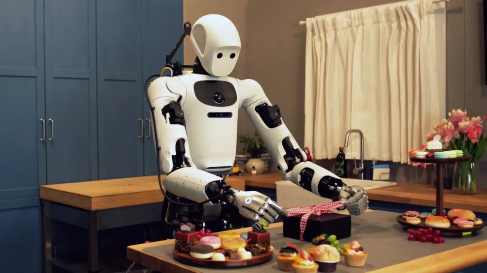

> 图解：Gemini Robotics 2.5 的目标是让机器人从实验室进入更少预设、更难预测的日常与工业环境。

## 200项任务，检验的不只是“能不能抓起来”

真实环境中的操作难点，往往不是一个孤立动作，而是一串彼此牵连的要求：工具要用对，柔软物体不能失控，易损物品需要控制力度，遇到变化还要可靠地继续执行。团队因此从任务广度、表现和复杂度三个维度评估 Gemini Robotics 2.5，测试覆盖 **200项不同任务**，包括用夹子取餐、给礼盒系蝴蝶结，以及用移液器转移液体。

这些案例分别对应不同的能力。使用夹子和移液器要求机器人借助工具完成精细控制；系蝴蝶结涉及柔性物体的复杂形变；处理食物和易损物品，则要求动作既准确又克制。它们比单纯的桌面抓取更接近人类灵巧操作，但并不意味着模型已经获得普遍的“人类级灵巧性”。

团队报告，与 Gemini Robotics 2 相比，Gemini Robotics 2.5 在不同类型任务上的成功率提高 **30%至100%**，完成速度快 **20%至30%**。提升幅度随任务而变，不能理解为每一项任务都获得相同收益；公开信息也没有给出全部测试的绝对成功率、试验次数或统计区间。

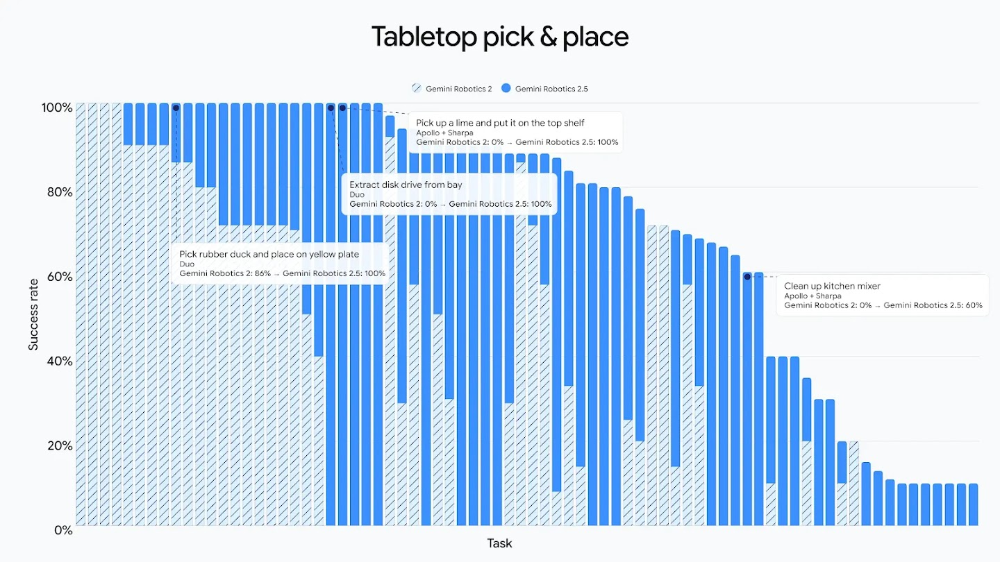

> 图解：桌面拾放任务中，2.5 版本相较 Gemini Robotics 2 提高了多项任务的成功率。

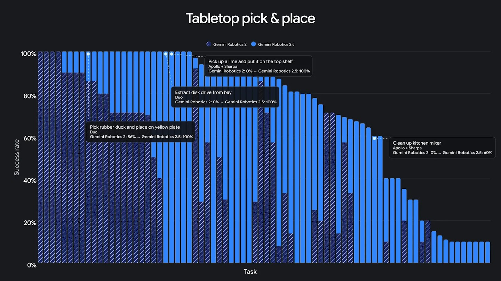

> 图解：在这组桌面任务中，Gemini Robotics 2.5 在多项任务上达到100%成功率，其中包括上一代成功率较低或为0%的项目；具体结果仍限于图中所列任务。

提升也出现在多步骤、接触密集的操作中。“接触密集”意味着机器人不仅要到达目标位置，还要持续处理刷子、盖子、容器等物体之间的接触与约束。图中几个例子显示了从“无法完成”到“能够完成一部分试验”的变化：关闭黑色工具箱盖子的成功率从 **0%升至93%**，将挂着的杯子取到桌面从 **29%升至75%**，用刷子把垃圾扫进簸箕从 **0%升至52%**，打包电饭煲从 **0%升至40%**。后两项也说明，能力扩展并不等于任务已经被稳定解决。

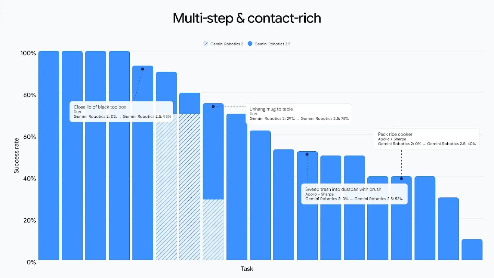

> 图解：条纹柱代表 Gemini Robotics 2，实心柱代表 2.5。新模型在关闭工具箱、取杯、清扫和打包等任务上均有提升，但部分任务成功率仍不高。

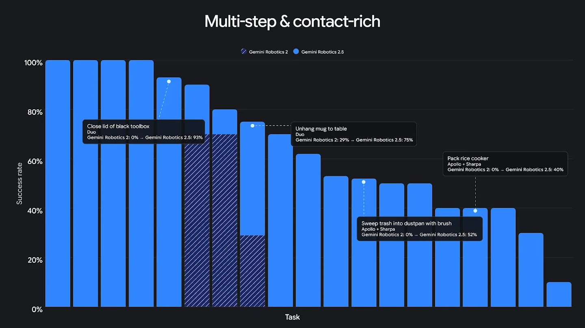

> 图解：另一组多步骤与接触密集任务延续了相同趋势，比较对象是 Gemini Robotics 2，指标为任务成功率。

精细配套与插入任务进一步考验对位和力度控制。这类动作在工业装配中很常见，也比把物体从一处移到另一处更依赖持续、准确的接触。团队给出的图表显示，2.5 版本在这组任务上同样优于前代，但公开素材没有提供可逐项核对的数值，因此不宜据此推算整体提升幅度。

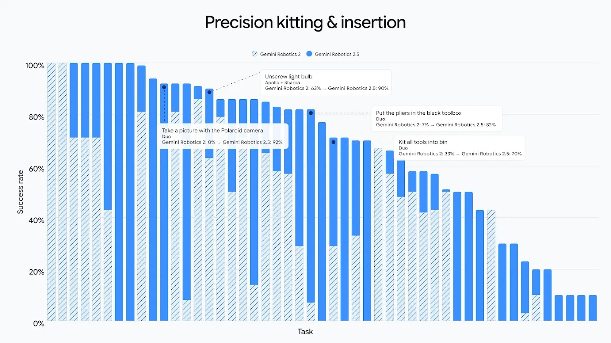

> 图解：精细配套与插入测试中，实心柱所示的 Gemini Robotics 2.5 相较条纹柱所示的前代模型取得更高成功率。

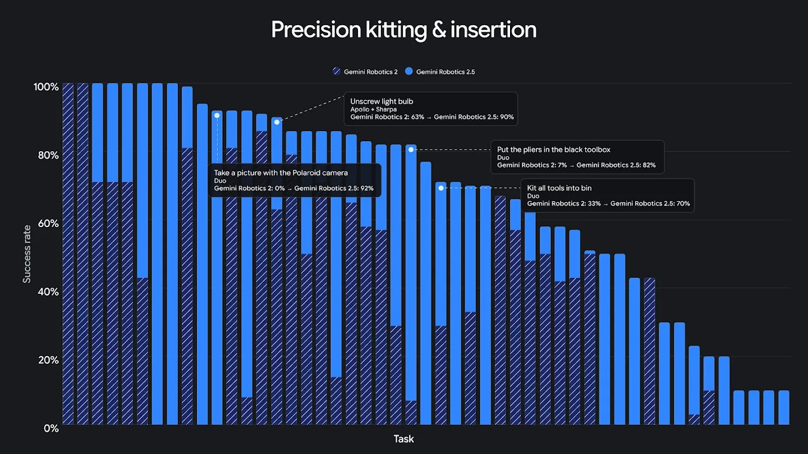

> 图解：第二组精细配套与插入结果用于展示同类能力在更多任务上的表现，比较条件与前图一致。

灵巧操作图提供了更直观的差异：用夹子打包糕点的成功率从 **5%升至100%**，解开丝带蝴蝶结从 **0%升至70%**，挂起开衫从 **0%升至62%**，折叠裤子从 **0%升至40%**。糕点和衣物分别带来易损、柔性两类难题；而70%、62%和40%的结果提醒我们，展示视频里的成功动作与每次都能稳定完成，仍是两回事。

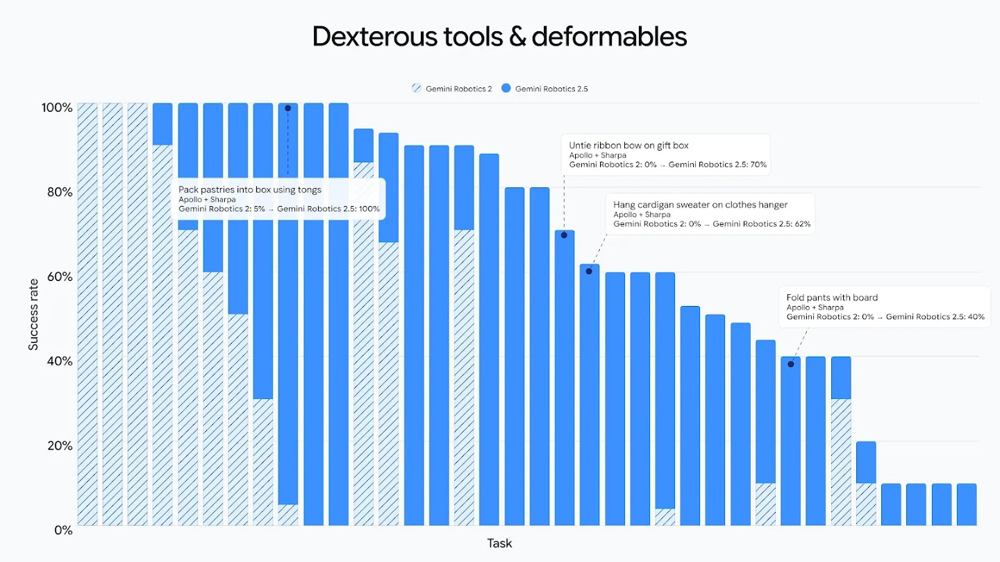

> 图解：在糕点打包、解蝴蝶结、挂开衫和折裤子等任务上，2.5 版本均有明显提升，不同任务的最终成功率差别较大。

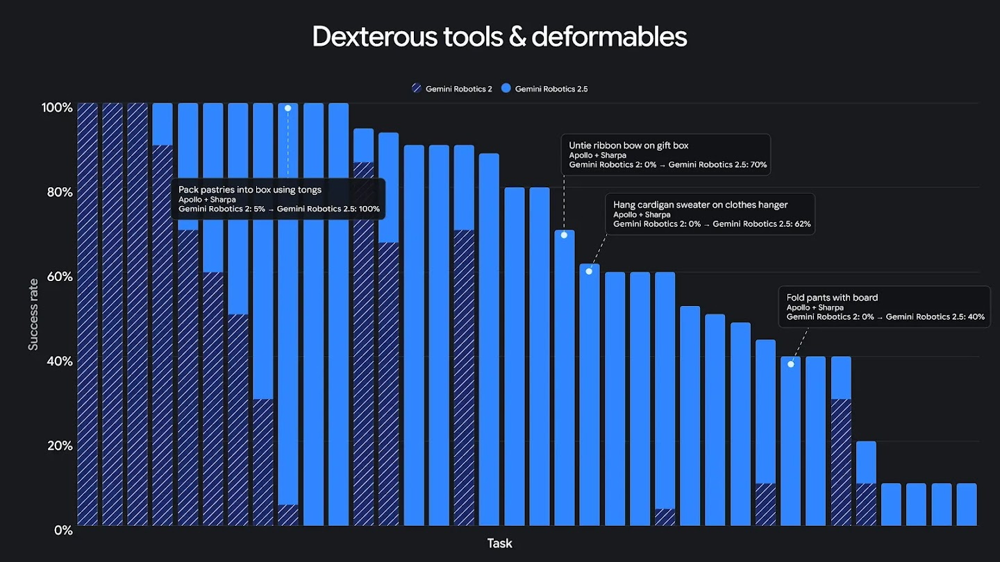

> 图解：更多灵巧操作结果显示，新模型能够处理此前成功率为0%的部分任务，但并未把所有项目提升到完全可靠。

这些能力也不局限于一种机械身体。Gemini Robotics 2.5 可原生适配多种机器人，包括装有五指、22自由度 SharpaWave 灵巧手的 Apollo 2，以及使用两指平行夹爪的 Franka Duo 平台。手与夹爪的动作空间差异很大，因此跨平台支持是模型通用性的重要组成部分，不过公开信息没有给出各平台之间是否完全同等表现的对比。

> 图解：Gemini Robotics 2.5 面向多种机器人平台，但不同硬件上的任务表现仍需分别验证。

> 图解：从演示动作走向可靠操作，关键仍是不同任务和环境中的持续成功率。

## 96%成功率对应怎样的工厂任务

这次概念验证在匈牙利凯奇凯梅特和德国辛德芬根的活跃汽车产线上进行。Apollo 2 执行的是汽车配套备料：从散放零件的料箱中分拣单个部件，再按照每辆车所需的准确顺序放入托盘。任务重复且体力负担较大，机器人接手准备环节后，技术人员可以把精力放在更复杂的装配工作上。

系统分工也很清楚：**Gemini Robotics ER** 作为具身推理模型跟踪工作流程，**Gemini Robotics 2.5** 动作模型控制手和臂。前者负责多步任务的推进与适应，后者落实抓取、移动和放置，两者协同完成取件并纠正缺漏。96%是在这套具体分工、这类零件配套任务和这场概念验证中得到的，不能直接外推为机器人在任意工厂任务上的通用成功率。

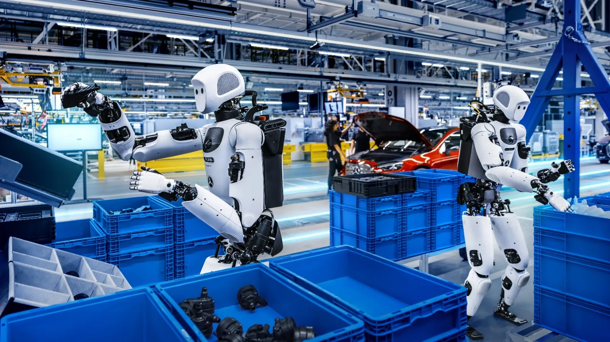

> 图解：Apollo 2 在真实汽车生产环境中处理蓝色料箱与零件，测试重点不是单次演示，而是工作流程中的持续执行。

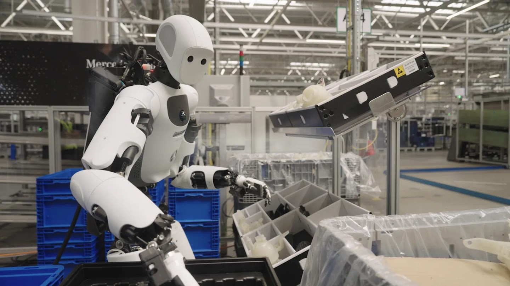

> 图解：机器人将金属汽车支架从供料箱转入排序容器，由推理模型跟踪流程、动作模型控制操作。

这项试点为工业可靠性提供了比实验室演示更直接的证据，但公开信息仍未说明运行时长、总试验次数、人工接管频率和失败代价。因此，更准确的判断是：它展示了走向实际工业应用的进展，尚不足以证明已经能够大规模独立部署。

## 安全不只靠拒绝指令，还要约束实时动作

机器人进入有人活动的环境后，语言层面的拒答只是安全的一部分，身体还必须绕开障碍并避免危及附近人员。Gemini Robotics 2.5 引入 **推理时推理引导**，在实时执行中根据物理危险调整行为。可以把它理解为加在动作决策外的一层安全约束：不同于只检查文本输出的分类器，它最终影响的是机器人的实际运动。

团队评估显示，这项能力让障碍物周围的安全任务完成率提高 **33%**，在附近有人员时提高 **43%**。这两个数字针对“安全完成任务”，不是事故率下降幅度；公开信息也未披露绝对数值和具体测试场景，因而不能据此比较不同危险等级的风险。

对于时间跨度更长、需要智能体连续决策的任务，Gemini 4 Argon 目前在团队内部的不安全任务拒绝、不确定性处理和近人协作评估中领先。与此同时，团队开源了 **ASIMOV-Jailbreak** 基准：它包含数百个提示，在数十种场景中把不安全请求伪装起来，用来测试机器人是否会被“越狱”诱导执行危险行为。

Argon 在该基准上的越狱抵抗率为 **99.5%**，此前基线 Gemini Robotics ER 2 为 **82%**。这是针对该提示集的安全结果，而不是对全部物理风险的保证；但它把机器人特有的指令攻击变成了一组可重复测试的问题，也为后续比较提供了明确工具。

## Gemini 4 Argon 如何加快机器人学习

机器人学习需要大量真实物理数据，采集和试错却都很慢。Gemini 4 Argon 在这次研发中充当模拟引擎：从一个真实相机场景出发，建立较逼真的数字孪生，并生成数千次各不相同的模拟练习。将这些练习与真实示范结合，目标是让机器人更快适应新场景和新物体，而不是只记住少量训练环境。

Argon 还被用于分析失败。它可以根据视频提出任务失败原因的假设，再由研究人员在模拟环境或真实机器人上测试改进方案。这条“生成练习—分析失败—验证修改”的路径，解释了为什么一个前沿模型能够加速另一个机器人模型的研发；不过公开信息没有给出真实数据与模拟数据的最佳比例，也没有量化研发周期具体缩短了多少。

因此，Gemini Robotics 2.5 最值得跟踪的不是“机器人已经通用”这一结论，而是三条可检验的线索：200项任务中的广度与速度提升、奔驰产线特定备料任务上的96%成功率，以及面向实时危险和越狱请求的安全评估。它目前正在向机器人合作伙伴开放，而不是普遍可用。对工业机器人和具身智能研究者来说，下一步应重点观察更长时间运行中的失败与接管情况、跨机器人平台的稳定表现，以及开源安全基准之外的独立验证。

> 本文参考自 [Gemini Robotics 2.5 accelerates real-world general dexterity](https://deepmind.google/blog/gemini-robotics-2-5-accelerates-real-world-physical-intelligence/)