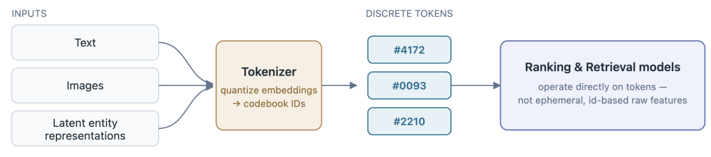
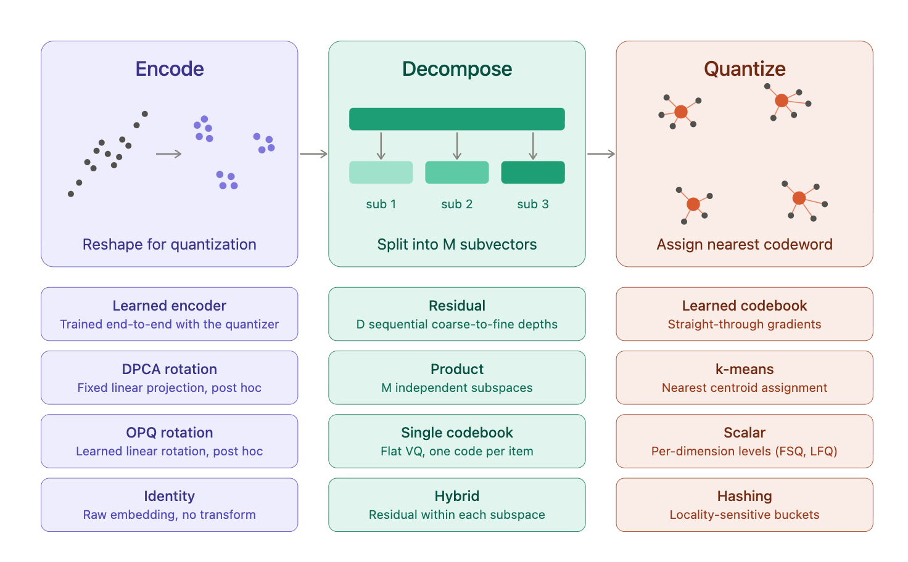
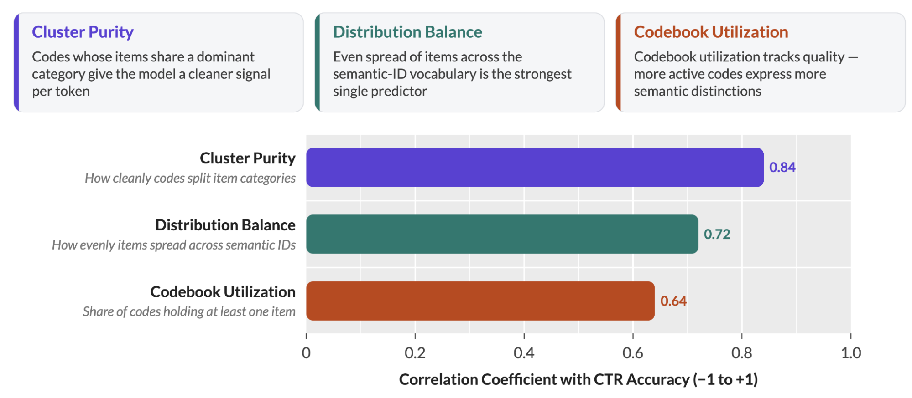
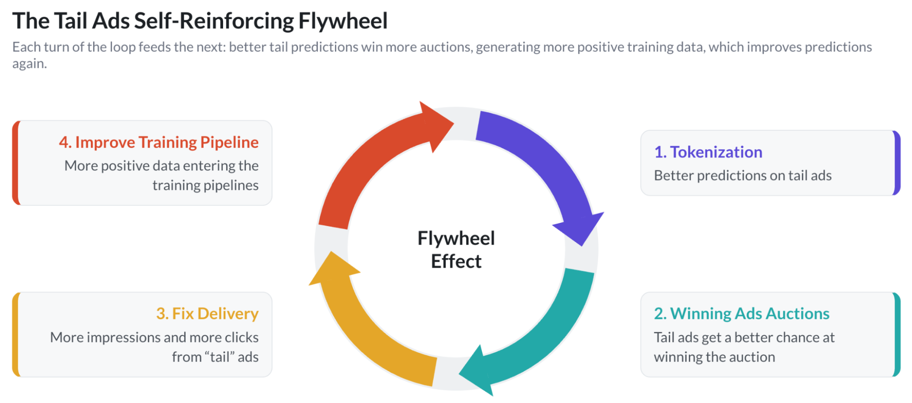

# GenRecs Tokenization：Meta 用“稳定语义词汇表”重构广告推荐的底层表示

一双刚上架的新款越野跑鞋，没有任何历史点击、没有过往广告互动记录——在传统推荐系统里，它几乎等于一个陌生人，模型只能靠随机试探慢慢积累信号。Meta 最近公开的 GenRecs Tokenization 要解决的正是这个问题：不再给每个广告、商品、页面分配一个孤立 ID，而是像语言模型用词表拼出任意单词一样，用一组稳定的语义 token 来表示每个条目。新跑鞋可以“继承”模型对上一代跑鞋品类的全部认知，冷启动还没开始就已经完成了。这套表示与 Meta 的生成式广告模型 GEM 及 Adaptive Ranking Model 搭配后，在 Meta 内部 2026 年 2 月的测量中为广告主带来了 +0.35% 的跨界面转化提升。

## 从“打分”到“推理”：GenRecs 需要什么地基

GenRecs（Generative Recommenders，生成式推荐器）代表了 Meta 广告推荐思路的转变：从对每一个候选广告逐个打分，转向利用 LLM 架构同时推理广告内容与用户偏好，预测对广告主最好的结果。原文给出的关键判断是，预训练语言模型自带的世界知识，可以让广告匹配跳出“点击模式匹配”的层面——即使面对一个没有任何互动历史的全新商品，系统也能理解它“是什么”，进而推断它与用户偏好的关系。

但 LLM 不会直接读广告数据库。让这一切成立的前提，是把 Meta 广告生态里的每一个条目翻译成模型能处理的词汇。这就是 GenRecs Tokenization 的定位：语言模型用有限的语义 token 词汇表组合出任意概念，而不是为世界上每个概念维护一个专用 ID。相似的条目共享 token，就像相关的词共享词根。上一季和这一季的两则跑鞋广告之间有明显的 token 重叠，于是新广告系列一上线就能受益于模型对旧产品的全部学习成果。

这套词汇表是结构化的，覆盖系统中的所有条目类型——广告、商品、页面、像素——同时支撑检索（retrieval）和排序（ranking）两个环节。

> 图解：Tokenization 在整条链路中的位置。左侧输入包括文本、图像和潜在实体表示，Tokenizer 将 embedding 量化为 codebook ID，产出一段离散 token（如图中的 #4172、#0093、#2210），右侧的排序与检索模型直接在这些 token 上工作，而不是在易失效的、基于 ID 的原始特征上工作。

## 三阶段流水线：编码、分解、量化

具体做法上，预训练的多模态模型先读取每个广告、商品和页面的文本与图片，把条目编码成携带世界知识的 embedding。Tokenizer 再把这份内容信号与从用户互动行为中学到的表示结合起来，量化成一小段离散 token。

核心是一个三阶段流水线：把每个条目编码进语义 embedding 空间；将 embedding 分解到若干独立子空间；再把每个子空间映射到 codebook（码本）中的一个条目。本质上，这相当于把连续向量“查字典”换成一串离散码字，只不过这本字典是按语义组织的。

> 图解：Encode（编码，为量化重塑表示）、Decompose（分解，切分为 M 个子向量）、Quantize（量化，分配最近的码字）三个阶段各自有多种可选实现。编码侧有与量化器端到端联合训练的 Learned encoder、事后固定线性投影的 DPCA rotation、事后学习线性旋转的 OPQ rotation，以及不做变换的 Identity；分解侧有 D 级由粗到细的 Residual、M 个独立子空间的 Product、单码本 flat VQ，以及在每个子空间内做残差的 Hybrid；量化侧有直通梯度（straight-through）的 Learned codebook、最近质心分配的 k-means、逐维度分级的 Scalar（FSQ、LFQ），以及局部敏感哈希。

Meta 的经验是，不存在单一的“最优配方”：要最大化广告推荐质量，需要根据实体和特征的语义组合不同阶段。例如对许多广告表示，GenRecs Tokenization 使用的是 prefix n-gram 方案，组合了学习型编码器、残差分解、学习型向量码本和 token 参数化。

## Tokenizer 质量可以直接预测排序精度

迭代 tokenizer 通常要等一次完整的下游模型训练才能验证效果，代价很高。Meta 给出的一个实用结论是：不必等。他们测试了八个 tokenizer 版本，发现三个内在质量指标与下游排序模型的 CTR 预测精度之间存在强相关——内在指标更好的版本，CTR 预测也更准。

这三个指标分别是：

- **Cluster Purity（簇纯度）**：共享同一码的条目倾向于属于同一品类，每个 token 给模型的信号更干净；
- **Distribution Balance（分布均衡）**：条目在语义 ID 上均匀分布，而不是挤在少数几个码里；
- **Codebook Utilization（码本利用率）**：更多码字至少承载一个条目，词汇表能表达更细的区别。

> 图解：三个内在质量指标与 CTR 预测精度的相关系数（横轴，范围 −1 到 +1）。簇纯度 0.84、分布均衡 0.72、码本利用率 0.64。原图同时指出，分布均衡——条目在语义 ID 词汇表上分布的均匀程度——是最强的单一预测因子；码本利用率衡量的是至少承载一个条目的码字占比。

这个结论的工程价值很直接：因为内在指标能预测下游收益，团队可以围绕 tokenizer 本身快速迭代，比如通过 diversity loss、dead code reset（重置闲置码字）和对比学习目标来优化码本质量，而不必每次都跑完整训练周期。

## 尾部广告的自增强飞轮

Tokenization 对不同类型的广告作用不同。对高量级广告系列，它通过挖掘庞大商品目录中的深层语义模式提升效率；对展示量稀少的尾部广告，作用更关键——模型可以借助共享的内容结构在条目之间泛化，从而修复冷启动表现，实现跨实体的知识迁移。运动品牌发布下一季越野跑鞋时，新产品及其广告在任何用户看到之前，就已经建立在模型对上一季产品的学习之上。

更重要的是这会形成自增强的飞轮：尾部广告预测变准之后，这些广告在竞价中赢得更多展示和点击，产生更多正向训练数据，而更好的训练数据又提升所有广告的预测质量。每转一圈，模型都更好一点。

> 图解：飞轮的四个环节。1）Tokenization 带来更好的尾部广告预测；2）尾部广告有更大机会赢得广告竞价；3）投放修复，尾部广告获得更多展示和点击；4）更多正向数据进入训练流水线，反过来继续改善预测。

Meta 还在探索这套词汇表能走多远。基于共享 LLM 编码器构建的双塔架构，在检索质量上达到了 SOTA 水平，同时保持了高效可服务性，并且只用经典双塔一小部分训练数据就追平了其性能。在此之上，团队正在同一词汇表上扩展具备推理能力的排序。这说明 tokenizer 的改进不局限于它调优时针对的那个模型——码本质量提升对下游是普适的。

## 三个推进方向与一处取舍

原文列出了继续把 GenRecs Tokenization 推向“ROI 最优前沿”的三个方向：

- **深化冷启动泛化**：尾部广告库存是语义 token 贡献最大、广告主影响也最大的地方，团队正在把 tokenization 的覆盖扩展到所有条目；
- **把 tokenizer 质量当作一等目标**：与互动行为对齐的训练、统一的跨实体词汇表、码本改进都是活跃投入方向；
- **高效服务 LLM 原生架构**：完全文字化（verbalized）的 tokenization 能给模型最丰富的广告视图，但所需的上下文窗口在广告规模下不现实，Meta 的做法是把压缩后的文字化 token 与语义 ID 结合，在保住推理质量的同时维持可接受的延迟。

最后一项值得单独说明：它承认了语义 token 方案的核心代价——表示越丰富，推理成本越高，工程上必须在“信息保真”和“服务延迟”之间取一个点，而不是全都要。

更长远的设想是，用同一词汇表统一跨界面、跨模态的表示：一个横跨文本、图像、音频、视频的共享 token 空间，让模型用一套表示同时推理“用户对什么感兴趣”和“广告主能提供什么”，而不是把分别训练的 embedding 拼接起来。

## 结语

回到开头的问题：当推荐系统从判别式打分走向生成式推理，数据地基也需要从易失效的 ID 换成稳定的语义表示。GenRecs Tokenization 给出的证据包括：内部测量的 +0.35% 转化提升、内在质量指标与下游 CTR 精度 0.64–0.84 的相关系数，以及双塔检索用更少数据追平经典架构的结果。需要注意的限制是，这些数字均来自 Meta 内部数据和自家生产系统，外部难以复现，+0.35% 的绝对幅度也需结合 Meta 广告大盘基数来理解。对于做推荐的团队，最值得借鉴的一条具体经验是：tokenizer 的内在质量指标（分布均衡、簇纯度、码本利用率）可以作为下游效果的先行指标，让词表迭代不必绑死在完整训练周期上。

> 本文参考自 [GenRecs Tokenization: Transforming Ads Recommendation at Meta with Stable Model Vocabulary](https://engineering.fb.com/2026/10/19/ml-applications/genrecs-tokenization-transforming-ads-recommendation-at-meta-with-stable-model-vocabulary/)