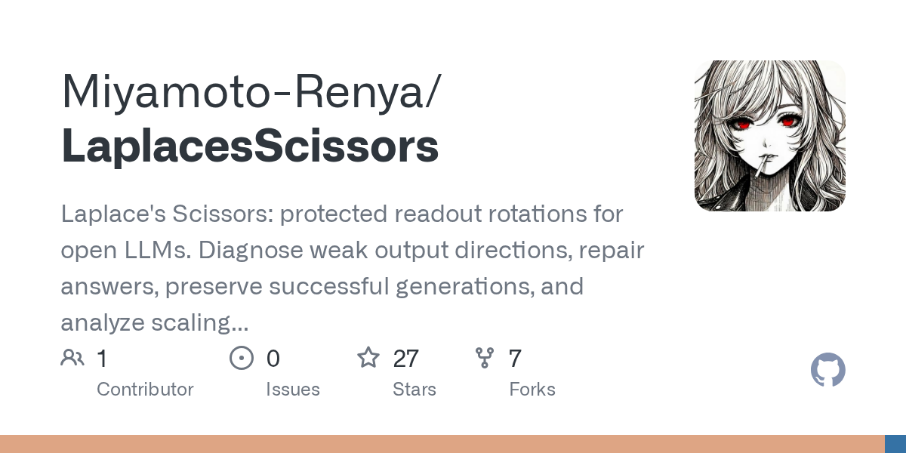

# Laplace’s Scissors：修错答，也保住对答

修改一个开源大模型的错误答案，难点不只是让目标答案出现，还包括别顺手破坏原本正确的生成。Laplace’s Scissors 把这件事写成了可检查的约束：在模型的读出阶段施加旋转变换，要求失败案例达到目标答案，同时限制原有输出的变化，并用真实 GPU 输出验证每个候选方案。

它不是一套重新训练模型的流程，也没有在项目中给出通用能力 benchmark。它提供的是一组更局部、更可复现的工具：寻找弱输出方向、修复指定答案、保存修改后的 checkpoint，以及观察同一修改策略在不同规模模型上的表现。



> 图解：项目以“受保护的读出旋转”为核心，围绕数值探测、答案修复、checkpoint 导出和规模分析组织工具链。

## 旋转读出层，而不是重写整个模型

在常见的线性读出层中，最终隐藏状态经过输出矩阵得到词表 logits。Laplace’s Scissors 在运行时先旋转最终隐藏向量，再乘原始输出矩阵，即计算 $W(Rh)$；导出模型时，则把同一份修改落实到输出矩阵中。共享 embedding 与读出权重的模型也只在 readout 调用处应用旋转，避免把输入 embedding 一并改掉。

“受保护”不是一句笼统的效果描述，而是一组明确条件。数值探测会保护原始输出矩阵的行 Gram 矩阵、两个隐藏状态的中点，以及参考和对照状态；答案修复则检查词表 margin、目标答案与 EOS、保护输出误差，以及原本成功生成的完整路径。候选方案只有在实际 GPU readout 或完整生成验证中满足这些条件，才会被接受。

项目的主流程因此是：从原始 checkpoint 观察隐藏状态，计算受保护的读出旋转，进行 GPU 验证，保存被接受的 proposal，最后直接生成或导出新模型。

| 目的 | 命令 | 主要输出 |
| --- | --- | --- |
| 获取模型并检查结构 | `fetch`、`inspect` | 固定 revision、文件哈希、执行图 |
| 在数值输入中追踪弱区分方向 | `probe` | 层间抵消、坐标贡献、受保护旋转 |
| 根据期望答案修改输出 | `diagnose` | 经真实输出检查的旋转候选、已接受 proposal |
| 使用原始或修改后的模型生成 | `generate` | Greedy 答案 |
| 把修改保存为 checkpoint | `export` | 修改后的输出矩阵和模型文件 |
| 分析不同模型规模下的偏差 | `scale` | 损失曲线、已恢复偏差、权重贡献 |

## probe：寻找“变化了，输出却分不清”的方向

`probe` 面向的不是自然语言问答案例，而是从模型权重构造的数值输入。它按随机种子选择 embedding 行，形成数值前缀、参考向量和正交归一基，再把两个与参考向量范数相同的向量直接注入 decoder 输入。程序用 Jeffreys divergence，也就是输出分布之间的对称 KL 散度，衡量两次响应的差异。

这里的“弱方向”有特定含义：在已记录的数值输入分布下，等量注入造成的输出区分度较低。搜索基的最大维度由 `--directions` 控制，实际维度还受隐藏宽度和 embedding 差异矩阵秩的限制；`--prefix-length` 决定注入位置之前有多少数值向量，`--probe-angle` 则以弧度指定构造两个输入所用的球面角。

一个候选方向先由小型响应 Gram 矩阵的最小特征向量提出，再通过真实 decoder 测量，与已有基方向的 divergence 比较。随后，程序从所选两次运行的残差分支计算各层带符号的贡献，并在负贡献最大的分支中报告权重坐标和 attention head 汇总。`--intervention-fraction` 会双向改变所选坐标的幅度，每次从固定的数值前缀重新运行，把实测干预效果与带符号贡献分别记录，而不是将二者混为一谈。

旋转阶段最多检查角度上限内的三个候选，只有实测 divergence 增加且保护误差满足 tolerance 的方案才会保存。`--max-angle-degrees`、`--max-edit-norm` 和 `--tolerance` 分别限制角度、权重变化量与保护输出误差。保存的输入可以 replay；加上 `--proposal` 后，还会让保存的输入对重新经过完整 decoder。

结果文件同时记录输入与模型哈希、真实硬件和精度、divergence、层与权重坐标、保护误差、数值残差及各阶段执行次数。proposal version 3 还保存 divergence 目标和注入输入哈希，重新应用时会校验权重及执行配置哈希。这些设计让一次“方向变好了”的判断能够回到具体输入、模型和运行环境，而不只停留在一张分数表上。

## diagnose：把正确答案和原有成功路径都写进条件

答案修复从 JSONL 案例开始。`expected` 是 `choices` 中正确答案的零基索引，模型则根据 `prompt` 生成答案字符串。例如：

```json
{"id":"sum","prompt":"What is 2 + 2? Reply with the number only.","choices":["3","4","5"],"expected":1,"oracle":{"sum":4}}
```

程序使用模型原始 chat template 构造并固定 prompt 的 token 前缀，另行编码期望答案并追加 EOS，形成目标 token 序列。答案正文必须能经过 tokenizer 往返后保持完全一致。若原始生成以 EOS 结束且与期望字符串精确一致，这条生成的每个前缀都会被保护；对于失败案例，则要求每个目标答案 token 和 EOS 的分数高于词表中的所有竞争 token。

单平面搜索中，`--max-planes` 指定要调查的旋转平面数，`--max-angle-degrees` 限制角度，`--margin` 设置目标 token 相对所有竞争 token 的最小 logit 间隔。保护输出的逐元素变化量会除以 $1+|\text{原始 logit}|$ 再与 `--tolerance` 比较，后者默认是 `0.00002`；不等式还会加入由该容差和观测 logit 幅度推导的数值余量。程序合并每个平面的禁止区间，寻找权重变化最小的角度，再按变化量顺序用真实 GPU readout 检查候选。

多个目标不一定能靠单个平面同时修好，因此平面候选之后还有联合响应计算。`--joint-steps` 默认执行 12 步调整，设为 0 则只运行平面候选；`--joint-rank` 默认把联合旋转基限制在 64 维。联合旋转同样受最大主角和输出权重变化 Frobenius 范数约束。

为减少搜索开销，联合搜索只计算并共享一次输出基和成本 Gram 矩阵；当响应数的两倍小于旋转维度时，Cayley 方程改在更小的空间求解。候选评分使用 GPU 上的压缩输出基，搜索结束后再求一个保持观测结果、同时最小化权重变化的旋转 completion。最终仍要回到原始 GPU readout，确认角度与成本上限、所有前缀的 token 选择、已满足的 margin 和保护容差都没有被破坏。

修复 proposal 可以表示为正交平面量与半角坐标，也可以表示为正交联合基和一个小型正交矩阵。`generate --proposal` 支持 version 1、2、3；重新应用答案修复 proposal 时，会检查权重、配置、tokenizer 文件哈希和输出运算约定。

如果需要知道修改来自哪里，`--attribution-rows` 默认报告 6 个输出行的重要坐标、撤销该行修改后的损失、贡献总和与积分误差。贡献沿指定的直线 readout 干预路径计算，并保留负值；设为 0 则只保存生成 proposal 和验证结果。

## 从运行命令到可导出的 checkpoint

运行环境需要 Rust 工具链、可导入 Triton 3.8 的 Python，以及 CUDA 或 HIP 驱动。Python 负责 Triton 编译桥接，Rust 负责模型加载、tokenization、执行、修改计算和结果存储。模型、kernel 与运行结果放在 `LAPLACE_CACHE`，后端和设备通过 `LAPLACE_BACKEND=auto|cuda|hip` 与 `LAPLACE_DEVICE` 选择。

```bash
export LAPLACE_CACHE="${XDG_CACHE_HOME:-$HOME/.cache}/laplaces-scissors"
export LAPLACE_PYTHON=python3
cargo build --release

cargo run --release -- fetch Qwen/Qwen3-0.6B
cargo run --release -- inspect Qwen/Qwen3-0.6B --out "$LAPLACE_CACHE/graph.json"
cargo run --release -- cases --count 12 --seed 7 --out "$LAPLACE_CACHE/cases.jsonl"
```

Hub 模型会固定到 commit SHA，并记录每个文件的 SHA256；也支持指定 revision、Hugging Face URL 或本地 safetensors 目录。一个典型的修复与验证调用如下：

```bash
cargo run --release -- diagnose Qwen/Qwen3-0.6B \
  --cases "$LAPLACE_CACHE/cases.jsonl" \
  --max-planes 8 --max-angle-degrees 120 --margin 0.05 \
  --max-new-tokens 64 --context 2048 --time-budget 20m \
  --out "$LAPLACE_CACHE/runs/rotation"

cargo run --release -- generate Qwen/Qwen3-0.6B \
  --prompt 'What is 2 + 2? Reply with the number only.' \
  --proposal "$LAPLACE_CACHE/runs/rotation/proposal.json"
```

时间预算从模型文件获取完成后的加载阶段开始，覆盖计算和归因分析。运行状态会区分 `complete`、预算耗尽的 `partial` 和执行错误的 `failed`；报告还记录模型 revision、输入 token 路径、权重数据类型、硬件、实测验证值和关键调用次数。这意味着 `partial` 不能被当成一次完整搜索的成功结果。

若要把 proposal 变成可独立加载的模型，`export` 会保留其他原始 tensor，把修改后的 `lm_head.weight` 以 FP32 写入，并解除 embedding 与 readout 的权重绑定，同时保存配置、执行图和 shard index。输出矩阵通过 CPU F64 分块乘法计算；`materialization.json` 记录原始 revision 与哈希、应用的 proposal、实测权重变化范数和 FP32 存储舍入误差。decoder tensor 仍保留各自的原始存储类型，运行时按 tensor 实际 dtype 读取。

## scale：同一修改预算下，偏差恢复了多少

`scale` 把同一套修改策略用于一系列 checkpoint。输入 manifest 指定资源轴、固定指数、修改范数预算、修复案例、独立评估案例，以及按资源量递增排列的 checkpoint。固定指数与前两个 checkpoint 用来锚定幂律参考曲线，再测量更大规模模型相对曲线的偏差。

所有 checkpoint 使用相同的 `max_edit_norm` 和诊断选项，CLI 参数可以覆盖 manifest 中的预算。修复与评估使用不同 prompt：评估损失是包含 EOS 的期望答案负对数概率，先除以答案的 UTF-8 字节数，再对案例取平均。

`scale-report.json` 保存实测损失曲线、恢复的偏差量、各 checkpoint 的输出权重贡献和撤销输出行的影响。不同 checkpoint 的坐标都标注所属模型及 tensor 行列位置。这里分析的是固定 decoder 之后的 readout 旋转，以及给定参考曲线下的偏差变化，不应直接解释为模型规模扩大后通用能力必然提升或下降。

## 实现范围与验证边界

当前执行图支持独立 Q/K/V projection、causal grouped-query attention、RMSNorm 与 LayerNorm、基础 RoPE、SiLU/GELU/ReLU 系列 gated MLP 和线性 readout。存储权重支持 F32、F16、BF16，执行状态使用 F32，平面和不等式计算使用 F64。标准 dense decoder 配置可以自动构建执行图，也可通过 `laplace.graph.json` 显式指定 tensor 连接；所需运算和 tensor 形状会在加载时验证。

| 检查 | 覆盖范围 |
| --- | --- |
| 默认测试 | 旋转、不等式、联合响应、归因和规模偏差的计算约定 |
| GPU 集成测试 | 真实运算、proposal 应用、生成路径和数值注入 |
| 编译器测试 | 根据收集的运算约定生成 CUDA code object |
| Qwen 参考测试 | 独立 Rust 全上下文计算与 Triton 执行的一致性 |

默认测试还覆盖开区间边界与单点解、保护旋转、贡献和、规模偏差，以及 softmax、RMSNorm、LayerNorm 的有限差分恒等式。完整模型 GPU 测试检查前缀验证与再生成的一致性、原始哈希、KV rewind、共享 readout 和三个合成 checkpoint 上的规模分析；数值注入测试则比较 token 与直接输入路径，并检查坐标干预分离、proposal 保存和完整 decoder replay。

这些测试说明了项目如何降低实现错误的风险，但不等同于对真实模型修复成功率的系统评估。项目材料没有给出跨模型、跨任务的准确率提升或性能数字，因此目前更合适的定位是一个带严格验证和可复现记录的研究工具，而不是已经证明普遍有效的模型修复方案。

如果你的需求是修复一组能明确写出期望答案的案例，同时必须保留已知正确生成，这套工具值得试验；使用时应同时检查保护案例、预算耗尽状态、模型与 tokenizer 哈希，并用独立输入评估副作用。运行产物包含 prompt 和环境信息，分享前也需要审阅。项目以 MIT License 发布，模型 checkpoint 仍遵循各自原始发布者的许可证。

> 本文参考自 [GitHub - Miyamoto-Renya/LaplacesScissors: Laplace's Scissors: protected readout rotations for open LLMs. Diagnose weak output directions, repair answers, preserve successful generations, and analyze scaling deviations with Rust and Triton on CUDA/HIP.](https://github.com/Miyamoto-Renya/LaplacesScissors)