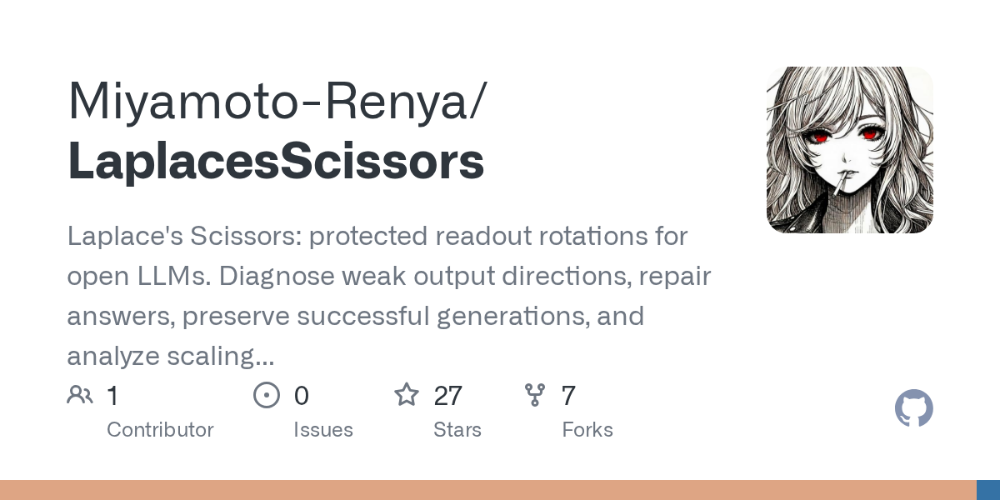

# Laplace’s Scissors：修错答，也保住对答

修改开源大模型的错误答案，难点不只是让目标答案出现，还要避免破坏原本正确的生成。Laplace’s Scissors 把这件事写成可检查的约束：在读出阶段施加旋转，要求失败案例达到目标答案，同时限制原有输出变化，并用真实 GPU 输出验证候选方案。它不重新训练模型，也没有给出通用能力 benchmark，定位是局部、可复现的研究工具。

## 旋转读出层，而非重写模型

线性读出层通常由最终隐藏状态经输出矩阵得到词表 logits。该项目在运行时计算 $W(Rh)$，导出时再把旋转落实到输出矩阵；共享 embedding 与读出权重时，也只修改 readout 调用，避免影响输入 embedding。

“受保护”对应明确条件：数值探测保护输出矩阵的行 Gram 矩阵、隐藏状态中点及参考状态；答案修复则检查词表 margin、目标答案与 EOS、输出误差和原本成功生成的完整路径。只有实际 GPU readout 或完整生成验证通过，候选才会被接受。`fetch`、`inspect`、`probe`、`diagnose`、`generate`、`export` 和 `scale` 分别覆盖模型获取、结构检查、方向探测、答案修复、生成、导出与规模分析。

## 从弱方向探测到答案修复

`probe` 使用由模型权重构造的数值输入，而非自然语言问答。它注入两个与参考向量范数相同的向量，以输出分布的对称 KL 散度寻找“输入变化了，输出却分不清”的方向。候选先由响应 Gram 矩阵的最小特征向量提出，再经真实 decoder 测量；旋转最多检查三个候选，且必须实测提高区分度并满足保护容差。结果记录输入与模型哈希、硬件、精度和执行次数，保存的输入还可重新经过完整 decoder。

`diagnose` 从 JSONL 案例读取 prompt、选项和正确答案，固定原始 chat template 的 token 前缀，并将期望答案与 EOS 组成目标序列。原始生成若与期望字符串精确一致，其每个前缀都会受到保护；失败案例则要求每个目标 token 和 EOS 胜过所有竞争 token。单平面搜索受角度、margin 和权重变化约束，保护容差默认 `0.00002`；联合搜索默认执行 12 步、使用至多 64 维旋转基，最终仍回到原始 GPU readout 验证全部条件。

## 能导出，也有明确边界

运行需要 Rust、可导入 Triton 3.8 的 Python，以及 CUDA 或 HIP。`export` 保留其他原始 tensor，将修改后的 `lm_head.weight` 以 FP32 写入，并记录来源哈希、权重变化范数和存储舍入误差。`scale` 则在相同修改预算下比较多个 checkpoint，用独立评估案例测量损失及相对幂律参考曲线的偏差恢复；这不能直接解释为通用能力随规模提升或下降。

项目测试覆盖计算约定、真实 GPU 运算、proposal 应用和生成路径，但不等于真实模型修复成功率的系统评估，材料也没有跨模型、跨任务的准确率数字。回到最初的问题：若需要修复一组能明确写出期望答案的案例，同时保住已知正确生成，这套工具值得试验；使用时仍应检查保护案例、预算耗尽状态、模型与 tokenizer 哈希，并用独立输入评估副作用。

> 本文参考自 [GitHub - Miyamoto-Renya/LaplacesScissors: Laplace's Scissors: protected readout rotations for open LLMs. Diagnose weak output directions, repair answers, preserve successful generations, and analyze scaling deviations with Rust and Triton on CUDA/HIP.](https://github.com/Miyamoto-Renya/LaplacesScissors)