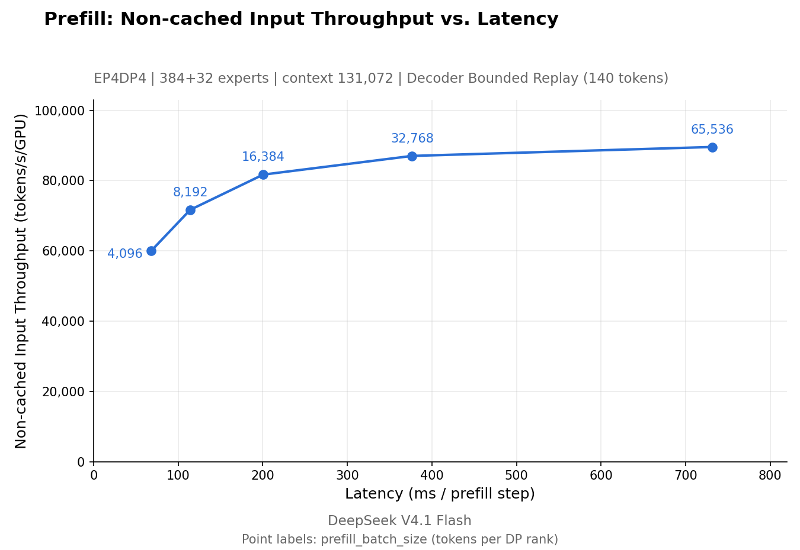

# DeepSeek 开源生产级推理框架 DeepInfer：支撑线上大规模服务的引擎长什么样

做推理框架的不少，但把支撑线上大规模生产服务的引擎原样拿出来开源，这样的例子并不多见。DeepSeek 近日在 GitHub 上开源了 DeepInfer——按官方说法，这正是驱动其生产服务的高性能推理框架，本次开源版本提供离线推理能力，以及规模化服务所需的核心特性。

对关注大模型推理工程的人来说，这份仓库的价值不在于又一个能跑模型的框架，而在于它把生产环境中真正起作用的机制摆到了明面上：投机解码的置信度调度、滑动窗口注意力的有界重放、批次无关推理、确定性采样……每一项都附带具体的环境变量配置，可以直接复现。

## 支持什么模型，跑在什么硬件上

目前 DeepInfer 支持的模型只有一个：DeepSeek-V4.1-Flash。硬件方面覆盖两类：NVIDIA SM100 GPU（即 Blackwell 架构的 B 系列）和华为昇腾 950 NPU。这是一个明显面向新硬件的框架，环境要求也相应较新——Linux、GCC 13.0 以上、Python 3.12，NVIDIA 平台需要 CUDA 13，昇腾平台需要 CANN 9.2。

值得注意的是，官方明确列出了**不包含**的部分。一个完整的推理服务还需要三样东西：KV cache 系统、VE/Prefill/Decode 分离部署（官方注明引擎侧的大部分必需功能已经实现），以及面向 prefill 和 decode 两类数据并行副本的负载均衡。换句话说，开源的是一个强引擎核心，而不是开箱即用的整套服务系统——想拿它搭生产服务，这三块要自己补齐。

## 核心特性：从 kernel 到调度的全套优化

DeepInfer 的特性清单可以分几个层次来看。

底层是优化的 kernel 和运行时，包括 FlashMLA、DeepGEMM、DeepEP、TileKernels、DeepSelect，以及一组自研的 TileLang kernel。这些名字对关注 DeepSeek 开源动态的人并不陌生——它们此前多以独立项目形式发布，现在被整合进了同一个推理框架。

并行策略上，注意力部分采用数据并行（DP）加均衡的上下文并行（CP），MoE 部分采用专家并行（EP）并配合 EPLB（专家并行负载均衡）。这与 DeepSeek 此前披露的线上推理架构思路一脉相承。

再往上有几个值得单独展开的特性：

- **DSpark 与置信度调度验证**：用草稿 token 加速解码，并依据置信度估计来安排验证。通过 `DEEPINFER_ENABLE_MTP_VARLEN=1` 开启，`DEEPINFER_USE_NEXTN_DECODE` 控制最大草稿长度（默认 5）。
- **Decoder SWA 有界重放**：只重放有界的后缀，以此削减 decoder 的 prefill 工作量。V4.1 默认配置下设置 `DEEPINFER_YOCO_PREFILL_TRUNCATION_MODE=compact`、`DEEPINFER_YOCO_PREFILL_KEEP_TOKENS=140`；官方提醒，保留的后缀必须覆盖 SWA 窗口加上最大回溯长度。
- **异步调度**：CPU 侧的批次调度与设备执行重叠，即所谓零开销批次调度器，默认开启。
- **批次无关推理（batch-invariant inference）**：保证不同批次组合下模型结果完全一致，用 `DEEPINFER_BATCH_INVARIANT=1` 开启（仅 NVIDIA）。
- **确定性采样**：相同输入 token 和采样参数产生完全相同输出。需要 `DEEPINFER_BATCH_INVARIANT=1`、`DEEPINFER_ENABLE_MTP_VARLEN=0`，并向 SamplingParams 传入固定的 `seq_seed`（仅 NVIDIA）。
- **结构化输出**：可将生成约束在正则表达式、JSON schema 或 EBNF 语法内，通过 SamplingParams 传入 `so_args={"schema_type": ..., "schema": ...}` 即可。

其中批次无关推理和确定性采样，对需要可复现实验、做评测、或对输出一致性敏感的业务（比如 RL 训练中的采样环节）尤其重要——这通常是大规模推理系统里很难做好、也很少被框架显式承诺的性质。

## 性能数据：prefill 与 decode 的帕累托曲线

官方给出了两组基准，测试条件是 prefill 用 4 张 SM100 GPU、decode 用 64 张，各自位于同一个 scale-up 域内，复现脚本见仓库中的 run_sweep.sh。

> 图解：DeepSeek V4.1 Flash 的 prefill 阶段「非缓存输入吞吐 vs. 延迟」帕累托曲线。测试条件为 EP4DP4、384+32 个专家、上下文长度 131,072，并启用了 Decoder Bounded Replay（保留 140 token）。横轴是单步 prefill 延迟（毫秒），纵轴是每 GPU 的非缓存输入吞吐（tokens/s），各点标注的是每个 DP rank 的 prefill batch size。

这张图读法很直接。batch size 从 4,096 提到 16,384 时，吞吐从约 60,000 tokens/s/GPU 涨到约 81,000，延迟从约 70ms 涨到约 200ms，收益明显。继续加大到 65,536，吞吐只爬到约 88,000 左右，延迟却冲过 700ms——曲线已经相当平缓。也就是说，在 4 卡规模下，16K 上下的 batch 是吞吐和延迟比较均衡的工作点。

> 图解：decode 阶段「输出吞吐 vs. 交互性」帕累托曲线。测试条件为 EP64DP64、384+64 个专家、上下文长度 131,072、nextn=3 固定草稿长度，逐 token 接受率 75%（等效每次前向约 τ=3.25 个 token）。横轴是单用户速度（tokens/s/user），纵轴是每 GPU 输出吞吐（tokens/s），各点标注的是每个 DP rank 的并发请求数。

decode 侧展示的是经典的吞吐与单用户体验的权衡：8 个并发请求时，单用户能拿到约 325 tokens/s 的速度，但每 GPU 总吞吐只有约 2,600 tokens/s；把并发拉到 256，总吞吐达到约 26,300 tokens/s/GPU，单用户速度则降到约 103 tokens/s。75% 的草稿接受率（等效每步约 3.25 个 token）也说明投机解码在这条曲线上起到了实质作用。运营方可以按业务对交互速度的要求，在这条曲线上选点。

## 怎么上手

构建过程很简短：建好一个空的 Python 3.12 环境后，导出 `DEEPINFER_ACCELERATOR=nvidia`（昇腾平台用 `ascend`，且运行环境也要保持该变量），然后执行 `./build.sh`。跑离线推理只需 `python examples/offline_inference.py`。默认 checkpoint 是 deepseek-ai/DeepSeek-V4.1-Flash-1017，首次运行会下载到 Hugging Face 缓存；本地已有权重则设 `DEEPINFER_HF_MODEL_DIR` 指向它。

## 写在最后

DeepInfer 的意义可以分两层看。对想用 DeepSeek-V4.1-Flash 自建推理的用户，它给出了一个官方口径的高性能起点，尤其在 SM100 和昇腾 950 这类新硬件上。对做推理系统研究的人，它更像一份生产系统的「解剖样本」——置信度调度的投机解码、SWA 有界重放、批次无关性这些机制，此前多散见于论文和博客，现在有了可直接阅读的实现。

限制也很明确：当前只支持一个模型，KV cache、PD 分离和负载均衡需要自己补，批次无关和确定性采样仅限 NVIDIA。框架以 Apache 2.0 协议开源。官方在致谢中说明，DeepInfer 最初主要构建在 vLLM 之上，并参考了 SGLang 和 TensorRT-LLM 的设计——想评估它的工程底子，这三条技术谱系是很好的参照系。

> 本文参考自 [GitHub - deepseek-ai/DeepInfer: DeepInfer: High-performance, large-scale inference framework for DeepSeek models](https://github.com/deepseek-ai/DeepInfer)