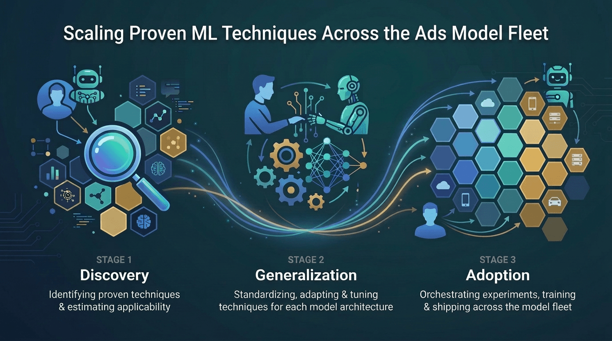
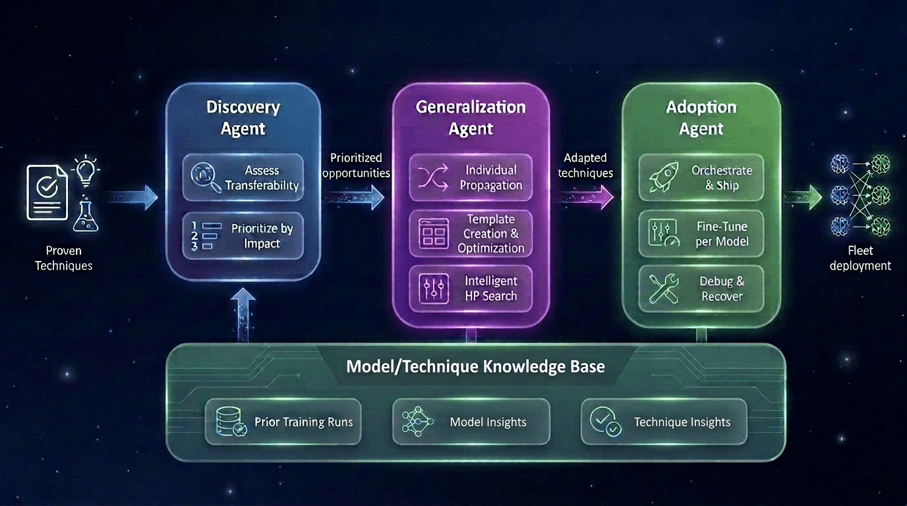

# AI Agents：让广告排序模型创新批量落地

一项模型改进在某个广告排序模型上验证有效，并不意味着它能直接用于下一个模型。不同模型面向不同产品界面和广告主目标，架构、训练数据及线上服务约束各不相同：核心思路可以迁移，具体实现却几乎无法复制粘贴。更棘手的是，机器学习技术有“保质期”：今天有效的创新，可能经过几个模型开发周期就被下一代方法取代。

Meta 因此把“技术传播”（technique propagation）做成了一套由 AI Agent 驱动的工程流程，让已验证的模型改进尽快覆盖整个广告排序模型群。Meta 报告称，自 2026 年 3 月智能体开始承担执行工作以来，它们已处理超过 60% 的技术传播。与引入智能体前的同类工作相比，早期结果显示工程生产率提高到 3 倍；在部分“技术—模型”组合中，训练算力消耗的中位数降至原来的四分之一。Meta 还预计到年底节省超过 4500 万美元算力成本。这些数字来自 Meta 的阶段性统计和估算，适用范围并不完全相同。

## 自动化之后，瓶颈变成了判断

Meta 所说的“技术”，泛指一切能改善排序模型的方法，包括 Wukong 分解层、Interformer 交互网络等架构创新，更丰富的数据表示、训练优化，以及训练和推理效率改进。此前，该系列文章介绍的 Ranking Engineer Agent（REA）负责提出假设、设计实验，并在广告排序模型上验证新的机器学习技术；这次要解决的则是验证之后，怎样把成果批量送到其他模型。

传统做法依靠领域专家手工适配。工程师需要同时理解技术和目标模型，分析二者如何交互，再完成泛化与调优。这种方式效果最好，至今仍是 Meta 最高收入模型采用的流程，但每次适配都很耗费人力，吞吐量受专家数量限制，无法追上不断增长的技术与模型组合。

算力是另一道约束。每次适配尝试都需要训练，而有限预算不可能覆盖所有配置。大多数尝试只能带来次优收益，因此问题不只是“尝试哪些技术”，还包括怎样探索组合空间、及时停掉不值得继续的实验。

Meta 先通过标准模型模板（Standard Model Templates，SMT）解决确定性工作：把模型组织成少量可复用、可组合的构建模块。一项技术在模板层验证后，就能自动传播到基于该模板构建的所有模型。过去两年，标准化和自动化帮助 Meta 在庞大而多样的模型群中交付了 5000 多个“技术—模型”组合，并将单模型工程时间减少 92%。

但自动化无法替人决定哪些技术值得迁移、超参数搜索应铺多宽、模型为何没有收益，以及故障怎样处理。正是这些非确定性判断，使 Meta 尚未实现“所有技术在验证后数周内到达所有适用模型”的目标，也成为智能体介入的位置。

## 用三类能力串起传播流程

> 图解：Meta 将技术传播拆分为发现、泛化和采用三个环节，分别负责筛选候选组合、适配不同模型，以及把验证后的改进交付上线。

整套系统围绕三项能力运转。**发现**维护已验证技术的动态视图，估计各项技术对不同模型的迁移效果，按预期影响排出候选组合的优先级。**泛化**重新实现技术，使其适用于原本未针对它设计的模型；共享模板只需泛化一次，模板之外的模型则需要逐一定制。**采用**负责把验证通过的适配批量变成可交付模型，包括启动实验、管理持续数天的异步训练、监控收敛、诊断故障并恢复，以及整理可合入的提案。

智能体把大语言模型推理与专用机器学习工具结合起来，承担其中判断密集的工作：决定尝试哪些适配、诊断并自动缓解故障、缩小超参数搜索空间，以及协调数百个并发任务的算力。它们共享一个知识库，持续积累历史训练记录、模型架构和技术效果，后续任务可以利用已有经验，而不必从零开始。

> 图解：智能体以历史训练、模型结构和技术结果形成的共享知识为基础，贯穿候选发现、模型适配与训练交付，并把新结果继续沉淀下来。

## 发现：从逐个评估转为全模型群筛选

过去，领域专家既要跟踪组织内的研究和实验结果、找出值得传播的技术，也要凭专业知识逐个判断模型是否适用。智能体改变了评估范围：它们利用共享知识库，同时扫描整个模型群，系统识别已验证技术、估计迁移可能性，再按预期影响生成优先列表。

工程师并未退出流程，而是从逐项调研转为审查智能体评估并作决定。这里节省的不只是执行时间，也减少了候选范围受个别专家知识和精力限制的问题。

## 泛化：模板复用与专家示范并行

泛化的难点在于，不同目标模型需要不同程度的改造。有时只需重新调整超参数，有时要把特征改成目标模型已经使用的表示，或缩放架构以满足推理预算，必要时还得重新设计技术。做到哪一步，本身就是技术判断。

对于标准化模板模型，智能体协助提出模板优化假设，在代表性模型集合上启动实验、评估结果、诊断失败，并迭代多日开发循环。一项技术只需在模板层验证一次，算力成本便只是逐模型适配的一小部分。

对于仍要逐一定制的最高收入模型，智能体先在少量模型上与机器学习工程师协同工作。工程师调整配置、调参或解决故障时，智能体记录每次修改及其结果，区分哪些决策只适用于特定模型，哪些可以推广。随后，它提出并测试其余模型的适配方案，工程师负责审查和引导，不再亲自驱动每一项任务。

在具体训练搜索中，智能体结合数百万次历史训练与目标模型自身属性，从最可能成功的配置开始；每轮训练后进一步收窄下一轮的搜索范围，并决定哪些实验值得继续、哪些应提前停止。Meta 报告的部分“技术—模型”组合中，训练算力消耗中位数降至原来的四分之一，正是来自这一环节，不能直接外推为所有模型都节省相同比例。

## 采用：工程师监督决策，智能体管理执行

进入采用阶段后，智能体逐个模型交付泛化后的技术：启动实验、微调模型、管理多日异步训练、监控收敛、从故障中恢复，并整理验证通过的提案。

微调方式取决于技术的来源。单独应用的技术，需要为特定模型寻找最佳技术组合配置；来自共享模板的技术，则由自动研究循环在模板之上继续搜索，补足共享配置无法带来的单模型收益。遇到基础设施异常、训练发散或数据管道错误时，集成调试与恢复机制会诊断根因，进行针对性修复或重试。

数百个流程同时运行后，局部自动化还不足以解决全局资源分配。Meta 正在加强智能体的容量管理能力：按收入重要性、技术潜力和截止期限对并发训练排序，从停滞或低价值任务中回收资源，让 GPU 优先用于高价值工作，而不是空闲或排在低优先级实验之后。Meta 明确表示，固定算力预算下的全局优化仍是当前持续投入的方向。

过去，工程师必须盯着每次运行、手工分诊故障并重启，每人只能兼顾少数模型。现在，人类把监督放在批准计划、设置优先级等决策点上。Meta 所称的 3 倍工程生产率，具体指每位工程师能够处理的“技术—模型”适配数量达到原来的 3 倍。

## 不只评估结果，也评估智能体的过程

智能体传播的技术，与工程师传播的技术遵循同一套上线门槛：先在归一化熵（NE）等预测性能离线指标上取得改善，同时不能让训练或推理成本等关键护栏指标倒退；随后还必须通过在线 A/B 测试，取得统计显著的收益，才能交付。

但传播往往持续数天，只在最后验收，无法及时纠正中间过程。Meta 因此按阶段产物分别设置指标。

发现阶段考察候选选择的精确率和召回率。对某项技术而言，精确率是被选中模型中最终成功交付的比例，召回率则是所有可行模型中被智能体找出的比例。这里召回率更重要，因为遗漏的模型不会再有第二次机会；精确率则作为护栏，避免把算力花在无效技术上。

泛化阶段要求技术在多种模型上取得超出原始验证模型的收益。系统先在缩小版模型上广泛筛选“技术—模型”适配，以控制算力；通过筛选后，再到有代表性的全尺寸模型上评估。只有 NE 改善并满足全部护栏指标，才能进入采用阶段。

采用阶段除了继续检查预测性能和护栏指标，还要衡量执行效率。两个关键指标是完成实验所需的人工干预次数，以及智能体能够独立诊断并缓解的问题比例。前者反映仍需投入多少工程时间，后者反映自动恢复能力。

因此，这套系统并非无人审批的自动上线机制。人类仍会审查关键决策、确认判断，并最终批准交付内容。

## 从一年缩短到三个月，仍是目标而非现状

Meta 正在把智能体驱动的工作流扩大为模型群技术传播的主要方式，但目标与当前能力需要分开看。现在，每项已验证技术到达所有适用模型仍可能超过一年；Meta 希望缩短到三个月，为此需要把端到端吞吐量提高到 5 倍。

后续投入包括提升泛化质量、容量效率和执行能力，并探索“自进化学习”：让智能体根据不断积累的结果改进自身策略，而不只依赖人类提供的启发式规则。更大的设想，是把智能体覆盖到排序 AI 的完整模型开发生命周期，从探索和假设生成，一直延伸到传播、实验与生产发布。

这套实践真正改变的，不是单次模型创新的产生方式，而是创新被复用的速度。对需要维护大量异构模型的团队，模板化可以消除确定性重复劳动，共享经验和智能体则进一步接管筛选、适配与执行判断；但 Meta 的证据仍是早期内部结果，最高收入模型保留人工深度适配，关键发布也由人审批。能否实现三个月覆盖目标，还要看后续吞吐量和自进化学习的实际进展。

> 本文参考自 [How Meta Uses AI Agents to Scale ML Innovations Across Ads Ranking Models](https://engineering.fb.com/2026/11/18/ml-applications/ai-agents-to-scale-ml-innovations-across-ads-ranking-models/)