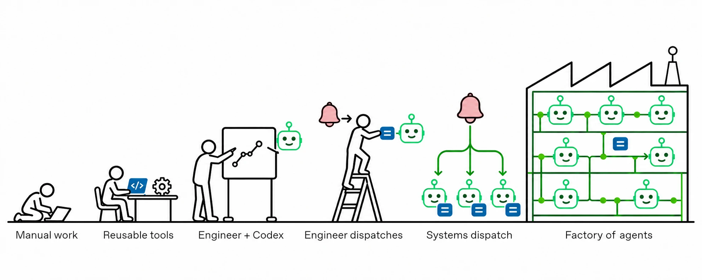
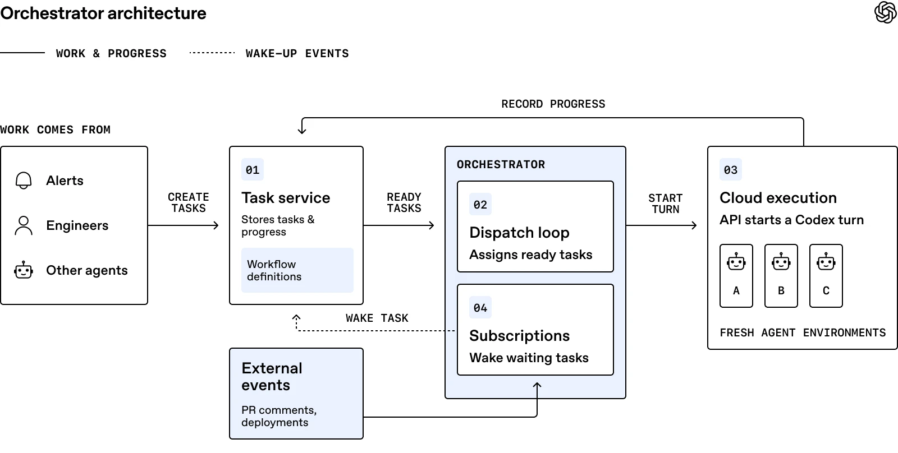
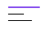
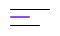
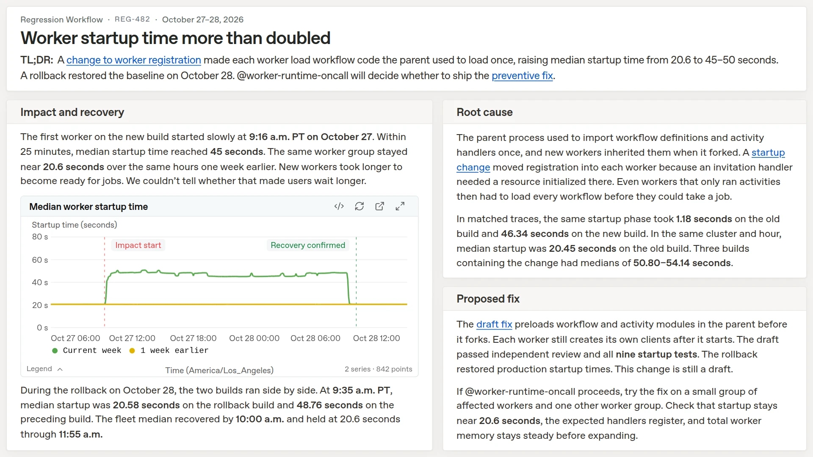
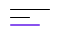

# Performance Factory：Codex 自动修复性能回退

ChatGPT 变慢之后，真正耗费工程时间的往往不是收到告警，而是跨指标、日志、链路和代码寻找原因，再在修复部署后确认性能确实恢复。随着 Codex 加快产品开发，OpenAI 认为，靠工程师逐项排查已经难以跟上迭代速度，于是搭建了 Performance Factory：让云端 Codex agent 接手调查、提出修复、响应代码评审，并验证线上恢复情况，工程师则保留关键判断与合并决策。

这套系统已经不只是演示。OpenAI 团队报告，首个 Regression Workflow 在三个多月里跟踪了 1700 多次调查，为 600 多个案例找到了根因，相当于每天自动开展 17 次调查。不过，这些数字描述的是自动化处理的规模，并不代表所有问题都已无需人工修复；根因准确率和修复质量，仍是这套系统需要持续解决的部分。

## 从人工排查到任务工厂

Performance Factory 并非一步建成。OpenAI 性能团队先把已有调查经验交给 Codex，再逐步把人与人的交接改造成可由系统追踪的任务状态。



> 图解：团队的路径不是直接让 agent 全权负责，而是先积累工具与调查方法，再自动触发单次调查，最后才用任务系统串联修复、评审、部署和验证。

这一演进分为六个阶段：

1. **纯人工调查。** 工程师检查指标和日志、比较 trace、调试线上机器并阅读代码。这不仅耗时，还依赖对服务的深入了解，信号很容易被遗漏。团队曾为 ChatGPT 首个 Token 延迟等反复出现的问题开发 CPU 和内存分配分析器，最终积累了 30 多种性能工具。
2. **Codex 作为调查伙伴。** 工程师可以直接问“这里为什么变慢”，让 Codex 搜索大型代码库、查找指标与 trace、追踪跨服务调用并选择合适的 profiling 工具。陌生系统因此更容易排查，但人仍要知道该用哪些工具，并持续引导调查。
3. **沉淀可复用技能。** 团队把调查流程写进共享技能 `perf-forensics`，说明有哪些工具、何时使用，以及如何定位变慢开始的时间、识别受影响请求、检查部署和配置变化。团队用历史回退构建评测并反复改进它；对于 ChatGPT 延迟和可用性下降等目标问题，已经可以从一次告警直接得到诊断，不必逐步指挥 Codex。
4. **人变成“传话代理”。** 告警触发后，工程师只是把它复制给配置了相应技能的 Codex，再把结论贴回 Slack。调查能力已经自动化，任务触发和信息流转却仍靠人。
5. **自动开展调查。** 调查移到云端后，告警可以自动启动 Codex 会话，并把结果发到 Slack 线程。但自动化止于诊断回复：工程师还要开发修复、验证部署效果，并从不断堆积的线程中判断哪些回退值得处理。
6. **形成端到端工厂。** Performance Factory 为每项工作保存状态和发现，在下一步就绪时分派 agent。代码评审或部署完成后，任务可以接着推进；一个工作流发现优化机会时，还能在另一个工作流中创建测试和实施任务。

这里最关键的变化，是把一次 agent 对话变成一份可持续流转的工作记录。单次诊断再详细，如果结论只留在某个会话里，后续修复与验证仍然要重新拼接上下文。

## 四个组件串起调查、等待与恢复

Performance Factory 由任务服务、调度循环、云端 Codex 执行 API 和事件订阅四部分组成。它们分别解决“工作处于什么状态”“现在该谁执行”“agent 在哪里工作”以及“等待结束后如何继续”。



> 图解：任务服务保存工作流状态与结果；调度循环将就绪任务分配给 agent；云端环境提供代码和观测工具；订阅则在评审、CI 或部署事件发生后重新唤醒任务。

### 用配置和 Markdown 定义工作流

工程师在任务服务中通过配置文件定义任务可进入的状态、允许的转移，以及哪些步骤必须由工程师参与；每个状态的 agent 指令则写在单独的 Markdown prompt 中。例如，一个代码变更任务可以组织为：

```text
code-change/
├── config.toml
└── work/
    ├── implementing.md
    └── reviewing.md
```

每项具体工作都会成为工作流中的一个任务，并显示在统一界面中。工程师可以查看待办、跟踪进度，也可以把任务转给更熟悉相关服务的同事。

调度循环定期检查哪些任务已经可以进入下一步，并按当前状态的指令启动一次 Codex turn。agent 把进展写回任务，完成本步后再推动状态转移。这样，状态保存在 agent 上下文之外，后续接手者不必依赖上一次会话仍然可用。

### 在受控云环境中执行

OpenAI 为云端 Codex turn 建立了内部 API。agent 运行在公司网络内的环境中，可以访问代码仓库，以及工程师日常使用的指标、日志、trace、CPU profile 和内存快照。

agent 使用独立的服务身份，因此权限可以按范围限制，操作也能与性能 agent 对应起来。云端执行还带来两个实际收益：多项工作可以并行，不必等工程师打开笔记本，也不必由人手动维护一批云开发机。

### 等待事件，而不是空转

代码评审和部署都需要时间，agent 没必要一直运行。任务可以订阅 GitHub PR 的评审评论、CI 失败或部署完成等事件；匹配事件到达后，任务重新变为就绪状态，再由调度循环分派 agent。这一机制把“持续轮询的聊天机器人”改成了由事件驱动的长期任务。

## Regression Workflow：从告警走到线上恢复

首个落地工作流处理性能回退，也就是延迟、可用性等指标相对原先水平恶化。任务依次经过“需要调查”“已找到根因”“已提出修复”和“已解决”等状态，状态与关键证据保存在任务中，工程师可以在 Slack 或专用界面补充背景、审查变更。


> 图解：Regression Workflow 不以“给出诊断”为终点，而是继续经过修复、人工评审与部署，最后检查指标是否回到原基线。

### 先确定何时、何处变慢

agent 接到告警后，先确认哪些指标恶化、变化从何时开始、哪些服务请求受到影响，再由 `perf-forensics` 提供工具和调查步骤。


告警阈值被跨过的时间未必就是回退起点，问题可能已经持续了数小时，因此 agent 会向前追溯数据。它还会比较不同请求组：究竟是相似请求本身变慢，还是慢请求在总流量中的占比上升？这两种现象对应不同原因，不能混为一谈。


确定时间和范围后，agent 检查部署、功能开关变更及相关代码，确认变更何时真正到达受影响请求，再用日志或 trace 检验它能否解释观测到的现象。


### 用另一个 agent 反驳诊断

早期系统有时会在第一个看似合理的解释处停下，而其中一些诊断后来被证明是错的。OpenAI 因此加入对抗式评审：启动独立的 Codex 会话，专门寻找能够推翻诊断的证据，重新检查假设并测试反事实。

例如，如果某次发布被认为导致变慢，未暴露在变更下的相似请求是否仍然健康？如果疑似变更已经回滚，受影响指标是否随之恢复？这些问题把“时间上相关”与“能够解释因果”区分开来。

在一次 ChatGPT 对话失败调查中，agent 将问题追到图片下载错误后便宣布找到原因。评审 agent 却发现，负责定位文件的内部服务已经恢复，图片请求仍在失败，因此原诊断解释不了持续故障。评审随即重新打开调查，并记录仍待验证的内容。



这套制衡有效，但远未达到可以省略判断的程度。OpenAI 对 100 条根因建议进行人工评审时，将 70% 评为准确，另外 30% 仍需完善，或没有充分建立因果关系。这个特定样本说明对抗式评审有必要，也不能被解读为所有回退都能以 70% 的准确率自动解决。团队目前把调查、质疑诊断和提出修复拆成不同的 Codex turn，希望用相互制衡继续提高质量。



### 找到根因之后，修复反而更难

诊断通过评审后，Codex 会实现修复并创建 PR，由工程师决定是否合并。任务报告自动概括回退现象、影响、根因和修复方案，并附上指标时间序列、CPU 火焰图与 trace，减少工程师重建调查过程的成本。工程师可以直接修改 PR，也可以只参考诊断、自行实现修复；如果留下评论，订阅机制会唤醒 agent 继续处理。



> 图解：任务报告把结论和支撑图表集中在一起，目标是让评审者快速判断证据是否支持修复，而不是阅读一整段原始调查记录。



部署之后，另一个 agent 检查性能是否回到先前基线，并分三种情况处理：完全恢复则关闭任务；只恢复一部分，则关闭原回退并为剩余问题新建任务，因为后者可能有不同根因；毫无改善则记录结果，把任务退回调查阶段。


OpenAI 明确表示，提出正确修复比找到根因更困难。agent 有时给出不必要的复杂方案，甚至引入新问题，因此修复也要经过对抗式评审，检查它是否针对根因，以及是否带来缺陷或意外后果。有些方案还涉及架构取舍，例如缓存可能改善性能，却也会引入陈旧数据，需要熟悉服务的工程师权衡。

团队正在比较 agent 提议与工程师最终合并的修改，以此构建评测、发现方案差距；还计划使用合成性能测试，让 agent 在请人评审前先测量并修改方案。对于低风险变更，OpenAI 也在探索结合其他 agent 评审工具，最终减少人工介入，但这不是当前已经实现的能力。

## 自动化越多，越要保护工程师的注意力

agent 能调查的回退数量，可能超过团队愿意阅读的数量。原始调查往往是一整墙文字，工程师既要辨认 agent 的主张，又要自己寻找图表验证数据；如果自动化只增加待读报告，它就把调查瓶颈搬进了评审环节。

Performance Factory 的第一版界面也堆满了发现，仍需人判断哪些信息重要。现在，工作流会关联同一回退在告警、监控和频道中产生的多个事件，按团队关注的指标分组，再按估算影响排序。工程师的主要工作由此转向补充上下文、评估取舍和决定是否发布。

这个设计比“让 agent 写更长的报告”更重要：自动化的收益不只看调查次数，还要看它是否减少了人为筛选和重复阅读。

## agent 的每次更新，也要接受评测

调查技能或底层模型升级后，agent 可能在一类案例上变好，却在另一类案例上退化。OpenAI 因此把评测拆成两部分：调查本身是否准确，以及交给工程师的摘要是否有用。

### 用历史事故回放调查能力

团队把过去的线上事故整理成可重复运行的测试集。每个案例都启动全新的 Codex investigator，只提供原始信号，并去掉可能泄露答案的信息，再将 agent 的行为与事故当时的真实解决过程比较。

历史回放有专门的数据陷阱。指标和 trace 会过期，而恢复后收集的证据又可能直接暴露根因；只有弄清调查者在当时实际能看到什么，测试才有意义。因此，agent 可以在限定范围内查看代码、查询线上遥测，但不能读取历史调查记忆、事故复盘或先前运行结果，团队还会检查 transcript 中是否存在泄题信息。

评分也拆成多个维度：问题何时开始、影响多大、哪些请求受影响，以及 agent 如何根据证据排列候选原因、说明仍有哪些不确定性。即使时间判断正确，也可能怪错部署，所以这些项目不能合并成一个笼统分数。

### 用任务快照评测人机交接

任务摘要使用已保存的快照进行回放，不依赖会过期的外部指标或 trace。独立评分器检查：不了解系统的工程师能否理解发生了什么、为什么重要，有用图表是否保留，以及建议的下一步是否得到证据支持。

把“诊断正确”和“人能否据此行动”分开评测，针对的正是两种不同的失败。前者需要更好的调查能力，后者则需要更好的信息组织，二者不能互相替代。

## 让反复出现的 agent 故障变成自修复任务

负责调查服务的 agent，本身也需要监控。profiler 损坏或权限缺失，可能让 agent 无法验证根因，而且这类失败不一定会在最终报告中显眼呈现。

OpenAI 每天运行一个 agent，检查近期任务的消息和日志，寻找工具失败与访问错误。如果同一工具错误阻碍了多次调查，Performance Factory 会创建修复任务；原因明确时，由 agent 提出修改，工程师评审并决定是否合并。合并后，团队再通过评测确认 agent 能否越过此前受阻的步骤。

这里的“自修复”仍有边界：系统可以自动发现并提议修复自身工具链的问题，但代码是否合并仍由工程师决定。

## 下一步是在告警之前发现问题

目前 Regression Workflow 仍由告警触发。OpenAI 希望进一步利用已经收集的细粒度性能数据，在告警没有出现时发现回退或优化机会。例如，跨版本比较成批 CPU 与内存 profile、堆转储和请求 trace，agent 可能注意到某类请求的 CPU 开销小幅上升，随后创建 Regression Workflow 任务，追查原因、实现修复并提交 PR 供人评审。

对于已经知道该寻找什么的问题，团队则准备把信号固化成定期运行的工作流。`service rightsizing` 技能就是一个例子：它帮助 agent 找出 autoscaling 配置中超出实际需要的副本数量。类似模式一旦明确，就能在各服务中重复执行，而不必等另一位工程师再次遇到同类问题。

Performance Factory 的核心价值，因此不只是每天完成 17 次自动调查，而是把一次调查中形成的经验保存为可复用流程，并通过状态、事件和评审机制持续推进。不过，现有证据也划清了边界：1700 多次调查证明系统已具备生产运行规模，100 条建议中 70% 根因准确则提醒人们，诊断与修复仍需制衡。当前瓶颈甚至可能转移到工程师评审和合并 PR；对关注 agent 工程化的团队来说，真正值得借鉴的不是“完全无人值守”的愿景，而是先明确哪些步骤可自动执行、哪些判断必须留给人，再用评测逐步扩大自动化范围。

> 本文参考自 [How OpenAI’s Performance Factory keeps ChatGPT fast](https://openai.com/index/how-openai-performance-factory-keeps-chatgpt-fast)