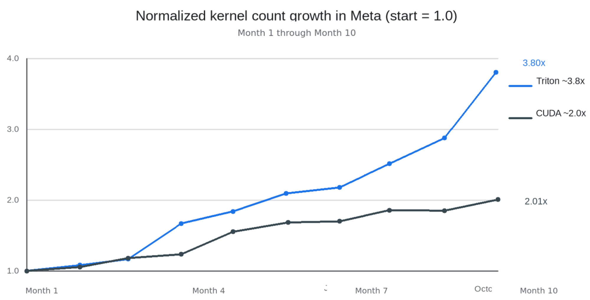
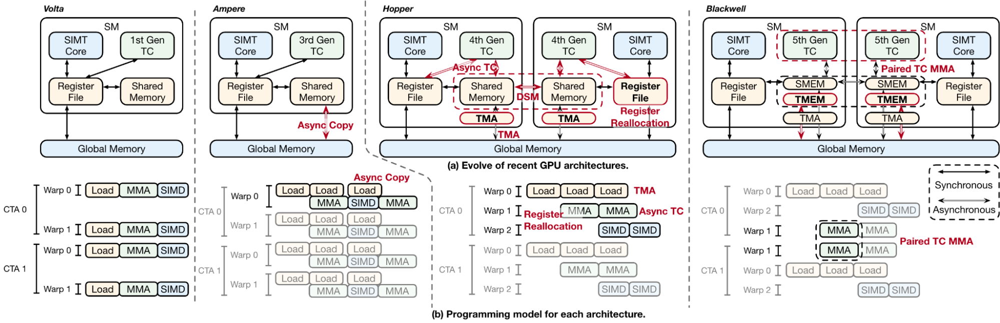
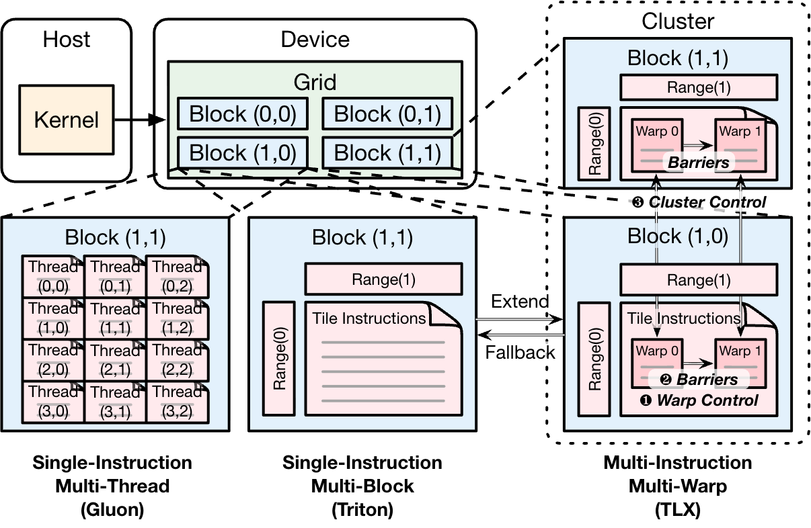

# TLX：在Triton中显式编排GPU执行

当高性能GPU内核越来越依赖异步传输、专用warp组和跨CTA协作时，真正难写的已不只是计算本身，而是多个执行单元如何配合。CUDA能完整表达这些关系，却需要大量架构相关代码；Triton显著提高了开发效率，又把不少关键执行结构藏在编译器抽象之后。

Meta为这两端之间的空白构建了Triton Low-Level Extensions（TLX）。它不是另起一套底层语言，而是在Triton的张量编程模型上增加显式执行编排：开发者继续描述“算什么”，再用TLX说明数据搬运、计算、同步和结果处理“怎样协作”。据Meta介绍，TLX已用于推荐系统训练与推理，以及大规模LLM预训练，并覆盖NVIDIA和AMD GPU。

## 从模型到内核，Triton已成为优化入口

在Meta，机器学习工作负载建立在以PyTorch为中心的通用软件栈上。模型代码经过图捕获、优化、编译和lowering，最终变成在大规模加速卡集群上运行的GPU内核。过去几年，Triton从实验性的内核语言变成这套栈的基础组件；无论编译器自动生成还是手工优化的生产内核，都有相当一部分采用Triton实现。

这一层的改进因此能向训练和推理广泛传导。Meta给出的10个月归一化内核数量变化显示，以首月为1.0，Triton内核数量增长到约3.8倍，CUDA则约为2.0倍。这里比较的是数量增长而非运行性能，但它清楚说明了Triton在Meta GPU软件栈中的扩张速度。



> 图解：在10个月统计期内，Triton内核数量约增长3.8倍，CUDA约增长2.0倍；纵轴为归一化数量，首月基线为1.0。

内核优化也不再只是GPU专家的工作。ML工程师会分析工作负载、定位瓶颈，再通过自动调优、算子融合、内存布局调整或算法重构优化最热的内核。Triton让许多迭代从数天缩短到数小时，使内核优化更接近日常模型开发流程。

Triton已经通过融合和编译器管理的内存访问优化，为许多内存受限工作负载提供了高效基础。TLX处理的是互补问题：如何协调执行组、异步数据移动和共享资源。

## 硬件演进把“协作方式”变成了性能关键

NVIDIA Hopper引入warp specialization和Tensor Memory Accelerator（TMA），Blackwell又加入Tensor Memory（TMEM）、cluster级执行、paired-CTA执行以及更多异步机制。它们并非几条可以被编译器悄然隐藏的新指令，而会改变高性能内核的组织方式。

以FlashAttention为例，一个warp组可以专门发起TMA传输，另一个执行Tensor Core计算。Blackwell GEMM则可能同时协调多个warp组、TMEM分配和cluster资源。此时，性能既取决于做什么计算，也取决于多个执行代理如何合作。

Meta在部署Hopper和Blackwell时反复遇到同一矛盾：CUDA能够表达所需结构，但架构特定的编排代码很多；Triton更高效，却把不少执行关系变成隐式的编译器决策。每一代硬件都带来新能力，开发者只能等待编译器支持，或退回高度专用的实现。团队因此判断，问题不只是缺少编译器特性，更是缺少合适的编程抽象。

## MIMW补上线程与线程块之间的控制层

CUDA的SIMT模型以线程为细粒度控制单位，开发者可以精确安排调度、同步和内存移动，但也要手工表达所有执行关系。Triton的SIMB模型把抽象提升为分块张量计算，提高了效率，却让许多执行结构由编译器隐式决定。

近几代GPU最重要的能力恰好不处在这两个粒度上。warp specialization在协作的warp组之间分工，TMA引入专门的数据移动代理，TMEM支持新的执行组通信方式，cluster执行允许多个CTA共享执行上下文。组织这些内核，需要明确多个执行代理怎样通信、同步和共享资源。

Meta把中间层称为Multiple Instructions, Multiple Warps（MIMW）：以warp组为基本编排单位，而不是围绕单线程或整个线程块思考。TLX正是这一抽象的实现。



> 图解：GPU执行从较同步的SIMT模式，逐步加入Tensor Core、Async Copy、TMA、WGMMA、TMEM、寄存器重分配和paired-CTA MMA等专用、异步能力，warp组编排由此成为编程模型需要直接面对的问题。

这一抽象来自硬件演进，而非单纯的软件设计偏好。Volta和Ampere通过线程级、warp级编程开放Tensor Core；Hopper让TMA异步数据移动和WGMMA warp组执行成为高性能内核的核心；Blackwell进一步引入TMEM、寄存器重分配、cluster执行和paired-CTA MMA。更多跨warp组、甚至跨CTA的协作，已经无法只交给编译器处理。



> 图解：MIMW处在SIMT的细粒度线程控制与SIMB的块级开发效率之间。TLX在保留Triton高层张量操作的同时，加入显式warp组编排。

## TLX如何显式描述生产者与消费者

标准Triton中的分块矩阵乘法可以写成同步的“加载—计算”循环：载入一个tile，完成计算，再进入下一轮，软件流水线由编译器管理。

```python
# Standard Triton: synchronous load-compute loop semantics,
# with compiler-managed software pipelining
@triton.jit
def matmul_kernel(a_ptr, b_ptr, c_ptr, M, N, K, ...):
    pid_m = tl.program_id(0)
    pid_n = tl.program_id(1)
    acc = tl.zeros((BLOCK_M, BLOCK_N), dtype=tl.float32)
    for k in range(0, K, BLOCK_K):
        a = tl.load(a_ptr + ...)
        b = tl.load(b_ptr + ...)
        acc += tl.dot(a, b)
    tl.store(c_ptr + ..., acc)
```

TLX保持相同的计算，但把执行结构直接写进源码：生产者warp组异步搬运数据，消费者warp组执行Tensor Core矩阵乘法，轻量barrier表达两组之间的依赖。共享内存缓冲区、TMEM累加器和多阶段流水线都清晰可见，内存移动、计算及输出处理得以重叠，同时仍可使用Python和Triton的自动调优设施。

```python
# TLX on Blackwell: explicit warp-group orchestration and pipelining
@triton.jit
def matmul_kernel(desc_a, desc_b, desc_c, M, N, K, ...):
    buffers_a = tlx.local_alloc((BLOCK_M, BLOCK_K), tl.float16, NUM_STAGES)
    buffers_b = tlx.local_alloc((BLOCK_K, BLOCK_N), tl.float16, NUM_STAGES)
    acc = tlx.local_alloc((BLOCK_M, BLOCK_N), tl.float32, 1, tlx.storage_kind.tmem)
    load_bars = tlx.alloc_barriers(num_barriers=NUM_STAGES, arrive_count=1)
    dot_bars = tlx.alloc_barriers(num_barriers=NUM_STAGES, arrive_count=1)
    with tlx.async_tasks():
        with tlx.async_task("default"):
            tlx.barrier_wait(dot_bars[num_k_tiles - 1], phase)
            result = tlx.local_load(acc[0])
            desc_c.store(offsets, result.to(tl.float16))

        with tlx.async_task(num_warps=1):
            for k in range(num_k_tiles):
                buf = k % NUM_STAGES
                tlx.barrier_wait(load_bars[buf], phase)
                tlx.async_dot(buffers_a[buf], buffers_b[buf], acc[0],
                              use_acc=(k > 0), mBarriers=[dot_bars[buf]])

        with tlx.async_task(num_warps=1):
            for k in range(num_k_tiles):
                buf = k % NUM_STAGES
                tlx.barrier_wait(dot_bars[buf], phase)
                tlx.barrier_expect_bytes(load_bars[buf], ...)
                tlx.async_descriptor_load(desc_a, buffers_a[buf], offsets, load_bars[buf])
                tlx.async_descriptor_load(desc_b, buffers_b[buf], offsets, load_bars[buf])
```

这套扩展主要覆盖五个方面：

- **Warp组编排**：把warp组作为一等执行代理，可分别赋予数据生产、Tensor Core计算和结果处理等角色。
- **同步**：在warp组而非线程层面表达依赖，例如用mbarrier连接流水线中的生产者和消费者；细粒度线程同步仍由底层执行模型和编译器处理。
- **内存编排**：直接开放TMA、异步Tensor Core操作和TMEM，使数据移动与计算在程序定义的流水线中重叠，同时减少CUDA中的底层设置和簿记工作。
- **Cluster执行**：把cluster级执行变成一等编程结构，多个CTA可通过分布式共享内存和cluster级同步协作，让部分片上通信不必绕经全局内存。
- **可选布局**：不像CUDA和CUTLASS那样要求先明确布局，TLX编译器会推断合理默认值；开发者只在性能需要时覆盖布局，因此没有布局标注也能先写出正确内核，再逐步调优。

自动布局推断还直接影响算子融合。融合能够减少中间内存流量和内核启动开销，但传统CUDA式流程中，各阶段可能采用不同tiling、swizzling或共享内存映射，大量工程工作会耗在布局衔接上。TLX尽可能由编译器解决兼容性，开发者只干预确有性能收益的布局选择，从而降低构建复杂融合内核和多阶段流水线的成本。

## 三个生产案例，对应三种不同瓶颈

Meta报告，TLX已在其ML基础设施中运行数月。三个部署案例并不只是重复证明“内核更快”，而是分别展示了异构模型训练、推荐推理中的广播浪费，以及MoE预训练中的计算通信结合。

| 案例 | 硬件 | TLX处理的问题 | 主要结果 | 部署位置 |
| --- | --- | --- | --- | --- |
| GEM模型训练 | NVIDIA Blackwell | 异构RecSys基础模型要接近roofline MFU，需要标准Triton之外的warp specialization和显式Tensor Memory控制 | 数千块GPU上达到20%–25%端到端MFU | GEM训练栈 |
| 内核内广播优化（IKBO） | NVIDIA Hopper | 用户特征在候选批次中重复多次，浪费带宽和计算；消除浪费需要warp专用化、多阶段融合 | 对协同设计模型，计算密集型净延迟最多降低2/3 | GPU上的RecSys推理，从早期到后期排序 |
| 分布式Grouped GEMM，用于LLM预训练 | NVIDIA Blackwell | 专家并行MoE层需要带节点间通信的Grouped GEMM，现有实现在大规模下仍有性能空间 | 在大规模GPU集群上经过长期生产验证 | LLM预训练 |

### GEM：用融合与模型—内核协同设计提高MFU

Meta的Generative Ads Model（GEM）比LLM训练更难优化：输入形状更小，每层有10个以上归一化操作，模块类型异构，架构也更丰富，这些因素都会限制模型计算利用率（MFU）。团队采用覆盖模型架构、自定义内核、编译器优化和硬件调优的协同设计，在最新版本中，于数千块NVIDIA Blackwell GPU上完成了总量为$O(10^{24})$ FLOPs的训练，端到端MFU达到20%–25%。

团队比较了CUTLASS、CuTeDSL和TLX三种Blackwell编程模型，认为TLX在多数内核上更好地平衡了效率与性能：既保留类似Triton的简洁、自动调优和可组合性，也能直接使用`async_dot`、TMEM操作和mbarrier同步。

GEM中的Generalized Dot Product Attention（GDPA）是一个具体例子。TLX用较低的实现复杂度获得接近最优的性能，通过把模型中许多类似attention的操作统一进一个GPU内核，前向速度最高提升至2倍。这个“最高”是特定内核与实现条件下的结果，不能外推成整个GEM训练都加速2倍。

更重要的是，优化范围从单个内核扩展到模型中更大区域的内核化与融合。对GEM而言，减少内存移动往往比单独优化计算更有价值。Meta还构建了AI辅助优化框架Agent for Compute Efficiency（ACE），自动执行性能分析、诊断和调优，缩短单个内核的优化周期，让工程师把精力放在更高层的优化机会上。

### IKBO：不再把同一份用户特征复制几十次

推荐系统推理中，同一用户的特征对所有待评分候选都相同，但通常要按候选维度复制几十次。Meta在多种“候选数/用户数”广播比例下验证后发现，这会造成显著的带宽和计算浪费，而且开销随候选数量线性增长。

In-Kernel Broadcast Optimization（IKBO）把广播移进内核：不再实际生成重复的用户特征，而是让内核直接接收批大小天然不匹配的用户与候选输入，在计算中隐式完成广播。这不是单独改一个内核就能完成的工作，还涉及模型架构、推理运行时和内核实现的协同设计。

在线性压缩内核中，经过矩阵乘法分解、内存对齐和广播融合后，团队再用warp专用化、多阶段TLX内核处理剩余瓶颈，在NVIDIA H100上取得4倍加速。最终实现把整个计算合并为一个持久化mega-kernel：生产者与消费者warp组通过ping-pong调度并发执行，用户和候选GEMM共享循环缓冲区，并用mbarrier同步，无需在阶段之间排空流水线；tile级release-acquire同步还负责跨CTA协调。

在FlashAttention上，IKBO通过让共享同一用户上下文的候选分摊K/V读取，把内核从I/O受限转为计算受限。TLX随后加入FA3式warp specialization与持久化，消除短查询长度下突出的跨CTA启动停顿。对协同设计模型，计算密集型净延迟最多降低2/3。若直接用CUDA表达，需要大量手工编排；TLX则把它保留在Triton的Python模型和自动调优框架内。

目前，IKBO已用于优化Meta Adaptive Ranking Model，覆盖GPU和Meta Training and Inference Accelerator（MTIA）。它说明推荐推理不必围绕广播开销做局部补救，而可以在计算原语中直接消除重复。

### 分布式Grouped GEMM：长期稳定同样重要

TLX还用于Meta大规模LLM预训练中的分布式Grouped GEMM，已在大规模GPU集群上持续运行较长训练周期。该内核加速Mixture-of-Experts（MoE）模型需要的分组矩阵乘法，并紧密结合计算与通信，以降低端到端延迟。原文没有给出这一案例的具体加速百分比，其证据是大规模、长期生产部署。

在这种规模下，峰值吞吐只是目标之一。内核还要在数周连续运行中保持可靠、可调试和性能稳定，并随着模型、硬件及系统软件变化而可维护。TLX的warp专用化、显式内存编排和异步流水线提供所需性能，Triton的Python编程模型则保留迭代、验证和部署效率。

## 从生产实践得到的编译器经验

Meta总结的第一条经验是从真实工作负载出发，而不是从跑分出发。GEM始于MFU偏低，IKBO始于推荐推理中的广播开销，工具设计跟随具体问题展开。这使优化目标始终对应实际系统收益。

第二条是不要把开发效率和性能只看成此消彼长。团队称，TLX通常能达到与手工调优CUDA相当的性能，同时显著加快迭代。在大规模集群上，一个只快一点、编写时间却长到三倍的内核可能反而是净损失；IKBO的TLX实现耗时数周，而不是数月。

硬件能力也必须可被方便地使用才有价值。WGMMA、TMA和TMEM很强，但复杂编程模型曾限制其采用。TLX用简洁标注开放这些能力，使IKBO的warp专用化融合和GEM的多DSL内核不必承担原始CUDA的高编排成本。

团队还把编译器视为用户界面的一部分：错误信息、调试支持和性能分析集成，与代码生成质量同样重要。无论GEM工程师排查MFU问题，还是IKBO工程师处理warp组同步，都需要清晰反馈，而不是晦涩报错。

最后，TLX选择演进Triton，而不是从零设计新语言。这样可以复用生态、工具和已有经验：GEM可让TLX与CUTLASS、CuTeDSL并存，IKBO团队只需在性能关键部分学习TLX标注。完全推倒重来或许更优雅，却未必能真正进入生产。

## 下一步是让编排再次自动化

TLX目前面向NVIDIA Hopper、Blackwell，以及AMD MI300和MI350X。团队计划支持更多NVIDIA、AMD架构和MTIA等定制加速器。MIMW本身不绑定特定硬件，难点在于如何把它高效映射到不同指令集架构；GEM和IKBO已经分别展示了GPU与MTIA上的应用基础。

显式warp组控制也不是抽象终点。Meta希望从更高层模式自动推断warp组编排，形成能替开发者写标注的“auto-TLX”。GEM中的多DSL选择和IKBO中的三阶段warp specialization都是候选自动化模式。

另一项工作是成为`torch.compile`的后端，让常见模式下的PyTorch代码自动得到TLX优化内核，无需手工标注。由此看，TLX当前解决的是“能否以可维护的方式使用新硬件”，下一步则是“哪些编排可以再次放心交给编译器”。

对需要为Hopper、Blackwell或支持中的AMD GPU编写高性能内核的团队，TLX值得关注的原因不是它取代了CUDA或Triton，而是它把执行协作放到了合适的抽象层。现有证据来自Meta自己的生产部署，覆盖推荐训练、推荐推理和MoE预训练；具体收益依赖模型—内核协同设计、硬件与工作负载条件，不能视为任意模型的通用加速承诺。

> 本文参考自 [How We Built TLX: A Hardware-Native GPU Compiler for Production ML at Scale](https://engineering.fb.com/2026/11/10/open-source/tlx-a-hardware-native-gpu-compiler-for-production-ml/)