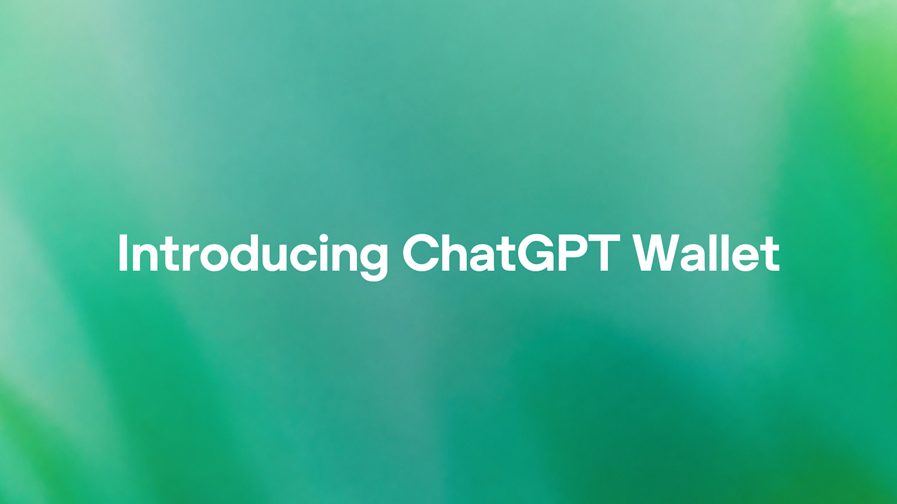

# ChatGPT Wallet：令牌代付隔离卡号，每笔消费需本人确认

当 AI 代理从比较商品走到实际付款，最敏感的问题是：它能否在不接触真实银行卡信息的情况下完成交易，同时让用户清楚自己授权了什么？OpenAI 推出的 ChatGPT Wallet 给出了一套具体流程：用户只需添加一次银行卡，代理可以代为购买，但当前每笔交易都要由用户核对商品、总额和所选卡片，再通过 Face ID 或指纹等安全检查。

OpenAI 将其称为首个不让代理接触用户真实卡信息、且要求每次购买都经过安全检查的钱包。它由 OpenAI 与美国运通、万事达卡和 Visa 合作建设，首先通过 dots 向美国符合条件的 ChatGPT Pro 订阅用户开放。

> 图解：ChatGPT Wallet 面向 AI 代理支付，核心设计是逐笔授权，并用支付令牌代替真实银行卡信息。

## 从选购建议到完成付款，难点不只是“会下单”

OpenAI 表示，每周有 12 亿人使用 ChatGPT，其中许多人已经用它研究产品、比较方案并决定买什么。ChatGPT Wallet 试图补上最后的支付环节，同时让商户能够沿用现有系统接受代理付款。

这也解释了为什么产品没有一开始就全面开放。网站可能无意间拦截代理，支付和风控系统也可能把合法的代理购买识别为异常交易。OpenAI 选择先向有限的 Pro 用户开放，以便根据真实使用情况，与商户、银行和支付网络继续改进兼容性与可靠性。

## 一次购买中，授权和卡信息如何分开处理

用户先把银行卡加入钱包，之后不必在每次购买时重新输入支付信息。代理发起购买后，用户需要检查商品、总金额和所选银行卡，再通过生物识别等安全检查。每次确认都会留下一条明确记录，说明用户授权代理完成了哪笔购买。

确认之后，支付网络提供支付令牌，用一组替代性的卡号、安全码和有效期代替真实卡信息。选中的银行卡仍会被扣款，但 ChatGPT Wallet 不会把用户的真实卡信息分享给商户或代理。这里的边界很清楚：代理获得的是完成付款所需的能力，而不是直接查看原始卡片的权限。

这套设计也尽量保留现有银行卡体系中的关系与规则。符合条件的交易继续享有原有卡片奖励和争议保护，例如商品存在缺陷时，用户仍可按相应规则处理与商户的争议。银行和支付网络继续参与交易评估，用户则直接与商户交易；商户保留客户关系，也继续掌控定价、履约、退货和客服。

这些安排并不意味着代理支付已经没有风险。OpenAI 当前强调的是生物识别、逐笔授权记录和既有银行风控共同构成保护措施，而实际兼容性正是小规模上线需要验证的部分。

## 商户要改的，不只是收银台

代理商务仍处于早期阶段，许多网站和支付系统尚未适应这种购买方式。与钱包一同发布的 Commerce Partner Playbook 提供了工具和操作指引，重点不是要求商户重建系统，而是让商品信息、网站访问、支付风控和代理操作能够衔接起来。

商户可以从最影响顾客的部分着手：

- **提供准确的商品信息。** 在 ChatGPT 中认领企业，完成验证后更新企业资料，并上传包含当前价格和库存状态的商品 feed，减少代理依据过期信息选购的问题。
- **允许 ChatGPT 代理正常访问网站。** 配置 CDN 或防火墙，通过 Web Bot Auth 识别签名请求，同时检查通用安全策略是否误伤代理。浏览器访问并不要求商户安装插件或上传商品 feed。
- **与支付及风控服务商协同。** 钱包令牌能够用于现有结账流程，但风控系统仍可能拒绝或取消合法的代理订单。商户需要了解服务商如何识别这些交易。OpenAI 也在与 Forter、Riskified、Sardine、Signifyd 等防欺诈服务商，以及 Adyen、Checkout.com、Stripe 等支付服务商合作，帮助其系统识别合法代理购买。
- **为代理增加操作入口。** 商户可以构建插件，让代理通过现有系统查询库存、管理购物车或执行其他操作，也可以在网站中加入 WebMCP 工具。

这份指引反映出代理支付落地时的真实分工：令牌解决了卡信息如何传递的问题，却不会自动解决商品数据是否准确、网站是否允许访问，以及风控是否信任代理等问题。对商户而言，现阶段可执行的起点是检查代理能否读取正确商品信息、能否顺利访问网站，以及合法订单会不会被现有风控误拒。

## 从逐笔确认走向限定范围内的预先授权

当前版本要求用户逐笔确认，但 OpenAI 设想的下一步是让用户把购买任务更完整地委托给代理。用户可以设定消费上限、商品类别或有效时间段等明确条件，并预先批准符合条件的购买。

这种委托仍会建立在现有保护之上，包括生物识别和清晰的授权记录，并增加相应保障。不过，原文没有给出这项能力的上线时间，也没有说明不同参数如何组合或出现争议时如何具体处理。因此，它更适合作为产品方向，而不是已经可用的功能。

## 谁能先用，接下来要验证什么

ChatGPT Wallet 从 11 月 13 日起在 dots 中逐步推出，用户可以让自己的 dot 代为完成购买。首批用户须同时满足几项条件：年满 18 岁、身处美国、订阅 ChatGPT Pro，并持有符合条件的美国发行银行卡。OpenAI 表示，后续将根据早期使用情况，与商户、银行和支付网络共同扩大覆盖范围。

因此，ChatGPT Wallet 当前最值得关注的不是“AI 已经可以随意替你花钱”，而是它把代理支付拆成了可检查的几个环节：用户逐笔授权，支付令牌隔离真实卡信息，银行与卡组织继续评估交易，商户保留交易和服务关系。首批用户能够验证这套流程是否顺畅；对商户来说，商品信息、代理访问和风控适配则是更现实的前置工作。它能否在扩大开放后保持可靠，仍要由这些早期实际使用来回答。

> 本文参考自 [Introducing ChatGPT Wallet](https://openai.com/index/introducing-chatgpt-wallet)