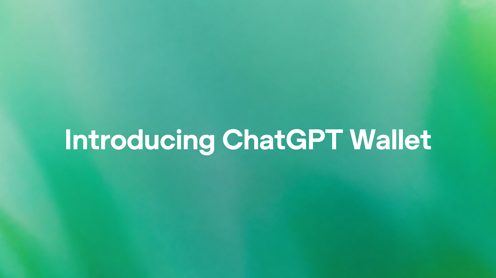

# ChatGPT Wallet：令牌代付隔离卡号，每笔消费需本人确认

当 AI 代理从比较商品走到实际付款，关键问题是：它能否不接触真实银行卡信息，同时让用户清楚自己授权了什么？OpenAI 推出的 ChatGPT Wallet 给出的答案是逐笔确认加支付令牌。用户只需添加一次银行卡；代理发起购买后，仍须由用户核对商品、总额和所选卡片，再通过 Face ID 或指纹等安全检查。

OpenAI 表示，每周有 12 亿人使用 ChatGPT，许多人已经用它研究产品、比较方案。钱包试图补上支付环节，并让商户沿用现有系统接受代理付款。OpenAI 称其为首个不让代理接触真实卡信息、且要求每次购买都经过安全检查的钱包；它由 OpenAI 与美国运通、万事达卡和 Visa 合作建设。

> 图解：ChatGPT Wallet 面向 AI 代理支付，核心设计是逐笔授权，并用支付令牌代替真实银行卡信息。

## 授权与卡信息如何分开

每次确认都会留下授权记录。确认后，支付网络提供支付令牌，以替代性的卡号、安全码和有效期完成付款；选中的银行卡仍会被扣款，但真实卡信息不会分享给商户或代理。代理获得的是付款能力，而非查看原始卡片的权限。

符合条件的交易仍享有原有卡片奖励和争议保护，银行与支付网络继续评估交易。用户直接与商户交易，商户保留客户关系，并继续掌控定价、履约、退货和客服。不过，生物识别、授权记录和既有风控并不意味着风险已经消失，实际兼容性仍待验证。

## 商户要改的不只是收银台

许多网站可能无意间拦截代理，支付和风控系统也可能把合法购买识别为异常交易。因此，OpenAI 先向有限用户开放，并发布 Commerce Partner Playbook，帮助商户衔接商品信息、网站访问、支付风控和代理操作，而不是重建系统。

商户需要认领并验证企业、更新资料，上传含当前价格和库存的商品 feed；配置 CDN 或防火墙，通过 Web Bot Auth 识别签名请求，避免安全策略误伤代理；还需与支付及风控服务商确认合法代理订单的识别方式。OpenAI 正与 Forter、Riskified 等防欺诈服务商，以及 Adyen、Checkout.com、Stripe 等支付服务商合作。商户也可构建插件，或在网站中加入 WebMCP 工具，让代理查询库存、管理购物车。

## 预先授权仍是下一步

当前版本要求逐笔确认。OpenAI 设想未来允许用户设定消费上限、商品类别或有效时间段，预先批准符合条件的购买，但没有给出上线时间，也未说明参数组合及争议处理细节，因此这只是产品方向。

ChatGPT Wallet 从 11 月 13 日起在 dots 中逐步推出。首批用户须年满 18 岁、身处美国、订阅 ChatGPT Pro，并持有符合条件的美国发行银行卡。它目前并非让 AI 随意代花钱，而是把支付拆成可检查的授权、令牌隔离和银行风控环节；能否在扩大开放后保持可靠，仍要由早期实际使用回答。

> 本文参考自 [Introducing ChatGPT Wallet](https://openai.com/index/introducing-chatgpt-wallet)