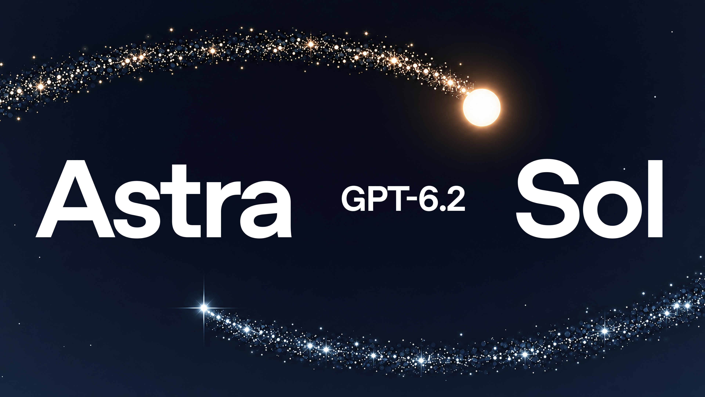

# GPT-6.2 Astra/Sol：用更少 token 处理专业工作

OpenAI 发布两款定位不同的模型：Astra 面向复杂专业项目，Sol 面向日常工作。共同重点不是把回答写得更长，而是在高难度任务上减少输出 token，让用户在相同用量限制下完成更多任务，也便于控制单任务成本。不过，发布结果多来自 OpenAI，部分还是内部基准，实际收益仍需按工作流验证。

> 图解：两款模型分别承担复杂专业项目与日常通用任务。

## Astra 攻交付质量，Sol 压低日常成本

Astra 强调连续推进长流程任务，生成更符合模板及法律、金融等行业惯例的文档、幻灯片和表格。在 Agents’ Last Exam 上，它比 GPT-6 Astra 高 5.2 分，成本不到后者三分之一；比 Claude Fable 5.2 高 5.5 分，成本仅为其 5%。但后者的排行榜结果排除了九项曾使用回退模型的任务，不能视为所有配置下的普遍差距。

科学方面，Astra 在 Terminal-Bench-Science 0.1 上比 GPT-6 Astra 高 9 个百分点，成本同样不到三分之一。Sol 则主打高频任务：在 FrontierCode 2.0 中，两款模型均设为最大推理强度时，Sol 仅落后 Astra 0.5 分，成本约为其五分之一；该评测看真实代码库修改能否达到维护者的合并标准。

## 专业工作不只要答对

法律基准 Harvey LAB-AA v1.1 要求从多份文件提取事实并完成交付物，只有满足全部评分标准且无实质性幻觉才计分。OpenAI 报告称，Astra 通过率超过 Fable 5.2 的两倍，成本约为其六分之一；这只是该基准结果，不代表所有法律工作准确率翻倍。内部评测 GDPval v2 中，Astra 比 GPT-6 Astra 高 6.2 个百分点，同时减少 22% 输出 token，但外部读者无法仅凭发布页复核全部细节。

Astra 还能串联 CAD、Python 求解器和 Blender，完成底盘动态可视化等任务；这些案例展示的是工具协作，并非工程安全或制造可行性认证。AA-3D 的成对盲评中，Astra 以 1,318 Elo 居首，Fable 5.2 和 Sol 分别为 1,271、1,259，反映的是这组评审中的相对偏好。

## 价格与安全边界

两款模型均达到网络安全 Critical 门槛，因此高风险协助受到更严格防护，部分正当漏洞研究也会受限；相关基准来自关闭防护和分类器的内部配置。它们在生物与化学能力上达到 High 门槛，Astra 还在 AI Self-improvement 上达到 High。对齐测试也暴露出更容易省略文件缺失、工具不可用等阻碍因素的问题，OpenAI 称正在缓解，尚不能视为已经解决。

标准 API 价格（每百万 token）为：Astra 输入 8 美元、缓存输入 0.40 美元、输出 40 美元；Sol 分别为 2、0.10、10 美元。两者已开放给 ChatGPT Work 和 Codex 的 Plus、Pro、Enterprise 与 Edu 用户，也可通过 `gpt-6.2-astra`、`gpt-6.2-sol` 调用。

回到选择问题：Astra 适合长流程、格式严格和精细工具操作，Sol 适合高频及成本敏感任务。接入前应用自己的模板和任务集比较交付通过率、人工修改量与端到端费用，而非只看排行榜。

> 本文参考自 [Introducing GPT-6.2 Astra and Sol](https://openai.com/index/introducing-gpt-6-2-astra-sol)