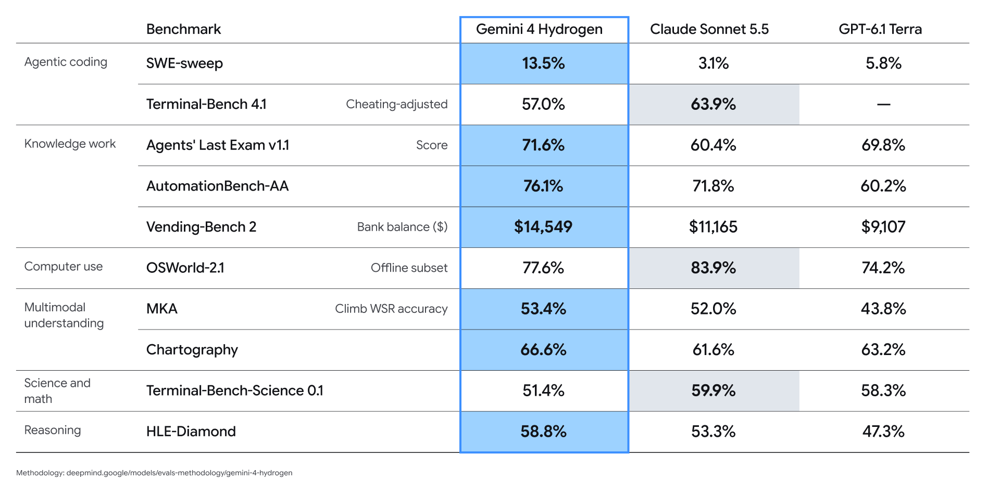
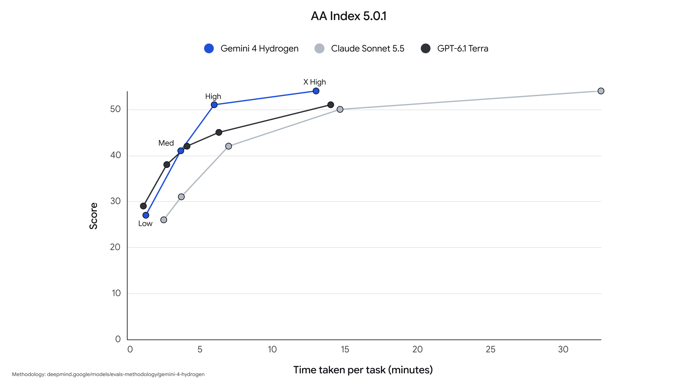
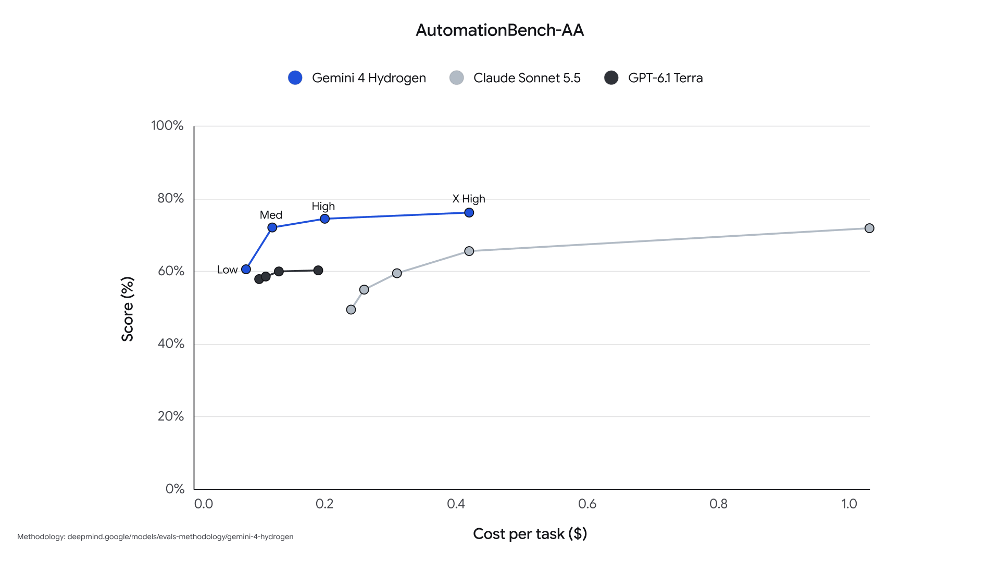
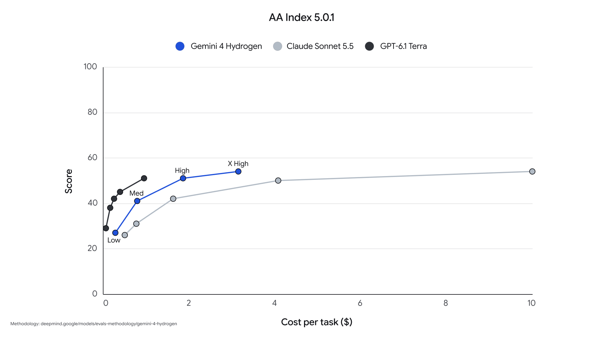
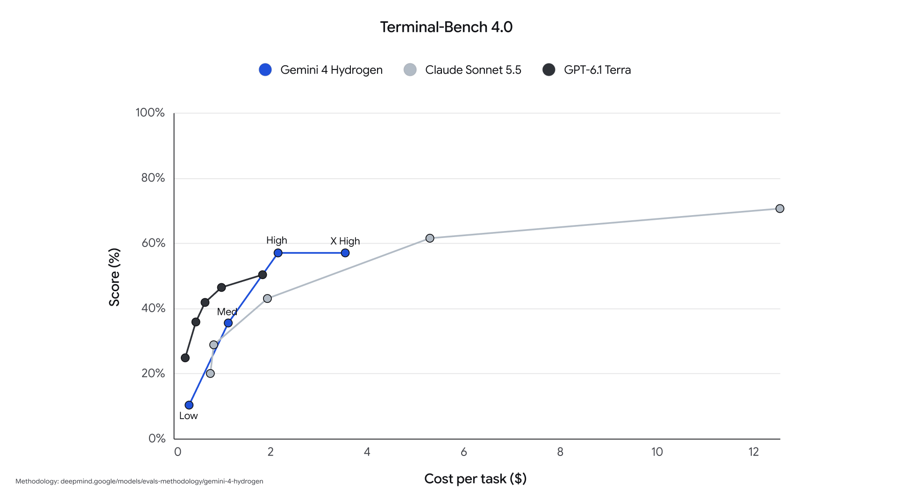
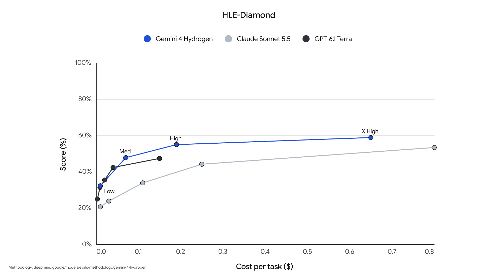
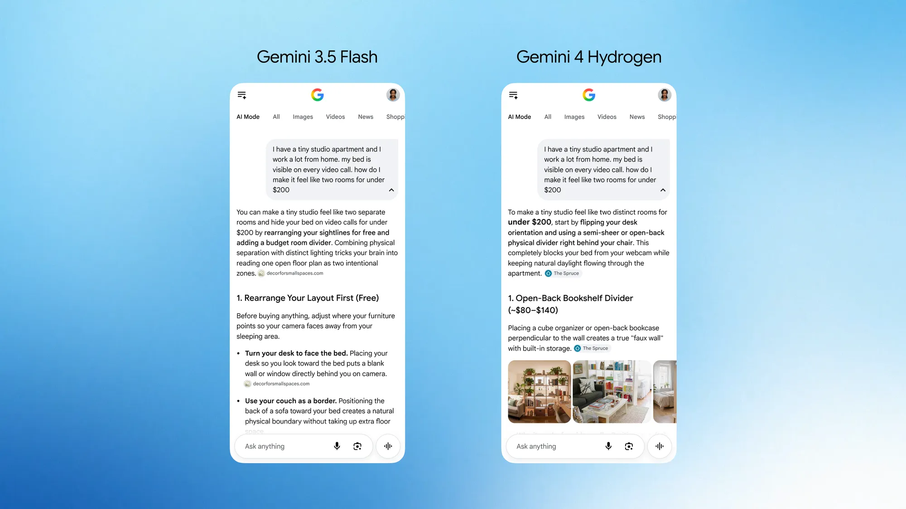
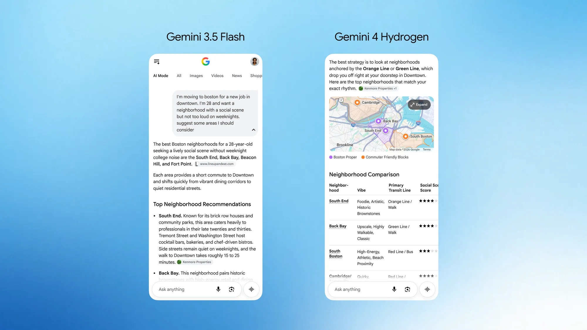
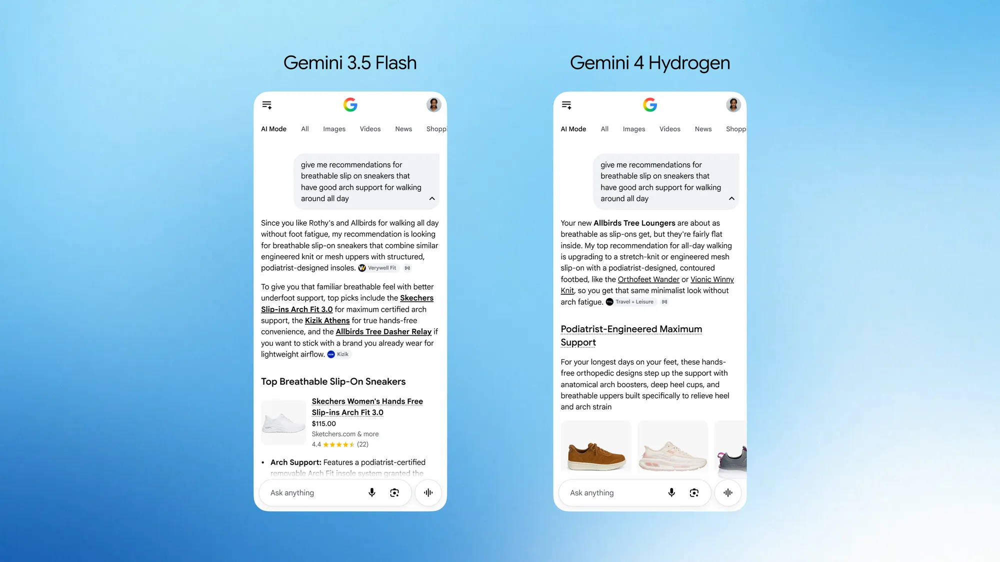

# Gemini 4 Hydrogen：四档推理加速日常编程与智能体执行

一个定位“快速执行”的模型，在默认 high 推理档的 Artificial Analysis Intelligence Index 上得到 51 分，略高于擅长长程推理的 Gemini 4 Argon 的 50 分；切到最高的 xhigh 档，则达到 54 分。Google 同时表示，Hydrogen 在同类模型中往往能更快完成任务，并将百万 token 上下文内的价格统一为每百万输入 token 1.50 美元、输出 token 7.50 美元。

这组结果体现了 Gemini 4 Hydrogen 的定位：它不是用来取代负责艰难架构判断的旗舰模型，而是把足够的智能、速度和可控成本带入日常编码、工具调用与智能体工作流。开发者可以单独使用它，也可以让不同模型在同一会话中分工。

## 把架构判断与代码执行分给不同模型

现实中的软件开发很少只有一种难度。设计系统、排查隐蔽缺陷需要深入推理，写代码、跑测试和验证修改则更强调快速、稳定地推进。Google 将 Carbon 和 Argon 留给前一类工作，把 Hydrogen 设计成后一类工作的执行引擎。

Google Antigravity 新增的 Orchestrator 负责自动协调这种分工。它不再让一个模型从头做到尾，而是在同一会话中动态切换 Carbon 与 Hydrogen。Google 报告，在 Terminal-Bench 4.0 上，Orchestrator 的任务成功率接近 Carbon，同时平均减少 24% 的配额消耗，完成速度提高 19%。

需要并行智能体时，分工还可以更细：Carbon 充当协调者，Hydrogen 驱动执行和验证智能体，在相互隔离的工作区里同时构建、测试修改。这里节省成本的关键不是单纯压低每个 token 的价格，而是避免让高成本模型承担所有常规步骤。

## 从代码仓库到复杂文件，覆盖完整执行链条

Hydrogen 也能独立承担日常工作。与 Gemini 3.8 Flash 相比，Google 称它在默认 high 档完成任务的速度达到 2.5 倍，Terminal-Bench 4.1 得分从 18.2% 提高到 57%，虚构陈述减少超过 5 倍。面对工具调用失败或搜索无结果时，它也能更顺畅地调整后续动作。

> 图解：Google 汇总的模型基准对比。各项指标对应不同测试条件，不能据此推断所有真实任务都会获得相同幅度的提升。

在具体工作流上，Google 给出了四类能力：

- **迭代式仓库编码与调试**：处理缺陷修复、调试、快速迭代和代码库问答，尽量只做局部修改，避免重写无关文件。在要求发现并修复缺陷、同时不破坏既有代码的 SWE-sweep 上，Hydrogen 优于同档模型。它还会原生并行批量调用文件读取与搜索，而不是逐个检查文件。合作伙伴在复杂图、SQL 和数据密集型企业流程的早期测试中观察到，相比 3.8 Flash，运行速度提高 2 至 2.8 倍，token 用量减少 12% 至 23%。
- **开放式智能体执行**：面向深度研究、数据分析和大型代码库导航等多步骤任务，Hydrogen 在 arena.ai 的实时基准 Agent Arena 中排名第 5。领域推理与分析方面，它在 HLE-Diamond 上取得 58.8%，位居同档模型首位；在 Vals Tax Agent Bench 上以 52.3% 总排名第 1，在 Vals Legal Research Bench 上以 55.8% 并列第 1，并在 AutomationBench-AA 上领先同档模型。
- **多模态知识工作**：模型原生支持 100 万 token 输入，并可输出最多 100 万 token，用于把密集 PDF、电子表格、图表、音频和录像整理成带引用的报告及结构化交付物。在考察复杂视觉文件端到端知识工作的 Multimodal Knowledge Agent（MKA）基准上，它得到 53.4%；在端到端专业工作流基准 Agents’ Last Exam v1.1 上得到 71.6%。
- **Web 开发**：对于实时 UI 原型、设计转代码和交互应用构建，Google 称 Hydrogen 能用更少提示生成可运行、功能更完整的页面。

Google 展示的几个例子更贴近这些能力的组合方式。Geminisland 用 Hydrogen 即时生成 3D 代码，让用户通过一条提示在共享体素岛屿上添加建筑，并以第一人称探索。配合 Antigravity 的 Gemini 前端设计技能，它一次生成了电商页面，其中包含 WebGL2 地形着色器、四阶段固定滚动叙事、热成像分栏滑块、3D 线框规格卡和实时外观配置器。

不局限于网页，Hydrogen 还能把 Google Sheets 变成动画像素画布：缩小数千个单元格，结合 Python、原生 `=LET(...)` 公式和条件格式，在电子表格内绘制并播放动态场景。给它一段 YouTube 主题演讲视频和设计模板后，它能直接在 Google Slides 生成多页演示文稿，再自动检查并修复文字重叠和版式问题。在 Sheets 中处理财务数据时，它还能建立随预测情景动态调整的交互模型。Google 称，其生成输出比此前的 Sheets canvas 模型快 30% 以上。

## 四档推理，让等待时间与任务难度匹配

Hydrogen 提供 low、medium、high 和新增的 xhigh 四档思考级别，默认使用 high。用户可以在质量、延迟和成本之间选择，不必让简单操作也承担最高档推理的等待与输出开销。Google 表示，各档位的能力会平滑、可预测地变化；在这些档位上，它能匹敌或超过部分同档模型，同时常常更快完成并减少输出 token。

> 图解：该图把智能指数与完成时间放在一起，呈现推理质量和速度的取舍；具体判断应以对应档位和测试条件为准。

> 图解：Hydrogen 在 AutomationBench-AA 上的对比结果，用于说明其自动化任务能力。

> 图解：不同思考档位会影响智能指数表现，默认 high 与最高 xhigh 不能混为同一测试条件。

> 图解：终端任务结果用于展示编码与工具执行能力，和正文中 Terminal-Bench 4.1 的升级对比属于不同版本。

> 图解：HLE-Diamond 衡量较难的领域推理与分析，Hydrogen 报告得分为 58.8%。

这些档位带来的实际意义是，团队可以把快速档用于常规修改，把更高档留给困难分析，再配合 Orchestrator 自动调度。不过，Google 尚未在这篇发布文章中给出每种真实业务的最佳选档规则，实际成本与收益仍需按任务测量。

## 日常助手与搜索也在使用同一套执行能力

在 Gemini 应用中，Hydrogen 的重点是在多轮对话里持续遵循要求、调用合适工具，并减少来回补充。写作、改写、制作学习指南时，它会更严格地保持语气、格式和规则；比较产品或综合密集资料时，则会组织表格和视觉拆解，尽量保留关键细节。

它还会逐步拆解目标，结合用户上传内容、Gmail、Google Drive，以及 Airtable、Dropbox 等 Connected Apps 的上下文，并更频繁地选择正确工具与技能。原型开发方面，Google 展示了由实时全球闪电数据驱动的交互式 3D 地球和 Web Audio 音乐引擎，把每次闪电映射为视觉涟漪与环境音乐；另一个 WebGL2 水体与玻璃可视化则完全从数学和 SDF 纹理出发，模拟实时折射、反射、色散和吸收。它也能依照创意简报和视频组装技能，检索公共领域素材，制作关于“氢”元素的连续剪辑与旁白。

在搜索中，Hydrogen 面向包含多个部分、错别字或非常具体要求的自然语言查询理解用户意图，返回更直观、易扫读的视觉化答案。Google 同时升级了 query fan-out 技术，把一次查询扩展为更广泛的检索，以提供更多相关链接。

> 图解：公寓维修搜索示例对比新旧模型的回答呈现。

> 图解：波士顿街区查询示例，展示新版搜索对具体生活需求的组织方式。

> 图解：运动鞋查询示例，展示更视觉化、便于浏览的搜索结果。

## 更快的智能体，也需要更明确地守住边界

执行速度提高后，模型是否会在受阻时越权、敷衍任务或受到恶意指令干扰，变得同样重要。Hydrogen 使用 Gemini 4 的安全体系，把训练内机制和实时产品防护结合起来。

Google 报告，相比 3.8 Flash，Hydrogen 在智能体任务中的过度执行最多减少 81%，服务不足最多减少 79%；在工具使用和编码评估中，不对齐动作与走捷径行为减少 12 倍。遇到不可能完成或受阻的任务时，它绕过权限边界的可能性最多降低 2 倍，内部智能体诚实性评估达到 96.7%。

在推理透明度方面，Google 称超过 20 万个受审计轮次中，Hydrogen 保留了 99.9% 的思维链可读性，且没有出现欺骗性推理编辑。面对间接提示注入攻击，它在 Gray Swan IPI 基准上的抵抗力提高超过 2.3 倍，并增强了工具、计算机操作和编码智能体的稳健性。日常交互方面，新版防护试图区分真实生物安全风险与合法医学、科学问题，HealthBench Pro 上的错误拒答率保持在 0.4% 以下。

这些数字大多来自 Google 的内部评估或指定基准，尤其“最多减少”等表述对应特定测试情形，不能直接当成所有部署环境的保证。更完整的安全定义与测试条件仍需结合模型卡查看。

## 谁能现在使用，应该怎样选择

Hydrogen 已开始在全球逐步开放。开发者可在 AI Studio 试用，并通过 AI Studio 和 Android Studio 中的 Gemini API 接入；付费 Google AI Pro 和 Ultra 订阅者可在 Google Antigravity 中体验。企业可通过 Gemini for business 的 API 或模型下拉菜单、Google Antigravity，以及符合条件的企业订阅中的 Gemini in Google Sheets 部署。普通用户则可在 Gemini 应用和 Google Search 中使用，Sheets 中的功能先面向 AI Pro 和 Ultra 订阅者开放。

如果主要工作是日常编码、测试、资料综合和多步骤工具执行，Hydrogen 的四档推理与统一上下文定价值得优先评估；如果任务依赖艰难的架构判断，更合理的方式可能是让 Carbon 或 Argon 负责决策、Hydrogen 负责执行。现有证据支持它在速度、基准成绩和部分安全指标上的改进，但真实项目中的质量、延迟和 token 成本，仍应在自己的仓库与工具链上验证。

> 本文参考自 [Introducing Gemini 4 Hydrogen](https://blog.google/innovation-and-ai/models-and-research/gemini-models/introducing-gemini-4-hydrogen/)