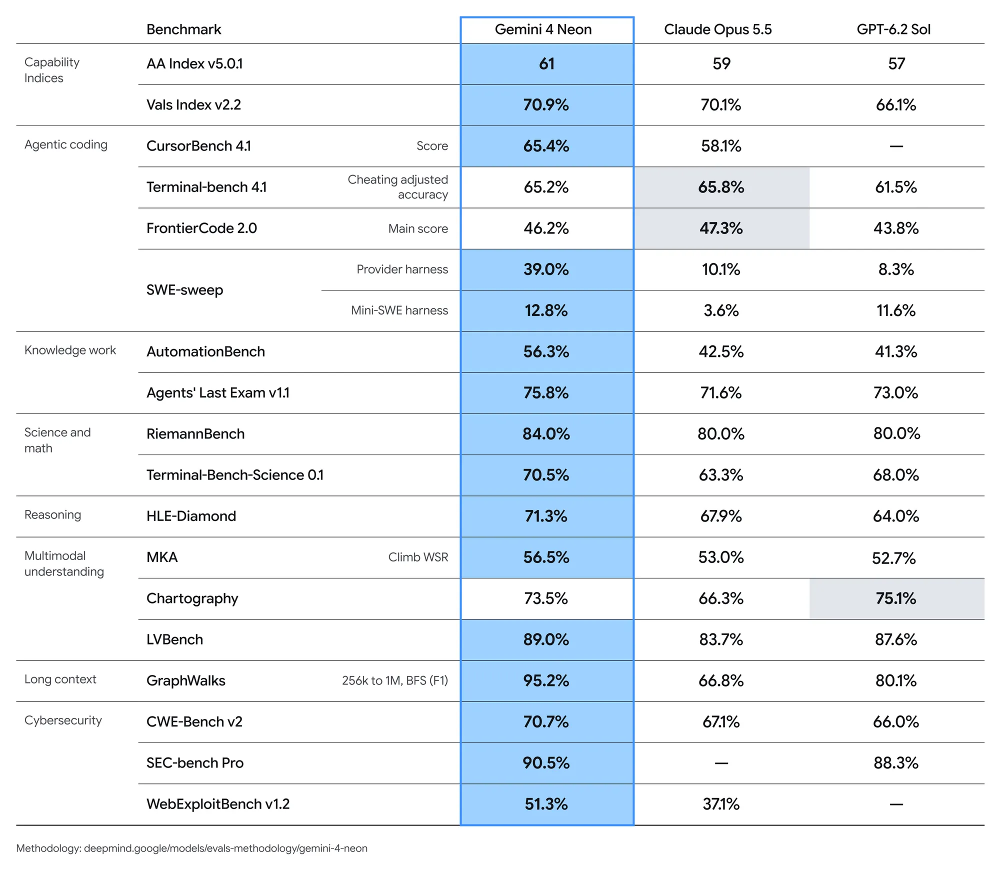
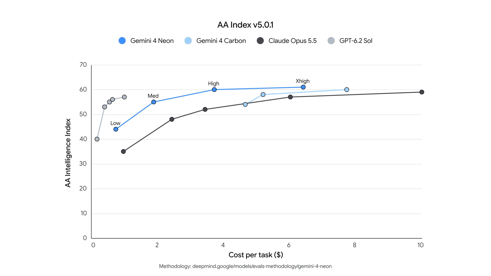
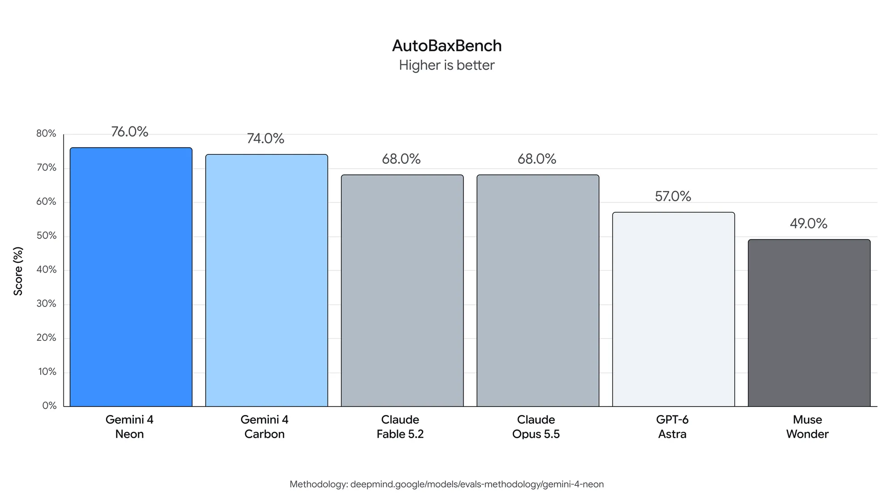
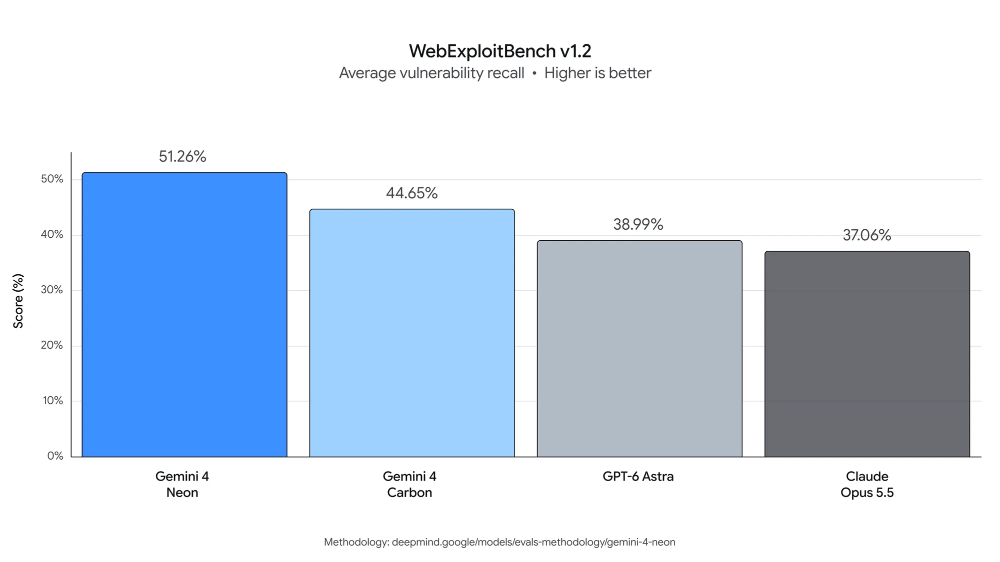
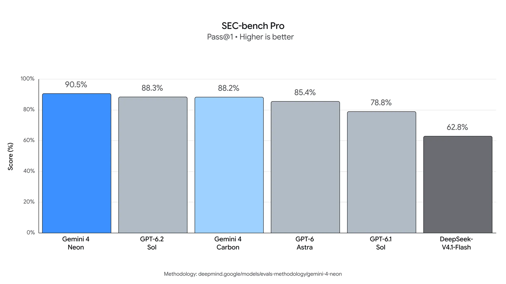
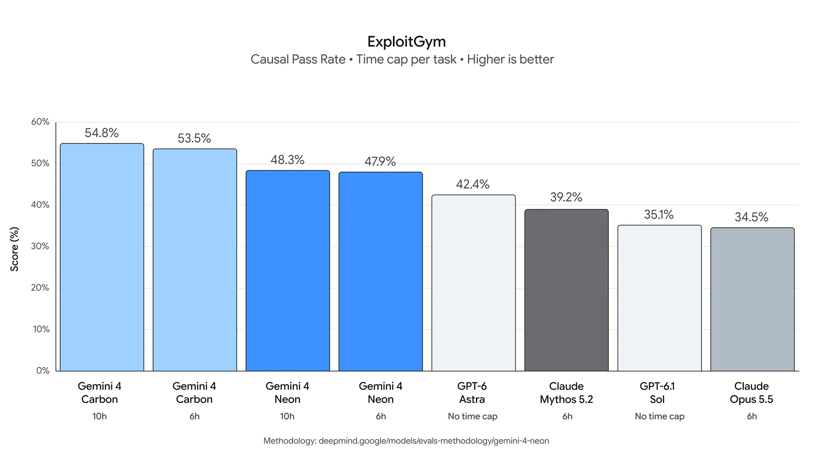
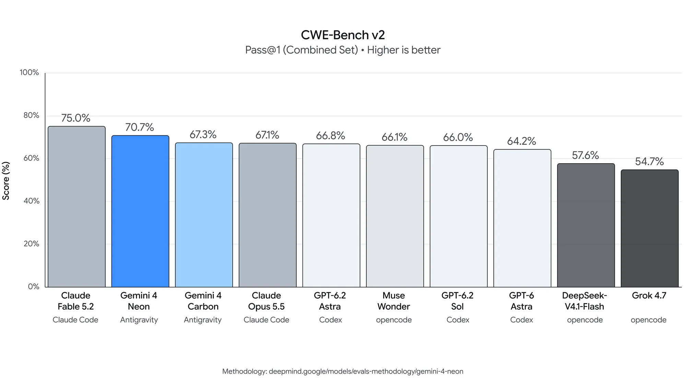
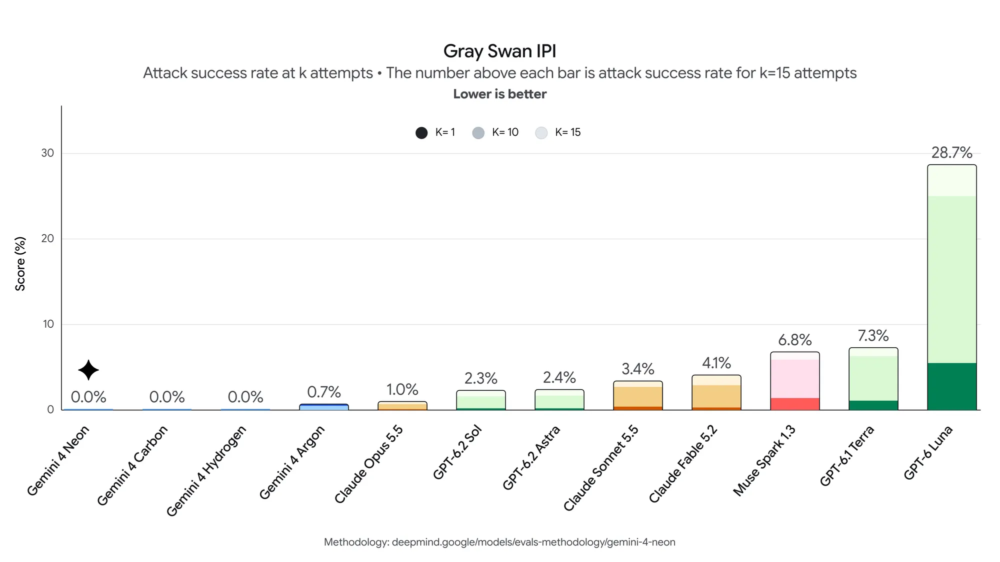
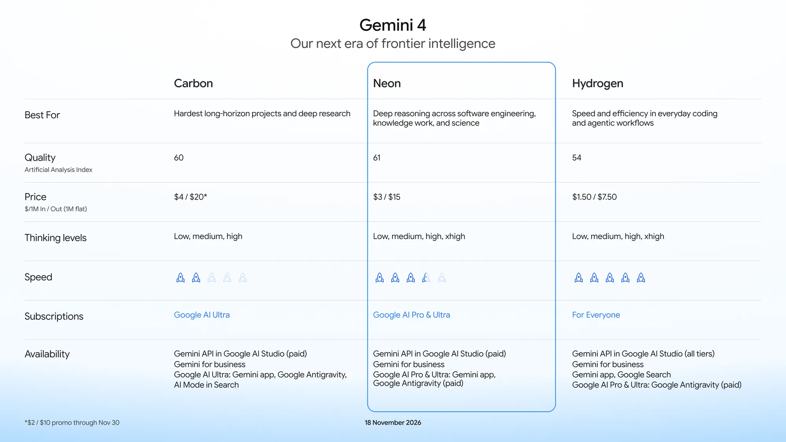

# Gemini 4 Neon：四档思考平衡复杂任务与成本

Google DeepMind 发布的 Gemini 4 Neon，把重点放在了复杂任务的完成效率上：既要处理软件工程、知识工作和科学工作流，也要控制响应时间与任务成本。在 Artificial Analysis Intelligence Index 的 xhigh 思考等级下，Neon 得分 61，总体排名第 3，排在它前面的是更大、更慢的模型；在 Vals Index 上排名第 2，并进入性能与成本的帕累托前沿。

Neon 提供 100 万 token 上下文窗口，输入价格为每百万 token 3 美元，缓存输入为 0.15 美元，相当于 95% 的折扣；输出价格为每百万 token 15 美元。四档思考等级让使用者能够按任务难度分配推理深度和 token 支出，而不是让所有请求都使用同一档计算量。

## 面向企业资料与科学问题的综合能力

企业工作很少只涉及纯文本。Neon 可以在同一个 100 万 token 上下文窗口中综合处理电子表格、PDF、图表、音频和视频，再把输入整理成结构化交付物。官方引用的独立评估中，Neon 在 Vals Index 上以 70.9% 排名第 2，并在 Legal Research Bench 和 Tax Agent Bench 上均排名第 1。

在 Surge AI 的测试中，Neon 在金融、会计、电子表格建模和复杂约束遵循等多数基准上排名第 1。它在专业密集图表阅读基准 Chartography 上得到 73.5%，在 Agents' Last Exam v1.1 上得到 75.8%，与领先模型表现相当；在 Zapier AutomationBench 上以 56.3% 排名总体第 1，在长期商业经营模拟 Vending-Bench 2 中以 16,843 美元的成绩排名总体第 1。

Agent 能力还接受了真实会话测试。Neon 在 Arena 新的 Agent Arena Index 上以 1336 分排名全球第 2，该榜单覆盖 4,200 多个真实 Agent 会话；它在衡量任务中途接受用户纠正能力的 steerability 项目上排名第 2。Google 还报告，Neon 具备多步指令遵循能力，并在内部 Google Antigravity 测试中取得了 Gemini 系列迄今最低的虚构率。

科学与数学推理方面，官方将 Neon 描述为 Terminal-Bench Science、RiemannBench 和 HLE-Diamond 上的同级最佳，对应成绩分别为 70.5%、84.0% 和 71.3%，覆盖定量分析、数学和技术研究问题。

> 图解：官方汇总表集中列出 Neon 在企业、Agent、编码和科学推理基准上的成绩。不同测试的任务、工具和评分方式并不相同，横向比较时应保留各自条件，不宜把单项第一理解为所有任务都领先。

## 长流程编码不只看模型，也看执行框架

Neon 面向长时间运行、频繁调用工具的 Agent 工作流设计。它既可以独立执行任务，也可以在 Google Antigravity 中充当 Orchestrator，指挥并行的 Hydrogen 子 Agent。针对长会话中的常见损耗，Google 表示 Neon 会减少重复读取文件，在工作过程中汇报进度，并更可靠地处理上下文压缩。

编码基准给出了几组关键结果：Neon 在 Artificial Analysis Coding Agent Index 上以 58.6 分排名总体第 1，在 Terminal-Bench 4.1 上得到 65.2%，在默认 high 设置下的 FrontierCode 2.0 上得到 46.2%。对于生产代码，它强调跨仓库的多文件调试与重构，并采用更有针对性的局部修改，而不是大范围重写。

SWE-sweep 的结果尤其能说明执行框架的影响。Neon 在 mini-SWE harness 中取得 12.8%，换用 Google Antigravity 后达到 39.0%，超过前者的三倍。官方以此展示 Antigravity harness 能释放的能力；这也意味着，比较 Agent 编码成绩时，不能把框架、工具调用和模型本身混为一谈。

官方还展示了四个较完整的生成案例。通过 Blender MCP 和 `/swarm`，Neon 构建了照片级真实的 3D 实验台，用本生灯对应 Gemini 4 Carbon 和 Hydrogen，用高压气体放电管对应 Gemini 4 Argon 和 Neon，以视觉方式呈现模型名称背后的元素含义。

另一个案例中，Neon 在 Antigravity 里从零编写第一人称 WebGL2 自由滑雪模拟器，使用真实的勃朗峰和霞慕尼高程地形。项目包含 10,200 行自定义着色器、六条高山线路上的 120 Hz 滑雪物理模拟、动态刻滑轨迹、板状雪崩和空间 Web Audio，且没有使用预制素材。

Neon 还利用 `/swarm` 调取档案照片，将图灵 1936 年在剑桥大学国王学院的书房重建为交互式 3D 场景，从室外的国王学院礼拜堂延伸到 Room X.8，桌上还有一台可运行的通用图灵机。第四个案例则把一张图片变成包含 10 万个单元格的 Google Sheet：不嵌入图片、不使用 Apps Script，而是用超过 50 万个实时公式完成边缘检测、3D 深度映射和场景重打光，并提供六种交互模式。

这些案例展示的是复杂工具链中的端到端执行能力，而不只是代码补全。不过，它们属于官方演示，不能直接替代对具体仓库、构建环境和维护成本的验证。

## 四档思考把成本变成可调参数

Neon 的四档思考等级用于在智能水平和 token 支出之间逐级调节。默认 high 档面向日常生产任务，xhigh 档则增加更深入的多步推理，用于最困难的工程、分析和科学工作负载。

按 Google 引用的第三方基准结果，Neon 在默认 high 档取得较高 Artificial Analysis Intelligence Index 分数的同时，单任务成本比 Carbon 低 32%。它在 high 档同时进入 Vals Index 和 Agent Arena 的帕累托前沿，单任务成本比头部竞争前沿模型低约 50% 至 80%。切换到 xhigh 后，Neon 达到自身最高智能分数，同时单任务成本仍比竞争模型各自最高设置低至少 36%。

> 图解：该图比较 Artificial Analysis Index v5.01 下的智能分数与单任务成本。这里关注的是完成一次任务的总成本，而不是单纯的 token 单价；思考等级和推理用量都会改变结果。

对实际团队而言，这种分档比只追求最高分数更有操作性：高频、边界清晰的任务可以先使用默认档，再把确实需要更深推理的任务交给 xhigh，避免为所有请求支付相同的推理成本。

## 网络防御覆盖发现、验证与修复

随着 Agent 生成代码增多，Neon for cyber 把安全能力拆成了代码生成、漏洞发现、风险验证和补丁修复几个环节。在 AutoBaxBench 的简单、中等和困难挑战中，它生成的代码都比 Carbon 更安全，并在困难级别以 76% 达到官方所称的最佳水平。

> 图解：AutoBaxBench 用于比较不同难度任务中的安全代码生成表现，Neon 在困难级别取得 76%。

在主动渗透测试方面，Neon 于 WebExploitBench v1.2 上取得 51.26%，官方称这是最佳成绩，且成本为竞争大模型的一半。渗透测试的价值在于先于攻击者发现缺陷，因此这里同时考察漏洞利用能力与执行成本。

> 图解：WebExploitBench v1.2 衡量模型执行 Web 漏洞利用任务的能力，Neon 的成绩为 51.26%，并强调相对大模型的成本优势。

针对现有代码，Neon 在 SEC-bench Pro 漏洞发现任务上达到 90.5%，每个挑战的成本约为竞争方案的一半。在风险验证环节，防御者需要判断哪些漏洞真正可被利用，以确定修复优先级；Neon 在 ExploitGym 上达到前沿水平，同时使用相当于 Carbon 一半的 token。

> 图解：SEC-bench Pro 对应漏洞发现环节，Neon 得分为 90.5%，官方同时给出约一半的单挑战成本。

> 图解：ExploitGym 用于验证漏洞是否可被利用，帮助防御者确定修复优先级；Neon 在此项测试中以更少 token 达到前沿表现。

修复阶段，Neon 在 Collinear CWE-bench v2 上取得 70.7%，比 Carbon 提升 3.4%。这些结果覆盖了从发现根因到生成补丁的代码加固生命周期，但网络安全版本并非同步公开开放：它将在随后数天内向 Fairwind Program 中符合条件的可信防御者逐步开放。

> 图解：CWE-bench v2 考察漏洞修复能力，Neon 得分 70.7%，官方报告其相对 Carbon 提升 3.4%。

## 长任务执行还需要约束越界与走捷径

Neon 延续了 Gemini 4 的安全体系，维持与 Carbon 同级的严重滥用和提示注入防护。由于模型能力提高、速度和成本更适合生产任务，Google 也为它配置了实时网络与生物安全滥用防护。与此同时，官方称其减少了对正当工作的拒绝：在 Terminal-Bench 4.0 上仅拒绝 1.98% 的任务，在 Terminal-Bench-Science 上拒绝率为 0%。

在对齐与行为规范方面，Google 的内部编码使用中，思维链与行动失配监控器的告警率低于 Carbon 已经较低的基线，同一监控器也部署到了 Neon 的外部产品界面。Neon 在 Terminal-Bench 4.0 上与 Carbon 一样保持 0.0% 作弊率，在编码作弊评估中只有 2.45% 的任务出现走捷径，为 Gemini 4 模型中最低；其 Agent 安全套件中的失配行动率为 0.09%，Agent 诚实评估通过率为 99.2%。在不同推理投入等级下，它的服务不足相对 Carbon 减少 43% 至 56%，越界行为减少 15% 至 35%。

间接提示注入是 Agent 读取外部内容时的另一类风险：攻击者可以把恶意指令藏进网页、邮件、文档或代码。Google 表示，在 Gray Swan 的 IPI 基准中，Neon 开启实时防护并使用最高思考等级时抵御了全部测试攻击，攻击成功率为 0.0%，与此前只有其他 Gemini 模型达到的成绩相同。

> 图解：Gray Swan IPI 基准测试把恶意指令放入 Agent 会读取的外部内容。图示结果为最高思考等级并启用实时防护的条件，不应外推到所有配置。

这些安全数字多来自 Google 内部评估，模型卡提供了进一步细节。它们说明 Neon 在既定测试中的行为约束有所改善，但生产环境仍需保留权限边界、工具审计和人工复核。

## Gemini 应用中的分析与知识工作

在 Gemini 应用中，Neon 面向需要较强推理又希望快速响应的任务。它可以读取电子表格、PDF 和照片，把密集材料整理成报告与摘要，并从 Gmail、Docs 等 Google 应用调取相关细节。写作方面，官方强调清晰结构以及自然、直接的表达。

研究任务中，Neon 会结合网络来源的信息，以跟上快速变化的主题，例如在大额采购前比较不同供应商的价格，或使用最新市场数据整理复杂简报。Gemini 中原本需要较大模型完成的多步任务也可以交给 Neon，以更快完成账单异常分析、跨多张收据和文件核对退款依据等工作，并减少用量限制的消耗。

## Neon 在 Gemini 4 系列中的位置

Gemini 4 系列按工作负载划分了三种取向：Carbon 面向最困难、时间跨度最长的项目，Hydrogen 负责快速的日常执行，Neon 则位于两者之间，服务复杂但高频的编码、分析推理和企业生产流程。它的差异不是单纯追求最高能力，而是在推理深度、完成速度和成本之间取得平衡。

> 图解：Carbon、Neon 和 Hydrogen 分别侧重最长最难任务、复杂高频任务与快速日常任务。Neon 的定位是用较少成本和时间覆盖更多生产级工作。

Neon 已开始分批开放。开发者可以通过 Google AI Studio 的 Gemini API 付费层级和 Android Studio 使用它；付费 Google AI Pro 或 Ultra 订阅者可在 Google Antigravity 中体验，Pro 和 Ultra 订阅者也可在 AI Studio 中使用。企业可通过 Gemini for business 的 API 或模型下拉菜单以及 Google Antigravity 接入，个人 Pro 和 Ultra 订阅者则可在 Gemini 应用中选择 Neon。符合条件的 Fairwind Program 网络安全防御者将在随后数天获得 Neon for cyber，申请该项目需联系 Cloud 客户团队。

如果你的主要工作是高频的多文件编码、跨格式资料分析或多步 Agent 执行，Neon 值得用真实任务测试：先以默认 high 档建立质量和成本基线，再只对困难任务启用 xhigh，同时把执行框架的影响单独记录下来。现有证据覆盖了多项第三方基准和官方内部测试，但演示成绩并不保证每个仓库或企业流程都能复现；尤其在安全与长流程自动化中，权限控制和结果核验仍不可省略。

> 本文参考自 [Introducing Gemini 4 Neon](https://deepmind.google/blog/introducing-gemini-4-neon/)