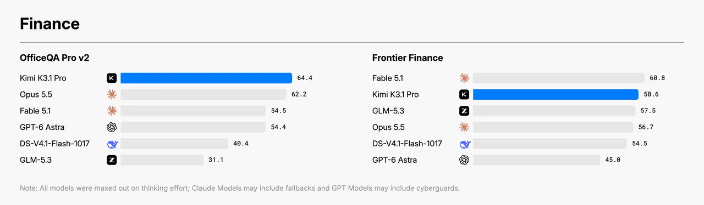
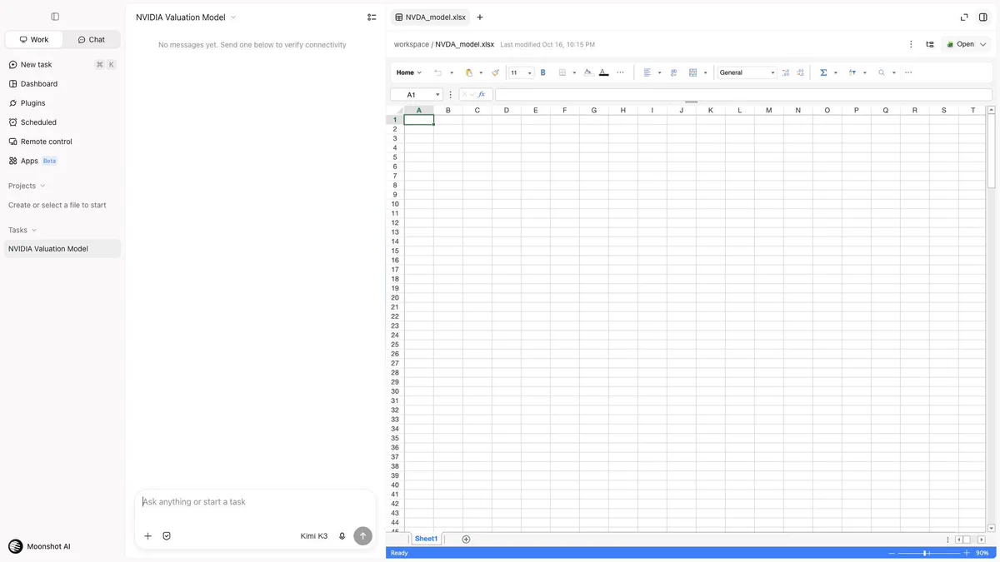

# Kimi K3.1 Pro 发布：OfficeQA Pro v2 拿下 64.4 分登顶，金融建模能力大幅升级

月之暗面（Moonshot AI）官方账号 Kimi.ai 于 2026 年 10 月 23 日在 X 平台发布了一条简短但信息量不小的公告：新模型 Kimi K3.1 Pro 在面向真实办公场景的 OfficeQA Pro v2 基准上取得 64.4 分，成为该榜单的 SOTA；同时在内部测试中，相比上一代 K3，金融建模得分提升 7.2 分，金融研究提升 11.6 分，模拟商业运营得分约为 K3 的 4.2 倍。官方还直接给出了三类交付物示例：一份英伟达（NVDA）的 DCF/LBO 估值模型、一份宁德时代（CATL）投资委员会演示文稿，以及一份带来源级引用的量子计算行业研究报告。

这条公告没有配技术报告，所有数字都来自官方自述，但它透露出的方向值得注意：Kimi 这一代模型的发力点明显从通用对话转向了“能交付金融级工作成果”的智能体场景。

## 基准成绩：一项登顶，一项居第二

官方配图给出了两组金融相关基准的横向对比。

> 图解：左图为 OfficeQA Pro v2 成绩，Kimi K3.1 Pro 以 64.4 分居首，其后依次为 Opus 5.5（62.2）、Fable 5.1（54.5）、GPT-6 Astra（54.4）、DS-V4.1-Flash-1017（40.4）和 GLM-5.3（31.1）。右图为 Frontier Finance 成绩，Fable 5.1 以 60.8 分领先，Kimi K3.1 Pro（58.6）位列第二，其后为 GLM-5.3（57.5）、Opus 5.5（56.7）、DS-V4.1-Flash-1017（54.5）和 GPT-6 Astra（45.0）。图注说明所有模型均使用了最大思考强度（thinking effort），Claude 系模型可能包含 fallback 机制，GPT 系模型可能包含 cyberguard 机制。

两组数据放在一起看更有意思。OfficeQA Pro v2 上，K3.1 Pro 领先第二名 Opus 5.5 约 2.2 分，优势不算悬殊，但拉开了与第三梯队（54 分档）近 10 分的差距。而在更贴近前沿金融实务的 Frontier Finance 上，它并没有拿到第一，被 Fable 5.1 压了 2.2 分——官方如实放出了这张自己并非榜首的图，这一点比单纯的“遥遥领先”式宣传更可信。

需要注意，公告没有说明这些对比成绩的测试细节，图注中关于 fallback 和 cyberguard 的备注也提示各家模型的测试条件并不完全对等，跨模型比较时应保留这一不确定性。

## 内部测试：相对 K3 的提升幅度

除了公开基准，公告还给出了三个内部口径的数字，全部以自家上一代 K3 为基线：

- 金融建模（financial modeling）：提升 7.2 分
- 金融研究（financial research）：提升 11.6 分
- 模拟商业运营（simulated business operation）：得分约为 K3 的 4.2 倍

内部基准无法外部验证，分值的具体构成也未披露，因此更合适的读法是把它当作“代际提升幅度”的信号，而非绝对能力值。其中 4.2 倍的模拟商业运营提升最为激进，如果属实，意味着模型在多步骤、长链条的经营决策任务上发生了质变，而不只是回答得更准确。

## 交付物示例：从“回答问题”到“交出成品”

公告列举的三个示例输出，代表了三种典型的专业工作交付形态。第一个是英伟达的 DCF/LBO 估值模型，官方强调其“报表完全联动、公式可追溯”——这是金融建模的硬要求：估值模型的价值不在结果数字，而在于每一格都能回溯到假设和来源，改动一个参数能正确传导到所有关联报表。第二个是宁德时代的投资委员会演示文稿，面向投决场景。第三个是量子计算行业研究报告，特点是带来源级引用，即论断可以定位到具体出处。

> 图解：公告所附演示视频的首帧，展示 Kimi 工作区界面。左侧为任务面板，当前任务为 “NVIDIA Valuation Model”；右侧为内嵌的电子表格编辑器，已创建 `NVDA_model.xlsx` 文件，视频从空白表格开始演示模型的逐步生成过程。

这类演示想证明的不是模型“懂金融知识”，而是它能在真实办公环境里操作文件、构建可交付的成品。这与基准测试的选择（OfficeQA、金融建模、商业运营模拟）是一致的：Kimi 显然在把模型往“办公智能体”的定位上推。

## 谁该关注，证据到哪一步

如果你从事金融分析、咨询或任何需要产出结构化办公文档的工作，K3.1 Pro 是近期值得实际试用的一次更新：OfficeQA Pro v2 的榜首成绩和公式可追溯的估值模型示例，都直接指向这类场景。但要清醒的是，目前所有信息都来自官方一条推文——内部基准无法复核，Frontier Finance 上它也并非第一，演示视频展示的是理想路径而非失败案例。这些能力在实际工作流中的稳定性如何，只能等独立评测和真实用户的反馈来回答。

> 本文参考自 [Kimi.ai (@Kimi_Moonshot) on X](https://x.com/Kimi_Moonshot/status/2113680714311094458)