# Liber-0：用220万小时人类经验训练零样本机器人

200万小时的网络人类视频，在机器人操作学习上仍输给1万小时的手套采集数据。Liber AI团队报告的这项对比，指向了人类视频训练机器人的关键矛盾：数据时长可以不断扩大，但画面里的人手运动并不会自动变成机器人能够执行的动作。

围绕这个问题，团队提出了世界动作模型Liber-0，使用超过220万小时人类经验进行预训练，并以带精确手部动作测量的LiberSense手套作为“动作锚点”，再通过统一的身体表征和LEO机器人硬件缩小人与机器之间的差异。在GPT-6提出、与内部基准独立的60项任务上，未使用这些任务的专属机器人示范进行训练的Liber-0，在600次试验中取得36.0%的总体成功率；其中多步骤任务成功率仍只有10.5%，说明零样本操作已经出现，但远未解决。

## 人类视频为什么不能直接教会机器人

机器人操作通常依赖针对特定机器人和任务采集的示范，成本高，也难以扩展。互联网视频中则有大量现成的人类物理交互经验，但把这种经验转成机器人动作，需要跨过三道鸿沟。

- **身体差异**：人和机器人的形态、运动学结构与运动范围不同，同一个操作目标可能需要完全不同的动作。
- **动作监督差异**：从视频估计的手部姿态和轨迹容易受遮挡、深度误差和估计误差影响，难以为精细操作提供可靠监督。
- **视觉差异**：人类录像与机器人观察在相机位置、视角以及手和身体的外观上不同，部署时会发生视觉分布偏移。

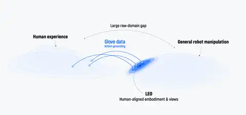

> 图解：人类经验与一般机器人操作之间并非直接等价。LEO让身体和观察视角更接近人类示范，手套录像则提供有动作依据的迁移桥梁。

Liber-0对应的设计不是单点修补，而是一套组合：用统一身体表征告诉模型“当前是谁在执行”，用手套测量动作把视觉经验落到可执行运动上，再让机器人硬件尽量复现人的视角和运动方式。后续实验要验证的，正是这三部分能否一起把数据规模转成操作能力。

## 世界动作模型同时预测画面与动作

Liber-0采用世界动作建模，让模型联合预测未来视觉帧和动作。视觉预测可以从没有动作标注的大规模视频中学习物体交互与物理变化，动作预测则利用手套和机器人录像中的测量运动，将画面变化与产生这些变化的动作联系起来。架构上，模型使用Mixture-of-Transformers，让语言、视觉和动作专家通过多模态注意力交互，共享的物理编码器接收状态、身体上下文和带噪动作。

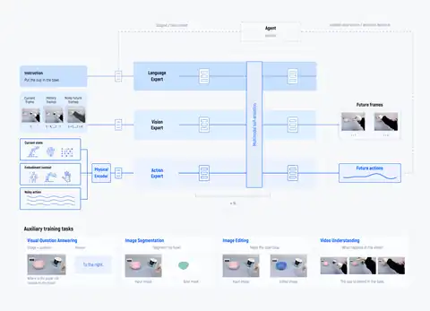

> 图解：语言、视觉和动作专家共同预测未来帧与动作；物理编码器把状态、身体信息和动作纳入同一预测过程。

统一身体表征将人手与机器人的几何和运动学编码到共享空间，动作预测以执行身体为条件。这样，模型学习的不只是某个固定轨迹，还包括同一操作目标如何随身体结构改变运动形式。它并不消除人与机器的差异，而是把差异显式交给模型处理。

操作还需要理解任务语义、空间关系和执行进度。因此，团队将视觉问答、图像分割、图像编辑和视频理解纳入联合训练。对于多步骤任务，Liber-0还可以选择接入GPT-6 Astra等推理智能体，规划中间目标并引导执行；这与Astra单独充当机器人策略是两种不同的使用方式。

## 一副薄手套和一台更接近人的机器人

LiberSense手套的作用，是在尽量不改变自然操作的情况下直接测量手指运动。它厚0.3毫米、重131克，团队称这种轻量设计能减少对手指运动及手物接触的干扰；肤色外观也尽量接近第一人称视频中的裸手。系统同步记录手部姿态、轨迹，以及第一人称相机和两只腕部相机的视频。

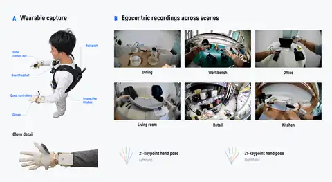

> 图解：左侧为可穿戴采集设备和手套硬件，右侧为日常场景中的胸前视角录像，叠加左右手姿态。视频保留了人类视角，测量动作则提供精确监督。

采集现场不需要机器人，因此可以覆盖更多人的手型、物体、任务和环境。相比继续增加遥操作示范，这条数据路线把扩展成本从“每个采集点都要有机器人”转为可穿戴设备采集，不过其最终收益仍取决于动作能否跨身体迁移。

LEO机器人负责缩小另一端差距。它配备灵巧手、三个腕部转动自由度和可活动腰部：手腕无需大幅移动前臂即可完成旋转，细前臂降低碰撞风险，腰部则扩展可达空间，支持弯腰和低处伸手。胸前与腕部相机也对应手套采集时的第一人称和腕部视角。

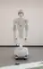

> 图解：LEO将灵巧手、灵活手腕、可调腰部以及与人类采集相匹配的相机配置组合起来，让人的观察与运动方式更容易在机器人上复现。

## 1万小时手套数据胜过200万小时网络视频

团队分别使用手套数据、跨身体机器人数据、OpenEgo、VendorEgo和网络人类视频进行预训练。前四类来源分别测试1、2、5、10千小时，网络视频额外测试100千小时和2000千小时；所有模型随后使用同一机器人数据集后训练，并在60项PnP和16项Non-PnP任务上比较平均进度分。

PnP即抓取与放置，主要考察物体选择、抓取和空间放置；Non-PnP涵盖折叠、开合、按压、推拉等精细及连续操作。进度分取0—100，既记录完整完成，也记录接近、对齐、抓取、运输、释放等中间里程碑，因此不能把它当成任务成功率。

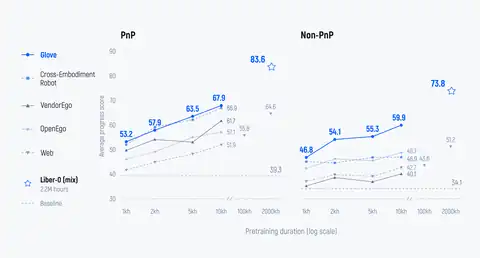

> 图解：虚线是没有对应来源预训练的基线，星号是完整分阶段预训练再经机器人后训练的Liber-0。横轴扩大数据时长，纵轴比较两类任务的平均进度分。

没有来源专属预训练时，PnP与Non-PnP基线分别为39.3和34.1，所有数据来源增加后总体都能带来改善，但增长方式明显不同。手套数据从1千小时增到10千小时，PnP提高14.7分，Non-PnP提高13.1分；其他来源在Non-PnP上的增益通常明显小于PnP。这意味着广泛的视觉经验较容易迁移到“选中并移动物体”，而持续、精细的手物交互更依赖可靠动作监督。

网络视频扩展到2000千小时后，PnP为64.6、Non-PnP为51.2，仍低于仅10千小时手套数据的结果。两者时长相差200倍，说明至少在这套实验条件下，单纯增加视频规模无法弥补动作监督和身体对齐的不足。

完整Liber-0方案经机器人后训练达到83.6和73.8，高于所有单一来源配置。团队据此支持的结论不是“网络视频无用”，而是广覆盖视觉经验与高质量动作监督具有互补作用，分阶段组合比单独堆大某一种数据更有效。

## 零样本能力到了哪一步

为了测试超出内部基准的泛化，团队让GPT-6独立提出60项桌面任务：20项PnP、20项短Non-PnP和20项有挑战的多步骤Non-PnP，每项测试10次。被测检查点没有使用为这些目标任务专门采集的机器人示范，但这并不等于它从未见过机器人数据。

| 任务类型 | Liber-0成功率 | Astra-only成功率 |
| --- | ---: | ---: |
| PnP | 63.5%（200次） | 8.3%（每项3次） |
| 短Non-PnP | 34.0%（200次） | 5.0%（每项3次） |
| 多步骤Non-PnP | 10.5%（200次） | 1.7%（每项3次） |
| 总体 | 36.0%（600次） | 未报告同口径总体值 |

Liber-0展示的案例包括杯子、袋子和卡片放置，物体重新定向、折纸、抽取纸巾，以及收纳、调味后覆盖、关闭后擦拭等多步骤序列。部分多步骤任务无需任务专属机器人训练即可完成，是这组结果最重要的信息；同时，成功率从PnP的63.5%降到多步骤任务的10.5%，也清楚标出了能力边界。

Astra单独作为机器人策略时共进行180次试验，与Liber-0每项10次并不完全同口径。团队报告其平均每次决策推理耗时87.3秒，成功任务从推理到执行完成平均需要17.8分钟。其成功行为主要集中在能容忍动作误差的粗略抓放，在需要精确对齐和受控接触的操作上表现较差；展示的抽屉任务中，它反复未能完成最初的开抽屉步骤。这个对比反映的不只是动作能力，也包含长控制周期难以及时根据反馈纠偏的问题。

团队还探索了物体级泛化：使用100小时仿真遥操作数据后训练后，用户可以在交互式在线仿真中上传自定义物体，无需针对该物体额外训练即可观察操作结果。它是对固定真实机器人基准的开放补充，但仿真观察不能替代真实物体上的成功率验证。

## 三阶段训练逐步靠近可执行操作

不同数据的互补性最终落实为三阶段预训练，数据采样重心从广泛视觉预测逐步转向动作落地。

1. **通用视觉预测**：在多样的人类活动、物体和环境上预测未来观察，不加入动作训练目标，先建立物体交互和物理动态的先验。
2. **联合世界—动作预训练**：同时预测未来帧与动作，把人类视频的视觉覆盖与手套、机器人录像的运动监督混合起来，在多种身体上建立画面变化与动作的联系。
3. **面向操作的预训练**：提高手套和遥操作录像的采样权重，强化精确运动与持续交互。

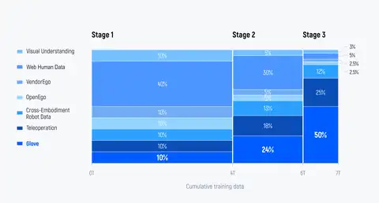

> 图解：色带表示各数据集的采样比例，阶段边界区分通用视觉预测、联合世界—动作预训练和操作导向预训练。视觉理解数据包括语义、空间和时间监督。

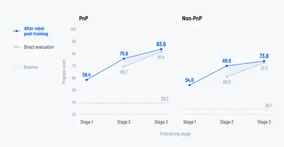

> 图解：三个阶段均在机器人后训练后评估，第二、三阶段还报告未经额外机器人后训练的直接评估；虚线沿用单来源实验基线。

第三阶段检查点直接评估已达到PnP 81.4、Non-PnP 72.3，机器人后训练只再增加2.2和1.5分，达到83.6和73.8。随着预训练推进，后训练增益缩小，说明更多操作能力已在预训练中形成。这是“预训练可能减少部署时机器人示范需求”的实验依据，但尚不能推出所有应用都无需后训练。

训练语料除手套和跨身体机器人数据外，还包括公开第一人称视频OpenEgo、外部采集且动作模式更接近机器人执行的VendorEgo，以及覆盖广泛物体、场景和视角的网络人类视频。视觉理解联合训练则进一步细分：视觉问答和描述覆盖识别与关系，子任务预测连接当前及历史观察与执行步骤；分割提供物体区域和边界监督；指令图像编辑联系语言与预期视觉变化；视频问答、密集描述和时间定位则覆盖事件顺序、物体状态及操作进度。

内部PnP基准包含两套各30项任务，每套使用40个物体、五种桌面场景，每个场景放置八个物体，每项测试三次。Non-PnP包含六类动作族共16项任务，每项六次，即每模型96次试验。评估时按参考图像或视频恢复初始配置，并使用匹配指令和场景；这些进度分基准与上述GPT-6零样本任务的成功率评估必须分开理解。

## 手套数据能减少多少机器人示范

团队用八项任务、每项10次试验检验手套数据能否替代机器人示范，所有配置训练步数相同，LEO安装WUJI2灵巧手，机器人与手套数据池包含等量示范。

当机器人示范固定为机器人数据池的25%时，手套数据从25%增加到50%、100%，平均进度分依次从61.2升至68.4、75.6。最后一种配置超过使用完整机器人数据池的Robot-only基线72.8，而机器人示范用量减少了75%。

完全不使用机器人示范时，50%手套数据得到49.4，接近25%机器人数据的50.0；手套数据增至100%后达到60.3。这里的替代关系仍限于这组任务、数据池和LEO平台，但它表明，纯手套训练也能产生有意义的跨身体迁移，而不只是给机器人示范做辅助增强。

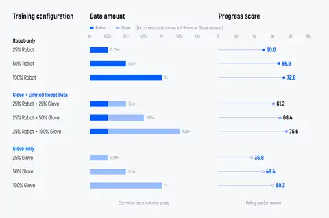

> 图解：Robot-only、手套加有限机器人数据、纯手套三种配置的柱状结果，分别显示减少甚至取消机器人示范后的平均进度分。

## 新技能与共享行为如何一起迁移

减少示范数量之外，更关键的是手套能否教会机器人示范中不存在的技能。团队以仅含机器人PnP遥操作数据为基线，与同时含机器人PnP和Non-PnP的Teleop All参考比较，再分别加入手套Non-PnP或全部手套数据。每项配置在四项目PnP和六项Non-PnP任务上各测试10次。

当机器人只见过PnP示范时，其Non-PnP进度仅2.2；加入手套Non-PnP后升至47.5，加入全部手套数据进一步达到54.6，接近Teleop All的56.3。也就是说，手套数据扩展了机器人的技能集合，而非只强化已有技能。

全部手套数据还带来另一层收益：相较只加Non-PnP手套数据，PnP从54.3升至69.5，Non-PnP从47.5升至54.6。团队将其解释为共享行为提供了人与机器人执行同类操作的对应样例，帮助模型建立跨身体动作关系，再迁移其他技能。

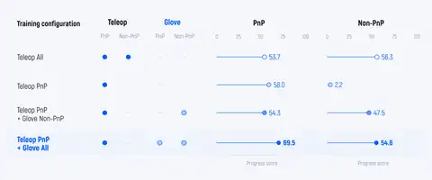

> 图解：不同机器人和手套数据组合分别报告PnP与Non-PnP表现。Teleop指机器人遥操作，All表示同时包含两类示范。

## 人手越多样，迁移反而越好

如果多样性只是增加数据量，就无法区分收益究竟来自“更多”还是“不同”。团队因此固定手套片段总数，只把采集者人数从1人增加到3、10、30和100人，所有人的采集任务与环境相同，再在两项目PnP和四项Non-PnP任务上评估。

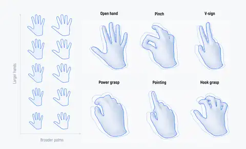

> 图解：手的大小、掌宽和形态差异会改变指尖布局，即使名义姿态相同，也可能形成不同操作方式。

手套加有限机器人数据的配置中，1人到100人的进度分从60.6提高到69.5；纯手套配置提升更明显，从12.7升至40.1，逐步接近Robot-only参考值51.8，但总手套片段数并未增加。

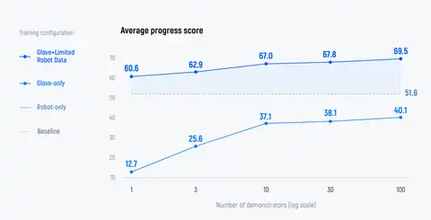

> 图解：横轴增加采集者覆盖，纵轴为平均进度分。两条手套训练曲线均随人的形态多样性上升，Robot-only作为参考线。

这支持了一个比“数据越多越好”更具体的判断：不同身体执行相似技能，本身就提供了有价值的监督。团队进一步提出一种可能性——足够多样的人类身体或许能让对齐良好的机器人成为所学身体空间中的插值目标；目前这仍是解释和方向，而不是已经普遍验证的结论。

## 机器人能否复现人的动作，直接影响迁移

为检验硬件对齐本身的价值，团队将LEO与采用天机的Marvin M6机械臂平台比较，重点选择需要大幅腕部旋转、精确手部放置和腰臂协同的任务。两套策略使用相同手套录像和等量、各自平台的遥操作数据；同一操作者在两个平台采集，尽量保持物体初始位置、动作序列和运动策略一致。

- **旋转旋钮**：手指必须稳定接触旋钮，同时手腕大幅转动。LEO可用腕部活动完成旋转，减少手臂补偿。
- **整理拖鞋**：需要降低上身、伸臂并在低处调整手指方向。LEO通过腰臂协调复现弯腰、伸手、抓取和repositioning的连续过程。
- **打开抽屉**：拉手靠近桌面，空间狭窄。人通常掌心朝前、手腕向上弯曲后沿抽屉方向拉动，机器人必须精确放置手指并调整腕姿以避免碰撞。

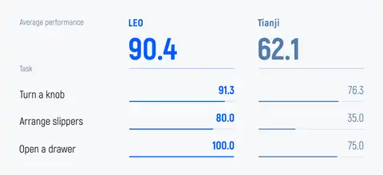

> 图解：三个任务分别考察大幅腕部旋转、狭窄空间中的手指放置和低处触达。两平台均使用相同手套录像及等量平台专属遥操作数据，进度分范围为0—100。

LEO在三项任务上均优于对照平台，平均进度分高28.3分。这个受控对比把收益更具体地归因于运动学兼容性：机器人越能复现人类示范中的运动模式，学到的操作策略就越容易成为可执行动作。它也意味着，Liber-0的结论与LEO这类对齐硬件紧密相关，不能直接外推到任意机器人。

## 220万小时之后，限制仍然清楚

Liber-0提供的主要证据是：人类经验要成为通用机器人能力，规模、动作监督和身体对齐缺一不可。手套数据在精细操作上呈现更强扩展性，能在特定实验中减少75%的机器人示范、补充机器人数据中没有的技能，并从人的形态多样性中获益；LEO与对照平台的差距则说明硬件并非被动承载模型的外壳。

对于关注通用操作和机器人基础模型的人，最值得继续观察的不是“220万小时”本身，而是这套方法能否跨更多机器人、任务与真实环境复现。当前多步骤零样本成功率只有10.5%，手套也主要测量运动，无法完整提供接触与力信息。团队将触觉和力传感列为后续方向，用于插入、紧固和可变形物体操作，同时还需避免新增传感破坏轻量、可扩展的采集方式。这些限制决定了Liber-0更接近一条可扩展路线的有力验证，而非通用机器人操作已经完成。

> 本文参考自 [Liber-0: Emergent Zero-Shot Capabilities in Multi-Step Manipulation from 2.2 Million-Hour Human Experience](https://www.liberai.com/blog/liber0/)