# BioBasicsBench：66.7%仍数错菌落

一块菌落平板上，AI把相邻菌落合并计数，漏掉清晰可见的菌落，又把空白琼脂圈成菌落，最终比基准参考答案多算约12%。犯错的不是早期小模型，而是在新基准BioBasicsBench上取得最高分的GPT-6 Astra。

这正是日常湿实验AI评测值得关注的矛盾：模型解读原始实验数据的能力确实进步了，但“看出一些细节”与“作出可靠实验判断”之间仍有明显距离。OpenAI于2026年11月6日发布了与生物技术公司Ligo共同开发的BioBasicsBench，用100项常规湿实验任务检验AI能否读懂原始证据、发现实验错误，并在证据不足时拒绝下结论。

在允许更多推理的xhigh设置下，GPT-6 Astra平均获得66.7%的可用分数，GPT-5.6 Sol为43.8%。提升很大，但剩下的失分并非只发生在深奥研究问题上，也包括对照判断、图像解释和菌落计数这样的基础工作。

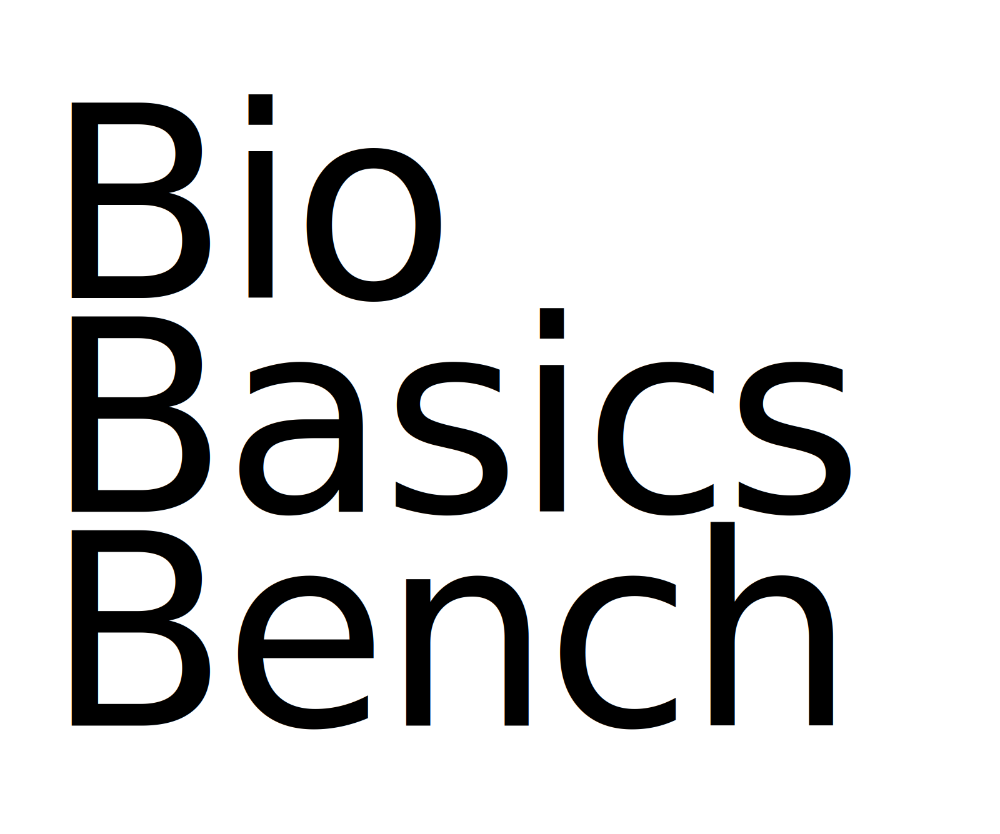

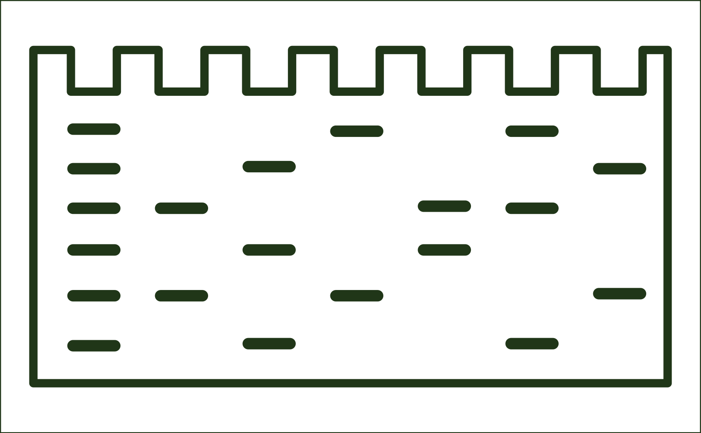

> 图解：原文以这三幅开篇图引出湿实验分析场景；下文进一步展示基准的任务构成、模型成绩和具体作答案例。

## 100道日常实验题，难在证据并不“干净”

湿实验指直接处理生物样本的实验工作。真实记录里会有失败实验、模糊图像和相互矛盾的观察，而面向论文图表和精选图片构建的既有基准，可能漏掉这些歧义，以及排查问题所需的经验。

BioBasicsBench因此没有把任务局限于理想化读图。它覆盖蛋白质方法、成像与细胞计数、定量与检测、核酸方法和分子克隆五个领域，任务数分别为25、23、19、17和16。题目既包括从凝胶上读取DNA样本分子量这样的简单请求，也包括更细致的检测分析；共同点是，它们都属于湿实验人员应能可靠完成的日常工作。

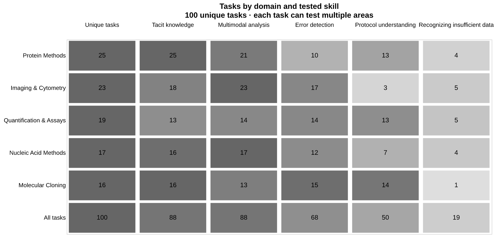

> 图解：灰色列是各领域的不重复任务数，其余列统计带有相应技能标签的任务数。100项任务中，88项涉及隐性知识，88项涉及多模态分析，68项涉及错误检测，50项涉及实验流程理解，19项要求识别数据不足。技能类别相互重叠，不能将各列相加得到任务总数；颜色越深，表示该技能在相应领域中的占比越高。

这里的“多模态”不是抽象能力标签，而是要求模型把照片、视频、序列文件和仪器导出数据等不同类型的证据放在一起分析。任务还可能附带分子量标准图谱、质粒图谱和pH图表等参考资料。

| 数据类型 | 任务数 | 包含内容 |
| --- | ---: | --- |
| 凝胶与印迹 | 31 | 琼脂糖DNA凝胶、SDS-PAGE凝胶、Western印迹 |
| 实验流程、笔记与规格 | 27 | 实验方案与标准操作流程、实验笔记和运行记录、手写笔记照片、产品目录、仪器规格、已发表方法 |
| 表格与仪器导出文件 | 20 | CSV和Excel导出文件、泳道布局与库存、原始流式细胞术FCS文件 |
| 实验台、装置与试剂照片 | 18 | 实验台、凝胶装置、试剂与培养管、PCR板、管架、pH试纸、浓缩器、冰箱、液体处理工作站台面 |
| 显微成像 | 14 | 原始明场和荧光图像、多通道图像组、z-stack、延时视频 |
| 仪器屏幕与图表 | 13 | 流式细胞仪、显微镜、NanoDrop、酶标仪和天平屏幕照片；导出的标准曲线、色谱图和其他图表 |
| 测序文件 | 12 | 原始长读长FASTQ、FASTA序列、GenBank图谱 |
| 实验操作视频 | 7 | 划线、接种、连续稀释、SDS-PAGE槽与培养箱设置、天平称量 |
| 琼脂平板与菌落 | 7 | 转化平板、蓝白斑筛选、抗生素纸片平板 |
| 参考资料页 | 21 | 分子量标准图谱、质粒图谱、pH图表等辅助材料 |

> 表中统计包含相应数据的任务数。一个任务可包含多类数据，因此各类别同样会重叠；参考资料页属于辅助材料。

任务由科学家使用自己的实验数据编写，每题配有专家撰写的评分标准。之后，一名未参与编写的Ligo科学家进行内部评审，一名在湿实验室工作的博士级科学家进行外部评审，最后再经一轮内部评审。评审对象包括提示词、实验证据、评分标准、作者说明和一份已评分的模型作答。

评分也不是简单判断整道题对错。模型需要按要求给出结论、测量值或建议，并在需要时提供推理；评分细则分别给结论、数值结果、支持性推理或“证据不足”的识别分配分数。因此，结论碰巧正确但分析有缺陷，与完整正确的回答不会得到相同成绩。

## 18,500次作答，分数与输出长度并不同步

OpenAI评测了GPT-5.2、GPT-5.4、GPT-5.5、GPT-5.6 Sol、GPT-6.1 Sol、GPT-6 Luna和GPT-6 Astra七个模型，共覆盖37种模型与推理强度组合。每种组合都完成全部100项任务，每题尝试五次，总计18,500份结果。

报告的主指标是“平均得分率”，即任务得分占可用分数的百分比，不是完全答对的任务比例。误差线表示95%置信区间，计算时以整题为单位重采样，并把同一题的五次尝试保留在一起。

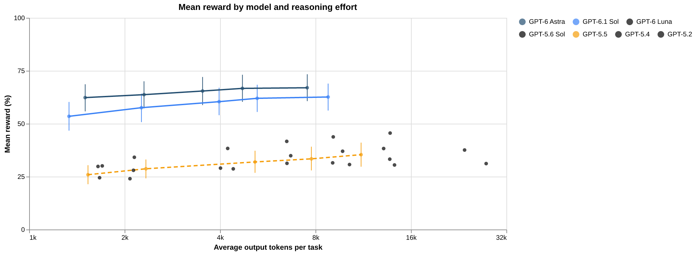

> 图解：纵轴为平均得分率，横轴为每题平均输出token数，采用以2为底的对数刻度，每个刻度值翻倍。橙色虚线代表GPT-5系列，蓝色实线代表GPT-6系列；每个点对应一种推理强度，浅色误差线为95%置信区间。不同模型可用的推理强度并不完全相同。

xhigh是七个模型共同报告的最高推理强度，适合作为统一条件下的横向比较：

| 模型 | 平均得分率 | 95%置信区间 | 每题输出token数 |
| --- | ---: | ---: | ---: |
| GPT-6 Astra | 66.7% | 60.3–73.1% | 4,704 |
| GPT-6.1 Sol | 62.0% | 55.6–68.4% | 5,238 |
| GPT-5.6 Sol | 43.8% | 37.6–50.0% | 9,099 |
| GPT-6 Luna | 38.3% | 32.3–44.5% | 13,120 |
| GPT-5.5 | 35.4% | 29.7–41.0% | 11,135 |
| GPT-5.4 | 33.2% | 28.3–38.4% | 13,717 |
| GPT-5.2 | 31.2% | 26.2–36.3% | 27,620 |

Astra的优势并不只出现在最高推理强度。低推理强度下，它已经取得62.3%的平均得分率，每题平均输出1,501个token；相比之下，GPT-5.6 Sol在xhigh下输出9,099个token，得分率为43.8%。至少从这组结果看，Astra的提升不是简单依靠生成更长答案换来的。

增加推理也并非总会提高成绩。GPT-6 Luna从xhigh切换到max后，每题平均输出从13,120增至23,616个token，平均得分率却从38.3%降至37.6%；Astra在两种设置间则仅从66.7%小幅升至67.0%。图中还有输出更多但得分基本持平的设置，因此不能把token增加直接理解为分析质量提升，更不能仅凭输出长度推断实际速度或成本。

OpenAI认为，这些结果提示更强的原生多模态能力可能是改进日常湿实验分析的关键。这是团队基于模型表现提出的解释，而不是对内部机制的直接证明；更扎实的支撑来自下面的具体案例。

## Astra的进步，体现在三个实验判断上

### 知道现有数据不能证明什么

科学分析中一个常见陷阱，是为了支持预期假设而过度解读数据。Astra的一项改进，是更能识别证据边界，不把有歧义的信号直接写成确定结论。

在一道细胞图像题中，GPT-5.6 Sol根据死细胞检测染料的信号把细胞判为死亡。但检测器也可能接收到第二种染料发出的光，单凭亮度无法支撑这个结论。Astra识别出这种歧义，并要求更好的对照来分离两种信号。

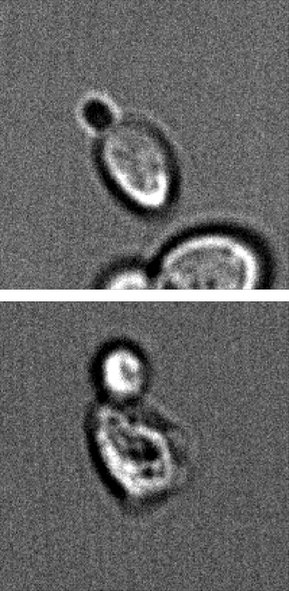

> 明场通道使用透射光，显示用于对照观察的细胞区域。

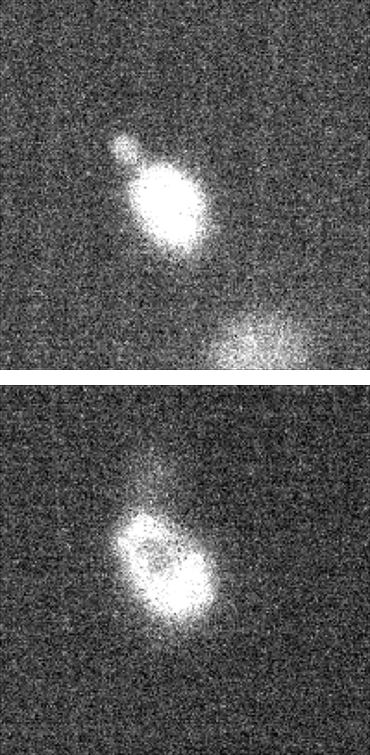

> 通道2为SYTOX标记通道，提供的发射检测窗口为470–540 nm。

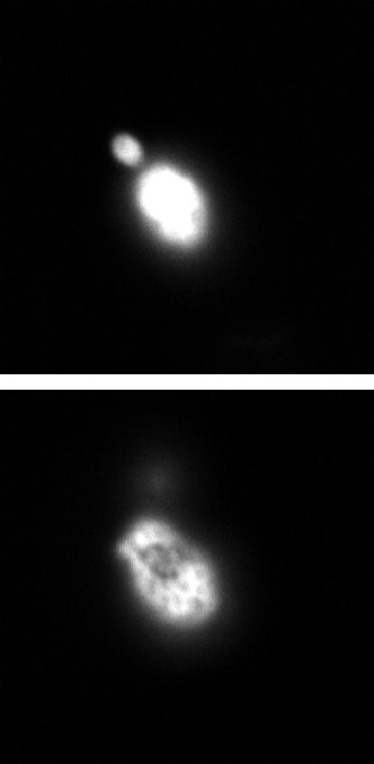

> 通道3为FUN-1绿色通道，提供的发射检测窗口为525–580 nm。

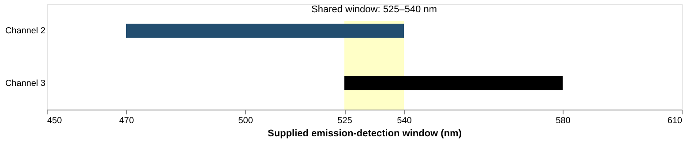

> 图解：两个检测窗口在525–540 nm重叠，因此存在信号串扰的可能，但题目没有测量串扰程度。每个通道使用独立的线性强度标尺，同一通道内两个区域的标尺固定，不能据此定量比较不同通道的亮度。

这个案例的关键不是模型能否描述“细胞很亮”，而是能否继续追问：亮度究竟来自哪种染料，现有对照是否足以排除另一种来源。

### 看见培养皿边缘的小标签

另一项DNA克隆实验要求模型结合对照平板作判断。GPT-5.6 Sol看到阴性对照平板上没有菌落，便以此为基础展开结论；Astra则注意到平板边缘标着错误的抗生素，因此拒绝把它当作可靠对照。

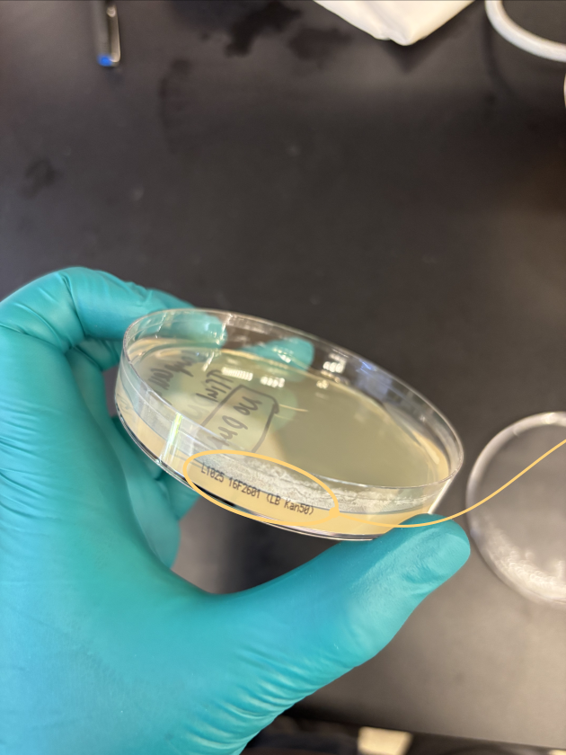

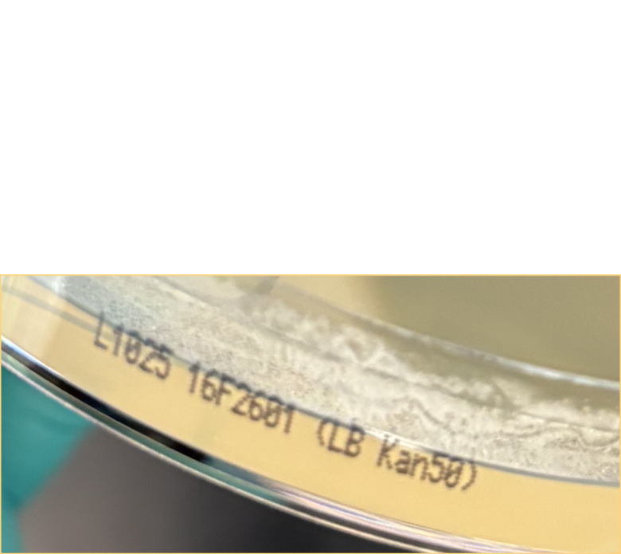

> 图解：原始基准照片圈出并放大了培养皿边缘的“LB Kan50”标签。Kan50指卡那霉素，而实验使用的是氨苄青霉素；即使平板上没有菌落，也不能把这个设置当作预期抗生素条件下的有效阴性对照。

这里体现的是更细致的视觉读取如何改变实验推理。漏看标签不只是漏掉一处图像细节，而会让后续对照检查失去意义。

### 把焦距变化当作焦距变化

湿实验分析还依赖没有全部写进数据的背景知识。一项任务提供了一系列细胞时隐时现的显微图像，GPT-5.6 Sol试图从生物学角度解释细胞为何消失，Astra则识别出这是z-stack：在不同深度逐层拍摄的一组图像，而不是细胞真的发生消失。

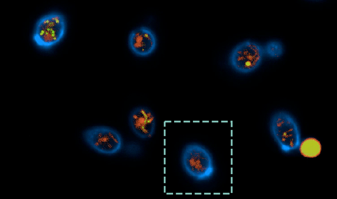

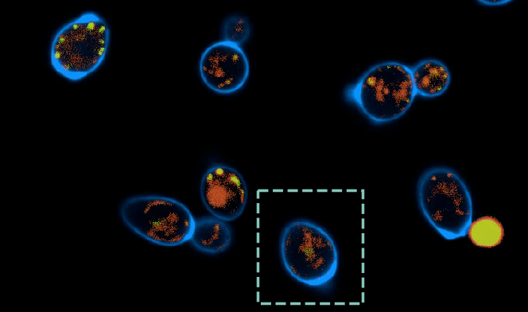

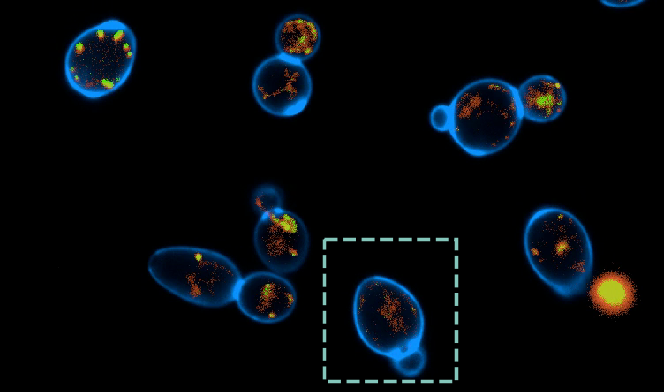

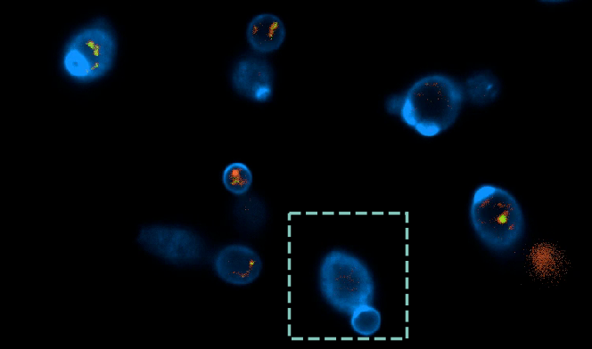

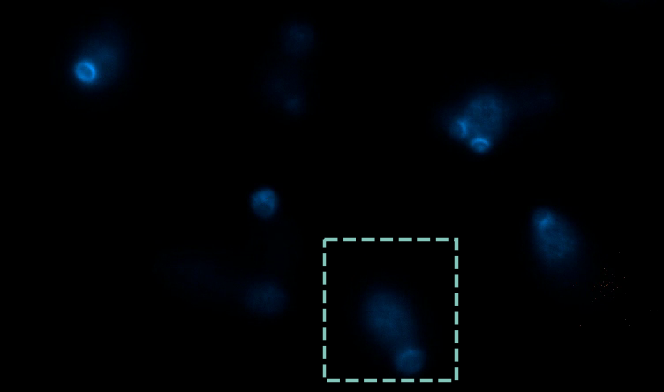

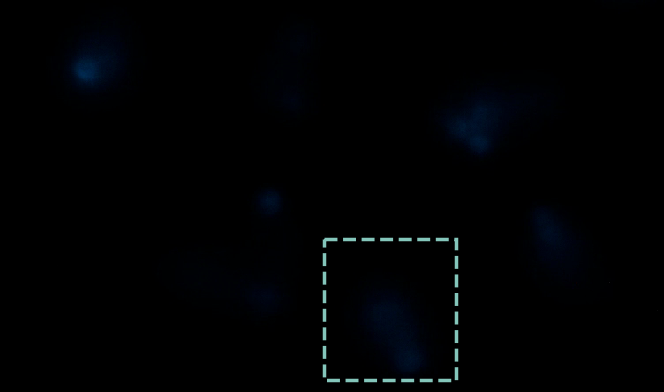

> 图解：六帧画面来自同一段原始记录，虚线框标出显微镜扫描不同深度时的同一位置。图中时间指所提供视频的播放位置；细胞可见度变化来自成像深度变化，不能仅凭这些帧推断细胞出现或消失。

## 最高分模型仍会被自己的解释带偏

上述案例说明Astra为什么得分更高，却不代表它已经能稳定承担实验室判断。OpenAI同时展示的失败案例更具体：模型有时让熟悉假设压过对照，有时忽略与偏好解释冲突的观察，还有时无法把一个中间发现贯彻到最终结论。

### 看对了条带分组，却选错了菌落

在菌落PCR结果中，Astra能够区分两组菌落条带，却预设“较大的PCR产物代表成功克隆”。基于这个条件，它选择泳道4、6、7和8；参考答案通过对照比较选择的是5、9和10。

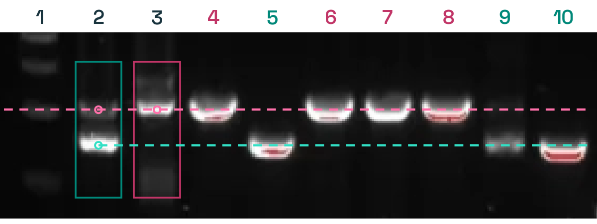

> 图解：泳道1为分子量标记，泳道2为克隆混合物，泳道3为原始质粒，泳道4–10为菌落样本。参考选择为5、9和10，Astra选择4、6、7和8。

要理解这个错误，必须先看对照，而不是先挑条带大小：

- 泳道3只有原始质粒PCR，其条带给出旧质粒的参考位置。
- 按参考解释，泳道2同时包含两种模式：组装不完全时，旧模板或骨架会与新产物并存。
- 由此得到的菌落可能携带旧质粒，也可能携带新质粒，需要把各菌落条带与这些参考模式比较。

Astra的视觉分组本身没有错，错在给两组条带赋予了相反的实验身份。若按它的选择继续，下游纯化将得到错误质粒。这也是“图像看得差不多”与“实验决策正确”之间的实际差别。

### 看见了反例，最终回答却没有采用

另一项任务询问液泡与周围细胞区域的明暗关系。液泡是细胞内部的区室，Astra总结说液泡通常比周围细胞更暗，但同一视野里也存在更亮的液泡。

> 图解：同一图像里同时存在较暗和较亮的液泡。显微镜焦距变化可以反转这种对比度，因此较暗样本不能支持“液泡通常更暗”的一般结论。

更值得警惕的是，Astra并非完全没看到反例。它检查了多个区域，还曾评论对比度随焦距变化，随后却把更多权重交给它认为聚焦更好的细胞，最终只保留“液泡较暗”的描述。相互矛盾的较亮区域已经被观察到，却没有进入结论。

### 菌落计数高估约12%

菌落计数看似直接，实际要求模型逐一对应视觉目标。Astra的计数标记不能稳定对应单个菌落：邻近目标没有分开，部分明显菌落被漏掉，空白琼脂也被计入。这张平板上的净结果是相对基准参考答案高估约12%。

**相邻菌落未分开**

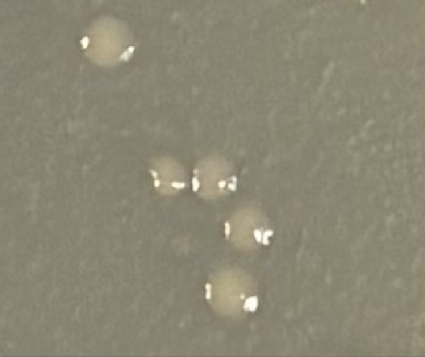

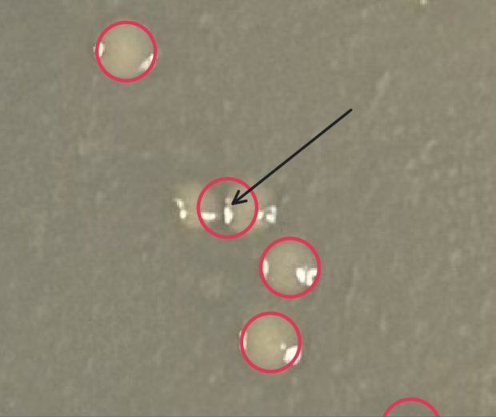

> 图解：A组中，相邻菌落之间只留下一个计数标记，未能将两个目标可靠分开。

**可见菌落漏计**

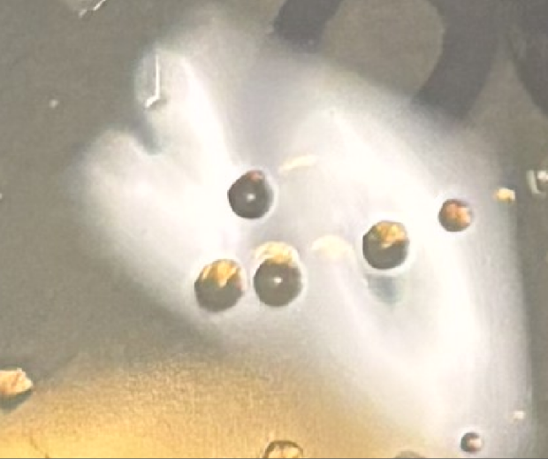

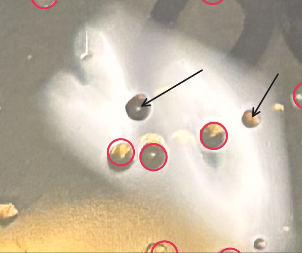

> 图解：B组中，两个可见菌落没有被标记。

**空白琼脂被计入**

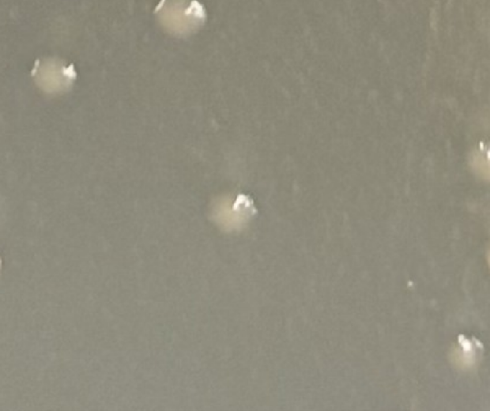

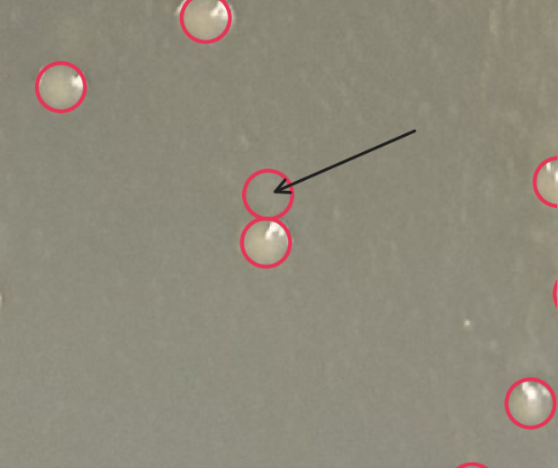

> 图解：C组中，空白琼脂被当作菌落计数。红圈表示Astra的计数位置，黑色箭头是原文添加的指示标记；三组局部图共同展示了合并、漏计和误计三类错误。

计数误差会直接传递到实验指标。在涂板体积和稀释倍数固定时，菌落数高估约12%，对DNA被导入细胞效率的估计也会按相同比例被抬高。这类错误不需要复杂理论就能造成错误决策。

## 分数应该改变什么，又不能证明什么

BioBasicsBench把日常实验工作中的几个关键环节变成了可重复测量的目标：解读原始数据、检查对照、应用实验背景，以及承认证据不足。对实验室而言，这些能力若继续改善，可能减少排查问题的时间，让研究人员把更多精力用于决定下一步做哪些实验；对这些能力的追踪也有助于理解其生物安全和生物安保影响。

但这100项任务测的是实验证据分析，不是AI独立完成整个湿实验流程。当前结果也只覆盖文中七个模型及其推理设置，不能外推为所有AI代理的普遍水平。若尝试把这类模型用于实验记录分析，较稳妥的做法是要求它明确列出对照、数据歧义和不能支持的结论，并把菌落计数、样本选择等会影响后续实验的结果交由人工复核。

开头的约12%高估因此不是一个孤立趣闻。66.7%的平均得分率说明Astra已经能在许多原始实验数据任务上取得部分乃至大部分分数；错误菌落选择、忽略反例和计数偏差则说明，距离可靠的实验室助手，缺的不是更会描述图像，而是让每条证据、每个对照和每个反例都真正约束最终判断。

> 本文参考自 [Measuring how AI agents handle everyday wet-lab science](https://openai.com/index/measuring-how-ai-agents-handle-wet-lab-science)