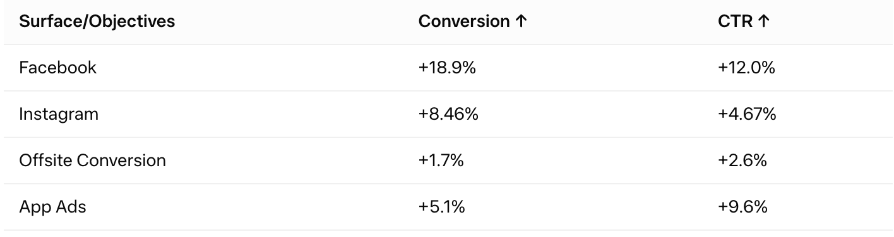
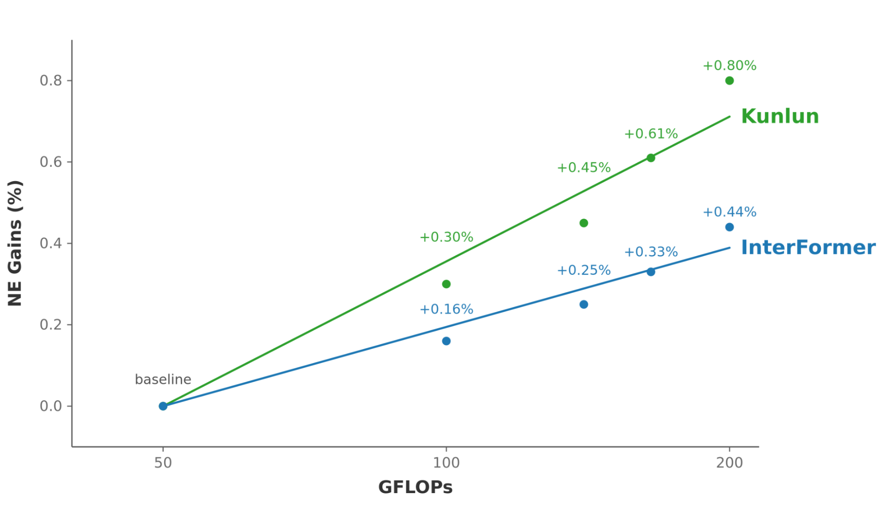
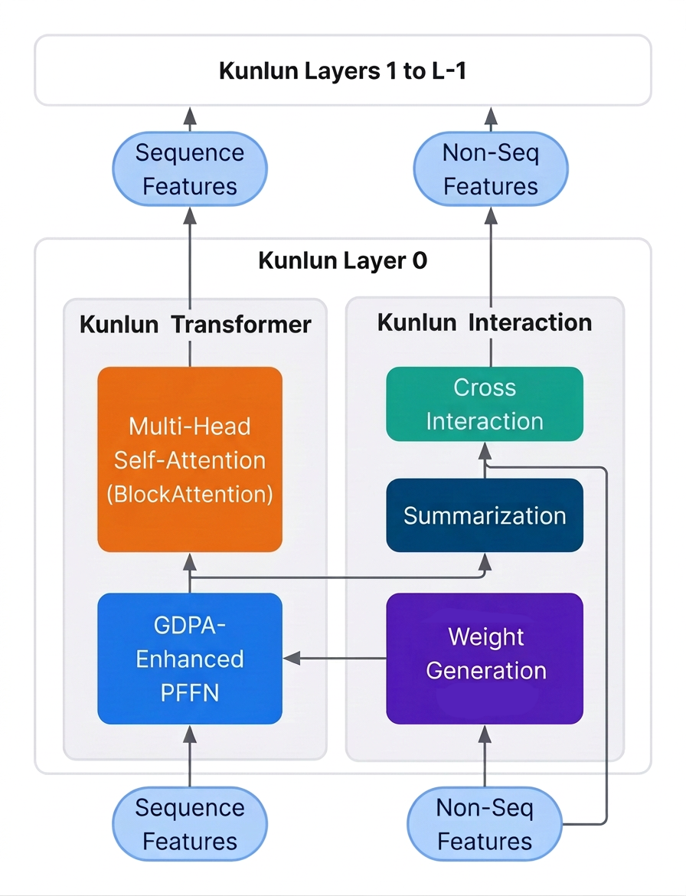
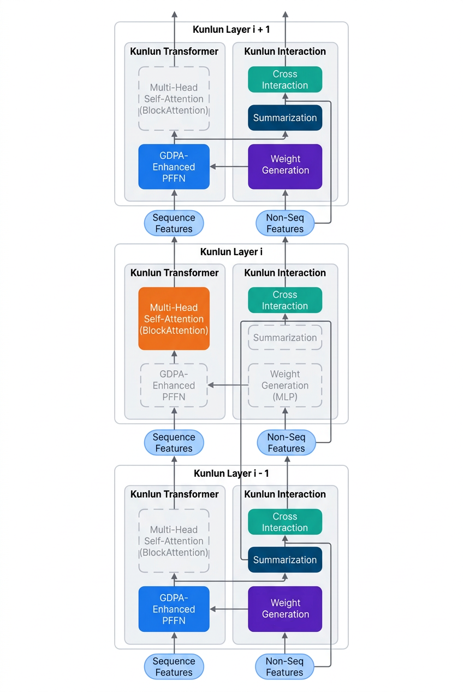
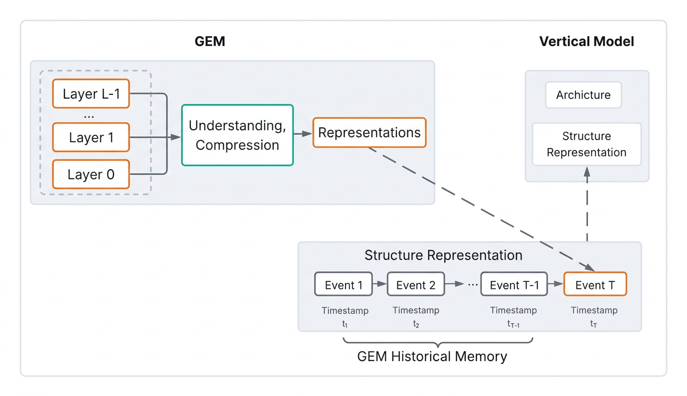
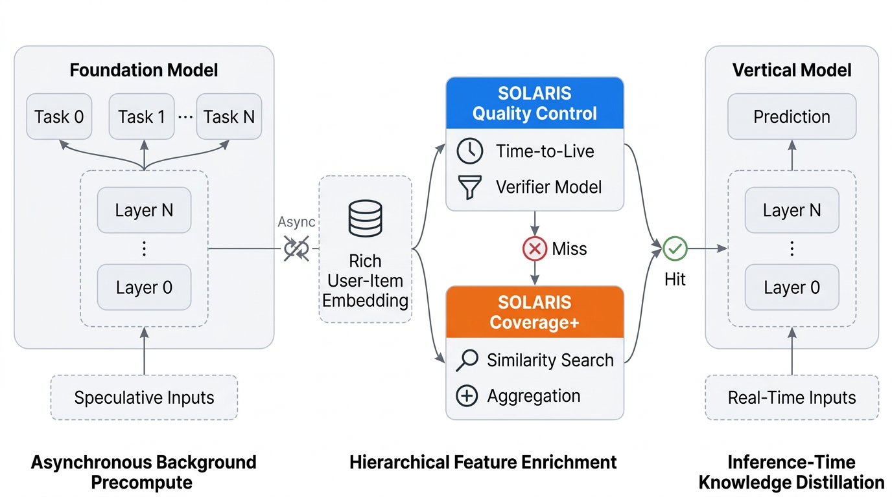
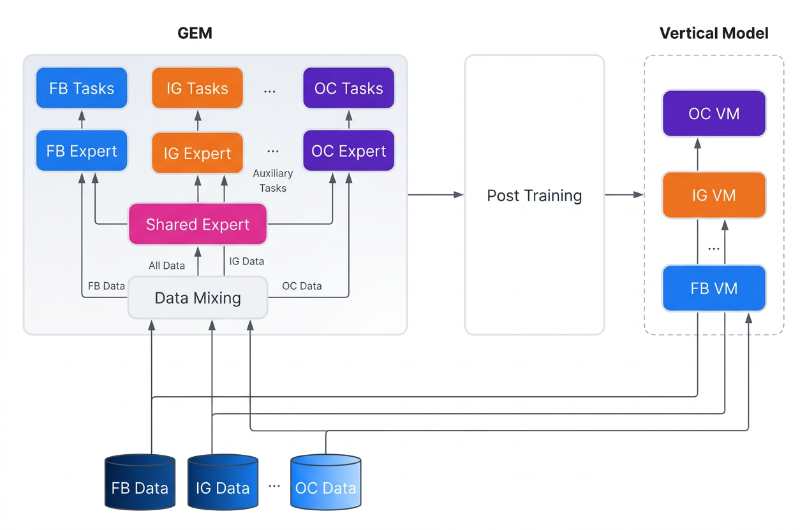

# GEM：Meta 广告推荐的中央大脑

每天使用 Meta 旗下应用的人约有 36 亿，而过去每换一个广告位——Facebook Feed、Instagram、Reels、Stories——就要单独维护一套预测系统，每个优化目标（点击、站外转化、应用安装）也各有一套模型。这种"烟囱式"架构的代价是：在数据丰富的点击任务上学到的规律，很难迁移到数据稀疏的转化任务上；某个版位的改进，也无法惠及其它版位。

Meta 在 2026 年 10 月发布的新一代 GEM（Generative Ads Model）给出的解法是：把这几十个版位和目标全部交给一个中央基础模型。团队报告，过去一年 GEM 为 Meta 广告系统带来了 18.9% 的转化提升和 12% 的广告点击率（CTR）提升，此外对定向用户还分别贡献了 Facebook 5.8%、Instagram 4.1%、站外转化 1.6% 的转化增量。

> 图解：GEM 分版位/目标的线上收益。Facebook 转化 +18.9%、CTR +12.0%；Instagram 转化 +8.46%、CTR +4.67%；站外转化 +1.7%、CTR +2.6%；应用广告转化 +5.1%、CTR +9.6%。收益同时覆盖上漏斗的点击和下漏斗的转化目标。

支撑这些数字的是四件事：把推荐模型的 Scaling Law 掰弯、把中央模型的"智能"低成本地传给线上模型、用一套引擎统一所有版位的训练、以及在几千张 GPU 上把训练效率翻倍。下面逐个展开。

## 推荐模型为什么吃不到 Scaling Law 的红利

大语言模型领域有一条经验定律：算力、参数、数据一起涨，性能可预测地涨。但推荐系统过去并不遵循这条曲线——推荐模型的输入是海量异构特征，用户画像、广告内容、行为序列混在一起，而且数据分布随时间漂移。直接套 Transformer 架构，加算力并不带来相应收益。

GEM 的回答是一套叫 Kunlun 的 LLM 式架构，与最新一代 GPU 硬件协同设计。团队在最大预训练规模上观察到了类 LLM 的 Scaling Law：相比上一代架构 InterFormer，同等算力扩展下 Kunlun 带来 2 倍性能收益，模型复杂度得以提升 2.5 倍。

> 图解：轻量版 GEM 上的 Scaling 实验。横轴为算力（GFLOPs），纵轴为归一化熵收益（NE Gains，推荐系统常用离线指标，越高越好）。同样从 50 GFLOPs 起步，扩到约 200 GFLOPs 时，InterFormer 的 NE 收益为 +0.44%，Kunlun 达到 +0.80%——同样的算力预算，收益接近翻倍，且差距随算力增加而拉大。

## Kunlun 架构：序列与非序列特征分而治之

Kunlun 把特征分成两类：非序列特征（如用户人口属性、广告内容表征）和序列特征（一串事件，每个事件带一组特征）。每一层由三部分组成：

- **Attention**：定制的注意力与前馈网络，捕捉用户行为中的长依赖，并适配数据分布的动态变化；
- **Summarization（摘要组件）**：从序列中抽取关键用户洞察，充当序列结构与非序列结构之间的桥梁；
- **Cross Interaction（交叉交互）**：扩展为 MoE（混合专家）式设计，大规模建模序列与非序列特征之间的复杂交互。

围绕这个骨架，团队做了三个层次的效率优化，让模型可以"又深又宽"地长大。

**计算复杂度：块状注意力。** 用块对齐的稀疏注意力替换全自注意力，序列长度带来的复杂度从二次降为相对窗口大小的线性，且只取块大小整数倍的窗口，对 GPU kernel 友好、没有碎块开销。

**组件统一：把 pFFN 改写成注意力。** Per-Example FFN（pFFN）本是为"每个样本一套分布"设计的组件，团队通过广义点积注意力（GDPA）把它重构成注意力运算，让模型中大量"类注意力"操作收敛到同一个 GPU kernel 上，前向速度最高提升 2 倍。

**专家并行。** 交叉交互组件采用 MoE 式框架做模型-专家并行，每张 GPU 只并行处理一部分专家子网络。

> 图解：Kunlun 第 0 层的结构。左侧 Kunlun Transformer 处理序列特征，包含多头自注意力（BlockAttention）和 GDPA 增强的 pFFN；右侧 Kunlun Interaction 处理非序列特征，包含权重生成、摘要和交叉交互模块。两路输出汇入后续第 1 到 L-1 层。

## 让超长序列算得起：CompSkip 与 OneSeq

长序列是推荐模型的"记忆"，但序列越长算力开销越大。Kunlun 用了两个专门设计把成本压下来。

**CompSkip（组件跳跃连接）** 的思路是：每层选择性地只激活部分序列模块，被跳过的组件只走残差连接把输出透传。这基于一个假设——网络在重新激活后能快速恢复。实测减少 43% 的 FLOPs，质量损失可以忽略。

**OneSeq（序列统一）** 解决的是工程碎片化问题。系统里有多条用户序列来源，事件特征各不相同：购买序列的事件用广告 ID、账户 ID 描述，帖子序列的事件则用发布者和对象 ID 描述，无法在数据源层面直接合并。OneSeq 在事件特征聚合之后按时间顺序统一序列，让单个序列层就能处理长序列——大张量运算最大化 GPU 效率，同时减少算子碎片化。

> 图解：CompSkip 在相邻三层（i-1、i、i+1）中的工作方式。实线框为当前层激活的组件，虚线框为被跳过的组件——输出经残差连接直接透传。不同层激活的组件组合交错排布。

有了这套架构，超长序列从"想都不敢想"变成了可量产的选项：GEM 在生产环境把长上下文扩大了 2 倍，并验证了扩展到 25 倍的基础设施能力。过程中团队还发现了两条规律，这或许是全文最值得推荐系统从业者留意的部分：

- 预测质量与序列长度呈幂律关系，且在不同长度上可预测、可复现；
- 越大的模型从长序列中获益越多——扩算力让模型变大，变大让长序列更值钱；扩序列让模型更准，更准又反过来支撑投入更多算力。两条 Scaling 曲线互相强化。

## 后训练：中央大脑如何向线上模型"传功"

基础模型再大，如果智能传不到几百个实时服务的垂直模型上，也是白搭。直接在广告请求的实时链路里跑 GEM 这种规模的模型，延迟和成本都不可接受。GEM 的答案是两条互补的传输通道。

**LoopFM：结构化表征，带宽翻倍。** 传统知识蒸馏的问题是带宽有限——下游模型每次训练只能拿到 GEM 智能的一个"压缩快照"。LoopFM 的做法是预计算结构化表征：从 GEM 的重要层提炼出紧凑表征来描述每个事件，再把同一用户的历史表征按时间组织成一个序列上下文窗口，相当于把中央大脑对用户的长期记忆一起打包。下游模型用专门架构在训练和推理时学习这段长上下文。这套表征生成过程与蒸馏所需的软标签计算共享算力，因此不增加基础模型的额外开销——团队报告称，相比上一版纯知识蒸馏，智能传输效果翻倍。

> 图解：左侧 GEM 各层经"理解与压缩"生成事件表征；下方把同一用户的事件表征按时间戳 $t_1$ 到 $t_T$ 组织成"GEM 历史记忆"；右侧垂直模型通过专门架构消费这段结构化表征。

**Solaris：投机式预计算，把时延挪出热路径。** 思路借用自 LLM 推理中的投机解码：多级排序把一次请求收敛到头部候选广告时，Solaris 就在异步后台任务里用 GEM 预算这些"用户-广告对"的嵌入，在垂直模型需要时刚好送达。它不占实时链路的延迟预算，却能提供近乎实时的点对点知识。预算结果未命中时系统降级而不是丢弃——用该用户在同广告组近期嵌入的聚合，或借用行为相似用户的嵌入来补位。

> 图解：Solaris 三段式流水线。左：基础模型对投机输入做异步后台预计算，产出丰富的用户-物品嵌入；中：质量控制（TTL 与校验模型）与覆盖率增强（相似搜索、聚合）构成层级化补全，命中（Hit）走绿色通道，未命中（Miss）走降级路径；右：垂直模型在推理时直接消费这些嵌入，等价于一次推理时的知识蒸馏。

## 一套引擎统一几十个版位

模型和传输之外，第三个难题是数据。GEM 用 Meta 全量广告数据训练——覆盖 Facebook、Instagram 的 Feed 与 Reels/视频等所有版位，以及站外转化、应用安装等深层漏斗目标，成为第一个跨全部版位联合预测 CTR、跨主要目标联合预测 CVR 的模型。数据丰富的点击任务上学到的通用表征，由此可以直接迁移到数据稀疏的转化任务。

与 LLM 的静态语料不同，推荐数据分布随时间和版位剧烈变化。GEM 的训练配方有两件新东西：

- **零成本数据混合**：通过"虚拟数据加载"从不同数据管线的组合中读取数据，物理上不做合并，不产生额外存储成本。混合比例机制让离线和在线训练都贴近真实数据流的接收顺序，缓解域切换的不稳定性和对近期域数据的过度记忆。这也保留了灵活性——下游垂直模型仍可只用特定版位的数据训练。
- **域专家框架**：共享专家学习跨域统一表征，域专家捕捉各版位特有模式，两者都建立在 Kunlun 架构之上，每个域专家同时受益于共享知识和专属知识。

> 图解：GEM 的跨域训练与下发链路。底部 FB、IG、OC（站外转化）等数据源经数据混合进入模型；共享专家消费全部数据，各域专家同时接收共享知识与自有域数据，分别支撑 FB、IG、OC 等任务头；再经后训练下发到各版位垂直模型，垂直模型的数据也回流参与训练。

## 在几千张 GPU 上把 MFU 翻倍

最后一个问题是纯工程的：数据中心 GPU 及其软件栈大多为 LLM 负载优化，推荐负载的数据特征和用户-广告交互模式完全不同，几千张卡上拿到高利用率极其困难。团队把端到端 MFU 拆成两个可独立优化的因子：

$$
\text{E2E MFU} = \text{Local MFU（计算效率）} \times \text{Scaling Ratio（扩展效率）}
$$

计算效率靠为推荐负载定制的 kernel 库——Jagged Flash Attention（JFA）、GDPA、Block-Attention 等——以及混合超低精度训练（MXFP8 注意力和 MLP）。扩展效率靠拓扑感知的 5D 并行与免 SM（Streaming Multiprocessor）的集合通信：稠密参数用 2D FSDP 加专家并行，稀疏参数用全分片 2D 模型并行，并与 Meta 的多层网络层级协同设计以降低通信开销。

结果是过去 12 个月里，总训练 FLOPs 扩大 4 倍的同时，端到端训练效率翻倍到 20%–25% MFU。团队强调，在 LLM 与推荐的交叉口训练基础模型是一个软硬件协同设计问题——kernel、精度、并行策略、网络、内存必须一起动。完整细节在配套博客《GEM Training》中。

## 结语

回到开头的问题：几十个版位各自为战的推荐系统，能否用一个中央模型统一？GEM 给出的证据是肯定的——18.9% 转化、12% CTR 的整体提升，且收益在上漏斗点击和下漏斗转化上同时出现。对推荐系统从业者，这篇文章有三点经验值得带走：推荐模型并非天生没有 Scaling Law，但需要为异构特征重新设计架构（Kunlun）；大模型的价值取决于传输带宽，LoopFM 和 Solaris 展示了"表征+记忆"和"投机预计算"两条通路；MFU 拆解成计算效率乘扩展效率后，每一半都有明确的工程抓手。

需要留意的边界是：文中所有收益数字均来自 Meta 自报的线上结果，未给出置信区间或对照实验细节；Kunlun 的 Scaling 曲线目前只在轻量模型上展示，最大规模上的证据仅以"观察到类 LLM 的 Scaling Law"一句话带过。团队下一步计划把 GEM 扩展到自然内容（文本、图像、视频）的全平台数据，并为后训练引入推理能力。

## 原文图表补充

|  |  |
| --- | --- |

> 本文参考自 [Meta's Generative Ads Model (GEM): Scaling the Central Model and Compute Engine for Frontier Ads AI](https://engineering.fb.com/2026/10/13/ml-applications/generative-ads-model-gem-scaling-frontier-ads-ai/)