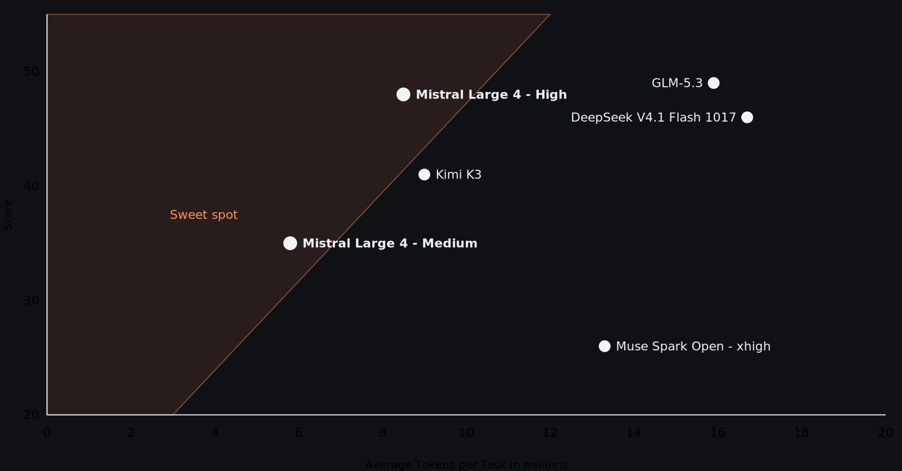

# Le Chonk：编程 Token 省 47%

编程 Agent 进入日常开发，不能只靠增加输出 Token 换成功率。Mistral 开放 1 万亿参数模型 Mistral Large 4（Le Chonk）的权重，核心看点正是效率：在 Artificial Analysis Coding Agent Index 上得分 48%，与 GLM-5.3 基本持平，平均每个任务却少用 47% 的 Token。这意味着相近表现可能带来更低延迟和推理费用，但不等于能力全面领先。

## 三周强化学习，提升分数也压缩输出

此次开放的不是原样预览版。Mistral 根据开发者、早期客户和合作伙伴反馈，追加三周强化学习，重点改善编程、防御性网络安全和推理效率。模型采用 MoE（混合专家）架构，支持多模态输入和 160 多种语言；完整技术报告尚未发布，专家数量、激活参数及硬件需求仍不明确，不能仅凭总参数量推算部署成本。

编程证据不只看分数。私有基准 FrontierCode 2.0 考察端到端仓库改动，Le Chonk 得 19.7%，仅比 DeepSeek V4.1 Flash 高 0.4 个百分点，也说明此类任务远未解决。Terminal-Bench 4.0 的变化更明显：成绩从预览版 28% 升至 41%，同时输出 Token 减少 30%；图中 GLM-5.3 为 40%。

> 图解：横轴为每任务平均 Token 消耗，纵轴为 Coding Agent Index 得分，越靠左上，得分与效率的组合越好。图中 High 和 Medium 档位表明效率并非固定工作点。

Le Chonk 提供 Low、Medium、High 三档推理预算，默认 High。Surge Code 盲测中，它相对 GLM-5.3、Kimi K3 的偏好率均为 64%，但对 Claude Opus 5.5 仅 22%；原文未给样本量，不宜外推到所有编程场景。

## 防御能力与滥用抑制要分开看

解决了代码交付，安全团队还要同时面对“会修漏洞”和“拒绝恶意攻击”。Artificial Analysis Cyber Index 要求发现、复现并修补漏洞，Le Chonk 得分 51%，并非图中第一。另一组 JailbreakBench、StrongREJECT 和 AgentHarm 测试中，Mistral 报告其对恶意网络安全请求的平均拒绝率为 96.6%。前者衡量防御能力，后者衡量滥用抑制，不能合并成一个“安全分数”。

Mistral 也承认，线上流量虽显示模型会拒绝针对真实目标的黑盒攻击，它仍可能提升真实攻击的执行能力。高级渗透测试等专用变体因此只向严格审查的企业合作伙伴开放，并要求测试限于自有或明确授权的系统。合作伙伴的内部评估和演示可说明应用方向，但缺少统一样本、成功率与耗时，不能视为稳定性证据。

## 开放权重带来控制权，也附带条件

企业能力也有提升：Finch 财务基准从预览版 67.4% 升至 73.3%，BrowseComp 达 84.5%，B3 Agent 攻击抵御率从 93.3% 升至 97.1%。不过，单项基准不能替代应用层权限控制与持续测试。

开放权重的实际价值，是组织可检查、定制并自行托管模型，而非只依赖厂商 API。API 价格为每百万 Token 输入 0.70 美元、缓存输入 0.07 美元、输出 2.10 美元。其修改版 MIT 许可证允许免费使用、修改、微调和商业化，但 Model-as-a-Service 企业用于商业服务前，须另获 Mistral 商业许可。

Le Chonk 最值得验证的不是“榜单第一”，而是能否在自己的仓库中复现相近质量与更低 Token 消耗；安全团队则须分别验证防御效果和授权边界。只有这些收益在真实工作流中成立，开放权重才会转化为部署优势。

> 本文参考自 [Mistral Large 4 (Le Chonk) is now open weight | Mistral](https://mistral.ai/news/mistral-large-4-oss/)