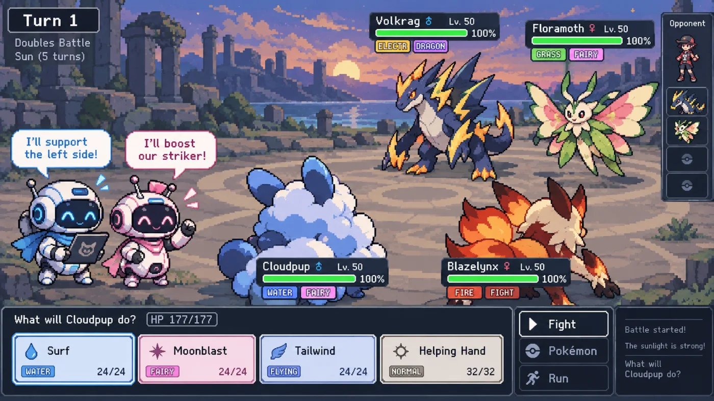

# Pokémon 2v2：让 LLM 组队打双打，会交流的队伍胜率高出 22 个百分点

抛开流水线式任务分发，两个 LLM 能不能像真人队友一样临场协商？研究者 Oliver Grabner 的做法很具体：把宝可梦对战平台 Pokémon Showdown 的 2v2 双打包装成多智能体环境，让两个 LLM 各操控一只宝可梦。结果：可自由交谈的组合胜率 64%，完全禁言的只有 42%，代价是 Token 消耗翻 3.8 倍。

## 为什么选宝可梦双打

作者指出，多数多智能体研究关注的是流水线式工作流，测的是分工而非协作。真正的协作要求多个智能体同时面对同一局面、各掌握部分信息、协商出一致行动。宝可梦 2v2 恰好如此：对手配置隐藏、伤害带随机性，想赢要分配攻击目标、围绕队友行动做计划。近期的 PokéAgent Challenge 也用宝可梦做基准，但每方只有一个智能体，测不出配合。

## 环境设计：四种"说话模式"

环境基于官方 Pokémon Showdown 模拟器。每回合智能体读到英文战局摘要和合法操作列表，可给队友发私信，或直接出招。为隔离"交流"这个变量，作者设计了四种模式：自由交谈、每人各发一条、禁止交流，以及关键对照组——单一模型同时操控本方两只宝可梦，用来区分收益来自"统一规划"还是对话本身。评估中 Qwen3.8-27B 扮演本方两名队友，对手是脚本化的最大伤害机器人，并用随机种子保证四种模式面对相同对局。

## 结果：交流有用，但每一句都很贵

四种模式胜率：自由交谈 64%、单一模型 54%、各发一条 52%、禁止交流 42%；每场 Token 消耗为 978k、450k、654k、259k。这说明：交流确实有用，自由交谈比禁言高 22 个百分点；收益来自对话而非集中规划——两个独立智能体的讨论（64%）胜过一个统一大脑（54%）；成本不低，每条消息都是一次额外调用，自由交谈的 Token 是禁言的 3.8 倍。"各发一条"性价比最差：胜率 52%，Token 却有 654k，浅层交流既没换来协商收益，也没省下开销。作者报告的对战片段中，一名队友出手前纠正了同伴的属性克制错误。

## 能分辨模型强弱吗

27B 双人组对 2B 双人组胜率 96%，对 9B 降到 74%，对最大伤害机器人 64%——胜率随对手实力单调变化，这是该环境能作为对比基准的前提。只按最大伤害出招的脚本机器人，难度还高于 9B 队伍，说明双打决策的复杂度不只是"算伤害"。

## 局限与下一步

核心实验只用一个模型扮演队友，对手以脚本机器人为主，推广性尚待验证。作者也指出：自由交谈模式下队友还能看到对方已选的招式，胜率提升里多少来自"说话"、多少来自"看见选择"目前分不清，留待下一步消融。更远的计划是带排行榜的公开基准和强化学习训练；代码已开源在 GitHub（OliverGrabner/multi-agent-poke-showdown）。

回到开头的问题：LLM 能不能像真人队友一样临场协商？这个小规模实验的答案是"能，且可测量"——对话带来 22 个百分点的胜率，这不是换一个更大的统一大脑就能替代的；但每多一轮对话都是真金白银的 Token 开销，协商放在哪个环节最值，值得先想清楚。
> 本文参考自 [Multi-agent LLM coordination in a Pokémon 2v2 environment](https://olivergrabner.com/research/pokemon/)