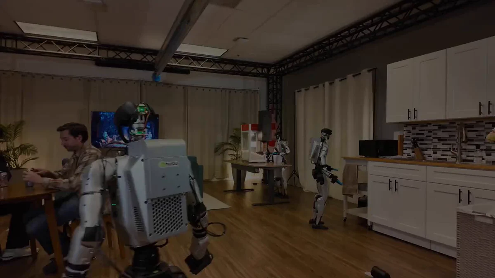
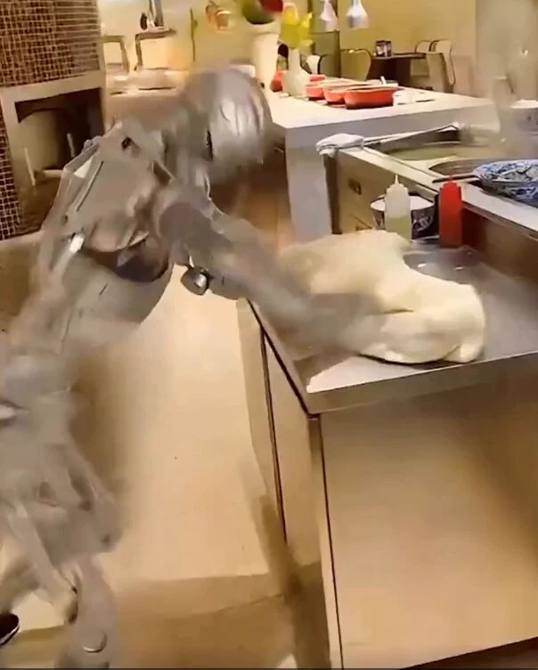

# GR00T 2：学习人类示范，跨机身迁移技能

机器人学会一项技能后，换一副机身，还要不要从头训练？NVIDIA 新公布的 GR00T 2 尝试减少这种重复：它从人类视频和示范中学习技能，把技能迁移到不同机器人身体，并预测自身动作对物理世界的影响。

根据 X 趋势页汇总的信息，GR00T 2 使用了 10 万小时数据；经过短暂微调后，在新任务上的成功率最高可达 95%。这些数字来自发布方相关介绍，其中 95% 针对特定新任务，并不代表所有机器人、环境和任务都能达到同样水平。

## 从人类示范到跨机身技能迁移

NVIDIA 将 GR00T 2 称为面向机器人研究的开放 System One 模型。它的一项核心能力是从人类示范中学习，而不是完全依赖工程师逐条编写动作规则；另一项能力是预测动作对物理世界的影响，为机器人在真实环境中执行任务提供依据。

跨机器人身体迁移是这次发布更值得关注的地方。不同机器人可能有不同的外形和运动方式，如果每换一种机身都从零教学，技能复用的成本会很高。NVIDIA 表示，GR00T 2 学到的技能可以跨机身携带，从而减少逐台机器人重复训练的需要。

不过，现有素材没有进一步说明迁移所需的适配流程、支持的机型范围或性能损失。因此，“无需从头教学”不等于任何场景下都完全不需要训练。

> 图解：NVIDIA 发布帖中的 GR00T 2 演示视频封面，原帖通过视频展示模型将研究能力用于机器人动作。

## 演示覆盖操作与自主导航

发布内容展示的任务包括擦拭表面、处理面团、自主分发爆米花，以及在人员密集的空间中导航。这些案例分别涉及接触物体、处理可形变材料、完成连续服务动作和避开动态障碍，说明 GR00T 2 的目标并不限于单一机械臂操作，而是覆盖多种机器人任务。

这些演示适合用来理解模型的应用方向，却不能替代完整的性能评估。现有素材没有给出每项演示的测试条件、失败次数或对照模型，因此不能仅凭视频判断其在未受控环境中的稳定性。10 万小时数据和最高 95% 的新任务成功率提供了规模与结果线索，但更具体的结论仍需等待技术资料和公开测试。

> 图解：NVIDIA 同一发布主题下的另一段视频封面，对应人类示范学习、动作结果预测与跨机身技能复用的介绍。

## Turbo 版本面向实时人形机器人控制

除基础模型外，NVIDIA 还准备了更轻量的 Turbo 版本，用于人形机器人的实时控制。轻量化的意义在于降低运行负担，让模型更有机会满足控制频率和响应速度要求；但素材没有提供其参数量、硬件需求、延迟或相对完整版本的性能差异，暂时无法量化这项取舍。

代码和工具预计于 12 月推出，富士康等合作伙伴正在制造场景中测试。对开发者和制造企业而言，后续真正需要观察的是开放代码包含哪些组件、迁移到不同机身需要多少微调，以及演示能力能否转化为稳定的生产流程。

这次发布也发生在 X 趋势摘要所称的公司领导层变动背景之下，相关帖子将其与 Jensen Huang 辞职后的 NVIDIA 动态联系起来。不过，该趋势页明确说明内容由 X 帖子汇总而成，可能继续变化，Grok 也可能出错；领导层相关信息及发布时间关联不宜视为已经独立核实的事实。

回到跨机身复用这个问题，目前较可靠的线索仍是人类示范学习、跨机身迁移、实时 Turbo 版本，以及即将发布的代码和工具。它们能否真正降低不同机器人之间的训练成本，还要看后续公开资料与实际测试。

> 本文参考自 [NVIDIA Unveils GR00T 2 Robotics Model After CEO Resignation](https://x.com/i/trending/2121345099992859087)