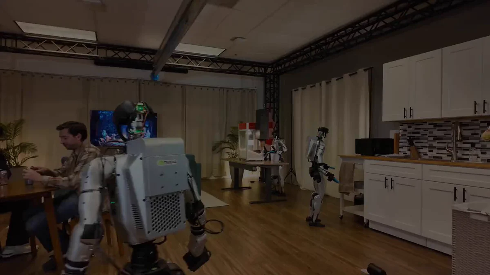

# GR00T 2：学习人类示范，跨机身迁移技能

机器人学会一项技能后，换一副机身，还要不要从头训练？NVIDIA 新公布的 GR00T 2 正试图减少这种重复：它从人类视频和示范中学习技能，将技能迁移到不同机器人身体，并预测自身动作对物理世界的影响。

据 X 趋势页汇总，GR00T 2 使用了 10 万小时数据，短暂微调后，在特定新任务上的成功率最高可达 95%。这一上限并不代表所有机器人、环境和任务都能达到同等水平。

## 从人类示范到跨机身迁移

NVIDIA 将 GR00T 2 称为面向机器人研究的开放 System One 模型。它不再完全依赖工程师逐条编写动作规则，而是从人类示范中学习，并通过预测动作后果，为真实环境中的任务执行提供依据。

更值得关注的是跨机身迁移。不同机器人的外形和运动方式各异，若每换一种机身都从零教学，技能复用成本会很高。NVIDIA 表示，GR00T 2 学到的技能可以跨机身携带，从而减少逐台重复训练。不过，现有素材没有说明适配流程、支持的机型范围或迁移后的性能损失，因此这不等于任何场景都完全无需训练。

> 图解：NVIDIA 发布帖中的 GR00T 2 演示视频封面，原帖通过视频展示模型将研究能力用于机器人动作。

## 演示、实时版本与待验证之处

发布内容展示了擦拭表面、处理面团、自主分发爆米花，以及在人员密集空间中导航，涉及物体接触、可形变材料处理、连续服务动作和动态避障，目标并不限于单一机械臂操作。

但演示不能替代完整评估：素材未给出各项测试条件、失败次数或对照模型，无法仅凭视频判断其在未受控环境中的稳定性。10 万小时数据和最高 95% 的成功率提供了线索，更具体的结论仍需技术资料和公开测试。

NVIDIA 还准备了更轻量的 Turbo 版本，用于人形机器人的实时控制，以降低运行负担、满足控制频率和响应速度要求。然而，参数量、硬件需求、延迟及相对完整版本的性能差异均未公布，暂时无法量化取舍。代码和工具预计于 12 月推出，富士康等合作伙伴正在制造场景中测试。

这次发布还被 X 趋势摘要与 Jensen Huang 辞职后的公司动态联系起来；但该页由 X 帖子汇总，可能继续变化，Grok 也可能出错，相关背景不宜视为已独立核实的事实。

回到跨机身复用的问题，GR00T 2 能否真正降低不同机器人之间的训练成本，关键仍在于后续开放代码包含哪些组件、迁移需要多少微调，以及演示能力能否转化为稳定的生产流程。

> 本文参考自 [NVIDIA Unveils GR00T 2 Robotics Model After CEO Resignation](https://x.com/i/trending/2121345099992859087)